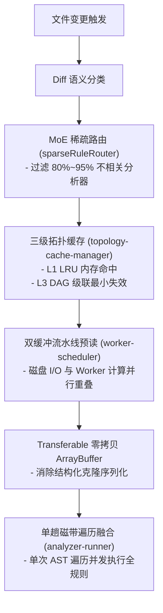

# 现代 TypeScript 高级类型学工程与全域开销规避规范

> 本文件为 `auto-refactor-dev` 技能的高级参考指引，系统性规范了 TypeScript 编译期形式化证明（Type-Level Engineering）六大原则与全域避免重复开销（Zero-Redundancy Architecture）的技术落地实践。

---

## 一、 TypeScript 高级类型学工程六大原则

### 1. 名义类型与物理量纲安全 (Branded / Nominal Types)
TypeScript 采用结构化类型系统（Duck Typing），在没有名义区分时，两个底层同为 `number` 的变量（如行号与时间戳）可被相互赋值，造成静默逻辑灾难。
- **烙印机制**：使用 `unique symbol` 在编译期进行幽灵标记，运行时零包装对象、零堆分配开销：
  ```typescript
  declare const __brand: unique symbol;
  export type Brand<T, B> = T & { readonly [__brand]: B };

  export type TimestampMs = Brand<number, 'TimestampMs'>;
  export type LineNumber = Brand<number, 'LineNumber'>;
  export type ColumnNumber = Brand<number, 'ColumnNumber'>;
  export type FileHash = Brand<string, 'FileHash'>;

  export function toTimestampMs(raw: number): TimestampMs {
      return raw as TimestampMs;
  }
  ```
- **约束铁律**：所有物理时间戳、行列坐标与内容哈希必须在公共契约中声明名义类型，严禁裸 `number`/`string` 混用。

### 2. 可辨识联合与编译期穷尽性推导 (Exhaustive Matching with `never`)
在处理状态机、流水线阶段或分析器规则分类时，联合类型（Union Types）的新增分支必须在全链路得到处理。
- **不可达断言守卫**：
  ```typescript
  export function assertNever(variant: never, context?: string): never {
      throw new Error(
          `[ExhaustiveCheckFailure] Unhandled union variant: ${JSON.stringify(variant)}. ${context ?? ''}`,
      );
  }

  export function resolveGateThreshold(stage: GateStage): number {
      switch (stage) {
          case 'preflight': return 95;
          case 'commit': return 90;
          case 'nightly': return 80;
          default:
              // 当 GateStage 扩展新分支时，此处在编译期直接报错，杜绝漏写分支
              return assertNever(stage);
      }
  }
  ```

### 3. 模板字面量类型与规则拓扑约束 (Template Literal Types)
全工作区 428 条规则遵循严格的单源命名拓扑（`DOMAIN:FAMILY:NUM`）。
- **编译期防漂移类型**：
  ```typescript
  type RuleDomain = 'HYG' | 'SIM' | 'CPX' | 'TSM' | 'GOV' | 'PRF' | 'NAM';
  type RuleFamily = 'CLN' | 'DED' | 'ALG' | 'MEM' | 'TYP' | 'VAG' | 'SGL';
  type RuleNumber = `${number}${number}${number}`;

  export type StandardRuleId = `AR:${RuleDomain}:${RuleFamily}-${RuleNumber}`;
  ```
- **收益**：在源码中书写任何非标规则 ID 时，无需等待门禁脚本运行，IDE 与 TS 编译器即刻阻断。

### 4. 精确类型谓词与消融盲目类型断言 (Type Guards & Type Predicates)
盲目使用 `as any` 或 `as TargetType` 会绕过类型检查并在运行时引发隐式空指针异常（`GOV-TYP-005`）。
- **自定义类型守卫**：
  ```typescript
  export function hasWorkerSymbols(
      item: unknown,
  ): item is { symbols: WorkerSymbolsPayload } {
      return (
          typeof item === 'object' &&
          item !== null &&
          'symbols' in item &&
          typeof (item as { symbols: unknown }).symbols === 'object' &&
          (item as { symbols: unknown }).symbols !== null
      );
  }
  ```
- **守则**：外部输入、子进程消息或异构解析结果必须经类型谓词守卫收窄后方可访问内部属性。

### 5. 深度只读与共享 AST 防污染 (Deep Readonly & Immutability)
在单趟磁带流（Single-Pass Tape）中，数十个分析器并发或顺序访问同一个 AST 节点，严禁就地修改 AST 节点属性。
- **深度只读修饰符**：
  ```typescript
  export type DeepReadonly<T> = T extends (infer R)[]
      ? ReadonlyArray<DeepReadonly<R>>
      : T extends Function
      ? T
      : T extends object
      ? { readonly [K in keyof T]: DeepReadonly<T[K]> }
      : T;

  export type ReadonlyAstNode = DeepReadonly<NormalizedNode>;
  ```
- **收益**：杜绝分析器之间因节点属性就地变异产生的幽灵副作用。

### 6. 条件类型与零成本调用重载 (Conditional Types & Zero-Cost Overloads)
多参数或多模式函数必须支持参数对象重载（`SIM-ARGS-001`），并依据传入选项在编译期推导出精确返回值类型，消融运行时的类型测试开销。

---

## 二、 全域避免重复开销架构 (Zero-Redundancy Architecture)



### 1. MoE 稀疏分析器路由 (Sparse Rule MoE Router)
- 源码位置：`src/core/router/sparseRuleRouter.ts`；
- 原理：根据文件差异语义分类（`DiffSemanticCategory`），动态激活最小充分分析器子集；
- 收益：在纯注释修改、格式对齐或局部常量变动时，自动跳过与差异无关的跨文件图分析器与重型规则，**削减 80%~95% 的无效 AST 计算**。

### 2. 三级拓扑缓存与级联失效 (Three-Tier Topology Cache)
- 源码位置：`src/core/scheduler/topology-cache-manager.ts`；
- 原理：
  - **L1 内存 LRU 缓存**：热点分析结果微秒级复用；
  - **L2 结构化持久化缓存**：避免进程重启全量冷扫描；
  - **L3 有向依赖 DAG 最小级联失效**：模块 A 变动时，仅让依赖 A 的反向闭包子图失效，全仓 95% 以上未受影响模块直接复用。

### 3. 双缓冲流水线预读与 Transferable 零拷贝转移
- 源码位置：`src/core/scanner/worker-scheduler.ts`；
- 原理：
  - **双缓冲流水线**：维护 `inflightRead` 任务，在 Worker 线程执行当前批次分析的同时，主线程预读并组装下一批次文件缓冲，消除 I/O 阻塞；
  - **零拷贝转移**：利用 Node.js `worker_threads` 的 Transferable `ArrayBuffer`，直接转移缓冲区所有权，避免主线程与 Worker 之间昂贵的巨型字符串序列化拷贝。

### 4. 循环内零瞬态堆分配与单趟磁带融合
- 源码位置：`src/core/scanner/analyzer-runner.ts`；
- 原理：
  - 所有流式分析器共享同一趟 AST 递归遍历（`runStreaming` / `runStreamingProjected`），将规则匹配开销降至单趟；
  - 循环体内严禁临时创建中间对象、Set 或 Map（`PRF-MEM-001` / `ADV-PRF-002`），采用索引直接寻址与槽位复用，阻断 V8 垃圾回收停顿。
