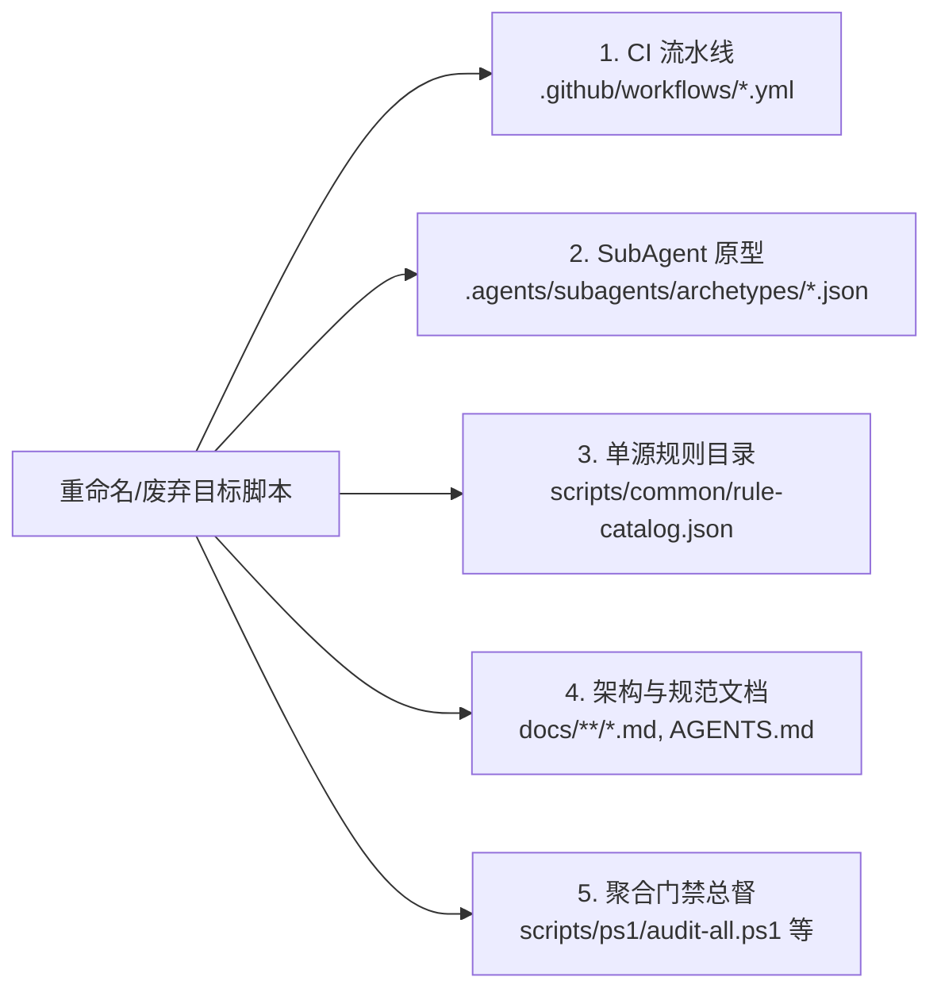

# gate-governance — 通用双层门禁架构与跨平台脚本工程治理

本技能规定了跨项目通用的双层同构门禁体系架构标准、受影响项目智能分流机制、跨平台脚本工程契约及子进程执行上下文隔离原则。

---

## 一、 双层同构门禁架构体系 (Two-Tier Isomorphic Gates)

门禁系统严禁依赖单层防线，必须实施端到端双层纵深防御，确保本地极速反馈与远端主干看守 100% 规则同构：

### 1. 第一层：本地左移防御 (Tier 1 Local Shift-Left Gates)
- **`pre-commit`（内存单遍流式判定，耗时 <90ms）**：
  核心由 `gate-fast-staged.js` 驱动，在单一 Node.js 进程内单遍流式读取暂存区文件，直接在内存中完成 6 大门禁判定：
  1. **物理空文件守卫**：一票否决 0 字节物理空文件与纯空白字符虚空文件；
  2. **换行契约守卫**：PowerShell 脚本（`.ps1`）在磁盘必须严格保持 CRLF 换行；Bash（`.sh`）、GDScript（`.gd`）、TypeScript/JavaScript（`.ts`/`.js`）、Markdown（`.md`）与 JSON（`.json`）严格保持 LF 换行；
  3. **缩进契约守卫**：TypeScript 源码保持 4 空格缩进，其余源码与配置文件保持 2 空格缩进；
  4. **密钥与敏感信息守卫**：拦截硬编码 Token、API 密钥与绝对路径；
  5. **单文件双轨体积与 1:3 动态包络**：看守有效代码行 $\text{ELOC} \le 900$ 与物理行 $\text{LOC} \le 1400$ 预算、1:3 动态反推包络及 $\text{ELOC} \ge 600$ 高负荷契约注释密度 $\ge 8\%$；
  6. **AST 切片局部复杂度守卫 (`GUARD-AST-001`)**：暂存区生产代码切片受单函数圈复杂度 $\text{CC} \le 15$（分发器与探针弹性包络 20~25）、控制流嵌套深度 $\text{Depth} \le 4$、单行噪声比 $\text{Noise} \le 4.0$ 刚性约束。
- **`commit-msg`（单进程统一提交信息流式检验）**：
  由 `validate-commit-msg.js` 驱动，毫秒级流式完成提交说明各项合规校验：
  1. **Conventional Commits 格式**：`<type>(<scope>): <祈使句中文摘要标题>`（长度 5~80 字符，结尾不加句号）；
  2. **受控四大项目归属 (`CMG-PRJ-001`)**：正文首行/首区块必须显式声明 `[Project]`，枚举严格限定于：`workspace-timing | auto-refactor | WebGames | governance`；
  3. **结构化必填区块**：必须包含 `[Why]`、`[Added]`、`[Changed]`、`[Fixed]`（如有修复缺陷）、`[Verification]`，正文非空白字数 $\ge 30$；
  4. **6 类禁词风格与零黑话拦截**：严格拦截临时敷衍（`CMG-STY-001`）、过度夸大（`CMG-STY-002`）、过度贬损（`CMG-STY-003`）、风格元叙事（`CMG-STY-004`）、程序化流水账（`CMG-STY-005`）与执行数字量词（`CMG-STY-006`）；拦截任何施工批次代号；
  5. **单源规则反虚构 (`RCFG-RULE-DRIFT`)**：提交信息中引用的所有规则 ID 必须在 `scripts/common/rule-catalog.json` 中真实登记。
- **`pre-push`（全域双重回归与基线看守）**：
  结合智能分流调度执行受影响项目的全量单元测试、跨模块静态审查、零高危技术债务防线与质量基线 Ratchet。

### 2. 第二层：远端主干看守 (Tier 2 Remote CI Gate)
- 远端 CI 流水线（`.github/workflows/`）完整镜像本地 Tier 1 全套判定（Hygiene + AST Slice + Style + Test + Audit）；
- 阻断任何由于本地 `--no-verify` 绕过提交的问题代码合入主干（触发 `GUARD-ISO-001` 熔断）；
- 远端 CI 步骤中如需动态生成多行文件，统一使用 `printf "%s\n"` 语法，杜绝 `echo` 平台差异行为。

---

## 二、 受影响项目智能分流 (Impact-Driven Routing)

为避免单次微小改动触发全工作区重构测试的膨胀开销，门禁调度系统采用基于路径特征的受影响项目智能分流机制：

### 1. 路径特征探测与精准映射
通过 `git diff --cached --name-only` 提取暂存区文件路径向量，精确映射至四大受控域：
- **`workspace-timing/**`** $\rightarrow$ 路由至 VS Code 扩展套件：触发快速增量编译（`npm run compile`）、单元测试（`npm run test:fast`）与双语字典审查（`npm run review`）；
- **`auto-refactor/**`** $\rightarrow$ 路由至 CLI 引擎套件：触发 30 分析器与 338 规则自测 (155/155 套测试，`npm test`)、Rust/TS 双轨内核等价性校验与项目中立性守卫（`npm run gate`）；
- **`WebGames/**`** $\rightarrow$ 路由至 Godot 引擎套件：触发 GDScript 语法审查（`check-gdscript.sh`）、无头回归套件（`test-run.ps1`）与配置同构审计；
- **`scripts/**` / `.github/**` / `AGENTS.md` / `.agents/skills/**` / 根目录配置** $\rightarrow$ 标记为 `governance` 域：触发工作区单源规则目录一致性、技能集规范性核验与全宗审计（`audit-all.ps1`，内置 `validate-skills.js`）。

### 2. 分流执行原则
- **增量收敛**：若改动仅局限于单一子项目，门禁仅调度该子项目的测试与审查，其余项目跳过；
- **跨域扩散**：若改动触及公共基础脚本、规则目录或多个子项目，自动升级为跨域级联审查；
- **零漏检契约**：分流器默认采用悲观安全策略，未识别路径自动归类为 `governance` 触发全面核验。

---

## 三、 受限递归门禁脚本探测规范

在项目治理分析器中检索门禁脚本时，严禁仅做顶层单级扫描：
1. **探测目录**：覆盖 `scripts/`、`tools/`、`gate/`、`gates/` 等标准路径；
2. **受限递归深度**：设置 `maxDepth = 2`，精准检出多级子目录（如 `scripts/ps1/`、`scripts/sh/`、`scripts/common/`），避免过度扫描进入构建输出或依赖目录；
3. **特征正则收口**：匹配 `/gate|audit|check|verify|lint|hygiene|commit|push|catalog|review-rules/i` 及对应脚本后缀（`.ps1`、`.sh`、`.js`、`.py`）。

---

## 四、 跨平台脚本与子进程工程契约

### 1. 子进程显式 WorkingDirectory 绑定
- **PowerShell**：调用子项目流水线必须使用 `-WorkingDirectory (Join-Path $repoRoot "<subproject>")`；
- **Bash**：调用子项目必须使用 `(cd "<subproject>" && ...)` 子 Shell 隔离；
- **严禁仅依赖 `--prefix`**：Node 工具链（Prettier、ESLint、Jest 等）使用 `--prefix` 时仍会向上查找父级目录的配置文件或失配相对 glob 模式，导致环境漂移与误判。

### 2. PowerShell 7+ 优先与编码安全
- **pwsh 优先原则**：统一路由至跨平台 `pwsh`（PowerShell 7+），严禁裸调 `powershell.exe`（Windows PS 5.1 解析无 BOM UTF-8 会发生乱码）；非 Windows 环境下优雅回退至 Bash；
- **严格安全指令**：脚本开头必须显式声明 `$ErrorActionPreference = 'Stop'` 与 `Set-StrictMode -Version Latest`；
- **Linux 语义开关注入**：脚本前言必须显式声明 `$PSNativeCommandUseErrorActionPreference = $true`（原生程序非 0 退出触发异常阻断）与 `$PSNativeCommandArgumentPassing = 'Standard'`（原生参数原样传递，杜绝参数裂解与转义异常）；输出锁定 UTF-8；
- **Linux 现代平替工具优先**：全仓禁止编写冗长脆弱的 `Get-ChildItem -Recurse | Where-Object | ForEach-Object` 或 `Select-String` 管道，必须优先调用已配置的现代化 Linux 等价工具链（`rg` 替代 grep、`fd` 替代 find、`bat` 替代 cat、`sd` 替代 sed、`jq` 解析 JSON、`which` 与 `touch` 垫片）或直接调用 `scripts/common/*.js`、`scripts/sh/*.sh`；
- **换行符契约**：PowerShell 脚本（`.ps1`）在磁盘必须严格保持 CRLF 换行；
- **沙箱隔离与环境自愈**：在 Windows 沙箱或自动化子进程中执行 Git 相关命令时，若遭遇用户级 `.gitconfig` 访问受限，统一前置声明 `$env:GIT_CONFIG_GLOBAL="NUL"; $env:GIT_CONFIG_SYSTEM="NUL"` 屏蔽外部全局文件依赖。

### 3. Bash 严格错误标志与平铺退出码
- **严格管道安全**：Bash 脚本开头必须声明 `set -euo pipefail`；
- **平铺退出码捕获**：预期允许非 0 退出码的探测指令，严禁裸调导致脚本隐式中断，必须采用 `STATUS=0; cmd || STATUS=$?` 平铺捕获或 `if cmd; then` 守卫分支。

### 4. Windows 二进制路径硬锁定规范 (Trusted Binary Path Hardening)
- **拒绝系统 PATH 模糊检索**：调用外部可执行程序（如 `ssh.exe`、`git.exe`、`node.exe`、`tar.exe`）时，严禁直接依赖系统环境变量 `PATH` 模糊查找，以防当前工作目录或不受信临时目录下的同名假冒二进制被意外优先执行（PATH 劫持防御）；
- **显式探测与受信任安全路径单源绑定**：必须按确定性优先级探测受信任的绝对安全路径（如 `$env:WINDIR\System32\OpenSSH\ssh.exe`、`$env:ProgramFiles\Git\bin\git.exe`、`[System.Environment]::GetFolderPath('ProgramFiles')`），探测失败时抛出带有确定性解决指引的异常，严禁静默退化至未经验证的模糊路径；
- **物理存在性与执行权限前置断言**：在将可执行程序路径传入子进程管道之前，必须前置执行 `Test-Path -PathType Leaf`（PowerShell）或 `[ -f "$BIN_PATH" ] && [ -x "$BIN_PATH" ]`（POSIX Shell）物理校验。

### 5. 跨平台带空格命令行双引号硬包裹防御契约 (Space-Safe Quoting Discipline)
- **参数硬包裹防转义裂化**：在跨平台脚本（PowerShell/Bash）拼接命令字符串或传递动态路径（包含 Windows 常见带空格目录如 `Program Files`、`Game Development`）时，所有路径变量与动态参数必须强制采用外层或转义双引号硬包裹（如 `"`$targetPath`"` 或 `"$TARGET_PATH"`）；
- **参数列表传参优先**：调用子进程时优先使用参数列表（ArgumentList 数组）形式替代原始字符串拼接执行，从语义层面彻底阻断 Shell 字符重分词与命令注入隐患；
- **路径规范化统一收口**：在 Windows 平台统一使用 `Join-Path` 或 `Convert-Path` 规整斜杠与盘符，Bash 脚本统一规整绝对路径后再行双引号包裹。

### 6. 平台与门禁脚本更名五维拓扑闭环规范 (Script Rename 5D Topology Checklist)

当重命名、移动或废弃 `scripts/` 下的门禁、治理或测试工具脚本时（例如 `validate-hygiene.js` $\to$ `validate-physical-hygiene.js`），严禁仅修改单一入口。必须严格依序排查并同步更新以下五维引用拓扑：

1. **第一维：远端 CI 自动化流水线 (`.github/workflows/`)**：
   检索 CI 工作流 YAML 中所有的 `run: node scripts/...` 与 `run: pwsh scripts/...`，确保 Actions 步骤调用的脚本路径 100% 有效；
2. **第二维：SubAgent 原型与角色元数据 (`.agents/subagents/archetypes/`)**：
   检索 `tool_requirements`、`responsibilities` 及自检建议命令中的脚本名称，避免派生的 SubAgent 执行不存在的废弃命令；
3. **第三维：全工作区单源规则目录 (`scripts/common/rule-catalog.json`)**：
   若该脚本负责承载或检验特定规则，同步更新规则元数据中的 `source` 或说明字段，运行 `node scripts/common/generate-rule-catalog.js --check-only` 验证；
4. **第四维：治理规范与蓝图说明文档 (`docs/`, `AGENTS.md`)**：
   同步更新 `AGENTS.md` 快速作业路由中枢及 `docs/system-spec/` 中的脚本指针，消除所有相对断链；
5. **第五维：聚合门禁脚本与本地 Git 钩子 (`scripts/ps1/`, `scripts/sh/`)**：
   同步更新 `audit-all.ps1/sh`、`pre-commit-gate.ps1` 中的受控调用链。

---

## 五、 零黑话纪律与技术事实守则

1. **零施工黑话**：门禁脚本日志、测试断言输出与提交检查中，严禁出现任何施工批次代号（`p[0-9]+`、`phase[0-9]+`、`st[0-9]+`、`temp`、`new`、`v[0-9]+`、`wip` 等）；
2. **客观质性断言**：门禁日志输出必须陈述纯粹客观的技术事实与输入输出质性结论，禁止输出“退出码0”或统计数字等形式主义流水账。

---

## 六、 常用门禁命令与零高危技术债务防线

1. **零高危技术债务防线**：全工作区 High/Critical 技术债务历史性归零（0 项），门禁系统一票否决任何导致债务反弹的改动；
2. **常用本地预审命令矩阵**：
   - 暂存区极速体检：`pwsh -File scripts/ps1/pre-commit-gate.ps1`
   - 提交信息预审：`pwsh -File scripts/ps1/commit-msg-gate.ps1 <msg-file>`
   - 单源规则零漂移断言：`node scripts/common/generate-rule-catalog.js --check-only`
   - 技能集规范与同构核验：`node scripts/common/validate-skills.js`
   - 双轨体积评估：`node scripts/common/evaluate-eloc-budget.js`
   - MOD SDK 双向同步核验：`python WebGames/scripts/py/audit_sdk_sync.py`
   - 全工作区快速统一审查：`pwsh -File scripts/ps1/audit-all.ps1 -Fast`
