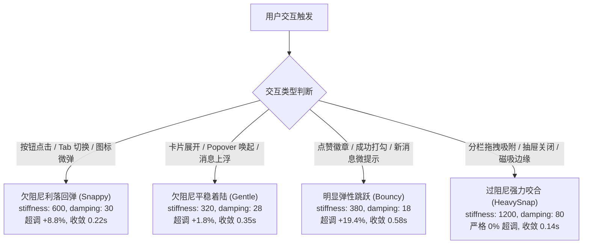

# interaction-design-physics — 通用界面工程与交互物理学规范

本技能指导跨项目、跨终端（Web 前端、VS Code Webview、客户端宿主及游戏表现层）的界面工程与交互动效研发。规范核心在于摆脱盲目拼凑组件与硬编码动画的低效模式，依托**第一性原理物理学方程、心理感知模型与防御性状态机**构建高内聚、高润泽度与零卡顿的生产级交互体验。

---

## 一、 界面交互物理学五大刚性公理

1. **语义化分层明度拓扑 (Semantic Elevation Topology)**：
   界面空间感依赖微小明度阶梯（$S_0 \dots S_n$），而非生硬的黑色实线；暗色模式下严禁使用刺眼的白框，必须以**内嵌发丝高光倒角 (`box-shadow: inset 0 0 0 1px ...`)** 模拟物理世界中边缘对环境顶光的漫反射。
2. **单闭合边框公理 (The 1-Border Rule)**：
   在任何单条视线路径上，至多穿透 1 层闭合结构边界。容器内部包含的子控件（按钮、胶囊、操作条）必须自动降级为 `Ghost` 悬浮态或表面填充态，彻底杜绝套娃边框。
   详见：[visual-enclosure-discipline.md](references/visual-enclosure-discipline.md)。
3. **二阶阻尼谐振子动效模型 (Damped Harmonic Oscillator)**：
   严禁使用 CSS 默认机械生硬的 `linear` 或过度超调的夸张动画。位移与形变必须依托经典二阶微分动力学方程求解：
   $$m \ddot{x} + c \dot{x} + k(x - x_{\text{target}}) = 0$$
   详见：[damped-harmonic-oscillator.md](references/damped-harmonic-oscillator.md)。
4. **意图仲裁时间戳与非侵入式锚定 (Intent Cooldown Arbitration)**：
   当自动化流式内容追加与人类主动交互（滚轮、触摸、拖拽）产生视口争夺时，人类物理输入享有绝对优先权，并触发 $T_{\text{cooldown}}$ 冷却锁（如 150ms 冷却），严禁程序化自动滚动强行抢夺视口。
5. **合成态生命周期互锁守卫 (IME Composition State Machine)**：
   输入框在处理中日韩等输入法编辑器 (IME) 候选词确认时，必须严格拦截回车事件冒泡，杜绝未完成候选词被误当作指令发送。
   详见：[cross-platform-ime-guards.md](references/cross-platform-ime-guards.md)。

---

## 二、 交互动力学四套标准弹簧选型决策树

---

## 三、 典型核心物理交互算法规范

1. **7 档感知幂律渐隐遮罩 (7-Stop Power-Law Mask)**：
   在视网膜高分屏滚动容器边缘，以紧密贴合 $y \approx x^{1.5}$ 幂律感知模型的 7 档 Alpha 阶梯替代粗暴的双色线性渐变，彻底消除色阶断层与发丝硬切感。
   详见：[perceptual-fade-and-affine.md](references/perceptual-fade-and-affine.md)。
2. **光标物理不动点仿射变换 (Fixed-Anchor Affine Pan/Zoom)**：
   图像与画布放大时，将当前鼠标指针或触控中心点作为几何不动点，解算仿射变换矩阵，结合手部微抖动死区（$\Delta d \le 4\text{px}$）与视口边界溢出阻尼系数（$y = 0.7$）。
3. **动态计数等宽数字绝对锁定 (Tabular Numerics)**：
   所有展示动态递增/递减数值（时间码、Token 计数、进度百分比、表格数字）的容器，强制配置 `font-variant-numeric: tabular-nums`，消除排版横向抖动。
4. **行内图标光学基线校准**：
   行内 SVG 图标默认处于基线位置会导致视觉重心偏高，必须统一施加 `vertical-align: -0.125em`（约沉降 1.5px~2px）使其对称轴与字母 x-Height 对齐。

---

## 四、 容器查询自适应与 CJK 防挤压排版矩阵

1. **4 阶容器阶梯响应矩阵**：
   - `< 576px`（双栏/中屏）：收窄外边距与行内留白，弹性操作按钮紧凑化排列；
   - `< 480px`（紧凑容器）：多列并列布局平滑降级为单列垂直流，操作胶囊切换至图标紧凑态；
   - `< 384px`（侧边栏/小窗）：隐藏次要文本标签（仅保留 `aria-label` 与语义图标），输入容器自动横向撑满；
   - `< 320px`（极限空间）：激活极限防挤压状态，严格消除所有横向滚动溢出，子组件全面垂直平铺。
2. **CJK 防挤压排版三联契约**：
   - 标题与强调块应用 `text-wrap: balance`，消除单字成行孤行现象；
   - 包含中英混排、技术术语、代码标识符及超长 URL 的文本块，必须硬性配置 `overflow-wrap: break-word` 与 `word-break: break-word`；
   - 动态数字与百分比强制声明 `font-variant-numeric: tabular-nums`，杜绝数字刷新引发字符排版横向抖动。
   详见样式实现：[container-responsive-matrix.css](templates/container-responsive-matrix.css)。

---

## 五、 分栏物理手柄与 Iframe 防吞噬护盾

1. **Iframe 防吞噬瞬态护盾 (Pointer Events Shield)**：
   在指针按下（`pointerdown`）激活拖拽瞬间，必须在分栏容器根节点标记 `data-pane-dragging="true"`，并动态为所有嵌套 `iframe` 挂载 `pointer-events: none` 隔离层，拖拽释放（`pointerup`）或取消（`pointercancel`）时即时卸载。
2. **4px 物理位移死区 (Movement Deadzone)**：
   初次点击分栏手柄时，累计物理位移 $|\Delta x| \le 4\text{px}$ 判定为微颤点击，不激活重排与分栏尺寸计算；超过死区门限方才建立拖拽会话。
3. **50/50 双击中点咬合与过阻尼回弹**：
   双击手柄触发平滑居中复位（50% 对等分栏），动效由过阻尼强力咬合模型驱动（`SPRING_HEAVY_SNAP`，0% 超调）。
4. **< 18% 临界折叠门限 (Snap-to-Collapse Threshold)**：
   当用户将侧栏拖拽收缩至容器总宽度 18% 以下时，手柄进入临界折叠区，松手后自动平滑吸附至 0%（完全折叠）；反向拉动超过 18% 时弹性恢复至标准最小推荐宽度。
   详见控制器实现：[split-pane-resizer.ts](templates/split-pane-resizer.ts)。

---

## 六、 纯代码 Web Audio 原生合成声学系统

1. **30% 舒缓音量刚性上限 (Max Safe Gain = 0.3)**：
   生产环境主增益节点输出幅度严格限制在 $\text{Gain} \le 0.3$，默认音量低调温和，杜绝高分贝音频震慑用户耳膜。
2. **双谐振调制器架构 (Dual-Resonance Modulation)**：
   通过载波振荡器（Carrier Oscillator，基频）与调制振荡器（Modulator Oscillator，泛音谐波或轻微 Detune 失谐）物理叠加，塑造饱满细腻的机械微弹触感。
3. **平滑指数淡入淡出 (Attack-Decay-Release Envelope)**：
   - 攻击段（Attack）：使用 3~5ms 超短线性爬升（`linearRampToValueAtTime`），彻底消除瞬间阶跃导致的音频破音与底噪；
   - 衰减段（Decay/Release）：使用平滑自然对数指数衰减（`exponentialRampToValueAtTime(0.001, endTime)`），使余音平稳归零。
4. **交互预设库完备内建**：
   原生集成轻触微弹（`click`）、成功确认（`success`）、温和警示（`warning`）及开关切换（`toggle`），全生命周期纯算法生成。
   详见声学合成器：[procedural-audio-synth.ts](templates/procedural-audio-synth.ts)。

---

## 七、 WAI-ARIA 焦点漫游与二维键盘导航矩阵

1. **单一可聚焦项公理 (Single-Focus Invariant)**：
   在同一复合控件容器中，当前激活项或最后聚焦项保持 `tabIndex = 0`，其余所有同级候选项严格设为 `tabIndex = -1`。
2. **二维导航正交解算**：
   - 线性容器支持 `ArrowLeft` / `ArrowRight` 或 `ArrowUp` / `ArrowDown` 遍历；
   - 矩阵容器支持二维行列（Row, Col）正交网格漫游，`Home` 与 `End` 分别直达首项与末项。
3. **Loop 边界回绕与 RTL 镜像对称**：
   - 聚焦到达边界末项后按前进键无缝循环回绕至首项，首项后退回绕至末项；
   - 当检测到从右向左阅读语系（`dir="rtl"`）时，水平方向键导航映射自动镜像翻转。
   详见漫游控制器：[roving-focus-controller.ts](templates/roving-focus-controller.ts)。

---

## 八、 流式视口物理学与图钉锁定 (§10 Viewport Pinning Physics)

在自动化流式字符生成与渲染过程中，严禁无条件强行抢夺用户滚动视口：
1. **40px 底部容差吸附 (Bottom Pinning Tolerance)**：
   当前视口距离底部距离 $\Delta h = \text{scrollHeight} - \text{scrollTop} - \text{clientHeight} \le 40\text{px}$ 时，系统判定处于“底部图钉锁定态”，流式追加内容时视口自动贴底。
2. **120px 快速直达悬浮钮 (Jump-to-Bottom Threshold)**：
   当用户主动向上回滚使 $\Delta h > 120\text{px}$ 时，立即浮现直达最新消息按钮；点击后通过平滑弹簧曲线快速回到底部，并重新激活图钉锁定。
3. **150ms 冷却时间戳窗口 (Intent Cooldown Arbitration)**：
   用户一旦触发主动物理滚动（`wheel`、`touchmove`、手势滚动），记录 `lastUserInputAt = performance.now()`；在接下来的 150ms 冷却窗口内，系统一票否决所有程序化自动滚动，将视口控制权绝对归还人类。
4. **流式推流 behavior: "auto" 瞬时无抖对齐公理**：
   在流式追加高频文本 chunk 时，若处于图钉锁定态，滚动对齐必须使用 `behavior: "auto"` 瞬时无缝锁定，**严禁使用 `behavior: "smooth"`**，杜绝平滑动画累积导致的视口剧烈抖动与排版重排卡顿。
   详见实现：[scroll-pinning-controller.ts](templates/scroll-pinning-controller.ts)。

---

## 九、 7 档非线性幂律 Alpha 渐变边缘遮罩 (§11 7-Stop Power-Law Mask)

1. **韦伯-费希纳心理物理学感知拟合**：
   人眼对暗部与中间调的亮度感知呈现非线性特性。长列表与滚动容器的边缘羽化严禁使用粗暴的单步双色线性渐变，必须基于 $y \approx x^{1.5}$ 幂律感知曲线采样。
2. **28px 采样距离 7 档非线性采样阶梯**：
   在固定 28px 羽化距离内，沿滚动轴依次排布 7 档精细透明度阶梯：
   - `0%`: `rgba(0, 0, 0, 0.000)`（完全透明）
   - `15%`: `rgba(0, 0, 0, 0.051)`（微雾渗透）
   - `30%`: `rgba(0, 0, 0, 0.149)`（柔和显现）
   - `45%`: `rgba(0, 0, 0, 0.302)`（加速上升）
   - `60%`: `rgba(0, 0, 0, 0.502)`（中位透光）
   - `75%`: `rgba(0, 0, 0, 0.702)`（高透光区）
   - `87%`: `rgba(0, 0, 0, 0.851)`（接近全透）
   - `100%`: `rgba(0, 0, 0, 1.000)`（完全实体）
3. **双轴位置传感器触顶触底动态归零**：
   当容器滚动到达物理顶端（`data-scroll-top="true"`）或底端（`data-scroll-bottom="true"`）时，对应边缘的渐变遮罩高度通过 CSS 变量动态收缩至 0，消除内容贴边时的多余发灰现象。
   详见实现：[scroll-fade-container.css](templates/scroll-fade-container.css)。

---

## 十、 光标不动点仿射变换方程 (§12 Fixed-Anchor Affine Pan/Zoom)

1. **指针绝对物理静止不变式 (Fixed-Anchor Invariant)**：
   在以鼠标滚轮或双指手势缩放画布时，指针所指的画布像素坐标在屏幕视口中必须保持物理绝对静止，严禁粗暴以视口中心缩放导致内容漂移：
   $$\text{idealTx} = O_x - (O_x - \text{tx}) \cdot \frac{S_{\text{target}}}{S_{\text{current}}}, \quad \text{idealTy} = O_y - (O_y - \text{ty}) \cdot \frac{S_{\text{target}}}{S_{\text{current}}}$$
2. **滚轮指数缩放方程**：
   单步缩放比例依托自然指数函数平滑计算：$S_{n+1} = S_n \cdot \exp(-\Delta y \times 0.01)$，确保在高倍与低倍下均保持尺度无关的均匀缩放手感。
3. **0.7 物理阻尼溢出回弹与 4px 移动死区**：
   当视口拖拽平移超出边界包络时，施加 $0.7$ 弹性阻尼衰减；平移初段注入 $\Delta d \le 4\text{px}$ 移动死区，彻底过滤手部微颤引起的意外画面漂移。
   详见实现：[affine-pan-zoom-engine.ts](templates/affine-pan-zoom-engine.ts)。

---

## 十一、 思考过程氛围着色器与频域 Gamma 压缩 (§13 Thinking Ambient Physics)

1. **非对称蓄力穿透扫光曲线**：
   智能体在深度思考或后台运算时，顶端氛围条采用专用缓动函数 `cubic-bezier(0.714, 0.121, 0.211, 0.888)`：前段缓慢蓄能聚积势能，中段高通量穿透扫过视口，尾段柔和平稳衰减。
2. **三相差分跳跃脉冲 (Three-Phase Differential Pulse)**：
   微光节点以三相交错延迟（0s, 0.35s, 0.7s）在色彩明度与缩放尺度上形成呼吸波形，打破死板的对称正弦波循环。
3. **8% 底噪门限与 0.7 次幂频域 Gamma 压缩**：
   对思考活动活跃度或音频频域数据施加 8% 底噪截断门限（$\le 0.08$ 强制归零消除视觉噪点），有效幅值应用 $A_{\text{out}} = A_{\text{norm}}^{0.7}$ 进行非线性动态范围压缩，极大提升微弱变化的可视化辨识度。
   详见样式与算法：[thinking-ambient-glow.css](templates/thinking-ambient-glow.css) 及 [spectral-gamma-compressor.ts](templates/spectral-gamma-compressor.ts)。

---

## 十二、 工件沙箱安全通信与原生手势门禁 (§14 Artifact Sandbox Security)

1. **`null-origin` 绝对同源阻断**：
   Webview 中嵌入的预览工件（Artifact iframe）必须强制声明 `sandbox="allow-scripts"`，严禁声明 `allow-same-origin` 与 `allow-top-navigation`。沙箱执行上下文被永久固化在无权限的 `null` Origin，阻断任何跨源 Cookie/Storage 窃取与主宿主污染。
2. **原生物理手势门禁 (Native UserActivation Guard)**：
   工件内部或向宿主发起敏感动作（如剪贴板写入、外链唤起、文件导出）时，通信网桥必须核验 `event.isTrusted === true` 并且 `navigator.userActivation?.hasBeenActive === true`，彻底拦截 JavaScript 通过 `dispatchEvent` 等合成事件伪造的用户手势攻击。
   详见实现：[sandbox-iframe-bridge.ts](templates/sandbox-iframe-bridge.ts)。

---

## 十三、 跨框架通用代码模板与参考指南

* 物理弹簧参数实现与二阶微分求解器：[spring-physics-presets.ts](templates/spring-physics-presets.ts)
* 视口图钉与意图冷却仲裁 Hook：[scroll-pinning-hook.ts](templates/scroll-pinning-hook.ts)
* 150ms 冷却视口图钉控制器：[scroll-pinning-controller.ts](templates/scroll-pinning-controller.ts)
* 7 档幂律 Alpha 渐变遮罩样式表：[scroll-fade-container.css](templates/scroll-fade-container.css)
* 仿射平移缩放数学计算方程：[fixed-anchor-panzoom.ts](templates/fixed-anchor-panzoom.ts)
* 光标不动点仿射平移缩放数学引擎：[affine-pan-zoom-engine.ts](templates/affine-pan-zoom-engine.ts)
* 思考过程氛围着色器与三相脉冲样式：[thinking-ambient-glow.css](templates/thinking-ambient-glow.css)
* 8% 底噪截断与 0.7 次幂 Gamma 压缩算法：[spectral-gamma-compressor.ts](templates/spectral-gamma-compressor.ts)
* 带原生手势门禁的工件沙箱安全通信桥：[sandbox-iframe-bridge.ts](templates/sandbox-iframe-bridge.ts)
* 纯几何定位分段滑动选择胶囊：[segmented-control-pill.tsx](templates/segmented-control-pill.tsx)
* 容器查询响应矩阵与 CJK 排版契约：[container-responsive-matrix.css](templates/container-responsive-matrix.css)
* 分栏拖拽手柄与 Iframe 防吞噬控制器：[split-pane-resizer.ts](templates/split-pane-resizer.ts)
* 纯代码原生 Web Audio 声学合成器：[procedural-audio-synth.ts](templates/procedural-audio-synth.ts)
* WAI-ARIA 焦点漫游与二维导航控制器：[roving-focus-controller.ts](templates/roving-focus-controller.ts)
