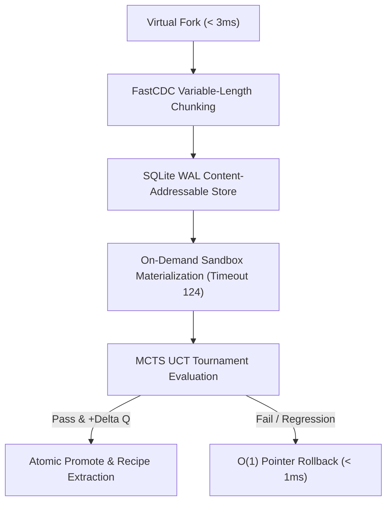

# LayerVFS Zero-Copy CAS Sandbox & MCTS Refactoring Tournament Specification

> **Parent Skill**: [praxis-vfs-and-trajectory-learning](../SKILL.md)  
> **Source of Truth**: `auto-refactor/src/core/praxis/vfs/`, `auto-refactor/docs/01-architecture/06-layervfs-virtual-storage-and-mcts.md`

---

## 1. LayerVFS Virtual Branching & FastCDC CAS Architecture

1. **FastCDC Content-Defined Chunking**:
   - Splits mutated files at rolling-hash Gear boundary cutpoints so localized edits reuse $> 90\%$ of unchanged chunks across parallel candidate branches.
2. **SQLite WAL CAS Backend**:
   - Stores chunks keyed by SHA-256 digest in WAL mode (`PRAGMA journal_mode=WAL;`), enabling concurrent reader/writer access across subagent candidate forks without whole-tree file copying.
3. **Controlled Sandbox Projection & Timeout Guard**:
   - Projects only the delta overlay into a temporary directory under `os.tmpdir()` when running external build/test commands.
   - Enforces a strict execution timeout (returning exit code `124` on hang) and cleans up projected directories via `try/finally` (`PRF-LEAK-001`).

---

## 2. MCTS UCT Refactoring Tournament

Candidate refactoring transforms are evaluated as nodes in a Monte Carlo Tree Search tournament:

$$\text{UCT}(v_i) = \frac{W_i}{n_i} + c \cdot \sqrt{\frac{\ln N_p}{n_i}}, \quad c = \sqrt{2}$$

- **Reward Function ($W_i$)**: Combines net 10D composite quality gain ($\Delta Q_{\text{composite}}$), cyclomatic complexity reduction ($-\Delta \text{CC}$), and token density compliance ($\tau \in [2.5, 22.0]$).
- **Hard Pruning Invariants**: Any candidate node that introduces a compile error, test failure, `ARCH-FAC-001` / `ARCH-ABS-001` violation, or `BLOCK_GAMING_DETECTED` is immediately pruned ($W_i = -\infty$) and rolled back in `< 1ms`.
