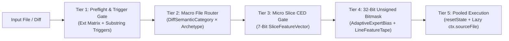

# Five-Tier Sparse MoE Routing & 32-Bit Unsigned Bitmask Specification

> **Parent Skill**: [sparse-moe-and-ast-routing](../SKILL.md)  
> **Source of Truth**: `auto-refactor/src/core/constants/analyzer-bitmask.ts`, `auto-refactor/src/core/experts/expert-catalog.ts`, `auto-refactor/src/core/experts/grouped-dispatcher.ts`, `auto-refactor/src/core/scanner/file-preflight-gate.ts`, `auto-refactor/src/core/ast/source-mask.ts`

---

## 1. End-to-End 5-Tier Routing Pipeline



1. **Tier 1 (`file-preflight-gate.ts` & `sparse-activator.ts`)**:
   - Rejects analyzers incompatible with the file extension (`LANGUAGE_ANALYZER_MATRIX`).
   - Evaluates `TriggerCatalog` (`trigger-catalog.ts`) over the raw buffer: if none of an analyzer's fast trigger substrings appear (e.g., `ASYNC_TRIGGERS` for `concurrency`, shell tokens for `shell-lint`), the analyzer is bypassed in $O(1)$ after a single Aho-Corasick / `includes` scan.
2. **Tier 2 (`sparseRuleRouter.ts`)**:
   - Maps file diff classification (`doc-only`, `literal-only`, `signature-change`, `control-flow`) and `ProjectArchetype` to candidate stages, achieving $\ge 70\%$ bypass on incremental edits.
3. **Tier 3 (`sparseMoEGate.ts`)**:
   - Computes `SliceFeatureVector` per AST slice and dispatches only the 2–4 domain experts matching mutated syntax traits (10%–25% activation).

---

## 2. 32-Bit Signed vs. Unsigned Bitmask Invariant (`AnalyzerBit`)

All 32 built-in analyzers occupy bits $0 \dots 31$ of a 32-bit bitmask:

$$\text{Bit}_i = (1 \ll i) \ggg 0, \quad i \in \{0, 1, \dots, 31\}$$

### Why Bit 31 (`AnalyzerBit.CONCURRENCY`) Requires Unsigned Normalization
- In ECMAScript, bitwise shift `1 << 31` produces a signed 32-bit integer `-2147483648` (`0x80000000 | 0`).
- Bitmask extraction `const lowestBit = (mask & -mask) >>> 0` or `Math.clz32` conversion `(1 << idx) >>> 0` produces unsigned `2147483648`.
- **Mandatory Dual-Key Registration**:
  ```typescript
  const unsignedBit = bit >>> 0;
  const signedBit = bit | 0;
  map.set(unsignedBit, entry);
  map.set(signedBit, entry);
  ```
- **Index Lookup Fallback (`grouped-dispatcher.ts`)**:
  When iterating set bits via `let remaining = activeMask >>> 0`, resolve the bit index `const bitIndex = 31 - Math.clz32(lowestBit)` and fall back to `EXPERT_BY_INDEX[bitIndex]` if `EXPERT_BY_BIT.get(lowestBit)` misses.

---

## 3. `LineFeatureTape` (`LINE_FLAG_*`) Bitmask Reference

Constructed during single-pass lexical masking (`src/core/ast/source-mask.ts`):

| Flag Constant | Bit Value | Semantic Meaning | Typical Consumer Analyzers |
| :--- | :---: | :--- | :--- |
| `LINE_FLAG_COMMENT` | `1 << 0` | Line contains comment tokens | `comments`, `docs`, `production-hygiene` |
| `LINE_FLAG_STRING_LITERAL` | `1 << 1` | Line contains string/template literal | `constants`, `secrets`, `client-exposure` |
| `LINE_FLAG_IMPORT` | `1 << 2` | Line contains `import` / `require` / `use` | `dependency-layout`, `dependency-graph`, `architecture` |
| `LINE_FLAG_EXPORT` | `1 << 3` | Line contains `export` / `pub` declaration | `architecture`, `facade`, `docs` |
| `LINE_FLAG_LOOP` | `1 << 4` | Line opens `for` / `while` / `loop` | `performance`, `complexity`, `gdscript-game` |
| `LINE_FLAG_ASYNC_AWAIT` | `1 << 5` | Line contains `async` / `await` / `Promise` | `concurrency`, `python-modern`, `rust-modern` |
| `LINE_FLAG_HAS_CALL_PAREN` | `1 << 6` | Line contains `(` invocation or signature | `stdlib`, `go-modern`, `gdscript-modern`, `vscode-extension` |

Any line-by-line loop inside an analyzer must check the tape bitmask before running regular expressions.
