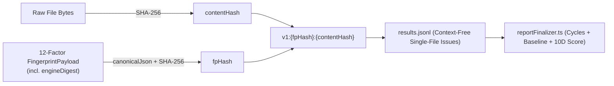

# Multi-Tier Cache Key, `l2LoadLevel` Shedding & DAG Invalidation Specification

> **Parent Skill**: [tiered-cache-and-wal-persistence](../SKILL.md)  
> **Source of Truth**: `auto-refactor/src/core/cache.ts`, `auto-refactor/src/core/cache-key.ts`, `auto-refactor/src/core/scheduler/topology-cache-manager.ts`, `auto-refactor/src/core/reporting/reportFinalizer.ts`

---

## 1. Twelve-Factor `FingerprintPayload` & Cold/Warm Byte Parity

1. **Twelve-Factor `FingerprintPayload`**:
   - `formatVersion`, `toolVersion`, `nodeMajor`, `adapterId`, `adapterVersions`, `projection` (`fastPath`, `legacyCount`, `policyHash`), `analyzers` (`name`, `version`, `modulePath`, `optionsHash`), `thresholds`, `customHash`, `fileExt`, `unsupportedLanguage`, and `engineDigest`.
   - **`engineDigest` Invariant**: Computed over sorted relative paths of `dist/analyzers/**/*.js` and `dist/core/ast/**/*.js`. Any compiled analyzer change shifts `fpHash` automatically (`tests/unit/core/cache-key-engine-digest.test.ts`).
2. **Post-Scan Finalizer Decoupling (`reportFinalizer.ts`)**:
   - Never store cross-file cycle issues (`import-cycle`) or baseline-filtered verdicts inside `results.jsonl`.
   - Always run `runCyclePass`, suppression filtering, baseline ratcheting, and 10D quality scoring over the combined warm+cold file results in `reportFinalizer.ts`.

---

## 2. `TopologyCacheManager` Reverse-Closure Invalidation

Maintains L1 hot LRU (1,000 entries) and L2 warm LRU (4,000 entries) alongside bidirectional adjacency maps `dependsOn` ($u \to v$) and `dependedBy` ($v \to u$):

1. **Body-Only Mutation (`signatureChanged === false`)**:
   - Exported symbol names, parameter types, and return types are unchanged.
   - Evicts only $u$; all callers $c \in \text{dependedBy}(u)$ retain valid cached diagnostics.
2. **Contract Mutation (`signatureChanged === true`)**:
   - Traverses $\text{dependedBy}^*(u)$ via iterative BFS/DFS (`collectTransitiveDependents`), evicting $u$ and every direct/indirect dependent from both L1 and L2 topology caches.
