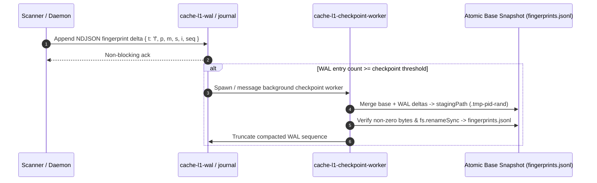

# WAL Journal, Worker Checkpointing & Atomic Persistence Specification

> **Parent Skill**: [tiered-cache-and-wal-persistence](../SKILL.md)  
> **Source of Truth**: `auto-refactor/src/core/cache-l1-wal.ts`, `auto-refactor/src/core/cache-l1-journal.ts`, `auto-refactor/src/core/cache-l1-checkpoint-worker.ts`, `auto-refactor/src/core/cache-persistence.ts`

---

## 1. L1 WAL Append & Off-Thread Compaction Lifecycle



1. **Idempotent Sequence Monotonicity (`UUID-REENTRANT-001`)**:
   - Each WAL record carries a monotonic sequence/timestamp (`ts` / `seq`); during startup replay or background compaction, the latest record for path `p` wins deterministically.
2. **Concurrent Flush Serialization**:
   - Coalesce concurrent `flush()` calls via an in-flight promise latch or advisory lock so two workers never compact the same WAL generation simultaneously (`tests/unit/cache-flush-concurrency.test.ts`).

---

## 2. PID-Salted Atomic Rename & `SyncIoBarrier` (`GOV-PRF-004` / `FGT-STO-001`)

1. **Unique Per-Process Staging Path**:
   ```typescript
   const stagingPath = `${targetFile}.tmp-${process.pid}-${Math.random().toString(36).slice(2, 8)}`;
   ```
   Using a fixed `.tmp` suffix causes race conditions when a background daemon and a foreground CLI flush concurrently.
2. **Three-Step Atomic Replace**:
   - Write full buffer to `stagingPath` via `SyncIoBarrier.writeText`;
   - Assert written payload is non-empty;
   - Execute `fs.renameSync(stagingPath, targetFile)` and clean up `stagingPath` in `catch` via `fs.rmSync(stagingPath, { force: true })`.
