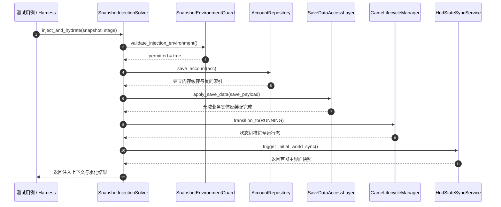
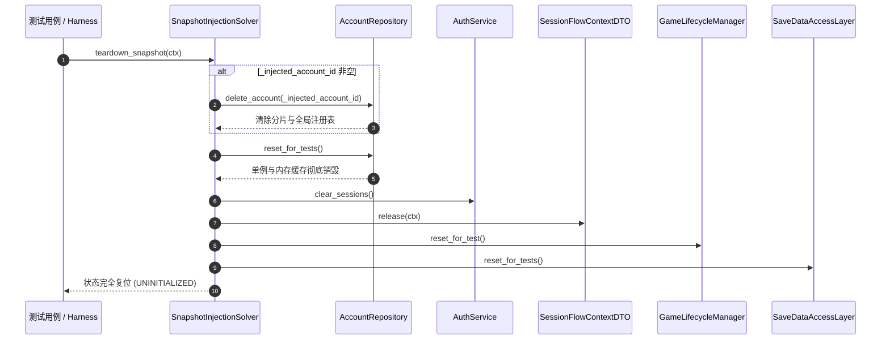

# 施工细则：快照水化仓储闭环与创角物理预占事务施工细则 —— 阶段2：快照水化器账号注入与生命周期对称反装配

> [!NOTE]
> **【施工目标】**：改造 `SnapshotInjectionSolver`，打通快照水化器与 `AccountRepository` 物理仓储的闭环联动。在快照注入与状态水化（`inject_and_hydrate`）过程中，动态构建 `AccountProfileAggregate` 账号聚合实体并注册到 `AccountRepository` 单例，建立内存缓存与大小写不敏感索引；在测试完成反装配（`teardown_snapshot`）阶段，执行对称级联清理，注销已注入账号并调用 `AccountRepository.reset_for_tests()` 实现零残留隔离。代码满足圈复杂度 CC <= 15，嵌套深度 Depth <= 4 与零瞬态堆分配。
> **案卷全局共享上下文**：👉 [KALAR-DEV-2026-ST106-ATT_附件_案卷共享契约与上下文.md](KALAR-DEV-2026-ST106-ATT_附件_案卷共享契约与上下文.md)。
> **施工开始日期**：2026-10-11
> 📍 **卷内快速直达**：[ATT 共享附件](KALAR-DEV-2026-ST106-ATT_附件_案卷共享契约与上下文.md) ｜ [阶段1](KALAR-DEV-2026-ST106-001_阶段1_快照仓储双向水化与创角事务数据契约.md) ｜ **阶段2 (当前)** ｜ [阶段3](KALAR-DEV-2026-ST106-003_阶段3_创角槽位物理预占事务与配置策略驱动.md) ｜ [阶段4](KALAR-DEV-2026-ST106-004_阶段4_无头测试矩阵与架构一致性验收.md)

---

## 📌 第一性原理溯源指针

* **精准上游规范指针**：[AGENTS.md 工作区全局刚性公理](../../../../../../AGENTS.md) §二.1、§二.2、§三、§四.1
* **核心不变量约束断言**：
  - `Inv-HYDRATE-REPO-1 (快照水化自动注入)`：`SnapshotInjectionSolver.inject_and_hydrate` 处理有效快照时，根据快照参数动态组装 `AccountProfileAggregate` 账号聚合实体，并调用 `AccountRepository.get_instance().save_account(acc)` 登记至内存索引与注册表，通过 `_injected_account_id` 维持生命周期跟踪；
  - `Inv-HYDRATE-REPO-2 (生命周期对称清理)`：`teardown_snapshot` 必须对称清理 `_injected_account_id`，调用 `AccountRepository.get_instance().delete_account(_injected_account_id)` 擦除物理分片与全局注册表条目，并调用 `AccountRepository.reset_for_tests()` 彻底释放测试隔离；
  - `Inv-HYDRATE-REPO-3 (无侵入兼容与防御隔离)`：保持全域 DAL、会话上下文（`SessionFlowContextDTO`）、生命周期状态机（`GameLifecycleManager`）与主界面（`HudStateSyncService`）水化链路稳定；生产环境由 `SnapshotEnvironmentGuard` 刚性熔断；
  - `Inv-HYDRATE-REPO-4 (低复杂度与平铺控制流)`：圈复杂度 CC <= 15，最大控制流嵌套深度 Depth <= 4，循环零瞬态堆分配，使用卫语句提前返回。
* **防漂移最高指示**：严禁快照测试结束后在 AccountRepository 物理介质或内存中遗留残留脏数据；严禁在单例复位时跳过物理分片删除。

---

## 一、 快照水化器架构与生命周期时序 (Hydration Architecture & Lifecycle Sequence)

### 1. 快照全域状态水化时序图 (Injection & Hydration Pipeline)



### 2. 对称反装配与零残留清理时序图 (Symmetric Teardown & Isolation)



### 3. 核心 API 契约与方法实现

```gdscript
## 全域注入与状态水化入口
static func inject_and_hydrate(snapshot: TestSnapshotBundleDTO, target_stage_key: String = "") -> Dictionary

## 测试结束后的对称清理与状态复位
static func teardown_snapshot(ctx: SessionFlowContextDTO = null) -> void

## 获取当前注入的账号识别码
static func get_injected_account_id() -> String

## 私有静态辅助：将快照账号实体水化注入 AccountRepository 仓储索引
static func _hydrate_account_to_repository(snapshot: TestSnapshotBundleDTO) -> String
```

---

## 二、 命令式施工执行清单 (Agent Execution Checklist)

- [x] **Step 2.1: 引入 AccountRepository 与 AccountProfileAggregate 强契约依赖** - 声明 preload 并增加 `_injected_account_id` 追踪静态变量
- [x] **Step 2.2: 在 inject_and_hydrate 中组装账号聚合实体并注册入仓储双层索引** - 提取 `_hydrate_account_to_repository` 辅助函数，控制流严格平铺
- [x] **Step 2.3: 在 teardown_snapshot 中落实对称反装配与彻底复位** - 执行 `delete_account` 擦除物理分片并调用 `AccountRepository.reset_for_tests()`
- [x] **Step 2.4: 静态质量与复杂度审计** - 验证圈复杂度 CC <= 15，嵌套深度 Depth <= 4，通过 `audit_gd.py`

---

## 三、 仓储闭环与反装配验收矩阵 (DoD Matrix)

| 检验项 ID | 校验目标 | 验证输入 | 预期输出断言 |
| :--- | :--- | :--- | :--- |
| **DOD-SNAP2-01** | inject_and_hydrate 建立仓储双层索引 | 注入 `fixture_mid_explorer()` | `AccountRepository.find_by_id("ACC_MID_01")` 与 `find_by_username("SylphExplorer")` 均返回有效聚合 |
| **DOD-SNAP2-02** | teardown_snapshot 对称反装配零残留 | 调用 `teardown_snapshot(ctx)` | `AccountRepository.has_account()` 返回 false，账号总数为 0，生命周期回到 UNINITIALIZED |
| **DOD-SNAP2-03** | 流水线测试用例强覆盖 | 运行 `test_snapshot_engineering_harness_pipeline.gd` | TC-SEH-05 与 TC-SEH-07 中新增 AccountRepository 断言 100% 通过 |
| **DOD-SNAP2-04** | 静态代码规范与架构护栏 | 运行 `python scripts/py/audit_gd.py` | 零 ERROR，圈复杂度 CC <= 15，嵌套深度 Depth <= 4，无瞬态分配 |
