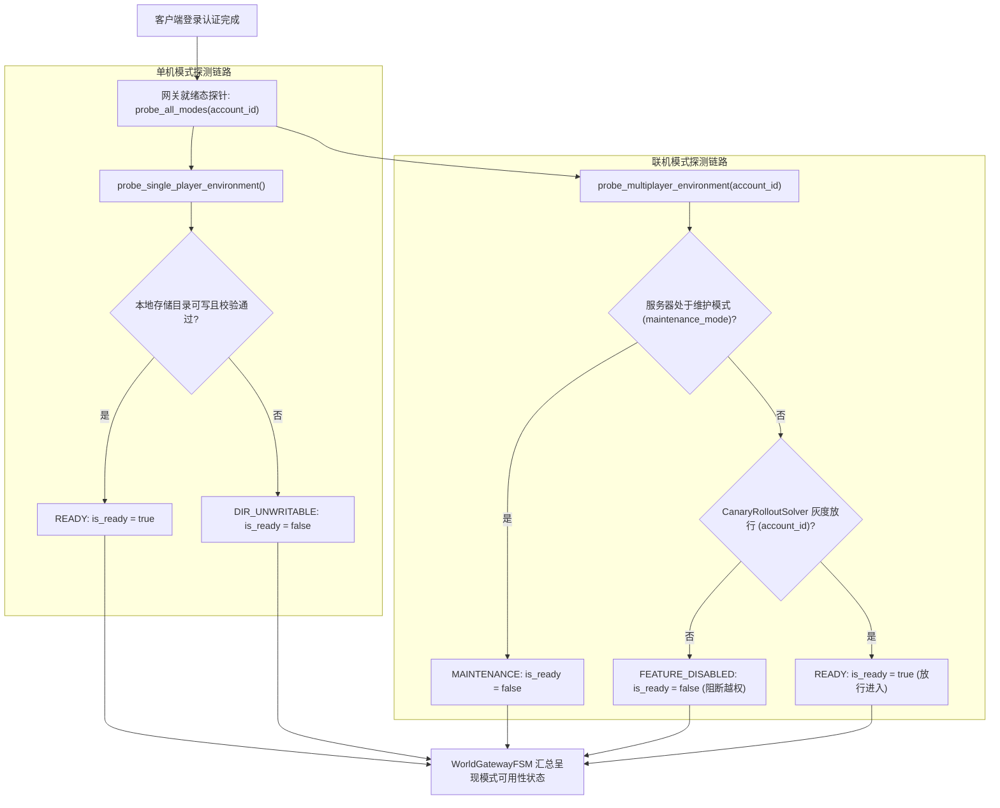

# 施工细则：世界档案库与模式探针防越权网关施工细则 —— 阶段1：世界档案数据契约与模式探针隔离拓扑设计

> [!NOTE]
> **【施工目标】**：定义世界档案物理仓储（`WorldArchiveRepository`）与模式就绪探针（`ModeReadinessProbe`）的核心数据契约、目录存储拓扑以及模式隔离防越权网关拓扑。确立 `WorldArchiveSummaryDTO` 与 `ModeReadinessReportDTO` 结构规范，明晰单机世界物理独立子目录（`user://worlds/sp/<world_id>/`）与全局索引表（`world_catalog.json`）的双轨持久化布局；规范单机与联机运行模式探测策略，构建阻断未授权账号越权进入联机界域的防线。
> **案卷全局共享上下文**：👉 [KALAR-DEV-2026-ST107-ATT_附件_案卷共享契约与上下文.md](KALAR-DEV-2026-ST107-ATT_附件_案卷共享契约与上下文.md)。
> **施工开始日期**：2026-10-11
> 📍 **卷内快速直达**：[ATT 共享附件](KALAR-DEV-2026-ST107-ATT_附件_案卷共享契约与上下文.md) ｜ **阶段1 (当前)** ｜ [阶段2](KALAR-DEV-2026-ST107-002_阶段2_单机世界物理仓储引擎与模式探针模块实现.md) ｜ [阶段3](KALAR-DEV-2026-ST107-003_阶段3_网关路由调度与气密级防越权安全守卫加固.md) ｜ [阶段4](KALAR-DEV-2026-ST107-004_阶段4_无头安全测试矩阵与全域门禁验收.md)

---

## 📌 第一性原理溯源指针

* **精准上游规范指针**：[AGENTS.md 工作区全局刚性公理](../../../../../../AGENTS.md) §二.1、§三、§四.1
* **核心不变量约束断言**：
  - `Inv-ARCHIVE-CONTRACT-1 (世界档案摘要单源轻量契约)`：世界列表浏览与网关展示严禁直接读取或实例化庞大的 `WorldInstance` 全量实体，统经 `WorldArchiveSummaryDTO` 提供轻量级索引，避免高频 I/O 拥塞与堆内存抖动；
  - `Inv-ARCHIVE-ISOLATION-2 (模式就绪探针物理隔离)`：单机环境由本地文件系统可写性与配额判定；联机环境强校验灰度白名单与维护状态，任何未放行账号一律阻断在网关门外，杜绝越权进入联机世界；
  - `Inv-ARCHIVE-TOPOLOGY-3 (多世界物理独立子目录拓扑)`：单机世界划分为独立子目录（`user://worlds/sp/<world_id>/`）存储 `world_meta.json` 与 `world_state.json`，总索引表 `world_catalog.json` 保持 $O(1)$ 常数时间全局元数据寻址；
  - `Inv-ARCHIVE-ZERO-HEAP-4 (低复杂度与零瞬态堆分配)`：DTO 与探针各核心方法满足圈复杂度 CC <= 15，控制流深度 Depth <= 4，使用卫语句提前返回，支持对象池 `reset_state()` 复用机制。
* **防漂移最高指示**：严禁网关跳过探针校验直接进入游戏世界；严禁单机与联机世界共享物理存储路径造成数据混淆。

---

## 一、 核心数据契约设计 (Core Data Contracts)

### 1. 世界档案轻量摘要契约 (`WorldArchiveSummaryDTO`)

网关层遍历世界列表或展示世界卡片时，使用 `WorldArchiveSummaryDTO` 传输摘要数据：

| 字段名称 | 数据类型 | 缺省回退值 | 语义说明 |
| :--- | :--- | :--- | :--- |
| `world_id` | `String` | `""` | 世界唯一物理标识符（如 `WORLD_DEFAULT_SP_01`） |
| `world_name` | `String` | `""` | 世界显示名称（如 `卡拉尔大陆·起源界`） |
| `mode` | `int` | `1` | 游戏运行模式（1=单机 SINGLE_PLAYER，2=联机 MULTIPLAYER） |
| `seed_value` | `int` | `0` | 世界地形生成伪随机数种子 |
| `current_tick` | `int` | `0` | 当前世界单调递增 Tick 计数 |
| `current_day` | `int` | `1` | 当前世界自然日天数 |
| `character_count` | `int` | `0` | 该世界中已绑定的活跃角色总数 |
| `created_timestamp_utc` | `int` | `0` | 世界创建 UTC 时间戳（秒） |
| `last_played_timestamp_utc` | `int` | `0` | 世界最近一次游玩/保存 UTC 时间戳（秒） |
| `is_active` | `bool` | `true` | 是否处于可用激活状态 |

数据载荷示例（JSON 序列化）：
```json
{
  "world_id": "WORLD_DEFAULT_SP_01",
  "world_name": "卡拉尔大陆·起源界",
  "mode": 1,
  "seed_value": 20260901,
  "current_tick": 1280,
  "current_day": 64,
  "character_count": 1,
  "created_timestamp_utc": 1728639000,
  "last_played_timestamp_utc": 1728642600,
  "is_active": true
}
```

### 2. 运行模式就绪态报告契约 (`ModeReadinessReportDTO`)

模式就绪探针在进行环境诊断后，向上游网关状态机输出确定性报告：

| 字段名称 | 数据类型 | 缺省回退值 | 语义说明 |
| :--- | :--- | :--- | :--- |
| `mode` | `int` | `0` | 被探测的目标游戏运行模式 |
| `is_ready` | `bool` | `false` | 目标模式当前是否具备进入条件 |
| `status_code` | `String` | `""` | 确定性状态码（`READY`, `DIR_UNWRITABLE`, `FEATURE_DISABLED`, `MAINTENANCE`） |
| `message` | `String` | `""` | 人类可读状态诊断描述与原因说明 |
| `latency_ms` | `int` | `0` | 网络诊断往返延迟估计值（毫秒） |
| `capabilities` | `Array` | `[]` | 目标模式具备的运行时能力特性标签 |

---

### 3. 模式探针隔离拓扑与防越权流程 (Probe Isolation & Anti-Bypass Gate)

#### 1) 探针决策与流转架构



#### 2) 状态码与网关动作映射

| 模式 | 状态码 | 就绪布尔 | 动作描述 |
| :--- | :--- | :--- | :--- |
| 单机模式 | `READY` | `true` | 启用单机模式按钮，加载单机世界档案列表 |
| 单机模式 | `DIR_UNWRITABLE` | `false` | 禁用单机入口，弹出存储介质权限错误警告 |
| 联机模式 | `READY` | `true` | 启用联机大厅入口，允许查询公网界域列表 |
| 联机模式 | `MAINTENANCE` | `false` | 标记联机维护徽标，禁用联机入口并显示维护公告 |
| 联机模式 | `FEATURE_DISABLED` | `false` | 隐藏或置灰联机入口，严防非白名单账号穿透 |

### 4. 单机世界存储拓扑与配置驱动 (Storage Topology & Configuration)

#### 1) 物理目录分层结构

```text
user://worlds/sp/
├── world_catalog.json           # 全局世界档案目录总表 (轻量元数据索引)
├── world_catalog.json.bak       # 目录总表轮转备份
└── WORLD_DEFAULT_SP_01/         # 独立世界存储子目录
    ├── world_meta.json          # 世界基础配置与创建元数据
    ├── world_state.json         # 世界全量运行时状态 (WorldInstance 序列化)
    └── world_state.json.bak     # 世界状态轮转备份
```

#### 2) 配置单源收敛 (`config/domains/world_gateway/core.json`)

```json
{
  "local_archive": {
    "root_dir": "user://worlds/sp/",
    "catalog_file": "world_catalog.json",
    "max_worlds": 10
  },
  "probe_policy": {
    "sp_disk_check": true,
    "mp_heartbeat_timeout_ms": 3000,
    "mp_simulated_ping_ms": 24,
    "allow_offline_bypass": false,
    "maintenance_mode": false
  }
}
```

---

## 二、 命令式施工执行清单 (Agent Execution Checklist)

- [x] **Step 1.1: 扩展 core.json 配置表** - 增加 `local_archive` 与 `probe_policy` 参数
- [x] **Step 1.2: 制定 WorldArchiveSummaryDTO 契约** - 规范轻量摘要元数据、序列化与反序列化
- [x] **Step 1.3: 制定 ModeReadinessReportDTO 契约** - 规范模式就绪探测报告信封与状态码
- [x] **Step 1.4: 确立探针就绪状态机与隔离拓扑** - 建立单机环境与联机灰度安全防越权判定
- [x] **Step 1.5: 确立单机独立多世界物理分片存储拓扑** - 确立分片子目录与全局目录原子写模型

---

## 三、 数据契约与存储拓扑验收矩阵 (DoD Matrix)

| 检验项 ID | 校验目标 | 验证输入 | 预期输出断言 |
| :--- | :--- | :--- | :--- |
| **DOD-ARCH1-01** | 配置结构一致性 | `audit_config.py --strict` 验证全域配置表 | 退出码 0，审查 100% 全部通过 |
| **DOD-ARCH1-02** | DTO 序列化闭环 | `to_dto()` 与 `from_dto()` 数据无损转换 | 字段类型与回退默认值完全一致，无丢失 |
| **DOD-ARCH1-03** | 单机存储探测断言 | 可写目录与非法目录分别执行探测 | 可写目录返回 `READY`，非法目录返回 `DIR_UNWRITABLE` |
| **DOD-ARCH1-04** | 联机灰度防越权阻断 | 非白名单与维护态执行联机探测 | 非白名单账号返回 `FEATURE_DISABLED`，严防非法越权 |
| **DOD-ARCH1-05** | 物理世界原子写契约 | 世界创建、读取、落盘与删除生命周期 | 均经由原子写入且目录索引时间同步落盘 |
