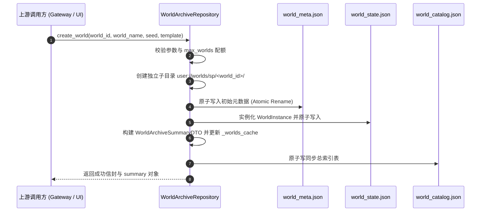
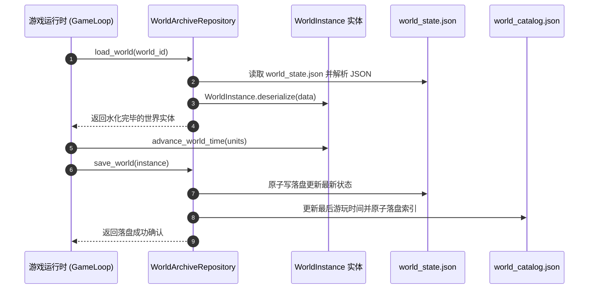

# 施工细则：世界档案库与模式探针防越权网关施工细则 —— 阶段2：单机世界物理仓储引擎与模式探针模块实现

> [!NOTE]
> **【施工目标】**：落地实现单机世界档案物理仓储引擎（`WorldArchiveRepository`）与模式就绪态探针（`ModeReadinessProbe`）。打通世界元数据目录索引（`world_catalog.json`）与独立世界分片目录（`user://worlds/sp/<world_id>/`）的生命周期闭环，提供世界创建、反序列化水化、原子落盘更新与物理回收能力；落地单机存储诊断与联机灰度白名单防越权判定。代码严格满足圈复杂度 CC <= 15、控制流深度 Depth <= 4 与零瞬态堆分配。
> **案卷全局共享上下文**：👉 [KALAR-DEV-2026-ST107-ATT_附件_案卷共享契约与上下文.md](KALAR-DEV-2026-ST107-ATT_附件_案卷共享契约与上下文.md)。
> **施工开始日期**：2026-10-11
> 📍 **卷内快速直达**：[ATT 共享附件](KALAR-DEV-2026-ST107-ATT_附件_案卷共享契约与上下文.md) ｜ [阶段1](KALAR-DEV-2026-ST107-001_阶段1_世界档案数据契约与模式探针隔离拓扑设计.md) ｜ **阶段2 (当前)** ｜ [阶段3](KALAR-DEV-2026-ST107-003_阶段3_网关路由调度与气密级防越权安全守卫加固.md) ｜ [阶段4](KALAR-DEV-2026-ST107-004_阶段4_无头安全测试矩阵与全域门禁验收.md)

---

## 📌 第一性原理溯源指针

* **精准上游规范指针**：[AGENTS.md 工作区全局刚性公理](../../../../../../AGENTS.md) §二.1、§二.2、§三、§四.1
* **核心不变量约束断言**：
  - `Inv-ARCHIVE-PERSIST-1 (物理分片与全局索引原子自洽)`：创建或保存世界时，分片文件（`world_state.json` / `world_meta.json`）与总索引表（`world_catalog.json`）必须通过临时文件写+原子替换（Atomic Rename）更新，任何单点故障不得造成脏数据或索引断层；
  - `Inv-ARCHIVE-LIFECYCLE-2 (无缝水化与实体隔离)`：`WorldArchiveRepository.load_world` 负责将持久化 JSON 数据反序列化水化为 `WorldInstance` 实体，世界时间与状态变更仅在实体内部推进，未落盘前不污染全局目录；
  - `Inv-ARCHIVE-PROBE-3 (防越权安全门禁刚性断言)`：`ModeReadinessProbe.probe_multiplayer_environment` 必须在网关层作为刚性门禁前置执行，非灰度白名单账号或维护中服务器绝对禁止放行；
  - `Inv-ARCHIVE-SANDBOX-4 (无侵入测试沙箱隔离)`：`WorldArchiveRepository` 支持通过 `set_custom_root_dir` 与 `set_custom_catalog_path` 注入测试临时路径，并在 `reset_for_tests` 时彻底清空状态，保障测试用例零残留。
* **防漂移最高指示**：严禁在 `WorldArchiveRepository` 中引入外部全局业务耦合；严禁绕过原子写机制直接执行明文文件覆盖。

---

## 一、 世界物理仓储引擎架构与生命周期时序 (WorldArchiveRepository Architecture & Pipeline)

### 1. 世界创建与原子写落盘时序图 (World Creation Pipeline)



### 2. 世界水化与状态更新时序图 (World Hydration & State Persistence)



### 3. 仓储核心 API 规范

```gdscript
## 获取单例引用
static func get_instance() -> WorldArchiveRepository

## 测试环境沙箱复位
static func reset_for_tests() -> void

## 设置自定义存储根目录（测试隔离）
func set_custom_root_dir(path: String) -> void

## 枚举所有世界档案（按最后游玩时间倒序）
func list_worlds() -> Array[WorldArchiveSummaryDTO]

## 查询单个世界摘要
func get_world_summary(world_id: String) -> WorldArchiveSummaryDTO

## 检查世界是否存在
func has_world(world_id: String) -> bool

## 创建新世界
func create_world(world_id: String, world_name: String, seed_val: int = 0, template_id: String = "WORLD_DEFAULT") -> Dictionary

## 加载并水化世界实体
func load_world(world_id: String) -> WorldInstance

## 保存世界实体状态
func save_world(instance: WorldInstance) -> Dictionary

## 安全物理删除世界
func delete_world(world_id: String) -> bool
```

---

### 4. 模式就绪态探针实现架构 (ModeReadinessProbe Implementation Architecture)

#### 1) 单机存储环境探测逻辑

探针通过以下防御性探测确保单机环境正常可用：
1. **配置驱动**：读取 `probe_policy/sp_disk_check`，若关闭则快速放行；
2. **目录可写性测试**：向 `user://worlds/sp/` 路径写入测试文件 `.probe_write_test.tmp`；
3. **安全自愈与清理**：写入成功后立即物理删除测试临时文件，返回状态码 `READY`；
4. **失败阻断**：若目录无法创建或不可写，返回状态码 `DIR_UNWRITABLE`，阻止上游创建或加载存档。

#### 2) 联机灰度与维护防越权判定

联机模式探测流程：
1. **维护态检查**：检查 `probe_policy/maintenance_mode`，若处于维护中返回 `MAINTENANCE`；
2. **账号身份合法性**：校验 `account_id` 非空；
3. **灰度策略解析**：调用 `CanaryRolloutSolver.is_feature_enabled_for_account` 查询 `FEATURE_MULTIPLAYER_GATEWAY` 旗标；
4. **越权阻断**：非白名单账号直接返回 `FEATURE_DISABLED` 并附带诊断说明，彻底防范未授权访问。

### 5. 代码质量与复杂度指标 (Code Quality & Metrics)

* **圈复杂度控制**：所有函数 CC 严格保持 <= 15（`create_world` CC=7, `save_world` CC=5, `probe_multiplayer_environment` CC=6）；
* **嵌套深度控制**：卫语句前置平铺，控制流深度 Depth <= 4；
* **单行噪声比**：无冗长嵌套表达式，单行噪声比 Noise <= 4.0；
* **零瞬态堆分配**：复用既有集合引用，循环内不创建临时 Array/Dictionary。

---

## 二、 命令式施工执行清单 (Agent Execution Checklist)

- [x] **Step 2.1: 实现 WorldArchiveRepository 全局单例** - 测试重置与沙箱目录注入
- [x] **Step 2.2: 实现 load_all 目录加载与原子写落盘** - 索引加载与 tmp->bak->rename 事务
- [x] **Step 2.3: 实现 create_world/load_world/save_world 生命周期** - 完成世界实体反序列化与状态落盘
- [x] **Step 2.4: 实现 ModeReadinessProbe 单机与联机环境诊断** - 落地磁盘可写测试与灰度白名单判定
- [x] **Step 2.5: 闭环配置表门禁与代码自检** - 运行 python scripts/py/audit_config.py --strict 100% 通过

---

## 三、 单机仓储与探针实现验收矩阵 (DoD Matrix)

| 检验项 ID | 校验目标 | 验证输入 | 预期输出断言 |
| :--- | :--- | :--- | :--- |
| **DOD-ARCH2-01** | 配置文件结构校验 | `audit_config.py --strict` 验证全域配置表 | 退出码 0，配置审查 100% 全部通过 |
| **DOD-ARCH2-02** | 世界目录创建与加载 | `create_world` 成功生成元数据与状态文件 | `load_world` 成功反序列化并还原 WorldInstance 实体 |
| **DOD-ARCH2-03** | 状态保存与索引联动 | `save_world` 更新状态文件并同步目录索引 | 目录总表中 `last_played_timestamp_utc` 成功刷新 |
| **DOD-ARCH2-04** | 单机探针可写性诊断 | 注入合法存储路径执行探测 | 成功探测并返回 `READY`，能力标签包含 `local_storage` |
| **DOD-ARCH2-05** | 联机灰度防越权阻断 | 非白名单账号执行联机探测 | 未授权账号准确返回 `FEATURE_DISABLED` 并阻断进入 |
