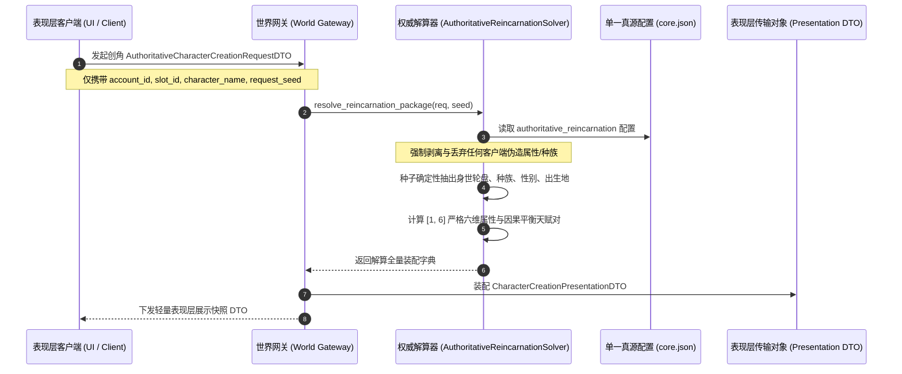

# 施工细则：世界内角色权威创建与时空装配施工细则 —— 阶段1：角色权威创建请求契约与后端生成拓扑设计

> [!NOTE]
> **【施工目标】**：定义世界内角色权威创建流水线的数据契约体系与后端生成拓扑架构。确立客户端仅声明意向、后端权威解算的零信任创建范式；制定 `AuthoritativeCharacterCreationRequestDTO`（入参请求契约）与 `CharacterCreationPresentationDTO`（出参表现层契约）；设计纯配置驱动的后端拓扑结构与种子确定性解算流；严禁客户端向后端注水或篡改六维属性与种族身世。
> **案卷全局共享上下文**：👉 [KALAR-DEV-2026-ST108-ATT_附件_案卷共享契约与上下文.md](KALAR-DEV-2026-ST108-ATT_附件_案卷共享契约与上下文.md)。
> **施工开始日期**：2026-10-11
> 📍 **卷内快速直达**：[ATT 共享附件](KALAR-DEV-2026-ST108-ATT_附件_案卷共享契约与上下文.md) ｜ **阶段1 (当前)** ｜ [阶段2](KALAR-DEV-2026-ST108-002_阶段2_身世属性权威解算器与背包装备物理水化实现.md) ｜ [阶段3](KALAR-DEV-2026-ST108-003_阶段3_世界时空连续性绑定与事务编排门面加固.md) ｜ [阶段4](KALAR-DEV-2026-ST108-004_阶段4_无头安全测试矩阵与全域门禁验收.md)

---

## 📌 第一性原理溯源指针

* **精准上游规范指针**：[AGENTS.md 工作区全局刚性公理](../../../../../../AGENTS.md) §二.1、§三、§四.1
* **核心不变量约束断言**：
  - `Inv-CREATION-ZERO-TRUST-1 (创角零信任请求契约)`：客户端仅提供账号标识、槽位索引、世界标识、角色名称与可选请求种子，任何属性数值、种族身世、金币道具由后端闭门解算，严禁客户端透传或覆盖；
  - `Inv-CREATION-DETERMINISM-2 (全域确定性生成拓扑)`：相同种子与请求三元组（账号、名称、槽位）在相同配置版本下必然产出同构且完全可回放的角色身世、属性与天赋分布，杜绝不可控的随机数漂移；
  - `Inv-CREATION-PRESENTATION-3 (表现层无副作用快照契约)`：表现层仅消费 `CharacterCreationPresentationDTO` 快照，该 DTO 为只读不可变投影，不直接持有游戏实体或场景树引用；
  - `Inv-CREATION-CONFIG-SOURCE-4 (单一事实真源配置驱动)`：身世轮盘池、种族映射、六维属性上下界与因果天赋对统一收敛于 `config/domains/character_creation/core.json` 的 `authoritative_reincarnation` 节点，代码零硬编码。
* **防漂移最高指示**：严禁客户端直接构造或修改角色实体属性；严禁绕过后端权威解算器直接落盘角色档案。

---

## 一、 第一性原理与架构解耦契约

### 1. 角色权威生成拓扑与零信任解耦架构

传统 Web/客户端 RPG 常常由前端自由选点或分配属性后提交给服务端，极易造成作弊、数据漂移或前后端逻辑分歧。卡拉尔世界引擎恪守后端绝对权威与零信任原则：

### 2. 核心数据契约设计

#### 2.1 入参请求契约 (`AuthoritativeCharacterCreationRequestDTO`)

| 字段名称 | 类型 | 缺省回退值 | 契约约束与职责语义 |
| :--- | :--- | :--- | :--- |
| `account_id` | `String` | `""` | 账户唯一标识符，网关校验所有权 |
| `slot_id` | `int` | `0` | 创角物理槽位编号（0~2） |
| `world_id` | `String` | `""` | 目标世界归属标识符 |
| `character_name` | `String` | `""` | 玩家角色名称，经字符过滤与长度校验 |
| `request_seed` | `int` | `0` | 客户端发起请求时的伪随机参考种子（0 表示由服务端自主派生） |
| `extra_custom_fields` | `Dictionary` | `{}` | 扩展自定义字段字典（严格零信任清洗，忽略任何属性/数值覆盖） |

#### 2.2 出参表现契约 (`CharacterCreationPresentationDTO`)

| 字段名称 | 类型 | 缺省回退值 | 契约约束与职责语义 |
| :--- | :--- | :--- | :--- |
| `character_id` | `String` | `""` | 后端权威签发的角色唯一 UUID |
| `character_name` | `String` | `""` | 校验通过的角色标准显示名称 |
| `origin_id` | `String` | `""` | 权威轮盘解算出的身世标识符 |
| `origin_name` | `String` | `""` | 身世本地化展示名称 |
| `origin_desc` | `String` | `""` | 身世详细背景长文本 |
| `race_id` | `String` | `""` | 身世绑定的种族标识符（如 HUMAN, ELF） |
| `race_name` | `String` | `""` | 种族本地化展示名称 |
| `gender` | `String` | `""` | 权威抽取的生理性别（MALE / FEMALE） |
| `attributes_radar` | `Dictionary` | `{}` | [1, 6] 严格区间六维属性雷达图数据 |
| `physiology_summary` | `Dictionary` | `{}` | 生命、魔力、耐力与最大负重等生理机能概况 |
| `wallet_summary` | `Dictionary` | `{}` | 初始金币与声望值汇总 |
| `starter_equipment` | `Array[Dictionary]` | `[]` | 初始穿戴武器与背包物品展示列表 |
| `world_chronicle` | `Dictionary` | `{}` | 出生地环境与世界纪元元数据 |
| `prologue_preview` | `Dictionary` | `{}` | 序章前瞻阶段与剧情指针数据 |

---

## 二、 命令式施工执行清单 (Agent Execution Checklist)

- [x] Step 1: 编制 Phase 112 阶段1角色权威创建请求契约与拓扑设计规范文档
- [x] Step 2: 设计并定义 AuthoritativeCharacterCreationRequestDTO 请求传输契约类
- [x] Step 3: 设计并定义 CharacterCreationPresentationDTO 表现层展示契约类
- [x] Step 4: 规范单一真源配置 authoritative_reincarnation 拓扑节点及值域范围
- [x] Step 5: 验证 DTO 类序列化/反序列化及深拷贝边界安全性

---

## 三、 DoD 验收矩阵 (DoD Matrix)

| 检验项 ID | 校验目标 | 验证输入 | 预期输出断言 |
| :--- | :--- | :--- | :--- |
| TC-CREAT-DTO-01 | 入参请求 DTO 默认实例化与重置 | 默认构造 `AuthoritativeCharacterCreationRequestDTO.new()` 并调用 `reset_state()` | 字段初值完全清空，`account_id` 为空，`slot_id` 为 0，`request_seed` 为 0 |
| TC-CREAT-DTO-02 | 入参请求 DTO 序列化往返一致性 | 构造含合法 `character_name`、`account_id` 与扩展字段的 DTO，执行 `to_dto()` 与 `from_dto()` | 往返反序列化实例字段与入参字典 100% 深度对齐 |
| TC-CREAT-DTO-03 | 表现层展示 DTO 强类型安全转换 | 传入包含 `attributes_radar`、`starter_equipment` 数组的字典至 `from_dto()` | 正确解析为类型化属性，深拷贝隔离防外溢污染 |
| TC-CREAT-ZERO-04 | 零信任字段隔离断言 | 客户端向 `extra_custom_fields` 注入伪造的 `{"attributes": {"STR": 999}}` | DTO 仅原样携带该扩展字典，不影响核心字段声明，由下游解算器彻底忽略 |
