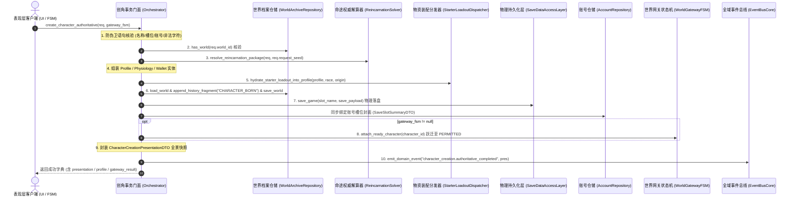

# 施工细则：世界内角色权威创建与时空装配系统 —— 阶段3：世界时空连续性绑定与事务编排门面加固

> [!NOTE]
> **【施工目标】**：实现世界内角色权威创建装配事务门面（`WorldCharacterCreationOrchestrator`），构建贯穿输入防伪校验、命途权威解算、实体装配、背包装备物理水化、世界时空因果连续性锚定、底层存储物理落盘、账号封面绑定与网关状态自动跃迁回挂的十步闭环流水线；确保世界历史片段严格只增追加，杜绝无归属游离角色；返回表现层全景只读呈现信封并发布全域领域事件。
> **案卷全局共享上下文**：👉 [KALAR-DEV-2026-ST108-ATT_附件_案卷共享契约与上下文.md](KALAR-DEV-2026-ST108-ATT_附件_案卷共享契约与上下文.md)。
> **施工开始日期**：2026-10-11
> 📍 **卷内快速直达**：[ATT 共享附件](KALAR-DEV-2026-ST108-ATT_附件_案卷共享契约与上下文.md) ｜ [阶段1](KALAR-DEV-2026-ST108-001_阶段1_角色权威创建请求契约与后端生成拓扑设计.md) ｜ [阶段2](KALAR-DEV-2026-ST108-002_阶段2_身世属性权威解算器与背包装备物理水化实现.md) ｜ **阶段3 (当前)** ｜ [阶段4](KALAR-DEV-2026-ST108-004_阶段4_无头安全测试矩阵与全域门禁验收.md)

---

## 📌 第一性原理溯源指针

* **精准上游规范指针**：[AGENTS.md 工作区全局刚性公理](../../../../../../AGENTS.md) §二.1、§三、§四.1
* **核心不变量约束断言**：
  - `Inv-CONTINUITY-BORN-1 (世界时空因果锚定公理)`：任何新角色诞生必须原子锚定在具体单机世界实例（`WorldInstance`）的当前世界时钟（`world_time`）上，向其历史片段列表（`history_fragments`）严格只增追加，杜绝无世界归属的游离角色与时空断裂；
  - `Inv-ORCHESTRATOR-ATOMIC-2 (创角事务原子落盘与账号封面同步)`：角色创建事务涵盖请求防伪校验、命途解算、实体组装、物资物理水化、世界历史追加、底层物理存盘（`SaveDataAccessLayer`）与账号封面更新（`AccountRepository`），任何阶段失败立即阻断，杜绝半成品质押；
  - `Inv-GATEWAY-HANDOFF-3 (网关状态自动跃迁无缝回挂)`：若传入 `WorldGatewayFSM`，创角成功后自动调用 `attach_ready_character(profile.character_id)`，驱动网关从 `CHARACTER_PENDING` / `SLOT_WORLD_RESOLVED` 跃迁至 `WORLD_ENTRY_PERMITTED`，为后续进入世界提供权威凭据；
  - `Inv-EVENT-BROADCAST-4 (全域领域事件发布)`：事务成功完结时统一发布 `character_creation.authoritative_completed` 领域事件，载荷携带全景呈现快照契约 `CharacterCreationPresentationDTO`。
* **业务实现最高指示**：严禁角色创建绕过 WorldArchiveRepository 独立存在；严禁跳过防伪校验与安全断言直接持久化；编排门面内部必须保持圈复杂度 CC <= 15，消除循环内堆瞬态分配。

---

## 一、 第一性原理与架构解耦契约

### 1. 创角时空装配事务编排拓扑与第一性原理

在卡拉尔世界引擎中，角色并非凭空产生的抽象数据结构，而是诞生于具体世界时空切片中的物理实体。创角流程必须在保证零信任安全的前提下，将角色生命周期与世界时钟精准锁定：

### 2. 十步原子装配流水线设计契约

1. **输入校验 (Input Validation & Guard Clauses)**：
   - 请求对象非空，账号标识、世界标识非空；
   - 角色名称去除首尾空白后长度必须在 `[2, 16]` 字符区间；
   - 杜绝包含任何路径与控制非法字符（如 `/`, `\`, `:`, `*`, `?`, `"`, `<`, `>`, `|`, `\n`, `\r`, `\t`）；
   - 槽位索引必须大于 0。
2. **世界有效性核验 (World Validity Check)**：
   - 调用 `WorldArchiveRepository.get_instance().has_world(req.world_id)`；
   - 若目标单机世界档案不存在，立即阻断返回 `WORLD_NOT_FOUND`。
3. **权威解算 (Authoritative Reincarnation Solving)**：
   - 委托 `AuthoritativeReincarnationSolver.resolve_reincarnation_package(req, req.request_seed)`；
   - 剥离客户端篡改字段，纯后端配置与确定性种子派生身世、种族、性别、六维属性、因果天赋对与初始财富。
4. **实体组装 (Entity Assembly)**：
   - 实例化 `CharacterProfile`，填充标识、六维属性底座、成长元数据；
   - 实例化 `CharacterPhysiologySheet`，映射属性等级并与生理参数对齐；
   - 实例化 `CharacterWalletEntity`，设定初始金币与货币换算比率。
5. **物资水化 (Starter Loadout Hydration)**：
   - 委托 `StarterLoadoutDispatcher.hydrate_starter_loadout_into_profile(profile, race_id, origin_id)`；
   - 将配置套件内初始物品实体（`ItemEntity`）物理装配入 `WearableInventoryAggregate`。
6. **世界时空连续性 (Continuity Anchoring & History Chronology)**：
   - 通过仓储加载 `WorldInstance`，提取当前 `world_time`（`tick`, `day`, `month`, `year`）；
   - 构造 `CHARACTER_BORN` 历史片段，记录诞生时间与角色标识，调用 `append_history_fragment` 只增追加并刷盘保存。
7. **物理落盘与账号封面 (Disk Provisioning & Slot Binding)**：
   - 组装全量数据载荷，调用 `SaveDataAccessLayer.save_game(slot_name, save_payload)` 物理刷盘；
   - 获取落盘文件的 SHA256 哈希值，组装 `SaveSlotSummaryDTO` 绑定至 `AccountProfileAggregate`，由 `AccountRepository` 持久化。
8. **网关回挂 (Gateway Handoff)**：
   - 若传入 `WorldGatewayFSM`，自动调用 `gateway_fsm.attach_ready_character(profile.character_id)`；
   - 驱动网关状态从 `CHARACTER_PENDING` 跃迁为 `WORLD_ENTRY_PERMITTED`。
9. **全景呈现信封构造 (Presentation Envelope Assembly)**：
   - 组装 `CharacterCreationPresentationDTO`，聚合六维雷达图、生理概况、装备清单、时空因果与序章引导预览。
10. **全域事件广播 (Domain Event Publishing)**：
    - 调用 `EventBusCore.get_instance().emit_domain_event("character_creation.authoritative_completed", event_payload)` 广播通知表现层与下游系统。

---

## 二、 命令式施工执行清单 (Agent Execution Checklist)

- [x] Step 3.1: 编写 `WorldCharacterCreationOrchestrator` 门面基类与输入防护卫语句
- [x] Step 3.2: 接入 `WorldArchiveRepository` 实施目标世界有效性阻断核验
- [x] Step 3.3: 编排 `AuthoritativeReincarnationSolver` 命途权威解算
- [x] Step 3.4: 构造 `CharacterProfile`、`CharacterPhysiologySheet` 与 `CharacterWalletEntity` 实体
- [x] Step 3.5: 调度 `StarterLoadoutDispatcher` 物理装备入包水化
- [x] Step 3.6: 锚定目标世界时钟，追加 `CHARACTER_BORN` 历史片段并保存 `WorldInstance`
- [x] Step 3.7: 调用 `SaveDataAccessLayer` 物理落盘与 `AccountRepository` 账号槽位封面绑定
- [x] Step 3.8: 联动 `WorldGatewayFSM` 状态机执行 `attach_ready_character` 跃迁
- [x] Step 3.9: 封装 `CharacterCreationPresentationDTO` 全景只读信封
- [x] Step 3.10: 广播 `character_creation.authoritative_completed` 领域事件

---

## 三、 DoD 验收矩阵 (DoD Matrix)

| 检验项 ID | 校验目标 | 验证输入 | 预期输出断言 |
| :--- | :--- | :--- | :--- |
| TC-ORCH-VAL-01 | 非法名称与特殊字符拦截 | 传入含特殊字符 `苍穹/行者` 或超出长度的创角请求 | 返回 `success = false`，错误码为 `FORBIDDEN_CHARACTERS` 或 `INVALID_NAME_LENGTH` |
| TC-ORCH-WORLD-02 | 不存在的目标世界安全阻断 | 传入未创建的世界标识 `WORLD_NON_EXISTENT` | 返回 `success = false`，错误码 `WORLD_NOT_FOUND`，不执行后续解算 |
| TC-ORCH-SOLVER-03 | 纯名字输入后端权威派生 | 仅传入合法名字 `晨曦行者` 与种子 `12345` | 成功解算，六维属性位于 `[1, 6]`，种族与身世由后端完全派生 |
| TC-ORCH-LOADOUT-04 | 初始物资物理水化入包 | 调用权威创角流水线 | `profile.inventory` 与 `equipment` 包含初始物品与穿戴主手武器 |
| TC-ORCH-CHRONO-05 | 目标世界时钟锚定与历史片段只增 | 执行权威创角 | 世界实例的 `history_fragments` 末项为 `CHARACTER_BORN`，记录当前世界时钟 |
| TC-ORCH-GATEWAY-06 | 状态机自动回挂与状态跃迁 | 传入就绪态网关状态机 `WorldGatewayFSM` | 网关状态自动流转为 `WORLD_ENTRY_PERMITTED`，`active_character_id` 成功挂载 |
