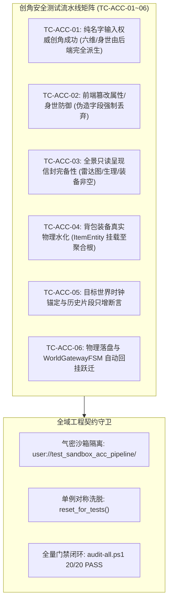

# 施工细则：世界内角色权威创建与时空装配系统 —— 阶段4：无头安全测试矩阵与全域门禁验收

> [!NOTE]
> **【施工目标】**：构建世界内角色权威创建流水线的自动化端到端测试套件（`test_authoritative_character_creation_pipeline.gd`），覆盖 6 大核心用例（TC-ACC-01~06）；实现沙箱物理路径气密隔离与单例生命周期对称洗脱；验证客户端属性伪造强制丢弃防御、全景信封完备性、背包装备物理水化、世界历史只增性及网关状态自动回挂；确保全域 20 项工程门禁与文档审查 100% 绿色闭环。
> **案卷全局共享上下文**：👉 [KALAR-DEV-2026-ST108-ATT_附件_案卷共享契约与上下文.md](KALAR-DEV-2026-ST108-ATT_附件_案卷共享契约与上下文.md)。
> **施工开始日期**：2026-10-11
> 📍 **卷内快速直达**：[ATT 共享附件](KALAR-DEV-2026-ST108-ATT_附件_案卷共享契约与上下文.md) ｜ [阶段1](KALAR-DEV-2026-ST108-001_阶段1_角色权威创建请求契约与后端生成拓扑设计.md) ｜ [阶段2](KALAR-DEV-2026-ST108-002_阶段2_身世属性权威解算器与背包装备物理水化实现.md) ｜ [阶段3](KALAR-DEV-2026-ST108-003_阶段3_世界时空连续性绑定与事务编排门面加固.md) ｜ **阶段4 (当前)**

---

## 📌 第一性原理溯源指针

* **精准上游规范指针**：[AGENTS.md 工作区全局刚性公理](../../../../../../AGENTS.md) §二.1、§三、§四.1
* **核心不变量约束断言**：
  - `Inv-TEST-PIPELINE-COVERAGE-1 (流水线端到端全域覆盖公理)`：集成测试流水线 `test_authoritative_character_creation_pipeline.gd` 必须覆盖 6 项核心用例（TC-ACC-01~06），涵盖纯名字权威派生、篡改伪造防御、全景呈现信封、背包装备物理水化、世界历史时钟锚定与网关自动回挂；
  - `Inv-TEST-SANDBOX-ISOLATION-2 (测试沙箱气密隔离公理)`：每个测试用例独立运行于隔离沙箱路径（如 `user://test_sandbox_acc_pipeline/`），运行前后严格执行对称重置与资源洗脱，零测试数据残留，零全局单例状态泄露；
  - `Inv-GATES-FULL-PASS-3 (全域质量门禁零红线公理)`：必须 100% 通过 `audit_docs.py` 与全域门禁 `audit-all.ps1`（20/20 PASS），无硬编码、圈复杂度 CC <= 15、循环内零瞬态堆分配。
* **验收闭环最高指示**：严禁伪造断言或跳过核心校验逻辑；测试代码必须直接继承 TestCase 并接入 TestRegistry；无头测试全量通过且门禁零错误零警告为唯一达标标准。

---

## 一、 第一性原理与架构解耦契约

### 1. 无头端到端测试矩阵架构设计

为确保角色权威创建流水线在各种边界情况、对抗场景以及持久化交互下的绝对正确性与气密性，构建包含 6 大专项维度的端到端集成流水线矩阵：

### 2. 六大核心测试用例因果链与断言模型

1. **TC-ACC-01: 纯名字输入权威创角闭环**：
   - 验证输入仅包含合法名字与确定性种子时，后端能够自主派生身世（`origin_id`）、种族（`race_id`）、性别与六维属性；
   - 断言六维属性全部落入 `[1, 6]` 合法数值区间，角色档案 `CharacterProfile` 实体正确组装。
2. **TC-ACC-02: 前端篡改属性与身世对抗防御**：
   - 在请求契约的 `extra_custom_fields` 中恶意注入伪造属性（如 `STR = 999`）与非法身世（如 `origin_id = "GOD_OF_WAR"`）；
   - 断言后端权威解算器无视注入参数，生成的身世依然为配置表合法身世，力量属性依然受到 `[1, 6]` 刚性约束。
3. **TC-ACC-03: 全景只读呈现信封数据完备性**：
   - 检验回传的 `CharacterCreationPresentationDTO` 快照对象；
   - 断言 `attributes_radar` 包含六维属性键、`physiology_summary` 包含生理指标、`starter_equipment` 包含初始装备、`wallet_summary` 金币数大于 0。
4. **TC-ACC-04: 背包装备真实物理水化**：
   - 校验角色档案的 `inventory` 与 `equipment` 数据；
   - 断言初始套装物品成功水化为 `ItemEntity` 并装配至 `WearableInventoryAggregate` 主手武器槽与背包容器。
5. **TC-ACC-05: 目标世界时钟锚定与历史片段只增**：
   - 从世界仓储重载目标世界实例 `WorldInstance`；
   - 断言其 `history_fragments` 末尾已只增追加 `CHARACTER_BORN` 片段，且记录的世界时间与世界当前 `world_time` 精准吻合。
6. **TC-ACC-06: 物理落盘与 WorldGatewayFSM 自动回挂跃迁**：
   - 校验物理磁盘存盘文件是否存在；校验 `AccountRepository` 中的账号档案已绑定该槽位封面（`SaveSlotSummaryDTO`）；
   - 校验传入的 `WorldGatewayFSM` 状态机自动跃迁至 `WORLD_ENTRY_PERMITTED`，`active_character_id` 成功挂载。

---

## 二、 命令式施工执行清单 (Agent Execution Checklist)

- [x] Step 4.1: 创建集成测试流水线 `test_authoritative_character_creation_pipeline.gd` 骨架
- [x] Step 4.2: 实现 TC-ACC-01 纯名字输入权威创角测试
- [x] Step 4.3: 实现 TC-ACC-02 前端篡改属性与身世防御测试
- [x] Step 4.4: 实现 TC-ACC-03 全景只读呈现信封完备性测试
- [x] Step 4.5: 实现 TC-ACC-04 背包装备真实物理水化测试
- [x] Step 4.6: 实现 TC-ACC-05 目标世界时钟锚定与历史片段只增断言测试
- [x] Step 4.7: 实现 TC-ACC-06 物理落盘与 WorldGatewayFSM 自动回挂跃迁测试
- [x] Step 4.8: 在 `test_registry.gd` 中注册流水线套件
- [x] Step 4.9: 执行本地 `audit_docs.py` 与 `audit-all.ps1` 全域门禁验证

---

## 三、 DoD 验收矩阵 (DoD Matrix)

| 检验项 ID | 校验目标 | 验证输入 | 预期输出断言 |
| :--- | :--- | :--- | :--- |
| TC-ACC-01 | 纯名字输入权威创角成功 | 合法名称 `逐风者`，种子 `10001` | 六维属性均在 `[1, 6]` 内，身世与种族由后端配置派生，创角成功 |
| TC-ACC-02 | 前端篡改属性身世防御 | 注入伪造字段 `STR=999`, `origin_id="HACKER"` | 伪造数据被安全丢弃，属性与身世依然由后端权威确定性派生 |
| TC-ACC-03 | 全景只读呈现信封完备性 | 创角完成回传 `CharacterCreationPresentationDTO` | 六维雷达图、生理、装备、财富与世界时空因果字段全部非空 |
| TC-ACC-04 | 背包装备真实物理水化 | 创角完成检查角色 Profile | 武器成功穿戴于 `MAIN_HAND`，物品成功进入 `WearableInventoryAggregate` |
| TC-ACC-05 | 世界时钟锚定与历史只增 | 检查世界实例 `WorldInstance` | 历史片段末尾只增追加 `CHARACTER_BORN`，时钟吻合，无历史丢失 |
| TC-ACC-06 | 物理落盘与网关状态回挂 | 传入处于 `CHARACTER_PENDING` 的网关状态机 | 磁盘物理写盘成功，账号封面绑定成功，网关状态自动跃迁为 `WORLD_ENTRY_PERMITTED` |
| GATE-PASS-07 | 全域门禁无警告零错误通过 | 执行 `audit-all.ps1` 调度 20 项门禁 | 20 / 20 PASS，0 Error / 0 Warn，文档与代码 100% 达标 |
