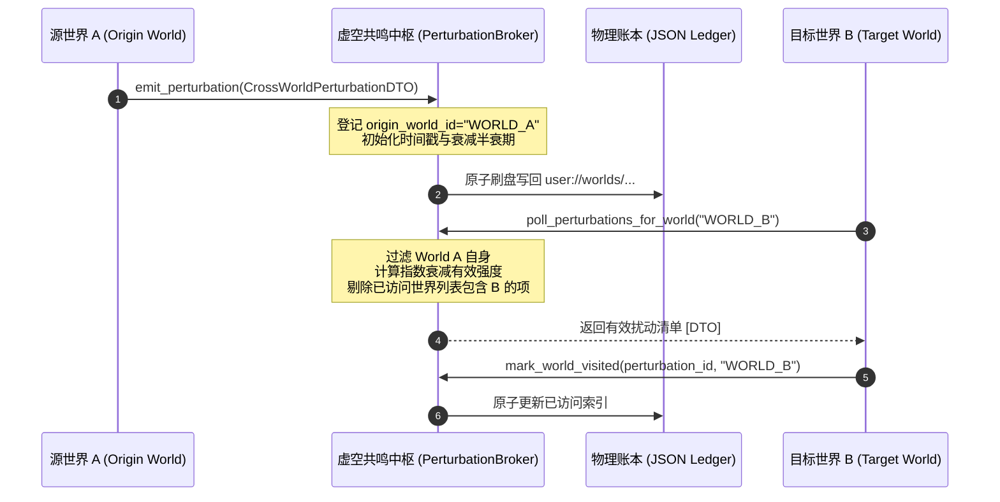

# 施工细则：剧情MOD库相对加载因果扰动与世界绑定引擎施工细则 —— 阶段2：DAG多包动态组装与因果虚空共鸣总线实现

> [!NOTE]
> **【施工目标】**：实现跨世界因果虚空共鸣扰动总线与多 MOD 包 DAG 动态装配机制。定义 `CrossWorldPerturbationDTO` 跨世界扰动载荷契约；落地单例与支持测试隔离的 `CrossWorldPerturbationBroker` 扰动中枢；建立基于指数半衰期（默认 86400 秒）的能量连续衰减模型与定容修剪策略；打通跨世界扰动发射、非源世界未访问过滤轮询、访问标记与物理原子刷盘闭环。
> **案卷全局共享上下文**：👉 [KALAR-DEV-2026-ST109-ATT_附件_案卷共享契约与上下文.md](KALAR-DEV-2026-ST109-ATT_附件_案卷共享契约与上下文.md)。
> **施工开始日期**：2026-10-11
> 📍 **卷内快速直达**：[ATT 共享附件](KALAR-DEV-2026-ST109-ATT_附件_案卷共享契约与上下文.md) ｜ [阶段1](KALAR-DEV-2026-ST109-001_阶段1_MOD相对加载路径与拓扑排序契约设计.md) ｜ **阶段2 (当前)** ｜ [阶段3](KALAR-DEV-2026-ST109-003_阶段3_世界MOD锁文件机制与网关防坏档守卫加固.md) ｜ [阶段4](KALAR-DEV-2026-ST109-004_阶段4_无头安全测试矩阵与全域门禁验收.md)

---

## 📌 第一性原理溯源指针

* **精准上游规范指针**：[AGENTS.md 工作区全局刚性公理](../../../../../../AGENTS.md) §二.1、§二.2、§三、§四.1
* **核心不变量约束断言**：
  - `Inv-PERTURB-ISOLATION-1 (跨世界共鸣沙盒隔离)`：扰动信息在源世界发射时必须记录 `origin_world_id`，且在轮询时严格排斥源世界自身与已访问记录中的世界，保障跨世界单向涟漪共鸣；
  - `Inv-PERTURB-DECAY-2 (物理半衰期连续衰减)`：共鸣有效强度遵循经典放射性半衰期方程 $I(t) = I_0 \times (0.5)^{\Delta t / T_{half}}$，当强度低于有界下限阈值（0.01）时判定为完全消散并安全回收；
  - `Inv-PERTURB-ATOMIC-3 (账本落盘原子事务安全)`：所有全局共鸣账本持久化写入临时文件后执行原子替换，杜绝断电或崩溃导致的 JSON 文件截断损坏；
  - `Inv-PERTURB-CONFIG-4 (全局账本配置单源收敛)`：账本文件路径、默认半衰期时长与最大保留条目统一收敛于 `config/domains/narrative_orchestration/core.json` 的 `perturbation_broker` 节点，代码零硬编码。
* **防漂移最高指示**：严禁在循环体内触发堆分配或非确定性随机；严禁将未衰减校验的脏扰动广播至跨域表现层。

---

## 一、 第一性原理与架构解耦契约

### 1. 因果虚空共鸣与跨世界扰动总线架构

在多元宇宙或多存档世界设定下，一个世界内的重大剧情因果事件（如神祇陨落、始源魔素爆发）将在因果虚空中激起共鸣扰动，并跨世界被其他世界捕获：

### 2. 核心数据契约设计 (`CrossWorldPerturbationDTO`)

扰动载荷通过 `CrossWorldPerturbationDTO` 进行强类型传输：

| 字段名称 | 类型 | 缺省回退值 | 契约约束与职责语义 |
| :--- | :--- | :--- | :--- |
| `perturbation_id` | `String` | `""` | 扰动全局唯一标识符（如 `ptb_astral_burst_001`） |
| `origin_world_id` | `String` | `""` | 激起共鸣的源世界 ID |
| `emitted_timestamp_utc` | `int` | `0` | 发射时的 UTC Unix 时间戳（秒） |
| `resonance_intensity` | `float` | `1.0` | 初始共鸣强度标量（标准基线 1.0） |
| `decay_half_life_seconds` | `int` | `86400` | 半衰期时长（默认 24 小时 = 86400 秒） |
| `semantic_tags` | `Array[String]` | `[]` | 因果语义标签（如 `void_cataclysm`, `mana_surge`） |
| `flavor_i18n_key` | `String` | `""` | 扰动回响的本地化叙事文案 Key |
| `perturbation_seed` | `int` | `0` | 目标世界据此派生确定性次生事件的伪随机种子 |
| `visited_world_ids` | `Array[String]` | `[]` | 已经消费或感知过该扰动的世界 ID 列表 |

### 3. 扰动中枢管理管线 (`CrossWorldPerturbationBroker`)

中枢服务采用轻量单例架构，提供四大核心生命周期操作：
1. **发射扰动 (`emit_perturbation`)**：补全缺省时间戳与哈希种子，自动将源世界录入 `visited_world_ids`，更新内存表并原子刷盘；
2. **世界拉取过滤 (`poll_perturbations_for_world`)**：依据目标世界 ID 进行过滤，剔除源世界自身、已访问世界，并按实时时间计算半衰期衰减值，剔除强度低于 0.01 的衰竭扰动；
3. **标记访问 (`mark_world_visited`)**：将目标世界 ID 幂等追加至扰动的访问列表，并原子刷盘同步；
4. **定容修剪 (`prune_decayed_perturbations`)**：计算全量扰动的实时有效强度，清理完全衰竭项；若超出最大容量上限（如 1000 条），按时间戳修剪过剩条目。

---

## 二、 命令式施工执行清单 (Agent Execution Checklist)

- [x] Step 1: 编制 Phase 113 阶段2 技术规范与总线架构设计文档
- [x] Step 2: 扩展 `config/domains/narrative_orchestration/core.json` 的 `perturbation_broker` 配置节点
- [x] Step 3: 实现 `CrossWorldPerturbationDTO` 跨世界扰动传输对象与序列化
- [x] Step 4: 实现 `CrossWorldPerturbationBroker` 扰动中枢服务与测试隔离沙盒
- [x] Step 5: 实现半衰期衰减方程、原子落盘、世界去重过滤与定容修剪机制

---

## 三、 DoD 验收矩阵 (DoD Matrix)

| 检验项 ID | 校验目标 | 验证输入 | 预期输出断言 |
| :--- | :--- | :--- | :--- |
| TC-PTB-DTO-01 | 跨世界扰动 DTO 默认实例化与重置 | 默认构造 `CrossWorldPerturbationDTO.new()` 并调用 `reset_state()` | 字段初值完全清空：`resonance_intensity == 1.0`，`decay_half_life_seconds == 86400` |
| TC-PTB-DTO-02 | 跨世界扰动 DTO 往返序列化一致性 | 构造含合法 `perturbation_id`、`origin_world_id` 与语义标签字典，执行往返转换 | 实例字段与字典数据 100% 深度等价 |
| TC-PTB-EMIT-03 | 扰动发射与源世界自旋隔离 | 在 Broker 发射源世界为 `WORLD_A` 的扰动 | `emit_perturbation` 成功，且 `visited_world_ids` 自动包含 `WORLD_A` |
| TC-PTB-POLL-04 | 目标世界轮询与异源过滤 | 使用 `WORLD_A` 与 `WORLD_B` 分别拉取 | `WORLD_A` 拉取结果为空；`WORLD_B` 成功拉取到该扰动 |
| TC-PTB-VISIT-05 | 世界访问登记幂等写回 | 对已拉取扰动执行 `mark_world_visited("ptb_01", "WORLD_B")` | 二次使用 `WORLD_B` 轮询返回空列表，物理账本成功记录 |
| TC-PTB-DECAY-06 | 半衰期衰减强度方程解算 | 传入初始强度 1.0、半衰期 86400，模拟过去 86400 秒与 172800 秒 | 衰减计算值分别精确收敛于 0.5 与 0.25 |
| TC-PTB-PRUNE-07 | 衰退超期与定容自动修剪 | 注入衰减强度低于 0.01 的历史扰动并调用 `prune_decayed_perturbations()` | 失效扰动被准确清出内存与物理账本，返回修剪计数 |
