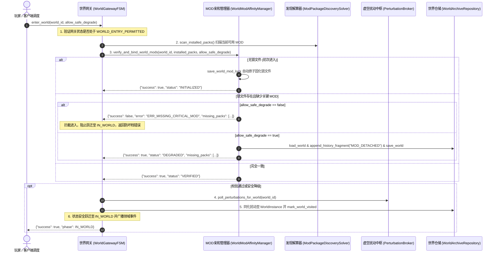

# 施工细则：剧情MOD库相对加载因果扰动与世界绑定引擎施工细则 —— 阶段3：世界MOD锁文件机制与网关防坏档守卫加固

> [!NOTE]
> **【施工目标】**：实现世界专属剧情 MOD 锁文件管理机制（`WorldModAffinityManager`）与世界网关进入守卫加固（`WorldGatewayFSM`）。为每个单机世界建立气密级 `world_mod_lock.json` 亲和锁；实现初次进入自动固化、二次进入严格一致性校验、关键 MOD 缺失网关拦截防坏档及安全降级追加 `MOD_DETACHED` 历史片段闭环；在网关 `enter_world` 阶段同化外部虚空因果扰动并更新世界实例历史。
> **案卷全局共享上下文**：👉 [KALAR-DEV-2026-ST109-ATT_附件_案卷共享契约与上下文.md](KALAR-DEV-2026-ST109-ATT_附件_案卷共享契约与上下文.md)。
> **施工开始日期**：2026-10-11
> 📍 **卷内快速直达**：[ATT 共享附件](KALAR-DEV-2026-ST109-ATT_附件_案卷共享契约与上下文.md) ｜ [阶段1](KALAR-DEV-2026-ST109-001_阶段1_MOD相对加载路径与拓扑排序契约设计.md) ｜ [阶段2](KALAR-DEV-2026-ST109-002_阶段2_DAG多包动态组装与因果虚空共鸣总线实现.md) ｜ **阶段3 (当前)** ｜ [阶段4](KALAR-DEV-2026-ST109-004_阶段4_无头安全测试矩阵与全域门禁验收.md)

---

## 📌 第一性原理溯源指针

* **精准上游规范指针**：[AGENTS.md 工作区全局刚性公理](../../../../../../AGENTS.md) §二.1、§二.2、§三、§四.1
* **核心不变量约束断言**：
  - `Inv-MOD-LOCK-AFFINITY-1 (世界与MOD物理亲和锁绑定公理)`：每个单机世界实例（`WorldInstance`）在初次挂载剧情 MOD 进入游戏时，必须将当前激活的 MOD 清单原子固化至 `user://worlds/sp/<world_id>/world_mod_lock.json`，形成世界专属的亲和指纹；
  - `Inv-MOD-LOCK-GUARD-2 (防坏档气密守卫与严禁跃迁公理)`：二次进入世界时，若已安装 MOD 列表中缺少锁文件中记录的关键依赖包且未显式声明安全降级，网关状态机必须强行拦截，阻止跃迁至 `IN_WORLD`，杜绝悬挂数据导致的坏档与崩溃；
  - `Inv-MOD-SAFE-DEGRADE-3 (安全降级历史追溯与单调片段公理)`：当且仅当显式开启 `allow_safe_degrade` 时，允许在缺失非核心 MOD 的情况下进入世界，但必须向世界实例 `history_fragments` 单调只增追加 `MOD_DETACHED` 历史片段，记录脱落时间戳与包标识；
  - `Inv-VOID-ASSIMILATION-4 (虚空共鸣扰动进入世界权威同化公理)`：网关进入世界通过安全守卫后，自动从 `CrossWorldPerturbationBroker` 轮询当前世界尚未捕获的有效虚空扰动，将其同化记录为世界历史片段并标记已访问，完成跨世界因果涟漪闭环。
* **业务实现最高指示**：严禁无锁文件随意变更世界内的 MOD 拓扑；严禁跳过网关守卫直接篡改 `WorldGatewayFSM` 状态跃迁至 `IN_WORLD`。

---

## 一、 第一性原理与架构解耦契约

### 1. 世界 MOD 锁文件机制与网关防坏档流程拓扑

在卡拉尔世界引擎中，剧情 MOD 深度嵌入世界运行时的因果 DAG 图与实体生成逻辑。若用户在世界游玩过程中随意卸载核心 MOD，将导致存档加载因丢失脚本或节点而产生不可逆坏档。因此必须通过 `WorldModAffinityManager` 与 `WorldGatewayFSM` 构建双重防御：

### 2. 核心组件契约与防坏档设计

1. **锁文件规范 (`world_mod_lock.json`)**：
   - 存储路径：`user://worlds/sp/<world_id>/world_mod_lock.json`（支持测试沙箱隔离路径）；
   - 元数据包：包含 `format_version`、`world_id`、`locked_timestamp_utc`、`locked_packs`（含包标识、版本、优先级与依赖）。
2. **三态裁定逻辑 (`verify_and_bind_world_mods`)**：
   - `INITIALIZED`：世界首度进入，将当前安装的所有包列表作为初始锁原子刷盘；
   - `VERIFIED`：当前安装包完整覆盖锁文件所要求的全部包标识；
   - `ERR_MISSING_CRITICAL_MOD`：缺少关键 MOD 且未允许降级，守卫直接阻断返回；
   - `DEGRADED`：允许降级时，向 `WorldInstance` 记录脱落片段 `MOD_DETACHED`，允许世界以基础存根继续运行。
3. **网关虚空同化 (`_assimilate_perturbations`)**：
   - 在网关成功跃迁至 `IN_WORLD` 之前，拉取外部共鸣扰动并以 `VOID_PERTURBATION_ASSIMILATED` 追加至世界历史，同时回写已访问状态。

---

## 二、 命令式施工执行清单 (Agent Execution Checklist)

- [x] Step 3.1: 编制 Phase 113 阶段3 世界 MOD 锁文件机制与网关防坏档技术规范
- [x] Step 3.2: 实现 `WorldModAffinityManager` 领域服务，支持锁文件读写、原子落盘与一致性校验
- [x] Step 3.3: 实现 `verify_and_bind_world_mods` 的首度固化、完全匹配、坏档拦截与安全降级分支
- [x] Step 3.4: 改造 `WorldGatewayFSM.enter_world` 流程，接入 MOD 亲和校验与虚空扰动同化
- [x] Step 3.5: 确保 `WorldGatewayFSM` 既有接口 100% 向后兼容与圈复杂度 CC <= 15

---

## 三、 DoD 验收矩阵 (DoD Matrix)

| 检验项 ID | 校验目标 | 验证输入 | 预期输出断言 |
| :--- | :--- | :--- | :--- |
| TC-LOCK-INIT-01 | 世界初次进入 MOD 锁文件自动固化 | 空世界目录首次调用 `verify_and_bind_world_mods` | 物理磁盘生成 `world_mod_lock.json`，返回 `INITIALIZED` 状态 |
| TC-LOCK-VERIFY-02 | 已固化 MOD 完全一致校验成功 | 传入与锁文件完全一致的已安装 MOD 清单 | 返回 `{"success": true, "status": "VERIFIED"}` |
| TC-LOCK-GUARD-03 | 关键 MOD 缺失网关防坏档拦截阻断 | 锁文件含 MOD_A，已安装清单缺失 MOD_A 且 `allow_safe_degrade = false` | 返回 `ERR_MISSING_CRITICAL_MOD`，网关禁止跃迁至 `IN_WORLD` |
| TC-LOCK-DEGRADE-04 | 允许安全降级追加脱落历史片段 | 缺少 MOD_A 但传入 `allow_safe_degrade = true` | 返回 `DEGRADED`，世界实例历史片段末尾成功追加 `MOD_DETACHED` |
| TC-GW-ENTER-05 | 网关正式进界拉取并同化外部虚空扰动 | 网关调用 `enter_world()` 且虚空账本存在其他世界的有效扰动 | 状态成功跃迁至 `IN_WORLD`，扰动被同化入世界历史并标记为已访问 |
| TC-GW-BYPASS-06 | 状态机气密防护与向后兼容 | 非 `WORLD_ENTRY_PERMITTED` 阶段或空参数调用 `enter_world()` | 绕过行为被直接阻断，既有无参调用行为保持 100% 稳定向后兼容 |
