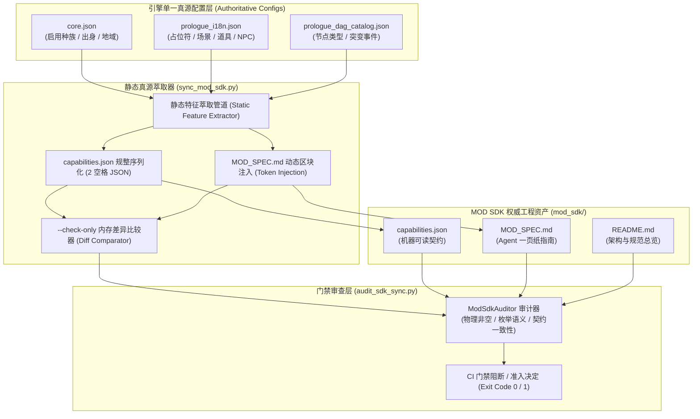

# 施工细则：MOD开发者SDK自动同步与联机安全净化引擎施工细则 —— 阶段1：SDK权威萃取器与契约防漂移自动化系统

> [!NOTE]
> **【施工目标】**：构建卡拉尔引擎 MOD 开发者 SDK 权威萃取器与契约防漂移自动化系统。静态萃取引擎核心真源配置（种族启用目录、DAG 节点类型、文本占位符字典、状态突变事件），生成标准 `mod_sdk/capabilities.json` 与面向创作者 Agent 的一页纸指南 `mod_sdk/MOD_SPEC.md`；研发 `--check-only` 零容忍契约漂移拦截引擎与门禁审计脚本 `audit_sdk_sync.py`，确保 MOD 开发者生态与底层引擎核心演进保持 100% 绝对一致。
> **案卷全局共享上下文**：👉 [KALAR-DEV-2026-ST110-ATT_附件_案卷共享契约与上下文.md](KALAR-DEV-2026-ST110-ATT_附件_案卷共享契约与上下文.md)。
> **施工开始日期**：2026-10-11
> 📍 **卷内快速直达**：[ATT 共享附件](KALAR-DEV-2026-ST110-ATT_附件_案卷共享契约与上下文.md) ｜ **阶段1 (当前)** ｜ [阶段2](KALAR-DEV-2026-ST110-002_阶段2_面向Agent友好型的创作者DevKit工具链与自愈诊断器.md) ｜ [阶段3](KALAR-DEV-2026-ST110-003_阶段3_联机域MOD气密级净化与防越权安全守卫加固.md) ｜ [阶段4](KALAR-DEV-2026-ST110-004_阶段4_无头跨域安全测试矩阵与全域门禁验收.md)

---

## 📌 第一性原理溯源指针

* **精准上游规范指针**：[AGENTS.md 工作区全局刚性公理](../../../../../../AGENTS.md) §二.1、§三、§四.1；[Phase 113 阶段1 细则](../Phase_113_剧情MOD库相对加载因果扰动与世界绑定引擎施工细则/KALAR-DEV-2026-ST109-001_阶段1_MOD相对加载路径与拓扑排序契约设计.md)
* **核心不变量约束断言**：
  - `Inv-SDK-EXTRACT-1 (单源权威萃取不可分)`：MOD SDK 的所有能力描述直接从引擎核心配置（`core.json`、`prologue_i18n.json`、`prologue_dag_catalog.json`）静态萃取，禁止任何人工二道贩运与二次重写；
  - `Inv-SDK-DRIFT-2 (零容忍契约漂移判定)`：CI 与门禁通过 `--check-only` 严格校验磁盘既有文件与内存萃取结果，一旦产生任何不一致立即阻断并抛出确定性非 0 退出码；
  - `Inv-SDK-SPEC-3 (一页纸极简指南权威嵌入)`：`MOD_SPEC.md` 作为面向创作者 Agent 的契约蓝本，必须完整嵌入动态萃取的可用种族、节点类型、占位符与突变事件，保持人机可读；
  - `Inv-SDK-CLEAN-4 (物理沙箱与路径洁癖)`：严格遵守 Path Jail 与工程规范，所有脚本与生成文件保持 LF 换行、2/4 空格对齐与 0 高危技术债。
* **防漂移最高指示**：严禁在 SDK 规范与能力清单中手工硬编码漂移数据；严禁允许包含契约漂移的改动合入主干。

---

## 一、 第一性原理与架构解耦契约

### 1. 权威真源静态萃取与防漂移架构

卡拉尔引擎在支持丰富的剧情与世界 MOD 扩展生态时，核心挑战在于底层引擎能力演进（如新种族解锁、DAG 节点扩展、i18n 占位符调整）与外部开发者 SDK 文档容易脱节。为彻底杜绝此问题，确立“单一真源萃取 + 自动化防漂移门禁”的双轨架构：

### 2. 核心数据契约说明

#### (1) `capabilities.json` 契约定义

包含引擎向 MOD 创作者暴露的权威能力白名单：

| 键名 | 类型 | 来源真源路径 | 职责语义与约束 |
| :--- | :--- | :--- | :--- |
| `supported_races` | `List[str]` | `config/domains/character_creation/core.json` | 当前启用的种族标识符集合（当前启用为 `["HUMAN"]`） |
| `valid_node_types` | `List[str]` | `config/narratives/prologue_dag_catalog.json` | 允许在 DAG 图中声明的四类拓扑节点 |
| `available_placeholders` | `Dict[str, str]` | `config/narratives/prologue_i18n.json` | 本地化文案中支持插值的动态占位符宏字典 |
| `valid_mutation_events` | `List[str]` | 引擎事件流与 DAG 突变契约 | 节点完成时允许触发的标准状态突变事件全集 |
| `origins` | `List[str]` | `core.json` | 预设出身背景列表（参考枚举） |
| `birth_regions` | `List[str]` | `core.json` | 预设降临地域列表（参考枚举） |
| `reference_locations` | `List[str]` | `prologue_i18n.json` | 标准初始场景字典键 |
| `reference_items` | `List[str]` | `prologue_i18n.json` | 标准初始装备道具字典键 |
| `reference_npcs` | `List[str]` | `prologue_i18n.json` | 引导 NPC 标识符字典键 |

#### (2) `MOD_SPEC.md` 一页纸指南动态注入机制

`MOD_SPEC.md` 采用双段式维护：
- 通用规范部分：包括扩展包目录布局、`pack.json` 清单元数据、DAG 有向无环图拓扑不变量、极简实战样例与安全规范；
- 动态能力区块：由 `<!-- AUTOGEN_CAPABILITIES_START -->` 与 `<!-- AUTOGEN_CAPABILITIES_END -->` 围栏包裹，`sync_mod_sdk.py` 在执行时自动将最新的种族、节点、占位符及突变事件以高可读 Markdown 表格形式注入，保证人工修订与自动同步互不干扰。

---

## 二、 命令式施工执行清单 (Agent Execution Checklist)

- [x] Step 1: 编制 Phase 114 阶段1 技术规范与数据契约设计文档
- [x] Step 2: 研发 `WebGames/scripts/py/sync_mod_sdk.py` 静态萃取引擎与 `MOD_SPEC.md` 动态渲染器
- [x] Step 3: 支持 `--check-only` 命令行参数与差异阻断退出码机制
- [x] Step 4: 编写 `WebGames/scripts/py/audit_sdk_sync.py` 门禁审计脚本
- [x] Step 5: 落地 `capabilities.json`、`MOD_SPEC.md` 与 `README.md` 权威工程资产

---

## 三、 DoD 验收矩阵 (DoD Matrix)

| 检验项 ID | 校验目标 | 验证输入 | 预期输出断言 |
| :--- | :--- | :--- | :--- |
| TC-SDK-SYNC-01 | 权威配置静态萃取完整性 | 调用 `extract_capabilities(root)` | 准确萃取 `supported_races` 包含 `HUMAN`、4 类节点类型、5 类占位符与 5 类突变事件 |
| TC-SDK-CHECK-02 | `--check-only` 幂等自检与零漂移断言 | 执行 `python WebGames/scripts/py/sync_mod_sdk.py --check-only` | 退出码为 `0`，标准输出输出 `[OK] MOD SDK 契约与引擎真源保持 100% 绝对一致` |
| TC-SDK-DRIFT-03 | `--check-only` 契约漂移敏锐阻断 | 人工模拟篡改 `capabilities.json` 或修改真源并运行 `--check-only` | 退出码为 `1`，标准错误输出详细统一差分 diff 并明确阻断 CI |
| TC-SDK-AUDIT-04 | 门禁审计脚本物理完整度校验 | 执行 `python WebGames/scripts/py/audit_sdk_sync.py` | 退出码为 `0`，全项检查通过且发现项数量为 0 |
| TC-SDK-SPEC-05 | `MOD_SPEC.md` 动态标记与人机可读性 | 审查 `WebGames/mod_sdk/MOD_SPEC.md` 文本 | 完整包含动态注入标记 `AUTOGEN_CAPABILITIES_START/END` 及清晰 Markdown 表格 |
| TC-SDK-README-06 | SDK 总览与架构文档规范性 | 审查 `WebGames/mod_sdk/README.md` 文本 | 完整陈述 SDK 目录树、Mermaid 创作者工作流图与门禁操作指令 |
