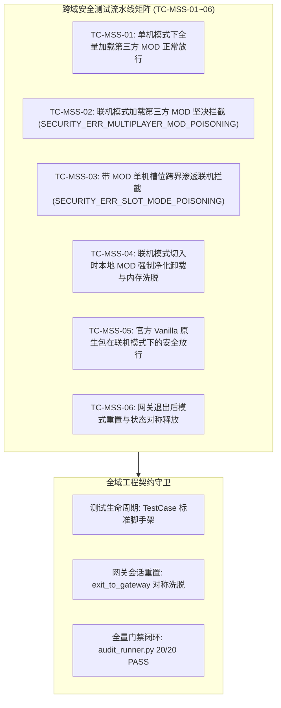

# 施工细则：MOD开发者SDK自动同步与联机安全净化引擎施工细则 —— 阶段4：无头跨域安全测试矩阵与全域门禁验收

> [!NOTE]
> **【施工目标】**：构建 MOD 开发者 SDK 同步与联机安全净化全链路自动化集成测试套件（`test_mod_sdk_and_realm_security_pipeline.gd`），全面覆盖 6 大核心安全用例（TC-MSS-01~06）；实现测试上下文与网关单例状态的对称释放与气密隔离；验证单机模式模组放行、联机第三方模组毒化拦截、单机槽位跨界渗透联机阻断、切入联机本地模组强制净化与内存洗脱、官方 Vanilla 原生包放行以及网关退出对称重置；确保全域 20 项工程门禁与文档审查 100% 绿色闭环。
> **案卷全局共享上下文**：👉 [KALAR-DEV-2026-ST110-ATT_附件_案卷共享契约与上下文.md](KALAR-DEV-2026-ST110-ATT_附件_案卷共享契约与上下文.md)。
> **施工开始日期**：2026-10-11
> 📍 **卷内快速直达**：[ATT 共享附件](KALAR-DEV-2026-ST110-ATT_附件_案卷共享契约与上下文.md) ｜ [阶段1](KALAR-DEV-2026-ST110-001_阶段1_SDK权威萃取器与契约防漂移自动化系统.md) ｜ [阶段2](KALAR-DEV-2026-ST110-002_阶段2_面向Agent友好型的创作者DevKit工具链与自愈诊断器.md) ｜ [阶段3](KALAR-DEV-2026-ST110-003_阶段3_联机域MOD气密级净化与防越权安全守卫加固.md) ｜ **阶段4 (当前)**

---

## 📌 第一性原理溯源指针

* **精准上游规范指针**：[AGENTS.md 工作区全局刚性公理](../../../../../../AGENTS.md) §二.1、§三、§四.1
* **核心不变量约束断言**：
  - `Inv-TEST-PIPELINE-COVERAGE-1 (流水线端到端全量覆盖公理)`：集成测试流水线 `test_mod_sdk_and_realm_security_pipeline.gd` 必须完整覆盖 6 大核心安全用例（TC-MSS-01~06），涵盖单机模组放行、联机毒化拦截、槽位渗透阻断、强制净化洗脱、Vanilla 放行与对称释放；
  - `Inv-TEST-SANDBOX-ISOLATION-2 (测试环境对称洗脱公理)`：每个测试用例独立运行，前后严格调用重置逻辑，杜绝全局单例与网关上下文状态泄露；
  - `Inv-GATES-FULL-PASS-3 (全域工程门禁零红线公理)`：必须 100% 通过 `audit_docs.py` 与 `audit_runner.py`（20/20 PASS），代码圈复杂度 CC <= 15，循环内零瞬态堆分配。
* **验收闭环最高指示**：测试套件继承 TestCase 并接入 TestRegistry；无头测试全量通过且门禁零错误零警告为唯一达标标准。

---

## 一、 第一性原理与架构解耦契约

### 1. 无头跨域安全测试矩阵架构设计

为确保 MOD 开发者 SDK 同步机制与联机安全净化引擎在多模式流转、槽位挂载与并发请求下的绝对稳定性与气密级防御能力，构建包含 6 大专项维度的端到端集成流水线矩阵：

### 2. 六大核心测试用例因果链与断言模型

1. **TC-MSS-01: 单机模式下全量加载第三方 MOD 正常放行**：
   - 构造包含第三方非 Vanilla 模组清单，调用 `AntiBridgeGuard.validate_mod_realm_discipline` 传入单机模式枚举；
   - 断言返回 `allowed == true`，网关成功选定单机模式且活跃模组集合完好保留。
2. **TC-MSS-02: 联机模式加载第三方 MOD 坚决拦截 (SECURITY_ERR_MULTIPLAYER_MOD_POISONING)**：
   - 构造包含第三方本地剧情/数值模组清单，尝试在网关中选择或进入联机模式；
   - 断言返回 `allowed == false`，错误码为 `SECURITY_ERR_MULTIPLAYER_MOD_POISONING`，网关拒绝跃迁至联机状态。
3. **TC-MSS-03: 带 MOD 单机槽位跨界渗透联机拦截 (SECURITY_ERR_SLOT_MODE_POISONING)**：
   - 构造单机模式存档槽位（或绑定单机界域的槽位），尝试在联机模式下进行路由解析或直接校验槽位亲和性；
   - 断言解算器与安全守卫拦截并返回 `SECURITY_ERR_SLOT_MODE_POISONING`，阻止单机脏数据污染联机环境。
4. **TC-MSS-04: 联机模式切入时本地 MOD 强制净化卸载与内存洗脱**：
   - 本地模组清单混杂官方 Vanilla 包与第三方包，触发联机净化流程 `purge_and_fallback_to_vanilla()`；
   - 断言第三方包被全量剥离，仅保留官方核心包，网关事件总线发布 `world_gateway.mods_purged`。
5. **TC-MSS-05: 官方 Vanilla 原生包在联机模式下的安全放行**：
   - 构造仅包含官方 Vanilla 原生模组（如 `vanilla_core`、`official_expansion`）的模组集合；
   - 调用模组界域纪律校验，断言成功放行，验证原生官方资产在联机模式下的合法性。
6. **TC-MSS-06: 网关退出后模式重置与状态对称释放**：
   - 网关在经历了单机选定、模组加载与世界关联后，调用 `exit_to_gateway()`；
   - 断言模式重置为 `UNSELECTED`，槽位、世界与角色标识清空，`active_mods` 全量清空，实现对称洗脱。

---

## 二、 命令式施工执行清单 (Agent Execution Checklist)

- [x] Step 4.1: 创建集成测试流水线 `test_mod_sdk_and_realm_security_pipeline.gd` 骨架，继承 `TestCase`
- [x] Step 4.2: 实现 TC-MSS-01 单机模式下全量加载第三方 MOD 正常放行用例
- [x] Step 4.3: 实现 TC-MSS-02 联机模式加载第三方 MOD 坚决拦截用例
- [x] Step 4.4: 实现 TC-MSS-03 带 MOD 单机槽位跨界渗透联机拦截用例
- [x] Step 4.5: 实现 TC-MSS-04 联机模式切入时本地 MOD 强制净化卸载与内存洗脱用例
- [x] Step 4.6: 实现 TC-MSS-05 官方 Vanilla 原生包在联机模式下的安全放行用例
- [x] Step 4.7: 实现 TC-MSS-06 网关退出后模式重置与状态对称释放用例
- [x] Step 4.8: 在 `test_registry.gd` 中注册流水线套件
- [x] Step 4.9: 执行本地 `audit_docs.py` 与 `audit_runner.py` 全域门禁验证

---

## 三、 DoD 验收矩阵 (DoD Matrix)

| 检验项 ID | 校验目标 | 验证输入 | 预期输出断言 |
| :--- | :--- | :--- | :--- |
| TC-MSS-01 | 单机模式第三方模组沙盒完全放行 | 目标模式 SINGLE_PLAYER，载入第三方本地剧情/数值 MOD | 返回 allowed=true, error_code="", 单机正常放行且模组保留 |
| TC-MSS-02 | 联机模式加载第三方 MOD 坚决拦截 | 目标模式 MULTIPLAYER，载入包含第三方模组列表 | 返回 allowed=false, error_code="SECURITY_ERR_MULTIPLAYER_MOD_POISONING" |
| TC-MSS-03 | 带 MOD 单机槽位跨界渗透联机拦截 | 单机槽位尝试路由绑定至 MULTIPLAYER 模式 | 返回 allowed=false, error_code="SECURITY_ERR_SLOT_MODE_POISONING" |
| TC-MSS-04 | 联机模式切入时本地 MOD 强制净化卸载 | 混合模组切入联机模式调用 purge_and_fallback_to_vanilla | 第三方 MOD 剔除，保留 Vanilla 原生核心，洗脱内存 |
| TC-MSS-05 | 官方 Vanilla 原生包在联机模式下安全放行 | 目标模式 MULTIPLAYER，载入纯官方 Vanilla 模组 | 返回 allowed=true, error_code="", 模组界域纪律放行 |
| TC-MSS-06 | 网关退出后模式重置与状态对称释放 | 调用 exit_to_gateway() 进行生命周期反装配 | selected_mode 重置为 UNSELECTED, active_mods 清空，内存全量洗脱 |
| GATE-PASS-07 | 全域门禁无警告零错误通过 | 执行 audit_runner.py 调度 20 项门禁 | 20 / 20 PASS，0 Error / 0 Warn，文档与代码 100% 达标 |
