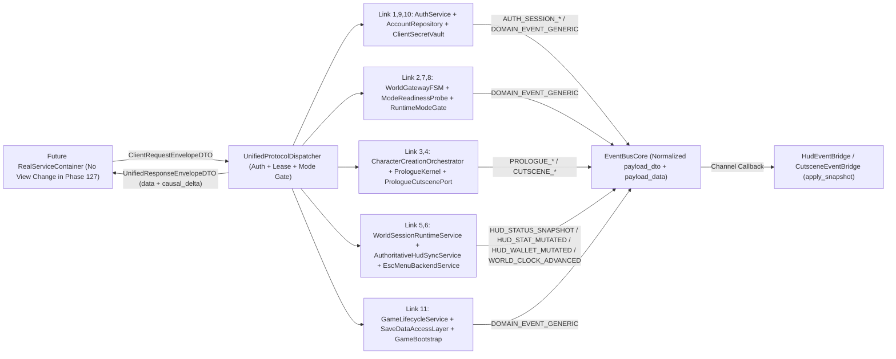

# 施工细则：全链路前后端交互数据流契约与后端闭环改造 —— 阶段1：全链路前后端交互数据流契约与强类型DTO规范

> 施工开始日期: 2026-11-10
> 状态: 已验收

> [!NOTE]
> 【施工目标】
> 在严格遵守"不接前端视图（`frontend/views/**` 零修改）"的前提下，确立从账号注册登录、网关选档、权威创角、序章剧情、主页 HUD 后端常驻同步、ESC 菜单双分流（退出到世界档案 / 直接退出游戏）、退出世界、切换运行网关、退出账号、返回账号首页到程序退出的全 11 环前后端交互数据流规范、统一信封协议动作集、EventBus 双轨载荷兼容标准与核心状态载体 DTO 契约。
> 📍 **卷内快速直达**：[ATT 共享附件](KALAR-DEV-2026-ST123-ATT_附件_案卷共享契约与上下文.md) ｜ **阶段1 (当前)** ｜ [阶段2](KALAR-DEV-2026-ST123-002_阶段2_后端全链业务闭环优化与状态机治理实现规范.md) ｜ [阶段3](KALAR-DEV-2026-ST123-003_阶段3_全域配置驱动协议注册与事件路由扩展规范.md) ｜ [阶段4](KALAR-DEV-2026-ST123-004_阶段4_后端全链路无头验收矩阵与防复发门禁规范.md)

---

## 📌 第一性原理溯源指针

### 1.1 精准上游规范指针

- 统一请求信封真源：[`ClientRequestEnvelopeDTO`](../../../../../backend/domains/world_state/dto/client_request_envelope_dto.gd)
- 统一响应信封真源：[`UnifiedResponseEnvelopeDTO`](../../../../../backend/domains/world_state/dto/unified_response_envelope_dto.gd)
- 会话流转上下文真源：[`SessionFlowContextDTO`](../../../../../backend/domains/lifecycle/dto/session_flow_context_dto.gd)
- 主页 HUD 快照契约：[`HudStatusSnapshotDTO`](../../../../../backend/domains/world_state/dto/hud_status_snapshot_dto.gd) · [`AuthoritativeHudSnapshotDTO`](../../../../../backend/domains/world_state/dto/authoritative_hud_snapshot_dto.gd) · [`HudMutationEventsDTO`](../../../../../backend/domains/world_state/dto/hud_mutation_events_dto.gd)
- 事件总线与信封定义：[`EventBusCore`](../../../../../backend/infrastructure/event_bus/event_bus_core.gd) · [`EventPacket`](../../../../../backend/infrastructure/event_bus/event_packet.gd) · [`EventChannelDefinition`](../../../../../backend/infrastructure/event_bus/event_channel_definition.gd)
- 序章交接与开局流：[`OpeningEventStreamDTO`](../../../../../backend/domains/character_creation/opening_event_stream_dto.gd) · [`PrologueHandoffDTO`](../../../../../backend/domains/character_creation/dto/prologue_handoff_dto.gd)
- 停机协议 DTO：[`GameShutdownDTO`](../../../../../backend/domains/lifecycle/dto/game_shutdown_dto.gd)
- 前端领域接口基线（只读契约参照，本阶段不接视图）：[`IAuthService`](../../../../../frontend/domain_boundary/interfaces/i_auth_service.gd) · [`IWorldService`](../../../../../frontend/domain_boundary/interfaces/i_world_service.gd) · [`ISaveService`](../../../../../frontend/domain_boundary/interfaces/i_save_service.gd) · [`HudEventBridge`](../../../../../frontend/systems/hud_event_bridge.gd) · [`CutsceneEventBridge`](../../../../../frontend/systems/cutscene_event_bridge.gd)

### 1.2 核心不变量约束断言

- **前后端单向黑盒契约不变量 (Inv-FE-BE-CONTRACT-1)**：未来真实前端（`RealServiceContainer`）与当前无头测试仅通过 `UnifiedProtocolDispatcher.dispatch_request(ClientRequestEnvelopeDTO)` 的"命令请求-响应通道"以及 `EventBusCore` 的"服务端权威推送通道"交互；`frontend/views/**` 不得直连后端聚合根或篡改业务状态。
- **EventPacket 双载荷零失真不变量 (Inv-PKT-DUAL-PAYLOAD-2)**：所有通过 `EventBusCore` 广播的交互事件包必须保证强类型 `payload_dto` 与可被 `HudEventBridge` / `CutsceneEventBridge` / 伴侣总线读取的 `payload_data`（标准 `{channel, payload}` 信封或直接字典视图）语义一致，严禁"只填 `payload_dto` 而 `payload_data == null`"导致订阅端静默丢包。
- **跨环状态连续性与密钥零明文不变量 (Inv-SESSION-VAULT-3)**：全 11 环会话流转以 `SessionFlowContextDTO` 及后台常驻运行时会话上下文为唯一真实持有者；会话令牌经 `ClientSecretVault` 掩码托管，任何未持有有效认证会话的非匿名写操作及跨模式热切换均须在协议入口层被显式错误码拒绝。
- **持久化诚实与防残缺覆盖不变量 (Inv-SAVE-INTEGRITY-4)**：任意自动存盘、ESC 存盘或退游落盘动作必须由 `SaveDataAccessLayer` 收集完整多域数据并通过 `SaveReadinessGuard`；严禁写入仅含 `{slot_id, account_id, saved_at}` 的残缺空壳结构覆盖真实存档文件，亦严禁在存档落盘失败时向调用方返回 `success = true`。

### 1.3 防漂移最高指示

本阶段仅制定并固化前后端交互协议、动作路由表、DTO 强类型字段契约与双轨事件载荷标准；严禁在当前方案未获审批前直接改动 `frontend/views/**` 或编写业务实现代码，且所有未来前后端对接参数命名必须与既有 DTO 真实字段（如 `attribute_values`、`attribute_levels`、`current_location_id`、`wallet_gold`、`wallet_mana_monocrystals`）逐字对齐，杜绝双口径映射漂移。

---

## 一、 全 11 环前后端交互逻辑数据流规范

### 1.1 双通道交互总拓扑（未来前端对接蓝图）

未来前端通过实现 `IAuthService` / `IWorldService` / `ISaveService` 等端口契约的 `RealServiceContainer` 发起 `ClientRequestEnvelopeDTO` 请求，统一经由 [`UnifiedProtocolDispatcher`](../../../../../backend/domains/world_state/services/unified_protocol_dispatcher.gd) 校验令牌与人类控制租约后驱动后端各域状态机，并由 `EventBusCore` 与响应 `causal_delta` 单向推送 UI 快照刷新。

### 1.2 全 11 环统一协议动作契约与端口映射矩阵

每条链路规定标准 `domain` + `action_type`、鉴权级别、请求 `payload` 强类型字段、响应 `data` 结构、关联推送事件及未来前端服务端口：

| 链路环节 | domain | action_type | 鉴权与门禁要求 | 请求 payload 核心字段 | 响应 data 核心字段 | 触发广播信道与事件 | 未来前端对接端口 |
| :--- | :--- | :--- | :--- | :--- | :--- | :--- | :--- |
| **1. 注册** | `account` | `REGISTER_ACCOUNT` | 匿名允许；设备指纹 + 用户名密码规则校验 | `username`, `password_plain`, `device_fingerprint`, `auto_login` | `account_id`, `username`, `session_token`（脱敏句柄）, `created_at_utc` | `DOMAIN_EVENT_GENERIC`: `ACCOUNT_REGISTERED` | `IAuthService.register_async` |
| **1. 登录** | `account` | `LOGIN_LOCAL` / `LOGIN_COMPOSITE` | 匿名允许；失败计入退避与审计 | `username`, `password_plain`, `device_fingerprint`, `device_token` | `account_id`, `username`, `session_token`, `slot_summaries`, `entitlements`, `masked_token` | `DOMAIN_EVENT_GENERIC`: `AUTH_SESSION_ESTABLISHED` | `IAuthService.login_async` |
| **2. 网关选档** | `world_gateway` | `ENTER_GATEWAY` / `PROBE_MODES` / `SELECT_MODE` / `LIST_WORLDS` / `SELECT_OR_CREATE_WORLD` | 须持有效 `session_token`；经 `AntiBridgeGuard` | `account_id`, `target_mode`, `world_id`, `slot_id`, `world_name`, `mod_paths` | `gateway_phase`, `selected_mode`, `mode_reports`, `worlds`, `bound_slot_id`, `adapted_mods` | `DOMAIN_EVENT_GENERIC`: `GATEWAY_MODE_SELECTED`, `WORLD_ARCHIVE_SELECTED` | 网关端口 / `IAuthService` 选档流 |
| **3. 创建角色** | `character_creation` | `ROLL_CHARACTER_PREVIEW` / `CREATE_AUTHORITATIVE_CHARACTER` | 须持有效 `session_token` 且网关处于已选模式与世界 | `world_id`, `slot_id`, `character_name`, `selected_race_id`, `selected_gender`, `request_seed`, `extra_custom_fields` | `character_id`, `character_name`, `race_id`, `slot_id`, `starting_location_id`, `opening_quest_line_id`, `attribute_values` | `DOMAIN_EVENT_GENERIC`: `OPENING_EVENT_STREAM` (`OpeningEventStreamDTO`) | 创角端口（零客户端属性直写） |
| **4. 序章剧情** | `prologue` | `START_PROLOGUE` / `ADVANCE_PROLOGUE` / `COMPLETE_PROLOGUE` / `SKIP_PROLOGUE` | 须已绑定 `character_id` 与 `world_id`；CG 由 Hook 触发 | `character_id`, `choice_id`, `skip_requested`, `cutscene_id`, `step_id` | `prologue_phase`, `completed`, `pending_cutscene_id`, `handoff_dto`, `initial_hud_snapshot` | `CUTSCENE_*`, `DOMAIN_EVENT_GENERIC`: `PROLOGUE_COMPLETED`, `WORLD_ENTERED` | `CutsceneEventBridge` + 序章端口 |
| **5. 主页 HUD 常驻同步** | `world_state` | `PULL_HUD_SNAPSHOT` / `TICK_WORLD_CLOCK` / `AGENT_ACTION` | 须已进入活跃世界；受 `HumanControlLeaseManager` 与脏标节流控制 | `character_id`, `delta_minutes`, `action_id`, `args`, `include_agent_slice` | `hud_snapshot` (`HudStatusSnapshotDTO` + `AuthoritativeHudSnapshotDTO`), `clock_state`, `agent_slice` | `HUD_STATUS_SNAPSHOT`, `HUD_STAT_MUTATED`, `HUD_WALLET_MUTATED`, `WORLD_CLOCK_ADVANCED` | `IWorldService.get_hud_snapshot_async` + `HudEventBridge` |
| **6. ESC 菜单服务** | `world_state` | `ESC_GET_MENU_STATE` / `ESC_SAVE_GAME` / `ESC_EXIT_TO_GATEWAY` / `ESC_QUIT_GAME` / `ESC_APPLY_SETTINGS` | 须在世界/暂停态（设置可在网关访问）；存盘须经 `SaveReadinessGuard` | `slot_id`, `auto_save`, `save_before_quit`, `force_quit`, `settings_patch` | `can_save`, `dirty_pending`, `current_mode`, `slot_id`, `saved`, `next_route`, `shutdown_result` | `DOMAIN_EVENT_GENERIC`: `HUD_PAUSED`, `SAVE_COMPLETED` / `ESC_*` | `ISaveService` / `ISystemMenuService` |
| **7. 退出世界** | `world_gateway` | `EXIT_WORLD_TO_GATEWAY` | 可由 `ESC_EXIT_TO_GATEWAY` 或直接调用；阻塞非安全覆盖 | `slot_id`, `auto_save`, `save_if_dirty` | `gateway_phase` (`GATEWAY_ENTERED`), `mode_reports`, `runtime_mode` (`UNSELECTED`), `saved` | `DOMAIN_EVENT_GENERIC`: `WORLD_EXITED_TO_GATEWAY` | ESC 退出至世界档案 |
| **8. 切换运行网关** | `world_gateway` | `SWITCH_GATEWAY_MODE` | **严禁在活跃世界内热切换**；仅允许 `GATEWAY_ENTERED` 状态执行 | `target_mode`, `account_id` | `selected_mode`, `runtime_mode`, `mode_reports`, `cleared_mod_session` | `DOMAIN_EVENT_GENERIC`: `GATEWAY_MODE_SWITCHED` | 网关模式切换器 |
| **9. 退出账号** | `account` | `LOGOUT_ACCOUNT` | 须校验令牌；若仍在世界内先安全退出世界并清理租约 | `account_id`, `save_active_world` | `logged_out`, `revoked_token_prefix`, `account_home_vm` | `DOMAIN_EVENT_GENERIC`: `AUTH_SESSION_REVOKED` | `IAuthService.logout` |
| **10. 账号首页** | `account` | `GET_ACCOUNT_HOME_VIEW_MODEL` | 匿名或已登录均可读；禁止返回敏感凭据或明文令牌 | `include_recent_accounts`, `locale` | `session_active`, `current_account_summary`, `known_accounts`, `gateway_ready`, `bulletin_notices` | 无副作用只读查询（可响应 `AUTH_SESSION_REVOKED` 刷新） | `AccountEntry` 首页初始化 |
| **11. 退出游戏** | `lifecycle` | `REQUEST_GRACEFUL_SHUTDOWN` | 由 `ESC_QUIT_GAME` 或应用关闭触发；严格诚实落盘断言 | `save_before_quit`, `force_quit`, `slot_id`, `reason` | `is_save_completed`, `lifecycle_state`, `failed_stage`, `degraded_resources`, `teardown_completed` | `DOMAIN_EVENT_GENERIC`: `LIFECYCLE_SHUTDOWN_COMPLETED` / `FAILED` | `AppRoot` 关闭闭环 |

### 1.3 EventBus 双轨事件包与桥梁解耦规范

针对现网 [`AuthoritativeHudSyncService`](../../../../../backend/domains/world_state/services/authoritative_hud_sync_service.gd) 仅设置 `packet.payload_dto`（导致 `packet.payload_data == null`）以及 [`HudEventBridge`](../../../../../frontend/systems/hud_event_bridge.gd) 仅读取 `packet.payload_data is Dictionary` 的裂口，确立以下双向契约：

1. **后端发布端统一规范（`EventPacket` 双填充规范）**：
   - 新增辅助序列化适配方法 `EventPacket.bind_dual_payload(dto: RefCounted, channel_label: String = "") -> EventPacket`（兼容调用端与信号携带场景）：同时持有强类型 `payload_dto = dto` 与脱敏字典视图 `payload_data = dto_dict + {"channel": channel_label}`。
   - 若目标消费方直接消费强类型字段字典，亦可通过统一解包工具 `EventPacket.extract_payload_dict(pkt)` 无差别兼容三种格式：
     - ① `pkt.payload_dto != null` 且具有 `to_dto()` 方法 -> 优先返回；
     - ② `pkt.payload_data is Dictionary` 且含 `"payload"` 包装 -> 展开内部 `"payload"`；
     - ③ `pkt.payload_data is Dictionary` 裸字典 -> 直接返回字典。
2. **专用信道严格分流（消除全部绑定到 `0x0602` 的串扰）**：

| 业务事件语义 | 规范信道常量 | 目标接收方（后端 / 未来前端） | 标准 DTO 载荷类型 |
| :--- | :--- | :--- | :--- |
| 主页 HUD 全量状态首帧/同步刷新 | `EventChannelDefinition.HUD_STATUS_SNAPSHOT` | `HudEventBridge` / `AgentHudSliceBridge` | `HudStatusSnapshotDTO` / `AuthoritativeHudSnapshotDTO` |
| 角色生命/行动力/六维数值变更 | `EventChannelDefinition.HUD_STAT_MUTATED` | `HudEventBridge` / 遥测录制器 | `HudMutationEventsDTO.StatMutation` |
| 钱包金币/魔晶资产变更 | `EventChannelDefinition.HUD_WALLET_MUTATED` | `HudEventBridge` / 经济日志 | `HudMutationEventsDTO.WalletMutation` |
| 世界时钟/天象历法推进 | `EventChannelDefinition.WORLD_CLOCK_ADVANCED` | `HudEventBridge` / 世界环境表现层 | `WorldCalendarEnvironmentDTO` |
| 剧情过场视频/CG Hook 状态流转 | `EventChannelDefinition.CUTSCENE_*` | `CutsceneEventBridge` / `PrologueExecutionKernel` | `CutsceneRequestDTO` 字典载荷 |
| 账号鉴权、网关迁移、创角开局与生命周期事件 | `EventChannelDefinition.DOMAIN_EVENT_GENERIC` | 全域观察者 / `AccountLifecyclePipeline` | `{channel, payload}` 标准化信封 |

### 1.4 序章到探索态字段对齐与会话载体契约

1. **序章交接字段精准对齐（修复 `WorldGatewayFSM.handoff_prologue_to_world_exploration` 字段失配）**：
   - 将传入 `AuthoritativeHudSyncService.trigger_initial_sync(hud_ctx)` 的键名强制修正为与 [`HudStatusSnapshotDTO`](../../../../../backend/domains/world_state/dto/hud_status_snapshot_dto.gd) 及 `AuthoritativeHudSyncService._resolve_physiology` 完全一致的标准键：
     - `"attribute_values"` ← `handoff.allocated_attributes`（同时读取或派生 `"attribute_levels"`）；
     - `"current_location_id"` ← `handoff.assigned_start_location_id`（移除无效键 `"current_location"` / 孤立 `"attributes"`）；
     - `"race_id"` / `"character_id"` / `"character_name"` / `"account_id"` / `"wallet_gold"` / `"wallet_mana_monocrystals"` 全部从权威对象读取并写入。
2. **后台常驻运行时状态载体 `WorldSessionRuntimeState` 契约**：
   - 规定 `WorldSessionRuntimeService` 在后端统一托管当前激活会话的 `SessionFlowContextDTO`、当前绑定 `WorldGatewayFSM`、`WorldInstance`、`CharacterProfile`、`CharacterPhysiologySheet`、`CharacterWalletEntity`、`WorldClockMaster` 与脏标集合；
   - `UnifiedProtocolDispatcher` 不再构建含硬编码 `unallocated_potential_points = 5` / `unread_mail_count = 1` 的一次性过渡快照，而是从 `WorldSessionRuntimeService` 实时读取与写回权威状态，保证 HUD 拉取（Pull）与事件推送（Push）同源严格一致。

---

## 二、 命令式施工执行清单 (Agent Execution Checklist)

- [x] Step 1.1: 在阶段 1 评审通过后，校验并固化 `EventPacket` 双载荷归一化助手规范（`bind_dual_payload` / `extract_payload_dict`），确保 `payload_dto` 与 `payload_data` 双向兼容且零热路径冗余深拷贝。
- [x] Step 1.2: 确立全 11 环 `ClientRequestEnvelopeDTO` / `UnifiedResponseEnvelopeDTO` 动作路由清单及错误码词汇表（`ERR_UNAUTHORIZED`、`ERR_HOT_SWAP_BLOCKED_IN_ACTIVE_WORLD`、`ERR_INCOMPLETE_SAVE_BLOCKED`、`ERR_SAVE_FLUSH_FAILED` 等）。
- [x] Step 1.3: 对齐 `SessionFlowContextDTO` 阶段流转与 `WorldSessionRuntimeService.RuntimeSessionState` 字段表，统一 `account_id`、`slot_id`、`world_id`、`character_id`、`game_mode`、`session_token_hash`（令牌掩码字节由 `AuthService` + `ClientSecretVault` 隔离托管）与 HUD 数值真实溯源链。
- [x] Step 1.4: 对齐 `PrologueHandoffDTO` ➔ `AuthoritativeHudSyncService.trigger_initial_sync` 与 `WorldGatewayFSM.handoff_prologue_to_world_exploration` 字段映射表，消除 `"attributes"` 与 `"current_location"` 键名失配。

---

## 三、 阶段验收矩阵 (DoD Matrix)

| 检验项 ID | 校验目标 | 验证输入 | 预期输出断言 |
| :--- | :--- | :--- | :--- |
| **DOD-P127-0101** | 11 环交互契约完整性 | 对照需求链路清单核验 1.2 动作矩阵 | 覆盖注册、网关选档、创角、序章、HUD、ESC、退世界、切网关、退账号、账号首页、退游戏共 11 环，零悬空环节 |
| **DOD-P127-0102** | EventPacket 双载荷重构标准 | 以 `HudStatusSnapshotDTO` 与 `WalletMutation` 调用归一化提取 | 同时支持 `payload_dto` 与 `payload_data` 提取，返回字段与源 DTO 严格等价 |
| **DOD-P127-0103** | 序章到 HUD 字段映射精度 | 传入含 `allocated_attributes` 与 `assigned_start_location_id` 的 `PrologueHandoffDTO` | 映射结果写入 `attribute_values` 与 `current_location_id`，零静默丢失 |
| **DOD-P127-0104** | 前端边界隔离合规性 | 核查 `frontend/views/**` 与 `.tscn` 变更范围 | 零前端视图文件修改，全部未来对接约束收敛于协议与接口层 |
