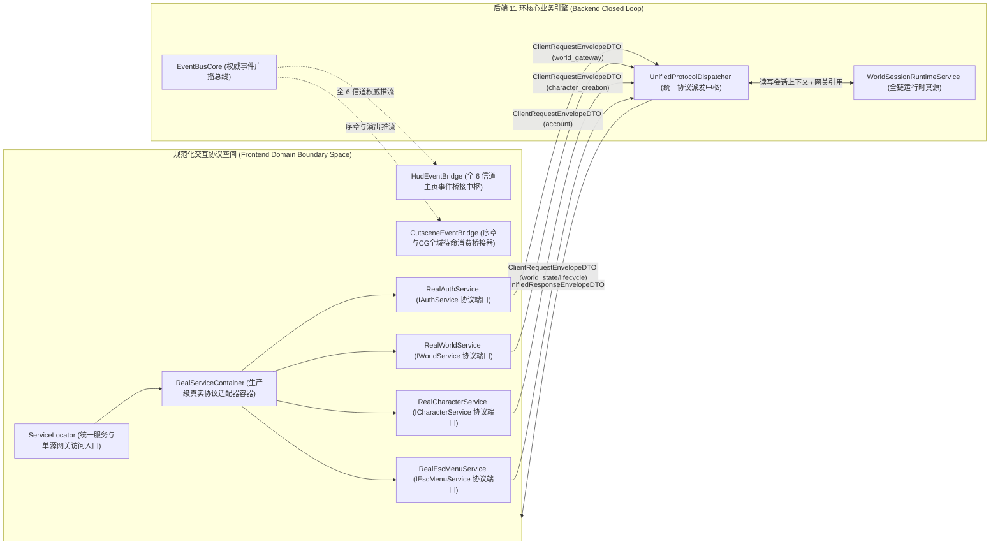

# 施工细则：全链路交互协议空间标准化与边界适配器闭环改造 —— 阶段1：全链路交互协议接口标准化与客户端请求上下文契约规范

> 施工开始日期: 2026-11-10
> 状态: 已验收

> [!NOTE]
> 【施工目标】
> 在严格遵守"前端表现层不接线闭环（`frontend/views/**` 零修改）"的前提下，面向 WebGames 全 11 环全链路审查所揭示的协议与边界缺陷，全面制定前端领域边界层（`frontend/domain_boundary/`）的规范化交互协议空间标准。确立统一客户端协议端口（Client Protocol Ports）、强类型客户端请求上下文、认证与世界网关会话协同模型、以及向 [`UnifiedProtocolDispatcher`](../../../../../backend/domains/world_state/services/unified_protocol_dispatcher.gd) 与 [`EventBusCore`](../../../../../backend/infrastructure/event_bus/event_bus_core.gd) 单向解耦的交互契约，为后续后端整齐后无缝接线预留规范化交互协议空间。
> 📍 **卷内快速直达**：[ATT 共享附件](KALAR-DEV-2026-ST124-ATT_附件_案卷共享契约与上下文.md) ｜ **阶段1 (当前)** ｜ [阶段2](KALAR-DEV-2026-ST124-002_阶段2_领域边界适配器实现与双网关脱节治理规范.md) ｜ [阶段3](KALAR-DEV-2026-ST124-003_阶段3_全信道事件桥接扩展与全域配置驱动路由规范.md) ｜ [阶段4](KALAR-DEV-2026-ST124-004_阶段4_无头集成测试矩阵与全链路防复发门禁规范.md)

---

## 📌 第一性原理溯源指针

### 1.1 精准上游规范指针

- 统一请求信封真源：[`ClientRequestEnvelopeDTO`](../../../../../backend/domains/world_state/dto/client_request_envelope_dto.gd)
- 统一响应信封真源：[`UnifiedResponseEnvelopeDTO`](../../../../../backend/domains/world_state/dto/unified_response_envelope_dto.gd)
- 统一协议派发入口：[`UnifiedProtocolDispatcher`](../../../../../backend/domains/world_state/services/unified_protocol_dispatcher.gd)
- 全链会话运行时真源：[`WorldSessionRuntimeService`](../../../../../backend/domains/world_state/services/world_session_runtime_service.gd)
- 账号服务与协议处理器：[`AuthService`](../../../../../backend/domains/account/auth_service.gd) · [`AccountProtocolHandler`](../../../../../backend/domains/account/services/account_protocol_handler.gd)
- 世界网关协议处理器与状态机：[`WorldGatewayProtocolHandler`](../../../../../backend/domains/world_gateway/world_gateway_protocol_handler.gd) · [`WorldGatewayFSM`](../../../../../backend/domains/world_gateway/world_gateway_fsm.gd)
- 权威创角编排器：[`WorldCharacterCreationOrchestrator`](../../../../../backend/domains/character_creation/world_character_creation_orchestrator.gd)
- 主页 HUD 权威同步门面：[`AuthoritativeHudSyncService`](../../../../../backend/domains/world_state/services/authoritative_hud_sync_service.gd)
- ESC 系统菜单后端服务：[`EscMenuBackendService`](../../../../../backend/domains/world_state/services/esc_menu_backend_service.gd)
- 生命周期停机协议处理器：[`LifecycleProtocolHandler`](../../../../../backend/domains/lifecycle/services/lifecycle_protocol_handler.gd)
- 前端服务定位器基线：[`ServiceLocator`](../../../../../frontend/domain_boundary/service_locator.gd) · [`RealServiceContainer`](../../../../../frontend/domain_boundary/services/real_service_container.gd)
- 前端认证契约接口：[`IAuthService`](../../../../../frontend/domain_boundary/interfaces/i_auth_service.gd) · [`RealAuthService`](../../../../../frontend/domain_boundary/services/real_auth_service.gd)
- 前端世界服务契约接口：[`IWorldService`](../../../../../frontend/domain_boundary/interfaces/i_world_service.gd)
- 前端系统桥接中枢：[`HudEventBridge`](../../../../../frontend/systems/hud_event_bridge.gd) · [`CutsceneEventBridge`](../../../../../frontend/systems/cutscene_event_bridge.gd)

### 1.2 核心不变量约束断言

- **规范化协议空间单向封闭不变量 (Inv-CLIENT-PROTOCOL-SPACE-1)**：前端视图未来仅通过领域边界接口与协议端口（`frontend/domain_boundary/`）向后端发起请求，严禁表现层视图直接持有后端状态机、求解器或单例；当前阶段视图层保持零接线待命（Standby Un-wired），全协议空间必须在领域边界层完全就绪。
- **客户端与运行时会话协同唯一真源不变量 (Inv-SESSION-COORDINATION-2)**：客户端持有的当前账号 ID、会话令牌与激活网关必须与后端的 [`WorldSessionRuntimeService`](../../../../../backend/domains/world_state/services/world_session_runtime_service.gd) 保持 100% 状态同步，严禁在 `ServiceLocator` 或视图层维持割裂的独立实例。
- **视图零修改与渐进式接线空间不变量 (Inv-ZERO-VIEW-MUTATION-3)**：本次改造严禁修改 `frontend/views/**` 任何视图代码；所有 11 环缺陷的闭环均在领域边界层、系统桥接层与测试流水线中完成，流出标准化的 `apply_snapshot` 契约端口，为后续视图接线消除一切后端隐患。
- **统一响应回执诚实判定不变量 (Inv-ENVELOPE-STRICT-VERDICT-4)**：客户端所有协议请求必须严格校验 `_response.success`，并在失败时提取 `error_code` 与 `message` 映射至标准错误字典，杜绝静默吞错、伪造成功或无条件状态跃迁。

### 1.3 防漂移最高指示

本阶段仅制定并固化全 11 环规范化交互协议空间标准、客户端接口契约签名、请求响应 DTO 映射与会话状态协同规范；严禁在当前方案未获审批前直接改动生产代码，所有接口与数据载荷命名必须与后端 DTO 强类型真实字段逐字对齐，严禁随意更名或创造跨端方言。

---

## 一、 全 11 环规范化交互协议空间拓扑与数据流规范

### 1.1 双通道解耦与待命交互协议空间架构图

### 1.2 全 11 环规范化交互协议空间接口映射规格表

| 环节序号与名称 | 领域边界接口方法 | 统一协议动作 (`domain` / `action_type`) | 请求入参载荷模型 | 统一响应返回与处理规范 |
| :--- | :--- | :--- | :--- | :--- |
| **1. 注册与登录** | `IAuthService.login_async` `IAuthService.register_async` | `account` / `LOGIN_COMPOSITE` `account` / `REGISTER_ACCOUNT` | `username`, `password_plain` 可选 `device_fingerprint` | 登录成功自动同步激活 `WorldSessionRuntimeService`；注册成功返回合法账号与创建时间，严禁伪造 Token。 |
| **2. 网关选档** | `IWorldService.enter_gateway_async` `IWorldService.probe_modes_async` `IWorldService.select_mode_async` | `world_gateway` / `ENTER_GATEWAY` `world_gateway` / `PROBE_MODES` `world_gateway` / `SELECT_MODE` | `account_id`, `session_token` `mode_id`, `account_slots` | 进入网关校验会话；选模式注入合法 `account_slots`（非空）；失败时阻断并返回标准错误。 |
| **3. 创建角色** | `ICharacterService.roll_attributes_async` `ICharacterService.create_character_async` | `character_creation` / `ROLL_CHARACTER_PREVIEW` `character_creation` / `CREATE_AUTHORITATIVE_CHARACTER` | `account_id`, `session_token` `char_name`, `race_id`, `class_id` | 严禁绕过创角编排器；权威创角落地存档、装备水化并初始化序章上下文。 |
| **4. 序章剧情** | `ICutsceneService.start_prologue_async` `ICutsceneService.advance_prologue_async` `ICutsceneService.skip_prologue_async` | `prologue` / `START_PROLOGUE` `prologue` / `ADVANCE_PROLOGUE` `prologue` / `SKIP_PROLOGUE` | `prologue_session_id`, `choice_index` | 经 `CutsceneEventBridge` 订阅推进事件；完成时触发 `world_entered` 广播。 |
| **5. 主页 HUD 同步** | `IHudSyncService.pull_hud_snapshot_async` `HudEventBridge.attach_hud` | `world_state` / `PULL_HUD_SNAPSHOT` + EventBus 全 6 订阅信道 | `account_id`, `session_token` | 首帧主动拉取常驻快照；覆盖 Mock 初始值；订阅 `stat_mutated` 与 `clock_advanced`。 |
| **6. ESC 菜单后端** | `IEscMenuService.get_menu_state_async` `IEscMenuService.request_save_async` | `world_state` / `ESC_GET_MENU_STATE` `world_state` / `ESC_SAVE_GAME` | `account_id`, `session_token` `target_slot`, `is_quicksave` | 打开菜单前拉取后端动态可用性；存盘携带会话令牌并严格校验 `_response.success`。 |
| **7. 退出世界** | `IEscMenuService.exit_to_gateway_async` | `world_state` / `ESC_EXIT_TO_GATEWAY` `world_gateway` / `EXIT_WORLD_TO_GATEWAY` | `account_id`, `session_token` | 后端洗脱世界内存且保留登录态；前端协议空间保留 `GATEWAY_ENTERED` 态。 |
| **8. 切换运行网关** | `IWorldService.switch_gateway_mode_async` | `world_gateway` / `SWITCH_GATEWAY_MODE` | `target_mode`, `session_token` | 校验活跃世界已安全洗脱；禁止热切；探针就绪度重新扫描。 |
| **9. 退出账号** | `IAuthService.logout_async` `IAuthService.revoke_token` | `account` / `LOGOUT_ACCOUNT` | `account_id`, `session_token` | 调用 `AuthService.revoke_token` 销毁内存掩码；清空运行时会话上下文。 |
| **10. 账号首页** | `IAuthService.get_account_home_async` | `account` / `GET_ACCOUNT_HOME_VIEW_MODEL` | `account_id`, `session_token` | 替代 Mock 静态数据；拉取真实账号档案、槽位角色列表与全局配置。 |
| **11. 退出游戏** | `ILifecycleService.request_shutdown_async` | `lifecycle` / `REQUEST_GRACEFUL_SHUTDOWN` | `account_id`, `session_token` `target_save_slot` | 注入当前激活槽位 `SLOT_0X`；保证落盘正档；按序反装配退出。 |

---

## 二、 命令式施工执行清单 (Agent Execution Checklist)

- [x] Step 1.1: 制定并审查 `IAuthService` 接口契约增补声明（补充 `revoke_token`、`logout_async`、`get_account_home_async`）。
- [x] Step 1.2: 制定并审查 `IWorldService` 接口契约规范（统一网关、探针、世界选档与模式切换异步方法）。
- [x] Step 1.3: 制定并审查 `ICharacterService` 与 `IEscMenuService` 协议空间接口规范。
- [x] Step 1.4: 制定 `ServiceLocator` 与 `WorldSessionRuntimeService` 单源网关协同规范，彻底消除双实例脱节隐患。
- [x] Step 1.5: 制定 `HudEventBridge` 全 6 信道消费规范与主动首帧拉取 `pull_hud_snapshot_async` 规范。

---

## 三、 阶段验收矩阵 (DoD Matrix)

| 检验项 ID | 校验目标 | 验证输入 | 预期输出断言 |
| :--- | :--- | :--- | :--- |
| **DOD-P128-0101** | 全 11 环客户端协议接口覆盖度 | 静态核对 `frontend/domain_boundary/interfaces/` | 11 环核心操作均有明确强类型接口声明与异步签名 |
| **DOD-P128-0102** | 视图零修改契约断言 | 检查 `frontend/views/**` 差异 | `frontend/views/**` 文件改动数为 0 |
| **DOD-P128-0103** | 会话单源协同断言 | 核对 `ServiceLocator` 网关委托规范 | `ServiceLocator` 网关实例唯一源自 `WorldSessionRuntimeService` |
| **DOD-P128-0104** | 文档规范与语法审计 | 运行 `python scripts/py/audit_docs.py` | 阶段细则零新增违规，命名、格式与链接 100% 合规 |
