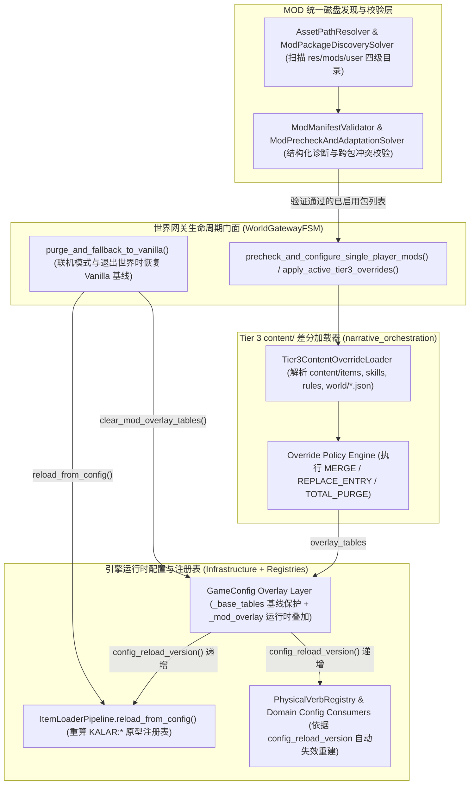

# 施工细则：MOD开发者体验优化与Tier3运行时差分加载及文档客观化体系改造 —— 阶段1：SDK工具链对齐与Tier3运行时差分覆盖架构契约规范

> 施工开始日期: 2026-11-14（半夜）
> 状态: 已验收 (Phase 129 Completed)

> [!NOTE]
> 【施工目标】
> 对齐 `WebGames/mod_sdk` CLI 工具参数、模板资产清单校验规则与 `capabilities.json` 单一事实来源；定义统一的多路径 MOD 磁盘发现契约与 Tier 3 `content/` 运行时差分加载模型（`MERGE` / `REPLACE_ENTRY` / `TOTAL_PURGE`）及可回退覆盖层架构；确立 `mod_sdk` 与 `docs/源码文档` 系统性客观技术文档规范，在修改任何生产代码前先锁定全量接口与校验不变量。
> 📍 **卷内快速直达**：[ATT 共享附件](KALAR-DEV-2026-ST125-ATT_附件_案卷共享契约与上下文.md) ｜ **阶段1 (当前)** ｜ [阶段2](KALAR-DEV-2026-ST125-002_阶段2_SDK工具链修复与Tier3运行时差分加载引擎及诊断实现规范.md) ｜ [阶段3](KALAR-DEV-2026-ST125-003_阶段3_SDK文档对齐与源码文档系统性客观重构工程规范.md) ｜ [阶段4](KALAR-DEV-2026-ST125-004_阶段4_全量自动化测试与CLI门禁及文档客观性回归验收规范.md)

---

## 📌 第一性原理溯源指针

### 1.1 精准上游规范指针

- 引擎配置中心与路由器真源：[`GameConfig`](../../../../../backend/infrastructure/game_config.gd) · [`ConfigRouterEngine`](../../../../../backend/infrastructure/config_router_engine.gd) · [`GameConfigLoader`](../../../../../backend/infrastructure/game_config_loader.gd)
- 全域装配与资源寻址真源：[`GameBootstrap`](../../../../../backend/infrastructure/game_bootstrap.gd) · [`AssetPathResolver`](../../../../../backend/infrastructure/resource_governance/asset_path_resolver.gd)
- MOD 清单校验与预检适配真源：[`ModManifestValidator`](../../../../../backend/domains/character_creation/mod_manifest_validator.gd) · [`ModPrecheckAndAdaptationSolver`](../../../../../backend/domains/character_creation/mod_precheck_and_adaptation_solver.gd) · [`DestinyModManifestDTO`](../../../../../backend/domains/character_creation/dto/destiny_mod_manifest_dto.gd)
- MOD 磁盘发现与世界网关真源：[`ModPackageDiscoverySolver`](../../../../../backend/domains/narrative_orchestration/mod_package_discovery_solver.gd) · [`WorldGatewayFSM`](../../../../../backend/domains/world_gateway/world_gateway_fsm.gd)
- 运行时物品与动作注册表真源：[`ItemLoaderPipeline`](../../../../../backend/domains/item_namespace_registry/item_loader_pipeline.gd) · [`PhysicalVerbRegistry`](../../../../../backend/domains/physics_thermodynamics/physical_verb_registry.gd)
- SDK 能力声明与 Schema 真源：[`capabilities.json`](../../../../../mod_sdk/capabilities.json) · [`world.schema.json`](../../../../../mod_sdk/schemas/world.schema.json) · [`items.schema.json`](../../../../../mod_sdk/schemas/items.schema.json) · [`skills.schema.json`](../../../../../mod_sdk/schemas/skills.schema.json) · [`game_rules.schema.json`](../../../../../mod_sdk/schemas/game_rules.schema.json) · [`assets_manifest.schema.json`](../../../../../mod_sdk/schemas/assets_manifest.schema.json)
- 离线 SDK CLI 与同步守卫真源：[`kalar_mod.py`](../../../../../mod_sdk/tools/kalar_mod.py) · [`cook_assets.py`](../../../../../mod_sdk/tools/cook_assets.py) · [`check_mod_common.py`](../../../../../mod_sdk/tools/check_mod_common.py) · [`audit_sdk_sync.py`](../../../../../scripts/py/audit_sdk_sync.py)
- 架构与域计数护栏真源：[`TestArchitectureGuardDomain`](../../../../../tests/guards/test_architecture_guard.gd)

### 1.2 核心不变量约束断言

- **覆盖层非破坏性回退不变量 (Inv-MOD-OVERLAY-REVERT-1)**：Tier 3 `content/` 运行时覆盖只作用于 `GameConfig` 内存运行时覆盖层（Mod Overlay Snapshot）与对应注册表（`ItemLoaderPipeline`、`PhysicalVerbRegistry`），严禁修改磁盘上的 `res://config/**` 基础 JSON 文件；执行 [`WorldGatewayFSM.purge_and_fallback_to_vanilla`](../../../../../backend/domains/world_gateway/world_gateway_fsm.gd) 或进入联机模式时，必须将内存表原子恢复至基线快照并递增配置版本号。
- **领域清单与架构单向依赖不变量 (Inv-ARCH-DOMAIN-CLOSED-2)**：不在 `backend/domains/` 下新增未登记目录；Tier 3 差分加载模块严格复用已登记域（`narrative_orchestration` / `infrastructure`），通过 `GameConfig` 覆盖接口与注册表重载完成联动，维持 `backend/infrastructure/` 不反向静态强依赖业务域，并通过 `TestArchitectureGuardDomain` (`TC-ARCH-01` ~ `TC-ARCH-06`) 全部校验。
- **能力单源驱动与诊断向后兼容不变量 (Inv-CAPABILITIES-SSOT-3)**：Python CLI 校验内置常量（原版 DAG、Starter Kits、Traits 等）优先从 [`capabilities.json`](../../../../../mod_sdk/capabilities.json) 解析，消除硬编码漂移；`ModManifestValidator` 新增结构化诊断条目 (`diagnostics`) 的同时，保留既有 `"errors": Array[String]` 契约字段，不破坏存量测试调用方。
- **客观边界声明与视图隔离不变量 (Inv-OBJECTIVE-BOUNDARY-4)**：所有文档（`mod_sdk/`、`docs/源码文档/`、`WebGames/README.md`）必须依据代码事实精确区分「Godot 运行时已执行机制」与「仅 SDK 离线校验/Schema 预留字段」，删除主观修饰词、绝对化断言与内部术语黑话；全程不改动 `frontend/views/**` 与 `docs/归档库/**`。

### 1.3 防漂移最高指示

本阶段仅制定并锁定 CLI/Schema 对齐规格、统一磁盘扫描根目录规范、结构化校验诊断格式、`GameConfig` Tier 3 差分覆盖契约与文档客观化改写规范；严禁在 Phase 129 未获用户明确审批前修改任何 `.gd`、`.py`、`config/*.json` 或既有业务文档。

---

## 一、 核心问题域与架构数据流契约

### 1.1 当前已核实断点与目标对齐矩阵

| 问题域 | 已核实基线状态 | 目标对齐契约 |
| :--- | :--- | :--- |
| **SDK 模板与 `.import` 过滤** | `cook_assets.py` 将 Godot 自动生成的 `.import` 伴生文件判定为 `ERR_ASSET_DISALLOWED_TYPE`，导致 4 个官方模板/示例中有 3 个无法通过 `kalar-mod check`；错误提示漏列白名单中已有的 `.gltf`/`.glb`。 | 将 `.import`、`.uid`、`.tmp` 等引擎元数据伴生文件纳入可控忽略规则（仅审计实体资产），对齐 `ASSET_WHITELIST` 提示文本与 `ART_AND_ASSETS_GUIDE.md` 视频扩展策略（默认未开启视频白名单或在 SSOT 中显式裁定）。 |
| **CLI 参数与脚手架清单** | `mod_sdk/README.md` 记载 `--tier TIER_1_LOGIC`、`--multi-dirs`、`--player-name`、`--race-id` 且缺少 `dispatch`、`bake` 说明；`scaffold_mod.py` 生成的 `pack.json` 缺少顶层规范 `"tier"` 字段。 | 统一以 `kalar_mod.py` 真实参数（`--tier 1 / 2 / 3`、`--check-multi`、`--name`、`--race`）为准更新全部文档；`scaffold_mod.py` 输出规范 `"tier"` 字段并确保新生成模板开箱通过 `kalar-mod check --json`。 |
| **资产清单 Schema 分叉** | `SPECIFICATION.md` / `ART_AND_ASSETS_GUIDE.md` / `assets_manifest.schema.json` 描述根目录 `assets_manifest.json`，实际 `cook_assets.py` 与各模板使用 `assets/manifest.json`。 | 明确将 `assets/manifest.json` 定义为 `cook_assets.py` 与官方模板的实际规范路径，同步更新 `assets_manifest.schema.json` 描述注释与兼容说明，消除文档自相矛盾。 |
| **多根磁盘发现不一致** | `AssetPathResolver` 支持 `res://mods/`、`mods/`、`user://mods/` 与 `narratives/` 子目录，而 [`ModPackageDiscoverySolver`](../../../../../backend/domains/narrative_orchestration/mod_package_discovery_solver.gd) 仅扫描 `.../narratives/`。 | 扩展 [`ModPackageDiscoverySolver`](../../../../../backend/domains/narrative_orchestration/mod_package_discovery_solver.gd) 扫描根目录以覆盖顶层 `mods/<pack_id>` 与 `user://mods/<pack_id>`（同 `pack_id` 按确定性优先级去重覆盖），与文档示例目录布局一致。 |
| **Tier 3 `content/` 运行时未接入** | `total_conversion_sample/content/` 存在 `items/`、`rules/`、`world/` 样例配置，但运行时仅加载 `story/` 叙事与创角数据，未接入 `GameConfig` 与核心注册表。 | 新增 `Tier3ContentOverrideLoader`（位于 `backend/domains/narrative_orchestration/`）及 [`GameConfig`](../../../../../backend/infrastructure/game_config.gd) 运行时覆盖层接口，支持 `MERGE` / `REPLACE_ENTRY` / `TOTAL_PURGE` 三种策略与退出净空回退。 |
| **源码与 SDK 文档漂移** | `docs/源码文档/` 存在文件总数漂移、77 个源码文件未索引及主观/术语措辞；`mod_sdk/examples/README.md` 含本地文件协议 URI 链接。 | 依据真实目录统计、AST/脚本清单与边界事实完成 `mod_sdk/**`、`docs/源码文档/**` 与 `WebGames/README.md` 全量客观化更新，保留 `TC-ARCH-05` 计数锚点。 |

### 1.2 Tier 3 运行时差分加载与覆盖回退架构图

### 1.3 Tier 3 `content/` 目录到引擎配置表的映射契约

| Tier 3 `content/` 子目录 | JSON 承载结构 | 目标引擎配置表 (`GameConfig`) 与下游注册表 | 支持的 `override_mode` 语义与兼容别名 |
| :--- | :--- | :--- | :--- |
| `content/items/*.json` | `items` 或兼容字段 `weapons` (数组) | `"items.mod_<pack_id>"`（增量合并）或接管 `"items.*"`；触发 `ItemLoaderPipeline.reload_from_config()` | `MERGE`（兼容别名 `APPEND_MERGE`）：按 `canonical_id` 新增或覆写；`REPLACE_ENTRY`：按 `canonical_id` 整条替换；`TOTAL_PURGE`（兼容别名 `REPLACE_EXISTING`）：清空原生 `items.*` 中的非模组条目后仅保留当前模组集。 |
| `content/skills/*.json` | `verbs` (字典)、`skill_cards` (数组) | `"domains.combat.mechanics"` (`verbs` / `skill_cards`)；版本号递增自动失效 `PhysicalVerbRegistry` 缓存 | `MERGE`：增量合并动词与卡牌键；`REPLACE_ENTRY`：整项替换指定动词/卡牌；`TOTAL_PURGE`：仅保留模组声明集（保留 `_fallback` 兜底键防空崩溃）。 |
| `content/rules/*.json` | `combat_constants`、`mechanics`、`character_rules` 或 `formulas` / `character_limits` / `inventory_limits` | `"domains.combat.damage_formulas"`、`"domains.combat.mechanics"`、`"domains.character_creation.core"`、`"domains.attribute.core"`、`"domains.currency.core"` | `MERGE`：递归深度合并键值；`REPLACE_ENTRY`：顶层节段整块替换；`TOTAL_PURGE` / `REPLACE_EXISTING`：按模块节段整块接管（未提供节段维持基线防止除零或缺失必需键）。 |
| `content/world/*.json` | `terrain_impedance`、`astar`、`swarm_risk`、`marching`、`node_defaults`、`town_defaults` 或 `nodes`/`edges` | `"domains.world.core"`（以及供地图检索使用的扩展子键 `"mod_world_topology"`） | `MERGE`：递归深度合并地形阻抗/行军参数；`REPLACE_ENTRY`：按节段键替换；`TOTAL_PURGE`：用模组世界参数替换原生世界配置并保留安全结构兜底。 |

---

## 二、 命令式施工执行清单 (Agent Execution Checklist)

- [x] Step 1.1: 审查并锁定 SDK 资产扫描规则：`cook_assets.py` 对 Godot `.import`/`.uid` 伴生文件的过滤准则与 `ASSET_WHITELIST` 提示同步策略。
- [x] Step 1.2: 审查并锁定 `check_mod_common.py` 从 `mod_sdk/capabilities.json` 读取内置 DAG、Starter Kit 与 Trait 定义的单一数据源加载协议。
- [x] Step 1.3: 审查并锁定 `ModManifestValidator` 的结构化诊断返回载荷字段（`code`、`message`、`field_path`、`entity_id`、`fix_suggestion`）及与存量 `"errors"` 字段的双态兼容协议。
- [x] Step 1.4: 审查并锁定 `ModPackageDiscoverySolver` 与 `AssetPathResolver` 统一的 `mods/` 多根目录扫描顺序与 `pack_id` 覆盖优先级。
- [x] Step 1.5: 审查并锁定 `GameConfig` 非破坏性 Mod Overlay 快照接口及 `Tier3ContentOverrideLoader` 的三态覆盖策略（含模板兼容别名 `APPEND_MERGE` / `REPLACE_EXISTING`）与 Vanilla 回退顺序。
- [x] Step 1.6: 审查并锁定 `mod_sdk/` 与 `docs/源码文档/` 系统性客观重写标准与禁止修改边界（`frontend/views/**`、`docs/归档库/**` 零改动）。

---

## 三、 阶段验收矩阵 (DoD Matrix)

| 检验项 ID | 校验目标 | 验证输入 | 预期输出断言 |
| :--- | :--- | :--- | :--- |
| **DOD-P129-0101** | Phase 129 路线图目录与总索引一致性 | 运行 `python WebGames/scripts/py/audit_docs.py --baseline WebGames/benchmarks/reports/docs_baseline.json` | 零错误、零警告、零新增违规 |
| **DOD-P129-0102** | 阶段1契约与真实文件路径匹配度 | 检查 1.1 节与 1.2/1.3 节引用符号 | 所有链接指向磁盘真实文件，零虚构符号或坏链 |
| **DOD-P129-0103** | Round 1 零生产代码改动约束 | 核对工作区改动范围 | Round 1 仅包含 Phase 129 施工细则与路线图总索引登记 |
| **DOD-P129-0104** | Phase 129 目标文风客观性 | 审校 Stage 1~4 全文 | 零宣传性形容词与内部开发黑话，边界清晰 |
