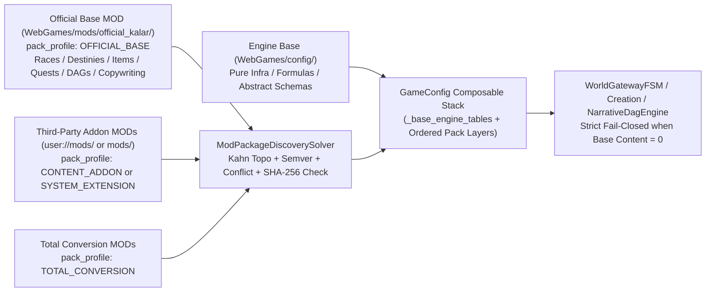
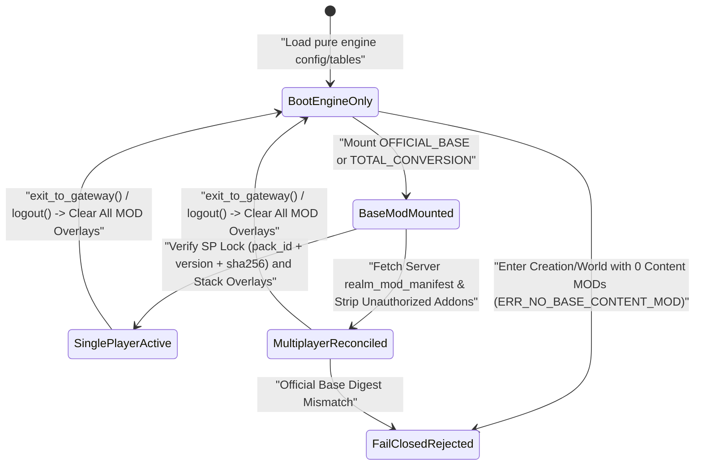

# 施工细则：官方与三方MOD全插件化架构及去内置剧情与全端入口重构 —— 阶段1：插件化官方MOD契约架构与引擎边界重构规范

> 施工开始日期: 2026-11-14
> 状态: 已验收 (Phase 130 Completed)

> [!NOTE]
> **【施工目标】** 本阶段确立 Phase 130“官方与三方 MOD 全插件化架构”的顶层边界契约、Schema 规范、前后端接口扩展协议与安全校验模型，使 `WebGames` 从“引擎配置内嵌卡拉尔官方世界观”彻底解耦为“纯净通用引擎底座 + 可插拔官方/三方 MOD 包”，并锁定零 MOD 拒绝入界、联机权威摘要鉴权与全端入口契约。

---

## 📌 第一性原理溯源指针

### 1.1 精准上游规范指针

- 路线图总索引真源: [路线图总索引.md](../../路线图总索引.md)
- MOD SDK 架构规范: [SPECIFICATION.md](../../../../mod_sdk/docs/SPECIFICATION.md) · [MOD_SPEC.md](../../../../mod_sdk/MOD_SPEC.md) · [TOTAL_CONVERSION_SPEC.md](../../../../mod_sdk/docs/TOTAL_CONVERSION_SPEC.md)
- 运行时配置真源: [game_config.gd](../../../../backend/infrastructure/game_config.gd) · [domains.json](../../../../config/infrastructure/domains.json) · [resource_catalog.json](../../../../config/infrastructure/resource_catalog.json)
- 安全与前后端契约: [anti_bridge_guard.gd](../../../../backend/domains/world_gateway/anti_bridge_guard.gd) · [i_world_service.gd](../../../../frontend/domain_boundary/interfaces/i_world_service.gd) · [i_prologue_service.gd](../../../../frontend/domain_boundary/interfaces/i_prologue_service.gd)

### 1.2 核心不变量约束断言

1. **纯净引擎底座与单一官方包契约 (A1 决策锁定)**: 规划目录 `WebGames/mods/official_kalar/` 作为唯一的官方基础内容插件包承载卡拉尔世界观、种族、出身、特质、开局套装、主线/分支序章 DAG、物品原型、任务、NPC/怪物、过场媒体与双语剧情文案；`WebGames/config/` 仅保留纯引擎基础设施配置、物理/数学公式常量、规则校验阈值与空/抽象数据结构定义。
2. **零内容 MOD 严格闭锁契约 (A2 决策锁定)**: 当活跃挂载队列中不存在至少一个合法的 `OFFICIAL_BASE` 或 `TOTAL_CONVERSION` 内容包时，角色创建、序章引导、默认世界生成与创世前检 **必须确定性失败拒绝**（错误码 `ERR_NO_BASE_CONTENT_MOD` / `MOD_ERR_NO_CONTENT_PACK_MOUNTED`），严禁回退至硬编码卡拉尔种族（如 `HUMAN`）、出身（如 `IMPERIAL_NOBLE`）、出生地（如 `CENTRAL_CONTINENT`）或线性 4 阶段内置序章。
3. **联机权威清单与摘要校验契约 (A3 决策锁定)**: 联机模式废除基于字符串前缀的宽松放行及整库回退清盘逻辑；服务器下发权威 `realm_mod_manifest`（固定三元组 `{pack_id, version, content_sha256}`），网关准入校验本地官方基座摘要合法性后，仅精确卸载未授权的三方扩展包并保留官方底座及服务器核准包栈。
4. **全栈全端闭环契约 (A4 决策锁定)**: 本次架构改造涵盖后端引擎重构、官方包抽取、SDK Schema 与工具链升级、静态与集成测试夹具重构，以及新增前端视图（`world_gateway`、`mod_workbench`、交互式 `prologue`）与真实服务容器（`service_mode = "real"`）接线；前端全视图必须满足 [test_frontend_boundary_guard.gd](../../../../tests/guards/test_frontend_boundary_guard.gd) 边界纪律。

### 1.3 架构设计防漂移最高指示

- **契约先行，严禁补丁式旁路**: 禁止在任何后端域脚本中以“若未找到表则硬编码兜底字典”或“兼容旧测试保留 `KIT_HUMAN_DEFAULT`”的方式绕过零 MOD 门禁；所有缺失官方世界数据的既有测试必须在阶段 4 显式挂载官方包或隔离测试包。
- **跨包组合确定性**: 所有 Tier 1/2/3 MOD 覆盖与卸载均须以拓扑排序 + `priority` 序为唯一真源，保证可逆撤销与零残余内存态。

---

## 一、 核心架构边界与 Schema 契约设计

### 1.1 引擎底座 vs 插件化 MOD 职责拓扑图

### 1.2 模式准入与生命周期状态流转

### 1.3 `pack.schema.json` 与关联 SDK Schema 扩展契约

#### (1) `mod_sdk/schemas/pack.schema.json` 扩展字段清单

保留既有 [pack.schema.json](../../../../mod_sdk/schemas/pack.schema.json) 必填标识字段，新增并规范以下顶层契约字段：

| 字段路径 | 类型 / 枚举 | 约束规则 | 用途说明 |
| :--- | :--- | :--- | :--- |
| `pack_profile` | `string` enum | `OFFICIAL_BASE` \| `CONTENT_ADDON` \| `SYSTEM_EXTENSION` \| `TOTAL_CONVERSION` | 声明模组在引擎底座上的定位与准入能力集；`OFFICIAL_BASE` 与 `TOTAL_CONVERSION` 可豁免外挂数值微小上限并承接完整世界表 |
| `is_official` | `boolean` | 默认 `false`；仅配合 `content_sha256` 校验，不可单独作为联机信任依据 | 标记官方发布包属性，禁止由包名字符串前缀推断 |
| `trust_tier` | `string` enum | `OFFICIAL` \| `SIGNED_PARTNER` \| `COMMUNITY` | 运行时与前端工作台展示可信等级 |
| `content_sha256` | `string` | 64 位小写十六进制 SHA-256 摘要（打包/规范校验生成） | 用于世界档案锁校验与联机权威清单一致性比对 |
| `publisher_signature` | `string` | 可选，Base64/Hex 签名载荷 | 预留官方及合作方数字签名验签入口 |
| `provided_domains` | `array<string>` | 合法领域 ID 列表（对齐 `config/infrastructure/domains.json`） | 显式声明该包挂载的领域表或剧情叙事域 |
| `has_prologue_dag` | `boolean` | 默认 `true` 对叙事包；`SYSTEM_EXTENSION` 与纯规则包可设 `false` | 解除工具链对所有 MOD 强制存在非空 `dag_graphs/` 的硬性束缚 |

#### (2) 新增与扩展 MOD Schema 目录规划

在保持已有 19 份 `.schema.json` 兼容性的前提下，规划新增以下 Schema 契约（阶段 3 在 `WebGames/mod_sdk/schemas/` 落地实体文件并入同步校验）：

| Schema 文件名（规划） | 对应的 MOD 包内路径 | 覆盖目标 `GameConfig` / 引擎消费方 |
| :--- | :--- | :--- |
| `quests.schema.json` | `content/quests/*.json` | `domains.quest`、`domains.commission_quest` |
| `entities.schema.json` | `content/entities/*.json` | `domains.npc`、`domains.monster`、`domains.elite`、`domains.world_boss`（接通此前未接线的 `content/entities/`） |
| `world_topology.schema.json` | `content/world/*.json`（扩展段） | `domains.world_gateway:worlds_catalog`、`domains.world_map` 地标图谱与出生大区表 |
| `event_probability.schema.json` | `content/events/*.json` | `domains.event_probability`、`NarrativeCausalityOrchestrator` 条件事件链 |
| `races_catalog.schema.json` | `destinies.json` 扩展或 `content/races/*.json` | `domains.character_creation:races_catalog`、`domains.attribute` 种族基础属性与修正系数 |
| `narratives_overlay.schema.json` | `content/narratives/*.json` | `narratives.<domain_id>` 及 `narratives.prologue_i18n`（非官方硬编码场景） |
| `copywriting_overlay.schema.json` | `content/copywriting/*.json` | `copywriting.{item,narrative,probability}` 及物品/事件条件文案表 |
| `routing_rules.schema.json` | `routing_rules.json` | `PrologueDagRegistry` 路由矩阵真源校验 |
| `realm_mod_manifest.schema.json` | 服务端联机握手下行清单 | 声明 `realm_id`、`protocol_version`、`required_packs[{pack_id,version,content_sha256,trust_tier}]`、`optional_whitelist_packs`、`allow_client_cosmetic_only` |

#### (3) `destinies.schema.json` 与上限分级解耦契约

扩展 [destinies.schema.json](../../../../mod_sdk/schemas/destinies.schema.json)：
- 增加可选节 `custom_races`（种族 ID、本地化键、性别约束、属性基值/系数、特性标识）及 `creation_rule_overrides`。
- 当关联 `pack.json` 的 `pack_profile` 为 `CONTENT_ADDON` 时，维持外挂平衡限额（`initial_gold <= 1000`、`KIT_ITEM_LIMIT <= 10`、单属性偏移 `[-2, 3]`、净偏移 `[-2, 4]`）；当 `pack_profile` 为 `OFFICIAL_BASE` 或 `TOTAL_CONVERSION` 时，解除外挂平衡上限限制，转为结构合法性、ID 唯一性与目标属性键存在于 `attribute_init.required_keys` 的完整性校验。

### 1.4 `GameConfig` 纯净底座边界与 `domains.json` 分层契约

对 [game_config.gd](../../../../backend/infrastructure/game_config.gd) 第 62-133 行的 `_required_tables`（当前 70 项）与 [domains.json](../../../../config/infrastructure/domains.json) 进行双轨解耦分类：

1. **Pure Engine Required Tables（保留在 `_required_tables`，启动必检）**：
   - `infrastructure.*` 核心运行契约（`clock`、`contracts`、`contract_completeness_baseline`、`domains`、`errors_catalog`、`event_bus_config`、`event_categories`、`lifecycle`、`log`、`object_pool`、`persistence`、`release_policy`、`resource_catalog`、`storage`、`version_manifest`、`admin` 纯机制段）。
   - `frontend.ui`、`frontend.views`。
   - 纯规则与数学常数领域表结构（保留公式与枚举边界；移除内置剧情实体列表，允许 `items.core`、`domains.starter_loadout.core`、`domains.event_probability.core` 等纯内容注册表以空阵基线形式启动，由活跃内容 MOD 层填充）。
2. **Engine-Only vs MOD-Provided Narrative 分层（`domains.json` 扩展元数据）**:
   - 在 `domains.json` 的 `_meta` 与域条目中显式区分 `narrative_scope`: `"engine_system"`（系统级报错与底噪日志模板，随引擎保存在 `config/narratives/`）与 `"mod_content"`（剧情文案、世界事件播报、物品/NPC 叙事描述，允许基础配置文件为空模板或彻底剥离至 `official_kalar`，仅在挂载内容 MOD 后注入）。
   - 过场媒体注册与钩子（`cutscene_registry.json`、`cutscene_hooks.json`）与序章目录（`prologue_dag_catalog.json`、`prologue_i18n.json`）移出纯引擎默认故事资产范畴，由引擎侧保留加载/解析机制与校验 Schema，实际剧本挂载自 `mods/official_kalar/`。

### 1.5 全端服务接口与前端视图路由增量契约

在保持 [i_world_service.gd](../../../../frontend/domain_boundary/interfaces/i_world_service.gd) 与 [i_prologue_service.gd](../../../../frontend/domain_boundary/interfaces/i_prologue_service.gd) 既有方法签名向后兼容的前提下，锁定以下扩展接口：

| 接口归属 | 方法签名 / 视图路由 | 请求 / 响应核心契约 |
| :--- | :--- | :--- |
| `IWorldService` | `list_installed_mods_async() -> Array` | 返回 `{packs: Array[Dictionary], discovery_roots: Array, errors: Array}`，包含 `pack_id`、`pack_profile`、`is_official`、`is_active`、`dependencies`、`incompatible_packs`、`priority`、`content_sha256`、`load_errors` |
| `IWorldService` | `set_mod_selection_async(pack_ids: Array[String], order_map: Dictionary) -> Dictionary` | 校验并持久化当前待启动 MOD 队列（不含默认卡拉尔回退），返回 `{success, error_code, diagnostics, resolved_order, adapted_snapshot}` |
| `IWorldService` | `get_world_mod_diagnostics_async(world_id: String) -> Dictionary` | 比对世界存档 `world_mod_lock.json` 与当前发现池，返回 `MATCHED` \| `VERSION_DRIFT` \| `MISSING_REQUIRED_MOD` \| `BASE_MOD_MISSING` 逐项诊断 |
| `IWorldService` | `verify_realm_manifest_async(realm_id: String, realm_manifest: Dictionary) -> Dictionary` | 联机模式下校验本地栈与权威 `realm_mod_manifest` 摘要，返回需卸载的三方扩展清单与官方底座验真结论 |
| `IPrologueService` | `advance_prologue_async(choice_id: String, extra: Dictionary) -> Dictionary` | 全量切入 `NarrativeDagExecutionEngine`，固定回传 `{completed, node_id, node_type, step_title, body_text, resolved_placeholders, choices: Array[{choice_id, label, condition_met}], cutscene_trigger}` |
| `NavManager` | 新增 3 个核心视图路由 | `"world_gateway"`、`"mod_workbench"`、`"prologue"`；并与 `"account_entry"`、`"main_hud"` 形成显式单向状态迁移，前端禁止自造业务状态或回退静默选择 |

---

## 二、 命令式施工执行清单 (Agent Execution Checklist)

- [x] Step 1.1: 审查并锁定纯引擎 `WebGames/config/` 与 `WebGames/mods/official_kalar/` 的物理职责边界及全量 131 份 JSON 剥离分级矩阵（覆盖 `infrastructure/`、`domains/`、`narratives/`、`copywriting/`、`items/`、`frontend/`、`i18n/`）。
- [x] Step 1.2: 锁定 Zero-MOD Fail-Closed 错误码常量规范（`ERR_NO_BASE_CONTENT_MOD`、`MOD_ERR_PACK_ID_CONFLICT`、`MOD_ERR_CYCLE_DETECTED`、`MOD_ERR_REALM_DIGEST_MISMATCH`）并在 `config/infrastructure/errors_catalog.json` 及相关守卫契约中完成命名对齐规划。
- [x] Step 1.3: 定稿 `pack.schema.json`、`destinies.schema.json` 扩展字段及 9 份新增 `.schema.json`（含 `quests`、`entities`、`world_topology`、`event_probability`、`races_catalog`、`narratives_overlay`、`copywriting_overlay`、`routing_rules`、`realm_mod_manifest`）字段映射表。
- [x] Step 1.4: 定稿 `GameConfig` 可组合叠层模型（`_base_engine_tables` + 有序 `applied_pack_stacks` + `_purged_prefixes` JIT 防回漏门禁）与 `domains.json` 的 `narrative_scope` 区分规范。
- [x] Step 1.5: 定稿 `IWorldService`、`IPrologueService`、`RealServiceContainer` 与 `world_gateway` / `mod_workbench` / `prologue` 前端视图边界接口契约，确认零静态守卫冲突（对齐 `TestFrontendBoundaryGuard`）。

---

## 三、 阶段验收矩阵 (DoD Matrix)

| 检验项 ID | 校验目标 | 验证输入 | 预期输出断言 |
| :--- | :--- | :--- | :--- |
| **DOD-P130-0101** | Phase 130 阶段1文档物理与语法合规 | 运行 `pwsh -File WebGames/scripts/ps1/audit-docs.ps1` 与 `check-mermaid.ps1` | Zero 错误、Zero 警告、Mermaid 节点引号转义 100% 通过 |
| **DOD-P130-0102** | 契约引用的既有磁盘路径与符号真实性 | 逐项核对 1.1 节链接与表字段 | 全部 Markdown 相对路径指向磁盘真实文件，零 `LINK-DEAD` 与虚构符号 |
| **DOD-P130-0103** | A1–A4 四项核心架构决策完整覆盖 | 对照 A1（单一官方包）、A2（零 MOD 拒绝）、A3（联机摘要鉴权）、A4（全栈全端）逐条审校 | 不变量断言、状态流转图、Schema 表与接口清单 100% 闭环反映四项决策 |
| **DOD-P130-0104** | Round 1 严格零源码改动约束 | 执行 `git status -s` | 仅存在 Phase 130 四阶段细则 Markdown 及路线图总索引变更，零 `.gd`/`.py`/`.json` 修改 |
