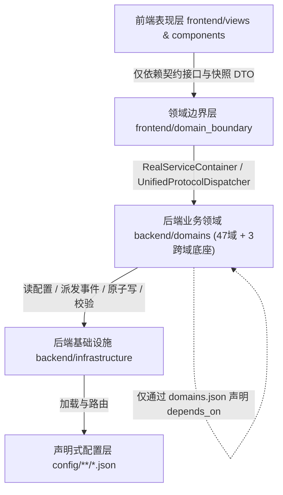
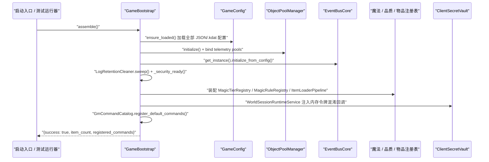

# 分层拓扑与依赖规则

> 卡拉尔世界引擎采用**无头确定性后端 + 待命式解耦前端 + 全量声明式配置**三层分离架构，全局通过 `GameBootstrap` 单点装配并通过 `EventBusCore` 与领域边界层隔离通信。

---

## 一、全局物理拓扑

```text
WebGames/
├── backend/
│   ├── infrastructure/   # 71 个 .gd：配置、事件总线、日志安全、持久化、对象池、过场编排
│   ├── config/           # 契约完备性基线 contract_completeness_baseline.json
│   └── domains/          # 50 个目录（352 个 .gd）：47 个登记业务域 + 3 个跨域基础设施豁免目录
├── frontend/             # 128 个 .gd：引导、导航、主题组件、UI 基建、domain_boundary、17 卷视图
├── dev_harness/          # 6 个 .gd：状态快照捕获与注入工具
├── config/               # 120+ JSON 表：infrastructure / domains / frontend / items / narratives / copywriting / i18n
├── mod_sdk/              # 模组工具链、JSON Schema、3 级模板与开发规格
├── tests/                # 149 个 .gd：unit（domains/frontend/infrastructure）/ guards / integration
├── benchmarks/           # 8 个 .gd：事件吞吐、配置解析、对象池与内存寿命基准
└── scripts/              # ps1 / sh / py / js 跨平台测试与 23 项静态审查门禁
```

---

## 二、四层架构依赖矩阵



| 层级 | 允许依赖范围 | 禁止依赖与红线 |
| :--- | :--- | :--- |
| **前端视图层**（`frontend/views/**`） | `presentation/`、`ui_infrastructure/`、`components/`、`navigation/`、`i18n/`、`theme/`、`view_models/` | 严禁直接实例化后端类、读取 `EventBusCore` 内部状态或消费业务数值 `GameConfig` |
| **领域边界层**（`frontend/domain_boundary/`） | `interfaces/` 强类型契约、`contracts/` 快照 DTO、`services/`（生产）/ `mocks/`（测试） | 视图不得越过 `ServiceLocator` 直接穿透 `world_gateway` 或 `account_repository` |
| **后端业务域**（`backend/domains/<id>/`） | `backend/infrastructure/`、共享域表、[domains.json](../../../config/infrastructure/domains.json) 中显式声明的 `depends_on` 域 | 领域求解器（`*_solver.gd`）不得反向依赖 `GameLoopFSM` 或持久化路径 |
| **后端基础设施**（`backend/infrastructure/`） | Godot 核心运行时与纯计算域库 `pure/`；仅装配入口 [game_bootstrap.gd](../../../backend/infrastructure/game_bootstrap.gd) 与跨端契约桥接层协同域注册表 | 不得耦合单一业务玩法规则 |

---

## 三、后端 50 目录分类契约

`backend/domains/` 下全部 50 个目录受 [test_architecture_guard.gd](../../../tests/guards/test_architecture_guard.gd) 的 `TC-ARCH-01` 双向差集守卫约束：

1. **47 个登记业务领域**：全部在 [domains.json](../../../config/infrastructure/domains.json) 注册 `id`、`config`、`narrative`、`test`、`test_symbol`、`phase`（1~4）与 `depends_on`。
2. **3 个跨域基础设施豁免目录**：显式登记于 `domains.json` 的 `_meta.infra_dirs_exempt`：
   - `contract_registry`：前后端契约定义注册表与基线核验。
   - `lifecycle`：引擎与会话生命周期上下文协定。
   - `version_governance`：版本清单解析、激活令牌与灰度路由门禁。

---

## 四、后端六角色内部拓扑规范

每个标准业务领域内部按统一六角色分工组织，避免状态突变逻辑与纯数值计算混杂：

| 角色后缀 | 形态 | 职责边界 | 硬性约束 |
| :--- | :--- | :--- | :--- |
| `*_entity.gd` / `*_aggregate.gd` | `RefCounted` 实例 | 持有领域状态容器与 `serialize()` / `deserialize()` | 禁止内联跨聚合流程编排 |
| `*_solver.gd` | 静态纯函数类 | 数值求解、公式评估与策略裁决 | 禁止带副作用的原地 `-> void` 改写入参 |
| `*_fsm.gd` | `RefCounted` 实例 | 有限状态迁移与前置守卫 | 禁止绕过状态转移表直接覆写外部系统 |
| `*_pipeline.gd` | 静态编排器 | 多步骤事务协调与跨聚合调度 | 所有阈值/倍率须源自 `GameConfig` |
| `*_service.gd` | 门面/服务类 | 对外命令入口、日志与事件发布、失败语义封装 | 错误出口遵循统一结构化返回契约 |
| `*_dto.gd` / `*_registry.gd` | 值对象 / 注册表 | 强类型参数载体或运行时索引表 | 零裸全局随机调用（`TC-ARCH-04`） |

---

## 五、全引擎冷启动装配序列

`GameBootstrap.assemble()`（[game_bootstrap.gd](../../../backend/infrastructure/game_bootstrap.gd)）以幂等方式按固定顺序激活全域单例，任一注册表校验失败即中断返回错误码而不暴露半成品：



若启用版本化门禁启动入口 `GameBootstrap.assemble_versioned(target_version, token)`，系统在加载配置后先执行 `VersionActivationGate.evaluate_startup_eligibility(...)`，校验通过后方推进装配并绑定当前 `VersionedRuntimeContext`。
