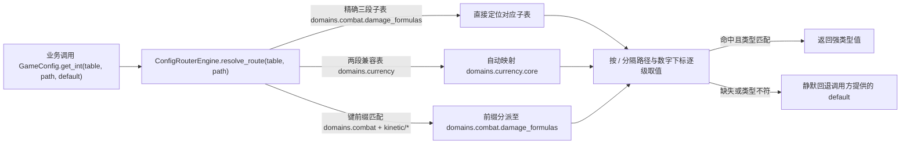

# 配置驱动与数据流契约

> 引擎坚持**零硬编码原则**：全部业务数值、阈值、概率、配方、文案模板与界面参数均存放在 `res://config/` 下，源码仅保留声明式读取缺省回退值与纯数学/协议常数。

---

## 一、配置目录分层与表名映射

`GameConfig`（[game_config.gd](../../../backend/infrastructure/game_config.gd)）扫描 `res://config/` 生成点分表名（`<层>.<名>` 或 `<层>.<子目录>.<子表>`）：

| 物理目录 | 表名规范 | 用途与代表表 |
| :--- | :--- | :--- |
| `config/infrastructure/` | `infrastructure.<name>` | 引擎级基线表（`domains`、`errors_catalog`、`log`、`persistence`、`clock`、`event_bus_config`、`event_categories`、`contracts`、`object_pool` 等） |
| `config/domains/<domain>/` | `domains.<domain>.core` 或多子表 | 业务域参数与规则矩阵；超大型域（如 `combat`）拆为 `mechanics` / `damage_formulas` / `buff_definitions` |
| `config/frontend/` | `frontend.<name>` | 前端界面配置（`ui`、`views`） |
| `config/items/` | `items.core` | 全局物品原型字典，启动装配时由 `ItemLoaderPipeline` 索引加载 |
| `config/narratives/` | `narratives.<domain>` | 业务与系统可读文案模板（支持占位符插值） |
| `config/copywriting/` | `copywriting.<name>` | 合规标准文案底座库 |
| `config/i18n/` | `i18n.<name>` | 多语言词条与动态插值模板 |

---

## 二、加载模式与热重载生命周期

1. **双源加载策略**：
   - 默认遍历 `res://config/` 下 JSON 文件并在互斥锁 `_tables_mutex` 保护下写入静态快照字典 `_tables`。
   - 若存在紧凑二进制包 `res://config/config.kdat`，可经 [binary_config_reader.gd](../../../backend/infrastructure/binary_config_reader.gd) 进行 CRC32 校验与 DEFLATE 解压加载。
   - **路径分段缓存**：`_path_cache` 仅缓存 `table:path` 拆分结果（上限 `PATH_CACHE_MAX_ENTRIES = 4096`），不缓存配置值；热重载成功后递增版本计数并清空路径分段缓存。
2. **原子热重载**：`GameConfig.reload_config()` 先在隔离快照构建与校验全部必需表，全部成功后才执行内存快照交换，避免半截配置污染运行期。
3. **版本版本号驱动失效**：上游各缓存组件（如 `EventBusCore` 信道映射、`RedactionRule`、`LogFileExporter`、`DeterministicRNG`）均比对 `GameConfig.config_reload_version()`，实现按版本无锁按需刷新。

---

## 三、强类型读取与智能子表路由

### 硬性编码规约
- **强制强类型读取器**：统一使用 `get_int`、`get_float`、`get_string`、`get_bool`、`get_dict`、`get_array` 与领域文案入口 `GameConfig.msg(domain, key)`；严禁回传未类型收窄的 `Variant`（静态审查门禁拦截 `GameConfig.get_value`）。
- **必需表与键存在性闭环**：
  - `GameConfig._required_tables` 登记启动必需表清单；
  - [test_architecture_guard.gd](../../../tests/guards/test_architecture_guard.gd) 中的 `TC-ARCH-02`（表存在性）与 `TC-ARCH-06`（静态双字符串字面量键路径存在性）确保“源码引用与磁盘 JSON 键”零漂移；
  - `domains.json` 中的 `shared_tables`（如 `attribute`、`economy`、`event_probability`、`item_attributes`、`magic_tiers`、`quality_tiers`、`starter_loadout`）允许跨域只读共享而无需额外声明 `depends_on`。
