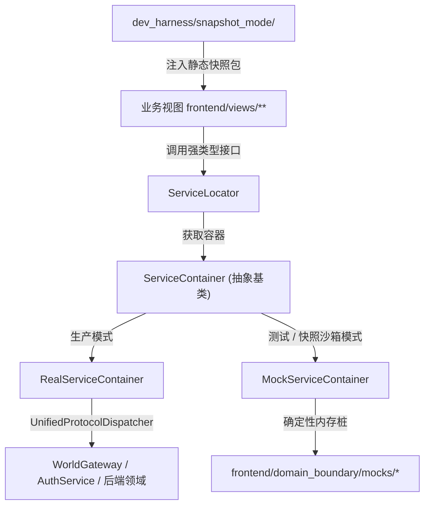

# 前端表现层解耦协议

> 前端工程遵循**表现层零业务逻辑**契约：UI 视图仅作为响应式快照消费者与用户意图收集器，不直接持有后端域模型或触发业务计算，所有跨端交互经由领域边界接口与统一协议信封流转。

---

## 一、待命式视图契约

所有位于 `frontend/views/**` 的场景视图遵循统一单向数据流约束（受 [test_frontend_boundary_guard.gd](../../../tests/guards/test_frontend_boundary_guard.gd) 静态守护）：

1. **唯一数据输入口**：视图暴露 `apply_snapshot(snapshot: Dictionary) -> void`，接收强类型 DTO 投影后的只读展示字段，视图内部不得执行成功率计算、伤害/汇率公式、伪持久状态缓存或随机数生成。
2. **主动状态拉取兜底**：在场景挂载或页面切回时，经 `HudEventBridge.pull_hud_snapshot_async()`（[hud_event_bridge.gd](../../../frontend/systems/hud_event_bridge.gd)）或绑定服务接口主动同步最新权威状态，消除错过的事件帧。
3. **节点与资源复用**：视图节点通过 `%UniqueName` 与 `@export` 绑定，弹窗、提示条与确认框统一委托全局管理器（`DialogManager`、`ModalManager`、`ToastLayer`、`LoadingOverlay`）呈现。

---

## 二、领域边界容器与服务替换机制

| 组件 | 路径 | 职责 |
| :--- | :--- | :--- |
| **服务定位器** | [service_locator.gd](../../../frontend/domain_boundary/service_locator.gd) | 统一托管当前激活的 `ServiceContainer` 及与 `WorldSessionRuntimeService` 绑定的运行时网关句柄 |
| **强类型服务契约** | `frontend/domain_boundary/interfaces/i_*.gd` | 18 个纯抽象接口（覆盖鉴权、角色、世界、Esc 菜单、战斗、经济、工坊、公会、邮件、任务、抽卡等全系统） |
| **契约快照 DTO** | `frontend/domain_boundary/contracts/*.gd` | `FrontendSnapshot`、`FrontendHudSnapshot`、`CombatFloatingTextDTO` 等强类型传递包 |
| **双实现容器** | [real_service_container.gd](../../../frontend/domain_boundary/services/real_service_container.gd) / [mock_service_container.gd](../../../frontend/domain_boundary/mocks/mock_service_container.gd) | 保证 UI 在无后端进程时可全量离线驱动单测与快照预览 |

---

## 三、统一协议信封与事件信道

1. **上行指令流（Client -> Backend）**：
   - 前端交互操作统一经 `UnifiedProtocolFactory.create_human_request(...)` 构造 `ClientRequestEnvelopeDTO`（含动作标识符、幂等请求 ID、载荷与人类控制租约校验标识）。
   - 由 `UnifiedProtocolDispatcher` 统一校验租约与契约路由并派发到目标领域管线，返回 `UnifiedResponseEnvelopeDTO`（明确承载 `success`、`error_code`、`message` 与 `data`），前端严格依据真实回执更新视图与弹出提示。
2. **下行事件流（Backend -> Frontend）**：
   - `EventBusCore` 通过整型信道常数（`EventChannelDefinition`）与分类位掩码（`EventCategoryMask`）将状态变更广播至 `HudEventBridge` 与 `CutsceneEventBridge`。
   - 订阅方统一持有 `EventBusSubscriptionToken` 或通过 `ScopedEventSubscriber` 在节点 `_exit_tree()` 时自动释放句柄，杜绝已销毁 UI 节点接收回调导致崩溃。
