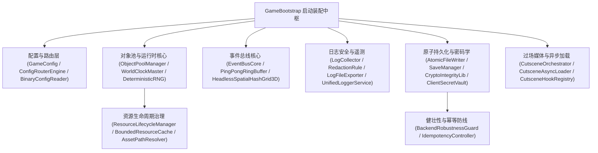

# 01 后端基础设施 (`backend/infrastructure/`)

> 本分卷映射 `WebGames/backend/infrastructure/` 全部 **72 个** `.gd` 脚本（根目录 37 个模块与 `dto`、`event_bus`、`logging`、`media`、`profiling`、`pure`、`resource_governance`、`robustness` 等子目录），构成卡拉尔世界引擎的底层运行基座。

---

## 一、基础设施分层全景

---

## 二、分册索引（全量覆盖 72 个脚本）

| 专题文档 | 覆盖目录/模块范围 | 文件数 | 核心内容 |
| :--- | :--- | :---: | :--- |
| [config_and_routing.md](config_and_routing.md) | `GameConfig`、`GameConfigLoader`、`ConfigRouterEngine`、`BinaryConfigReader`、`dto/kdata_*`、`CopywritingResolver`、`TemplateFormatter` | 9 | 配置双源加载、JIT 惰性装表、智能子表路由、`.kdat` 二进制解码与文本模板插值 |
| [event_bus.md](event_bus.md) | `event_bus/*` 全部事件总线子系统 | 11 | 整数信道、掩码过滤、对象池与双环形缓冲、3D 空间哈希分发、表现适配器 |
| [logging_and_telemetry.md](logging_and_telemetry.md) | `logging/*`、`log_*`、`RedactionRule`、`TelemetryAggregate`、`ErrorCodeRegistry`、`ErrorReporter`、`profiling/*` | 15 | 结构化日志链路、四模上下文脱敏、防篡改加密导出、错误码登记与耗时分位 |
| [persistence_and_security.md](persistence_and_security.md) | `AtomicFileWriter`、`SaveManager`、`AuthoritySyncStub`、`ClientSecretVault`、`pure/*`、`robustness/*` | 8 | 三阶段原子写盘、单字段 SHA-256 存档信封、纯计算密码学域库与幂等器 |
| [runtime_core_and_pooling.md](runtime_core_and_pooling.md) | `GameBootstrap`、`GameLoopFSM`、`WorldClockMaster`、`DeterministicRNG`、`ObjectPool*`、`SoAEntityBuffer`、`resource_governance/*` 等 | 22 | 冷启动装配、主循环状态栈、LCG 确定性随机、对象池与 SoA 缓冲、资源寿命治理 |
| [media_and_cutscene.md](media_and_cutscene.md) | `media/*` 与 `media/dto/*` | 7 | CG 过场编排状态机、异步预加载器、钩子注册与降级文字演播 |
