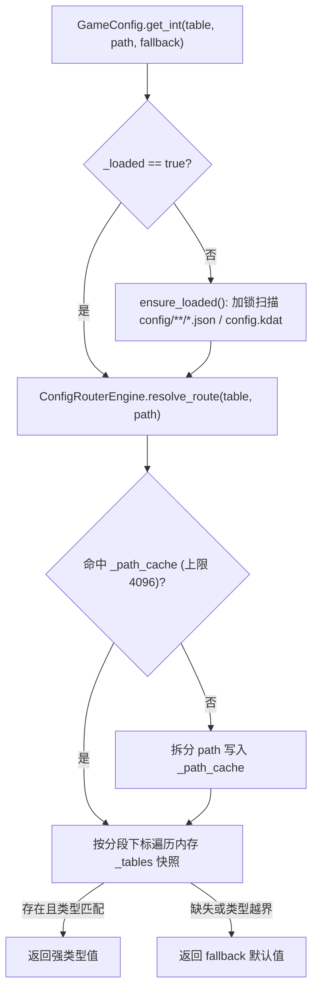

# 配置管理、子表路由与模板解析 (`config_and_routing`)

> 对应源码：`backend/infrastructure/` 下配置中心、I/O 加载器、路由器、`.kdat` 二进制解码器及文本模板工具共 **9 个**脚本，承担全引擎配置的加载、按需 JIT 读盘、热更新、子表重定向与文案插值职责。

---

## 一、模块与类清单

| 文件路径 | 核心类 | 基类 | 核心职责与关键接口 |
| :--- | :--- | :--- | :--- |
| [game_config.gd](../../../backend/infrastructure/game_config.gd) | `GameConfig` | `RefCounted` | 全域配置中央快照与模组覆盖层门面；提供 `ensure_loaded()`、`ensure_l0_loaded_sync()`、`load_via_storage_async()`、`reload_config()`、`apply_mod_overlay_tables()`、`clear_mod_overlay_tables()`、`config_reload_version()` 及 `get_int/float/string/bool/dict/array`、`msg()` |
| [game_config_loader.gd](../../../backend/infrastructure/game_config_loader.gd) | `GameConfigLoader` | `RefCounted` | 承担物理目录扫描、`.kdat`/`.json` 单表加载、JIT 按需读盘、异步工作池装载及热重载快照差异计算，实现查询门面与 I/O 构表分层解耦 |
| [config_router_engine.gd](../../../backend/infrastructure/config_router_engine.gd) | `ConfigRouterEngine` | `RefCounted` | 点分表名与键前缀智能路由器；提供 `resolve_table_name()`、`resolve_route()`、`get_subtables_for_domain()`、`build_subtable_key()`、`is_subtable()` |
| [config_route_dto.gd](../../../backend/infrastructure/config_route_dto.gd) | `ConfigRouteDTO` | `RefCounted` | 路由解析结果值对象；携带 `root_layer`、`domain_id`、`sub_table_id` 与 `RouteResolutionMode` 枚举（直通/别名/前缀分派） |
| [binary_config_reader.gd](../../../backend/infrastructure/binary_config_reader.gd) | `BinaryConfigReader` | `RefCounted` | `.kdat` 紧凑二进制配置解码器；实现魔数 `0x4B444154` 校验、`compute_crc32()`、`load_kdat_file()`、`load_kdat_buffer()`、`load_monolithic_bundle()` |
| [kdata_header_dto.gd](../../../backend/infrastructure/dto/kdata_header_dto.gd) | `KDataHeaderDTO` | `RefCounted` | `.kdat` 32 字节文件头描述符（魔数/版本/标志位/压缩模式/载荷类型/校验值），支持 `reset_state()` 与 `validate()` |
| [kdata_toc_entry_dto.gd](../../../backend/infrastructure/dto/kdata_toc_entry_dto.gd) | `KDataTOCEntryDTO` | `RefCounted` | 单包多表（Monolithic Bundle）目录表（TOC）偏移量条目，支持 `reset_state()` 池化复用 |
| [copywriting_resolver.gd](../../../backend/infrastructure/copywriting_resolver.gd) | `CopywritingResolver` | `RefCounted` | 从 `config/copywriting/` 读取合规标准文案底座与回退键解析 |
| [template_formatter.gd](../../../backend/infrastructure/template_formatter.gd) | `TemplateFormatter` | `RefCounted` | 模板占位符参数萃取（`extract_param_keys()`）与命名/顺序占位插值格式化 |

---

## 二、配置加载与路由机制

---

## 三、`.kdat` 二进制包解析规范

1. **魔数与版本门禁**：强制验证 32 字节定长头 `MAGIC_KDAT = 0x4B444154`（`'KDAT'`）与 `FORMAT_VERSION = 0x0100`。
2. **标志位与压缩**：支持 `FLAG_COMPRESSED`（RAW / DEFLATE / ZSTD）、`FLAG_STRING_POOL`（字符串驻留池引用 `TAG_STRING_REF`）、`FLAG_MONOLITHIC_TOC` 与 `FLAG_ENCRYPTED`。
3. **TLV 类型解码**：支持 `TAG_NIL`、`TAG_BOOL_FALSE/TRUE`、`TAG_INT32/INT64`、`TAG_FLOAT64`、`TAG_STRING`、`TAG_ARRAY`、`TAG_DICT` 与 `TAG_BINARY_BLOB`，校验通过静态懒加载 IEEE 802.3 CRC32 查找表完成。

---

## 四、关键不变量与对应测试

- **原子热重载**：`GameConfig.reload_config()` 在隔离临时字典完成解析后一次性交换 `_tables` 并递增版本号，防止半加载状态被业务读取。
- **动态缓存防膨胀**：`_path_cache` 受 `PATH_CACHE_MAX_ENTRIES = 4096` 上限保护并在热重载后清空。
- **相关测试**：[test_config_subtables.gd](../../../tests/unit/infrastructure/test_config_subtables.gd)、[test_binary_config_and_kdat_pipeline.gd](../../../tests/integration/test_binary_config_and_kdat_pipeline.gd)、[test_configuration_guard.gd](../../../tests/guards/test_configuration_guard.gd)。
