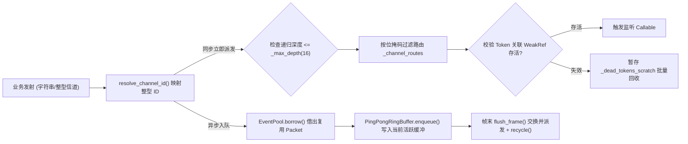

# 解耦事件总线与空间分发 (`event_bus`)

> 对应源码：`backend/infrastructure/event_bus/` 全部 **11 个** `.gd` 文件。`EventBusCore` 是全域唯一事件广播与异步队列中枢，通过整数信道、位掩码过滤、对象池与乒乓环形缓冲支撑高吞吐零分配派发。

---

## 一、子系统文件与类清单

| 文件路径 | 核心类 | 职责定位 |
| :--- | :--- | :--- |
| [event_bus_core.gd](../../../backend/infrastructure/event_bus/event_bus_core.gd) | `EventBusCore` | 全局解耦事件中枢单例；管理路由注册、整型信道映射、同步嵌套重入保护与帧批异步刷新 |
| [event_channel_definition.gd](../../../backend/infrastructure/event_bus/event_channel_definition.gd) | `EventChannelDefinition` | 强类型整型信道常量字典（含 `HUD_STATUS_SNAPSHOT`、`HUD_STAT_MUTATED`、`HUD_WALLET_MUTATED`、`AUTH_REGISTERED` 等） |
| [event_category_mask.gd](../../../backend/infrastructure/event_bus/event_category_mask.gd) | `EventCategoryMask` | 基于位掩码的事件类别常量，供令牌在路由阶段内联位运算拦截 |
| [event_packet.gd](../../../backend/infrastructure/event_bus/event_packet.gd) | `EventPacket` | 池化事件载体，支持 `reset_state()`、2D/3D 空间坐标头 `set_spatial_header*()` 与字典提取 `extract_payload_dict()` |
| [event_pool.gd](../../../backend/infrastructure/event_bus/event_pool.gd) | `EventPool` | `EventPacket` 定长对象池（默认容量 4096），暴露 `borrow()`、`recycle()` 与借出峰值统计 |
| [ping_pong_ring_buffer.gd](../../../backend/infrastructure/event_bus/ping_pong_ring_buffer.gd) | `PingPongRingBuffer` | 读写隔离的双区乒乓环形缓冲，实现 `enqueue()` 与 `flush_frame()` 帧批交换 |
| [event_bus_subscription_token.gd](../../../backend/infrastructure/event_bus/event_bus_subscription_token.gd) | `EventBusSubscriptionToken` | 订阅凭据句柄，绑定回调目标、掩码与活跃态并提供安全解绑 `unbind()` |
| [headless_spatial_hash_grid_3d.gd](../../../backend/infrastructure/event_bus/headless_spatial_hash_grid_3d.gd) | `HeadlessSpatialHashGrid3D` | 无头 3D/2D 空间网格哈希索引；支持按位置半径精准路由 `dispatch_spatial()` 与 `dispatch_packet()` |
| [i_visual_presentation_adapter.gd](../../../backend/infrastructure/event_bus/i_visual_presentation_adapter.gd) | `IVisualPresentationAdapter` | 表现层视觉同步抽象适配器接口（生灭、位移、Cue 特效、空间爆发） |
| [headless_presentation_mock_adapter.gd](../../../backend/infrastructure/event_bus/headless_presentation_mock_adapter.gd) | `HeadlessPresentationMockAdapter` | 无头测试用表现适配器记录桩实现 |
| [visual_cue_dto.gd](../../../backend/infrastructure/event_bus/visual_cue_dto.gd) | `VisualCueDTO` | 视觉提示与空间表现数据包 |

---

## 二、同步广播与帧批异步流转

---

## 三、配置契约与性能防线

1. **配置驱动参数**：`initialize_from_config()` 读取 `infrastructure.event_bus_config` 下的 `spatial_routing/cell_size_meters`（默认 `16.0`）、`spatial_routing/max_dispatch_radius_meters`（默认 `256.0`）、`frame_batching/ring_buffer_capacity` 与 `channel_registry`。
2. **版本感知信道缓存**：`_channel_name_to_id` 与 `_narrative_table_cache` 在检测到 `GameConfig.config_reload_version()` 变化时自动刷新。
3. **重入熔断与零堆分配**：`_max_depth = 16` 防止循环订阅死锁；按递归深度索引的 `_target_scratch`、`_seen_scratch`、`_dead_tokens_scratch` 复用数组确保派发循环零瞬态堆分配；单测推荐使用独立 `EventBusCore.new()` 并调用 `clear_for_tests()` 清理环境。
4. **关联测试**：[test_event_bus2_zero_gc_pipeline.gd](../../../tests/integration/pipelines/test_event_bus2_zero_gc_pipeline.gd)。
