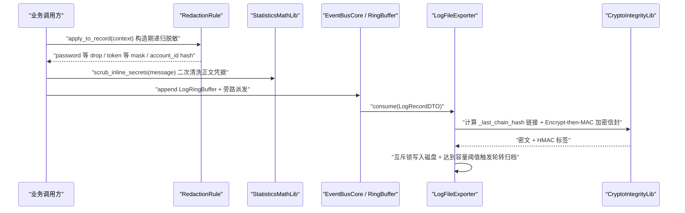

# 结构化日志、脱敏与遥测审计 (`logging_and_telemetry`)

> 对应源码：`backend/infrastructure/` 日志采集、脱敏、内存环形缓冲、加密防篡改落盘、异常上报与性能遥测共 **15 个**脚本，严格保障敏感凭据零明文落盘与审计链路可验真。

---

## 一、核心模块清单

| 文件路径 | 核心类 | 职能域 | 关键能力说明 |
| :--- | :--- | :--- | :--- |
| [unified_logger_service.gd](../../../backend/infrastructure/logging/unified_logger_service.gd) | `UnifiedLoggerService` | 日志服务门面 | 六级过滤阈值（`TRACE`..`CRITICAL`）、模板目录格式化、挂接环形缓冲与控制台静音开关 |
| [log_constants.gd](../../../backend/infrastructure/logging/log_constants.gd) | `LogConstants` | 日志常量单源 | 定义脱敏模式常量（`mask`/`drop`/`hash`/`salted_hash`）、AES 密钥长度、链式初始摘要及轮转文件匹配 |
| [system_base_messages.gd](../../../backend/infrastructure/logging/system_base_messages.gd) | `SystemBaseMessages` | 合规英文底座文案库 | 提供日志与系统内部 `format()` 与 `resolve_event_or_base()` 标准化底座模板 |
| [log_collector.gd](../../../backend/infrastructure/log_collector.gd) | `LogCollector` | 采集与追踪上下文 | 管理调用链路跟踪 ID（`begin_trace`/`get_active_trace_id`/`clear_trace`）与调用栈帧捕获开关 |
| [log_record_dto.gd](../../../backend/infrastructure/log_record_dto.gd) | `LogRecordDTO` | 池化传输日志记录 | 支持 `reset_state()` 与基础字段填充 `populate_base_from_dict()` |
| [structured_log_record.gd](../../../backend/infrastructure/structured_log_record.gd) | `StructuredLogRecord` | 完整结构化日志 | 承载序列号、事件码、严重度、脱敏上下文、相关性 ID 与 `clone()/to_dto()` |
| [redaction_rule.gd](../../../backend/infrastructure/redaction_rule.gd) | `RedactionRule` | 构造期规则脱敏器 | 基于 `infrastructure.log` 的 `redaction/rules` 正则对 context 递归执行掩码、丢弃、摘要或加盐摘要 |
| [log_ring_buffer.gd](../../../backend/infrastructure/log_ring_buffer.gd) | `LogRingBuffer` | 内存有界环形队列 | 定长存储近期结构化日志，供实时排查检索 `query()`，杜绝日志内存无限增长 |
| [log_export_config_dto.gd](../../../backend/infrastructure/log_export_config_dto.gd) | `LogExportConfigDTO` | 导出配置 DTO | 从 `infrastructure.log` 解析批阈值、通道/等级白名单、轮转上限与加密开关 |
| [log_file_exporter.gd](../../../backend/infrastructure/log_file_exporter.gd) | `LogFileExporter` | 防篡改加密落盘消费 | EventBus 旁路消费者；互斥锁 `_io_mutex` 串行批写、容量轮转、哈希链串联与 AES+HMAC 审计信封写入 |
| [log_query_service.gd](../../../backend/infrastructure/log_query_service.gd) | `LogQueryService` | 审计检索与解密验真 | 支持过滤条件查询及 `verify_encrypted_log_file()` 解密与逐行哈希链篡改检出 |
| [log_query_dto.gd](../../../backend/infrastructure/log_query_dto.gd) | `LogQueryDTO` | 查询条件值对象 | 封装时间窗口、最小等级、领域、关键字与分页限制 |
| [log_retention_cleaner.gd](../../../backend/infrastructure/log_retention_cleaner.gd) | `LogRetentionCleaner` | 保留期巡检清理 | 启动期间调用 `sweep()` 清除过期归档日志文件 |
| [telemetry_aggregate.gd](../../../backend/infrastructure/telemetry_aggregate.gd) | `TelemetryAggregate` | 遥测聚合统计 | 汇集事件吞吐与延迟样本，经 `StatisticsMathLib` 懒计算 `P50/P95` 分位耗时 |
| [error_code_registry.gd](../../../backend/infrastructure/error_code_registry.gd) | `ErrorCodeRegistry` | 错误码核验登记 | 对接 `infrastructure.errors_catalog` 查询与未登记错误码计数追踪 |
| [error_reporter.gd](../../../backend/infrastructure/error_reporter.gd) | `ErrorReporter` | 统一错误出口 | 取代散落 `push_error`，通过 `emit()` / `emit_warning()` / `migrate_push_error()` 收口告警通道 |
| [profiling_metric_hook.gd](../../../backend/infrastructure/profiling/profiling_metric_hook.gd) | `ProfilingMetricHook` | 性能探针钩子 | 按类别采集耗时指标样本并受开关控制按需启停 |

---

## 二、安全日志处理全链路

---

## 三、关联验证套件

- [test_unified_logger_service.gd](../../../tests/unit/infrastructure/test_unified_logger_service.gd)
- [test_log_crypto_and_base_messages.gd](../../../tests/unit/infrastructure/test_log_crypto_and_base_messages.gd)
- [test_log_error_base_pipeline.gd](../../../tests/integration/pipelines/test_log_error_base_pipeline.gd)
- [test_structured_log_pipeline.gd](../../../tests/integration/pipelines/test_structured_log_pipeline.gd)
