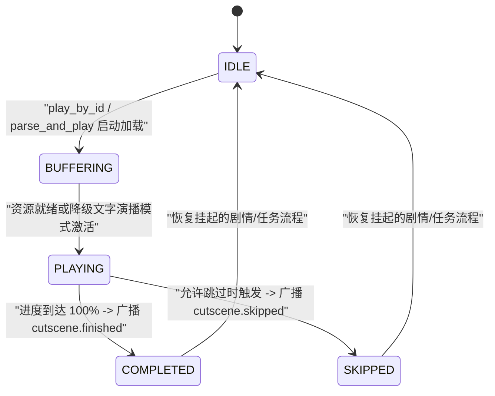

# 过场媒体编排与异步预加载 (`media_and_cutscene`)

> 对应源码：`backend/infrastructure/media/` 与 `media/dto/` 共 **7 个**文件，承担全游戏 CG 视频、文字演播降级、字幕同步、剧情钩子触发与资源预加载调度职责。

---

## 一、模块与 DTO 清单

| 文件路径 | 核心类 | 角色定位 | 核心接口与字段 |
| :--- | :--- | :--- | :--- |
| [cutscene_orchestrator.gd](../../../backend/infrastructure/media/cutscene_orchestrator.gd) | `CutsceneOrchestrator` | 播放生命周期状态机单例 | `play_by_id()`、`parse_and_play()`、`play_cutscene()`、`update_playback_progress()`、`finish_cutscene()`、`is_playing()`、`get_playback_state()` |
| [cutscene_hook_registry.gd](../../../backend/infrastructure/media/cutscene_hook_registry.gd) | `CutsceneHookRegistry` | 清单与剧情钩子注册中心 | 从 `infrastructure.cutscene_hooks` 与 `infrastructure.cutscene_registry` 装配清单；提供 `resolve_request()`、`match_narrative_hook()`、`match_quest_hook()` |
| [cutscene_async_loader.gd](../../../backend/infrastructure/media/cutscene_async_loader.gd) | `CutsceneAsyncLoader` | 异步流式资源加载器 | 支持确定性测试步进模式 `set_deterministic_mode()`、`request_load()`、`poll_tasks()`、`cancel_task()` 与有界缓存 |
| [cutscene_preload_predictor.gd](../../../backend/infrastructure/media/cutscene_preload_predictor.gd) | `CutscenePreloadPredictor` | 下游分支预判预加载器 | `predict_and_preload_downstream()` 根据剧情节点后继边提前预热下游媒体资源 |
| [cutscene_manifest_dto.gd](../../../backend/infrastructure/media/dto/cutscene_manifest_dto.gd) | `CutsceneManifestDTO` | 过场媒体元数据清单 DTO | 定义视频路径、字幕轨道、文字降级剧本、可跳过标记与时长 |
| [cutscene_request_dto.gd](../../../backend/infrastructure/media/dto/cutscene_request_dto.gd) | `CutsceneRequestDTO` | 播放请求强类型载体 | `to_dict()`、`from_dict()`、`duplicate_request()`，防止外部修改污染活动请求 |
| [cutscene_playback_state_dto.gd](../../../backend/infrastructure/media/dto/cutscene_playback_state_dto.gd) | `CutscenePlaybackStateDTO` | 运行时播放状态与枚举 DTO | 包含 `PlaybackState` 枚举与当前进度/字幕游标 |

---

## 二、播放状态流转与无头降级机制

1. **防重入隔离**：进入 `play_cutscene()` 时检查 `is_playing()`（`PLAYING` 或 `BUFFERING` 态拒绝并发请求并返回 `CUTSCENE_ALREADY_PLAYING`），并对入参执行 `duplicate_request()` 深拷贝保护。
2. **路径沙箱校验**：视频及素材 URI 经 `AssetPathResolver.resolve_unified_uri()` 解析，确保 MOD 注入素材不越界访问本地文件系统。
3. **无头与文字降级**：缺失物理视频轨或处于无头推演测试模式时，自动衔接文字演播序列并触发完成事件，不阻塞主线剧情推进。
4. **关联测试**：[test_cutscene_hook_and_playback_pipeline.gd](../../../tests/integration/test_cutscene_hook_and_playback_pipeline.gd)。
