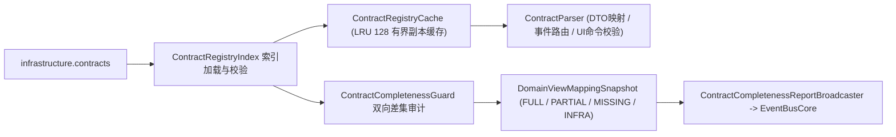

# 契约注册与完备性审计 (`contract_registry`)

> 对应源码：`backend/domains/contract_registry/`（7 个 `.gd`）及基线文件 [contract_completeness_baseline.json](../../../backend/config/contract_completeness_baseline.json)。承担前后端边界契约元数据索引、DTO/事件/命令三向解析与契约完备性快照广播职责。

---

## 一、模块与类清单

| 文件路径 | 核心类 | 角色定位 | 关键公开接口 |
| :--- | :--- | :--- | :--- |
| [contract_registry_index.gd](../../../backend/domains/contract_registry/contract_registry_index.gd) | `ContractRegistryIndex` | 契约唯一索引单例 | `get_instance()`、`ensure_loaded()`、`validate_config()`、`reload_from_config()`、`get_schema_version()`、`get_infra_domains()`、`get_reverse_orphans()`、`find_all()`、`find_by_domain()`、`find_by_view()` |
| [contract_registry_entry.gd](../../../backend/domains/contract_registry/contract_registry_entry.gd) | `ContractRegistryEntry` | 单契约条目模型 | `to_dto()`、`from_dto()` |
| [contract_registry_cache.gd](../../../backend/domains/contract_registry/contract_registry_cache.gd) | `ContractRegistryCache` | LRU 128 有界缓存 | `get_cached()`、`invalidate_cache()`、`invalidate_domain()`、`reload_from_config()`、`check_compatibility()`（返回深度副本防外泄） |
| [contract_parser.gd](../../../backend/domains/contract_registry/contract_parser.gd) | `ContractParser` | 三核心契约解析器 | `resolve_dto_mapping()`、`route_domain_event()`、`dispatch_ui_command()` |
| [contract_completeness_guard.gd](../../../backend/domains/contract_registry/contract_completeness_guard.gd) | `ContractCompletenessGuard` | 双向完备性与漂移审计 | `audit_domain_coverage()`、`audit_view_density()`、`audit_infra_consistency()`、`audit_full_registry()` |
| [domain_view_mapping_snapshot.gd](../../../backend/domains/contract_registry/domain_view_mapping_snapshot.gd) | `DomainViewMappingSnapshot` | 审计快照 DTO | 承载 `FULL` / `PARTIAL` / `MISSING` / `INFRA` 四分类映射快照 |
| [contract_completeness_report_broadcaster.gd](../../../backend/domains/contract_registry/contract_completeness_report_broadcaster.gd) | `ContractCompletenessReportBroadcaster` | 事件报告广播器 | `broadcast_completeness_report()`、`alert_breaking_change_pending()` |

---

## 二、契约路由与完备性检查链

---

## 三、关联配置与验证

- **配置与基线**：`infrastructure.contracts`（[contracts.json](../../../config/infrastructure/contracts.json)）、[contract_completeness_baseline.json](../../../backend/config/contract_completeness_baseline.json)。
- **测试入口**：[test_contract_registry_pipeline.gd](../../../tests/integration/pipelines/test_contract_registry_pipeline.gd)。
