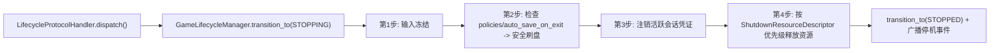

# 生命周期治理与停机管线 (`lifecycle`)

> 对应源码：`backend/domains/lifecycle/`（9 个 `.gd`，含 `dto/` 与 `services/`），负责引擎运行期阶段状态机、十阶段会话钩子管线、多步骤安全停机排序清理以及未接线空槽静默赋值拦截。

---

## 一、模块与类清单

| 文件路径 | 核心类 | 角色定位 | 关键公开接口与配置消费 |
| :--- | :--- | :--- | :--- |
| [lifecycle_model.gd](../../../backend/domains/lifecycle/lifecycle_model.gd) | `GameLifecycleModel` | 枚举与阶段语义定义 | `get_phase_name()`、`get_reason_name()` |
| [game_lifecycle_manager.gd](../../../backend/domains/lifecycle/game_lifecycle_manager.gd) | `GameLifecycleManager` | 生命周期状态权威单例 | `get_instance()`、`reset_for_test()`、`get_current_phase()`、`is_running()`、`is_stopping()`、`is_stopped()`、`transition_to()` |
| [game_lifecycle_service.gd](../../../backend/domains/lifecycle/game_lifecycle_service.gd) | `GameLifecycleService` | 多阶段安全停机编排器 | `register_shutdown_resource()`、`clear_shutdown_resources()`；读取 `infrastructure.lifecycle` 中 `policies/*` 与 `shutdown_hooks/*` |
| [lifecycle_stage_hook_registry.gd](../../../backend/domains/lifecycle/lifecycle_stage_hook_registry.gd) | `LifecycleStageHookRegistry` | 十阶段配置驱动钩子引擎 | `invalidate_cache()`、`clear_hooks()`、`register_hook()`、`get_hooks()`、`execute_stage()`；消费 `infrastructure.lifecycle:session_stage_pipeline` |
| [shutdown_resource_descriptor.gd](../../../backend/domains/lifecycle/shutdown_resource_descriptor.gd) | `ShutdownResourceDescriptor` | 停机资源释放描述符 | `execute_cleanup()`（携带释放优先级与超时约束） |
| [unwired_slot_guard_solver.gd](../../../backend/domains/lifecycle/unwired_slot_guard_solver.gd) | `UnwiredSlotGuardSolver` | 未接线空槽拦截纯求解器 | `validate_slots()`、`detect_unwired_slots()`（阻止缺省默认值伪造槽位绑定） |
| [game_shutdown_dto.gd](../../../backend/domains/lifecycle/dto/game_shutdown_dto.gd) | `GameShutdownDTO` | 停机指令交互信封 | `to_dto()`、`from_dto()` |
| [session_flow_context_dto.gd](../../../backend/domains/lifecycle/dto/session_flow_context_dto.gd) | `SessionFlowContextDTO` | 十阶段共享池化上下文 DTO | `acquire()`、`release()`、`reset_state()`、`prune_intermediate_snapshots()`、`mark_slot_unwired()`、`has_unwired_slot()`、`to_dto()` |
| [lifecycle_protocol_handler.gd](../../../backend/domains/lifecycle/services/lifecycle_protocol_handler.gd) | `LifecycleProtocolHandler` | 客户端生命周期协议处理器 | `dispatch()` 分发优雅停机与安全退出动作 |

---

## 二、停机清理顺序与空槽防线

1. **降级停机可控**：`policies/allow_degraded_shutdown_on_save_failure` 与 `shutdown_hooks/require_explicit_save_slot` 均由 [lifecycle.json](../../../config/infrastructure/lifecycle.json) 驱动，确保存档异常时可按策略明确拒绝退出或受控降级。
2. **上下文对象池化**：`SessionFlowContextDTO` 自建 `acquire()`/`release()` 复用池，并在流程收尾裁剪中间快照防止长驻内存膨胀。
3. **关联测试**：[test_game_lifecycle_pipeline.gd](../../../tests/integration/pipelines/test_game_lifecycle_pipeline.gd)。
