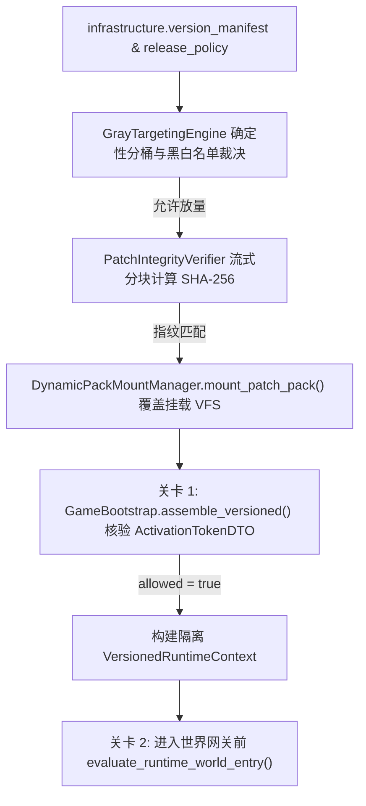

# 版本治理、灰度分群与激活门禁 (`version_governance`)

> 对应源码：`backend/domains/version_governance/`（9 个 `.gd`）。贯彻“物理包存在不等于允许运行”的最高安全边界，覆盖版本元数据、确定性灰度放量、流式 SHA-256 验签、VFS 增量 PCK 挂载与多版本运行时上下文隔离。

---

## 一、模块与类清单

| 文件路径 | 核心类 | 角色定位 | 关键公开接口 |
| :--- | :--- | :--- | :--- |
| [version_manifest_dto.gd](../../../backend/domains/version_governance/version_manifest_dto.gd) | `VersionManifestDTO` | 版本清单元数据模型 | `is_valid()`（校验版本号/版本码/兼容性/补丁类型与 SHA-256 摘要） |
| [gray_policy_dto.gd](../../../backend/domains/version_governance/gray_policy_dto.gd) | `GrayPolicyDTO` | 多维灰度策略模型 | `is_explicitly_whitelisted()`、`is_explicitly_blacklisted()` |
| [gray_targeting_engine.gd](../../../backend/domains/version_governance/gray_targeting_engine.gd) | `GrayTargetingEngine` | 确定性零分配分群引擎 | `compute_user_hash_bucket()`、`evaluate_eligibility()` |
| [activation_token_dto.gd](../../../backend/domains/version_governance/activation_token_dto.gd) | `ActivationTokenDTO` | 版本激活授权入场券 | `is_eligible_at()`（校验时间窗与目标版本授权有效性） |
| [version_activation_gate.gd](../../../backend/domains/version_governance/version_activation_gate.gd) | `VersionActivationGate` | 双保险激活阻断门禁 | `evaluate_startup_eligibility()`、`evaluate_runtime_world_entry()` |
| [patch_integrity_verifier.gd](../../../backend/domains/version_governance/patch_integrity_verifier.gd) | `PatchIntegrityVerifier` | 分块流式指纹校验器 | `compute_file_sha256()`、`verify_file_sha256()` |
| [dynamic_pack_mount_manager.gd](../../../backend/domains/version_governance/dynamic_pack_mount_manager.gd) | `DynamicPackMountManager` | Godot VFS 增量挂载管理器 | `mount_patch_pack()`、`get_active_mounted_version()`、`get_mounted_packs()`、`reset_for_tests()` |
| [version_runtime_context.gd](../../../backend/domains/version_governance/version_runtime_context.gd) | `VersionedRuntimeContext` | 版本隔离运行时上下文 | `assemble_context()`、`dispose()` |
| [version_state_machine.gd](../../../backend/domains/version_governance/version_state_machine.gd) | `VersionStateMachine` | 版本生命周期单向状态机 | `transition_to()`（管控 9 大正常态与 4 大异常态） |

---

## 二、安全激活与 VFS 挂载双保险流程

---

## 三、核心不变量与对应验证

1. **双门槛零信任**：即使补丁 PCK 已落盘且被挂载，若缺乏有效的 `ActivationTokenDTO`，启动点与进世界网关点均执行 Fail-Fast 阻断。
2. **配置真源**：[release_policy.json](../../../config/infrastructure/release_policy.json) 与 [version_manifest.json](../../../config/infrastructure/version_manifest.json)。
3. **验证套件**：[test_version_governance_pipeline.gd](../../../tests/integration/pipelines/test_version_governance_pipeline.gd)。
