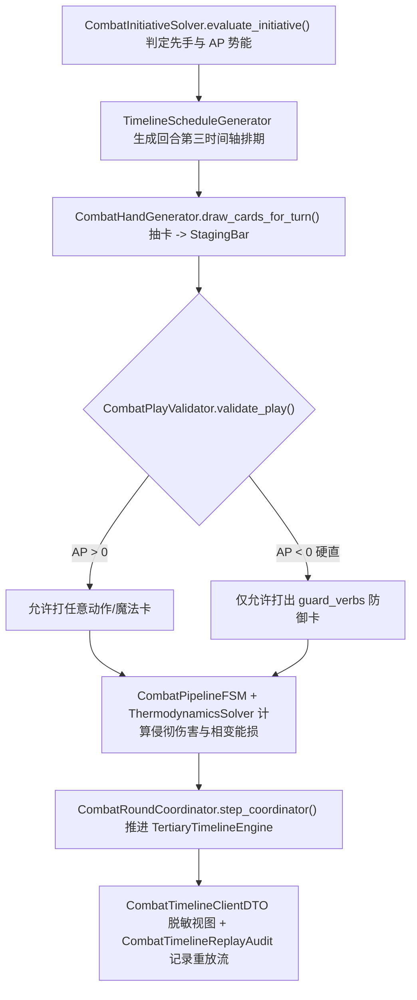

# 物理热力学与三轴战斗引擎 (`physics_thermodynamics`)

> 对应源码：`backend/domains/physics_thermodynamics/`（15 个 `.gd`）。本域承担动量侵彻伤害、魔法相变能损、先手与 AP 正负势能博弈，以及**操作轴 × 小回合轴 × 第三时间轴**的三轴离散战斗协同与回放审计。

---

## 一、模块与类清单

| 文件路径 | 核心类 | 架构角色 | 关键职责与公开方法 |
| :--- | :--- | :--- | :--- |
| [physical_verb_registry.gd](../../../../backend/domains/physics_thermodynamics/physical_verb_registry.gd) | `PhysicalVerbRegistry` | 动词与卡牌注册表 | 八大物理动词侵彻常数、`MagicForm` 枚举、`get_verb()`、`card_defaults()`、`reset_state()` |
| [thermodynamics_solver.gd](../../../../backend/domains/physics_thermodynamics/thermodynamics_solver.gd) | `PhysicsAndThermodynamicsSolver` | 物理与热力学求解器 | `calculate_penetration_damage()`（动量刃口侵彻）、`calculate_mana_phase_transition_loss()`（始源直驱 vs 咒术两步能损） |
| [combat_initiative_solver.gd](../../../../backend/domains/physics_thermodynamics/combat_initiative_solver.gd) | `CombatInitiativeSolver` | 先手与势能求解器 | `evaluate_initiative()` 敏捷/感知/等级加权与三级平局决胜算法 |
| [combat_hand_generator.gd](../../../../backend/domains/physics_thermodynamics/combat_hand_generator.gd) | `CombatHandGenerator` | 手牌生成器 | 分离手牌数量随机与牌型抽取，`evaluate_base_hand_count()`、`apply_special_modifiers()`、`draw_cards_for_turn()` |
| [combat_hand_draw_dto.gd](../../../../backend/domains/physics_thermodynamics/combat_hand_draw_dto.gd) | `CombatHandDrawDTO` | 手牌抽取 DTO | 承载发牌规格与合法 `0` 手牌裁决结果 |
| [combat_play_validator.gd](../../../../backend/domains/physics_thermodynamics/combat_play_validator.gd) | `CombatPlayValidator` | 出牌双条件校验器 | `validate_play()`：`AP > 0` 主动打牌 vs `AP < 0` 硬直态仅限招架类防御卡 |
| [combat_pipeline_fsm.gd](../../../../backend/domains/physics_thermodynamics/combat_pipeline_fsm.gd) | `CombatPipelineFSM` | 战斗交互状态机 | `execute_action_round()` 正负 AP 博弈、架招打断僵直与战报事件发射 |
| [action_card_staging_bar.gd](../../../../backend/domains/physics_thermodynamics/action_card_staging_bar.gd) | `ActionCardStagingBar` | 待发栏队列 | `enqueue_card()`、`pop_card()`，满载执行配置策略 `DISCARD_OLDEST` 或 `CONVERT_AP` |
| [tertiary_timeline_engine.gd](../../../../backend/domains/physics_thermodynamics/tertiary_timeline_engine.gd) | `TertiaryTimelineEngine` | 第三时间轴引擎 | `initialize()`、`advance_time()` 按分布触发随机发放点与回内紧张点事件 |
| [timeline_schedule_generator.gd](../../../../backend/domains/physics_thermodynamics/timeline_schedule_generator.gd) | `TimelineScheduleGenerator` | 回合事件排期生成器 | `generate_round_schedule()` 满足最小间距约束预排期 |
| [timeline_event_schedule_dto.gd](../../../../backend/domains/physics_thermodynamics/timeline_event_schedule_dto.gd) | `TimelineEventScheduleDTO` | 预排期事件 DTO | 包含 `EventKind` 枚举与单次修饰绑定 |
| [pending_timeline_modifier_dto.gd](../../../../backend/domains/physics_thermodynamics/pending_timeline_modifier_dto.gd) | `PendingTimelineModifierDTO` | 跨回合时间轴修饰器 | 显式传递下一回合时间密度与最小间距干预 |
| [combat_round_coordinator.gd](../../../../backend/domains/physics_thermodynamics/combat_round_coordinator.gd) | `CombatRoundCoordinator` | 三轴协同协调器 | `step_coordinator()` 联动操作轴、小回合与第三时间轴并保活 0 手牌推进 |
| [combat_timeline_client_dto.gd](../../../../backend/domains/physics_thermodynamics/combat_timeline_client_dto.gd) | `CombatTimelineClientDTO` | 客户端只读安全视图 | `to_client_view()` 剥离未决离散事件绝对时间戳防止信息泄露 |
| [combat_timeline_replay_audit.gd](../../../../backend/domains/physics_thermodynamics/combat_timeline_replay_audit.gd) | `CombatTimelineReplayAudit` | 确定性重放审计器 | `record_step()`、`export_replay_payload()` 产出无状态服务端重放证据 |

---

## 二、三轴协同战斗流转

---

## 三、配置契约与验证

- **配置多子表**：`domains.combat.mechanics`、`domains.combat.damage_formulas`、`domains.combat.buff_definitions`（经 `ConfigRouterEngine` 对 `domains.combat` 执行前缀路由）；叙事表 `narratives.combat`。
- **测试入口**：[test_physics_thermodynamics.gd](../../../../tests/unit/domains/test_physics_thermodynamics.gd)、[test_combat_dual_random_and_timeline_pipeline.gd](../../../../tests/integration/pipelines/test_combat_dual_random_and_timeline_pipeline.gd)、[test_combat_tertiary_timeline_pipeline.gd](../../../../tests/integration/pipelines/test_combat_tertiary_timeline_pipeline.gd)。
