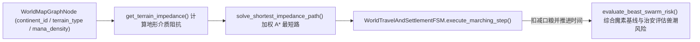

# 世界导航与地理寻路 (`world_navigation`)

> 对应源码：`backend/domains/world_navigation/`（3 个 `.gd`），负责世界节点图、地形介质阻抗 A* 最短路径求解、队伍行军推进以及魔素畸变引起的兽潮风险评估，并向 `world_state`、`spatial_movement`、`ground_loot` 等域提供基础地理契约。

---

## 一、模块与类清单

| 文件路径 | 核心类 | 角色定位 | 公开接口与配置路径 |
| :--- | :--- | :--- | :--- |
| [world_map_entities.gd](../../../../backend/domains/world_navigation/world_map_entities.gd) | `WorldMapGraphNode` | 图节点与城镇聚合 | `serialize()`；读取 `domains.world:node_defaults/*` 与 `town_defaults/*` |
| [map_ecology_solver.gd](../../../../backend/domains/world_navigation/map_ecology_solver.gd) | `MapAndEcologySolver` | 阻抗寻路与风险纯求解器 | `get_terrain_impedance()`、`solve_shortest_impedance_path()`、`evaluate_beast_swarm_risk()`；读取 `astar/*` 与 `swarm_risk/*` |
| [world_travel_fsm.gd](../../../../backend/domains/world_navigation/world_travel_fsm.gd) | `WorldTravelAndSettlementFSM` | 行军与入城状态机 | `execute_marching_step()` 计算时间流逝、按人数与耗时消耗口粮并触发城镇抵达状态转移 |

---

## 二、寻路与行军推进流程

---

## 三、配置、存档与测试

- **配置映射**：`domains.world.core`（别名 `domains.world`）与 `narratives.world`。
- **存档策略**：在 [domains.json](../../../../config/infrastructure/domains.json) 中登记为可存档域（策略 `full`，序列化载体 `WorldGatewayModel`）。
- **验证测试**：[test_world_navigation.gd](../../../../tests/unit/domains/test_world_navigation.gd)。
