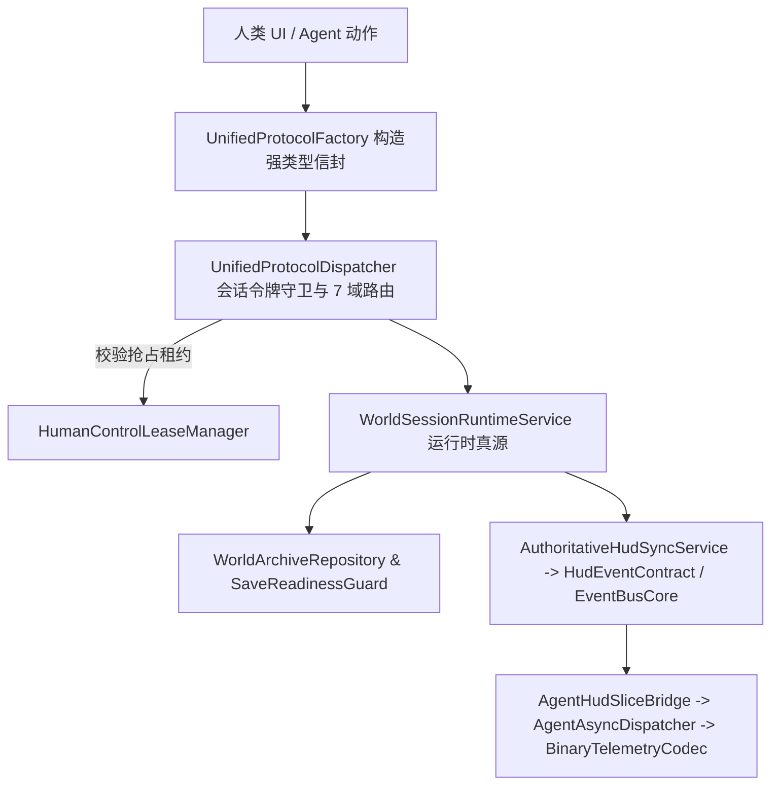

# 世界状态、统一协议调度与 Agent 遥测流 (`world_state`)

> 对应源码：`backend/domains/world_state/`（**42 个** `.gd`，全后端体积最大的枢纽域，含 `dto/`、`guards/`、`resolvers/`、`services/`、`solvers/`）。承担**单机世界档案与实例连续性**、**运行时会话单源托管 (`WorldSessionRuntimeService`)**、**跨端统一协议分发 (`UnifiedProtocolDispatcher`)**、**前后端交互租约仲裁 (`HumanControlLeaseManager`)**、**主页 HUD 权威同步**及**面向无头 Agent 的结构化切片与二进制遥测管道**六大中枢职能。

---

## 一、子目录职责拓扑

---

## 二、核心模块分段清单

### 1. 世界仓储与连续性实例（根目录 & `guards/`、`resolvers/`）
| 文件路径 | 核心类 | 职责与核心接口 |
| :--- | :--- | :--- |
| [world_archive_repository.gd](../../../../backend/domains/world_state/world_archive_repository.gd) | `WorldArchiveRepository` | 单机世界物理目录索引与原子落盘仓储；提供 `create_world()`、`load_world()`、`list_worlds()`、`get_world_summary()`、`set_custom_root_dir()` |
| [world_instance.gd](../../../../backend/domains/world_state/world_instance.gd) | `WorldInstance` | 世界时钟推进与只增不改历史片段容器；提供 `advance_world_time()`、`append_history_fragment()`、`serialize()`/`deserialize()` |
| [world_recombination_stub.gd](../../../../backend/domains/world_state/world_recombination_stub.gd) | `WorldRecombinationStub` | 依据 `domains.world:continuity/enabled` 控制多世界重组模板扩展 |
| [hud_event_contract.gd](../../../../backend/domains/world_state/hud_event_contract.gd) | `HudEventContract` | 事件信道名称白名单单源（`channel_auth_*`、`channel_hud_*`），消除硬编码串 |
| [save_readiness_guard.gd](../../../../backend/domains/world_state/guards/save_readiness_guard.gd) | `SaveReadinessGuard` | `evaluate_save_readiness()` 与存储目录气密隔离检测 `evaluate_storage_path_safety()` |
| [world_calendar_environment_resolver.gd](../../../../backend/domains/world_state/resolvers/world_calendar_environment_resolver.gd) | `WorldCalendarEnvironmentResolver` | 基于行军时辰推导昼夜相位与以太环境载荷 `resolve_day_phase()`、`resolve_environment()` |

### 2. 运行时中枢、协议派发与 HUD 同步（`services/` 关键服务）
| 文件路径 | 核心类 | 职责与核心接口 |
| :--- | :--- | :--- |
| [world_session_runtime_service.gd](../../../../backend/domains/world_state/services/world_session_runtime_service.gd) | `WorldSessionRuntimeService` | 全域活跃账号/槽位/世界/角色与网关引用单一真源；通过 DIP 挂载令牌混淆回调；提供 `activate_authenticated_session()`、`bind_gateway()`、`bind_prologue_session()` 等 |
| [unified_protocol_dispatcher.gd](../../../../backend/domains/world_state/services/unified_protocol_dispatcher.gd) | `UnifiedProtocolDispatcher` | 接收 `ClientRequestEnvelopeDTO` 执行令牌核验、租约检查与领域处理器路由（`register_domain_handler()`、`dispatch()`） |
| [unified_protocol_factory.gd](../../../../backend/domains/world_state/services/unified_protocol_factory.gd) | `UnifiedProtocolFactory` | 池化构造 `create_human_request()`、`wrap_agent_action()`、`create_response()` 并自维护序列 |
| [human_control_lease_manager.gd](../../../../backend/domains/world_state/services/human_control_lease_manager.gd) | `HumanControlLeaseManager` | 维护人类操作抢占窗口与失效判定（`renew_human_lease()`、`is_lease_active()`、`release_lease()`） |
| [authoritative_hud_sync_service.gd](../../../../backend/domains/world_state/services/authoritative_hud_sync_service.gd) | `AuthoritativeHudSyncService` | 聚合 <= 4KB 轻量快照并按 `hud_sync/min_interval_ms` 节流推送变更与时钟流 |
| [esc_menu_backend_service.gd](../../../../backend/domains/world_state/services/esc_menu_backend_service.gd) | `EscMenuBackendService` | 统一裁决 ESC 菜单安全存盘、网关退回清理与桌面安全退出（`handle_esc_action()`） |

### 3. Agent 无头观测与零分配遥测流水线（`services/` & `solvers/`）
| 文件路径 | 核心类 | 职责与核心接口 |
| :--- | :--- | :--- |
| [agent_action_channel.gd](../../../../backend/domains/world_state/services/agent_action_channel.gd) | `AgentActionChannel` | 专属动作通道，执行无硬件争抢直投 |
| [agent_action_execution_solver.gd](../../../../backend/domains/world_state/solvers/agent_action_execution_solver.gd) | `AgentActionExecutionSolver` | 面向 Agent 的动作校验与前置派发求解器（`validate_and_execute()`） |
| [agent_hud_slice_bridge.gd](../../../../backend/domains/world_state/services/agent_hud_slice_bridge.gd) | `AgentHudSliceBridge` | 增量差分切片门面（`step_and_publish()`、`inject_ui_notice()`） |
| [agent_hud_slice_solver.gd](../../../../backend/domains/world_state/solvers/agent_hud_slice_solver.gd) | `AgentHudSliceSolver` | 主页 HUD 上下文切片求解器与标准遥测数据包原子装箱流水线 |
| [hud_causal_delta_solver.gd](../../../../backend/domains/world_state/solvers/hud_causal_delta_solver.gd) | `HudCausalDeltaSolver` | 主页 HUD 上下文因果差分计算器 |
| [home_action_space_solver.gd](../../../../backend/domains/world_state/solvers/home_action_space_solver.gd) | `HomeActionSpaceSolver` | 面向 Agent 的主页 HUD 动态行动空间裁决器 |
| [agent_trajectory_ring_buffer.gd](../../../../backend/domains/world_state/services/agent_trajectory_ring_buffer.gd) | `AgentTrajectoryRingBuffer` | O(1) 定长环形历史轨迹缓冲与跨步因果累积聚合 |
| [agent_async_dispatcher.gd](../../../../backend/domains/world_state/services/agent_async_dispatcher.gd) | `AgentAsyncDispatcher` | 有界背压队列（支持 `DROP_OLDEST` / `DROP_NEWEST` 策略与确定性测试步进） |
| [agent_telemetry_pool_registry.gd](../../../../backend/domains/world_state/services/agent_telemetry_pool_registry.gd) | `AgentTelemetryPoolRegistry` | 经 `GameBootstrap` 依赖倒置挂接基础设施池并自带领域 LIFO 备用池，消除热点堆分配 |
| [binary_telemetry_codec.gd](../../../../backend/domains/world_state/services/binary_telemetry_codec.gd) | `BinaryTelemetryCodec` | 基于 `StreamPeerBuffer` 的紧凑二进制遥测编解码器（`encode_to_bytes()`、`decode_from_bytes()`） |
| [game_mode_feature_solver.gd](../../../../backend/domains/world_state/solvers/game_mode_feature_solver.gd) | `GameModeFeatureSolver` | 按运行模式推导系统启用特性矩阵 `resolve_features()` |
| [pagination_slice_solver.gd](../../../../backend/domains/world_state/solvers/pagination_slice_solver.gd) | `PaginationSliceSolver` | 分页下标与总页数边界纯算子 `slice_array()` |

### 4. DTO 数据传输模型族（`dto/` 共 17 个脚本）
[authoritative_hud_snapshot_dto.gd](../../../../backend/domains/world_state/dto/authoritative_hud_snapshot_dto.gd)（`AuthoritativeHudSnapshotDTO`）、[hud_mutation_events_dto.gd](../../../../backend/domains/world_state/dto/hud_mutation_events_dto.gd)（`HudMutationEventsDTO`）、[hud_mutation_context_dto.gd](../../../../backend/domains/world_state/dto/hud_mutation_context_dto.gd)（`HudMutationContextDto`）、[active_quest_tracker_dto.gd](../../../../backend/domains/world_state/dto/active_quest_tracker_dto.gd)（`ActiveQuestTrackerDTO`）、[mode_feature_manifest_dto.gd](../../../../backend/domains/world_state/dto/mode_feature_manifest_dto.gd)（`ModeFeatureManifestDTO`）、[world_calendar_environment_dto.gd](../../../../backend/domains/world_state/dto/world_calendar_environment_dto.gd)（`WorldCalendarEnvironmentDTO`）、[runtime_session_state.gd](../../../../backend/domains/world_state/dto/runtime_session_state.gd)（`RuntimeSessionState`）、[client_request_envelope_dto.gd](../../../../backend/domains/world_state/dto/client_request_envelope_dto.gd)（`ClientRequestEnvelopeDTO`）、[unified_response_envelope_dto.gd](../../../../backend/domains/world_state/dto/unified_response_envelope_dto.gd)（`UnifiedResponseEnvelopeDTO`）、[pagination_query_dto.gd](../../../../backend/domains/world_state/dto/pagination_query_dto.gd)（`PaginationQueryDTO`）、[paged_result_dto.gd](../../../../backend/domains/world_state/dto/paged_result_dto.gd)（`PagedResultDTO`），以及 Agent 遥测包族 [agent_hud_telemetry_packet_dto.gd](../../../../backend/domains/world_state/dto/agent_hud_telemetry_packet_dto.gd)（`AgentHudTelemetryPacketDTO`）、[agent_hud_context_slice_dto.gd](../../../../backend/domains/world_state/dto/agent_hud_context_slice_dto.gd)（`AgentHudContextSliceDTO`）、[agent_action_directive_dto.gd](../../../../backend/domains/world_state/dto/agent_action_directive_dto.gd)（`AgentActionDirectiveDTO`）、[agent_action_packet_dto.gd](../../../../backend/domains/world_state/dto/agent_action_packet_dto.gd)（`AgentActionPacketDTO`）、[hud_causal_delta_dto.gd](../../../../backend/domains/world_state/dto/hud_causal_delta_dto.gd)（`HudCausalDeltaDTO`）、[hud_ui_notice_dto.gd](../../../../backend/domains/world_state/dto/hud_ui_notice_dto.gd)（`HudUiNoticeDTO`）。

---

## 三、配置契约与集成验证

- **依赖域**：`world_navigation`；配置表 `domains.world_state.core` 与 `narratives.world_state`。
- **单测与集成流水线**：[test_world_state.gd](../../../../tests/unit/domains/test_world_state.gd)、[test_unified_protocol_and_esc_pipeline.gd](../../../../tests/integration/pipelines/test_unified_protocol_and_esc_pipeline.gd)、[test_agent_hud_slice_and_action_space_pipeline.gd](../../../../tests/integration/pipelines/test_agent_hud_slice_and_action_space_pipeline.gd)、[test_agent_telemetry_high_throughput_pipeline.gd](../../../../tests/integration/pipelines/test_agent_telemetry_high_throughput_pipeline.gd)。
