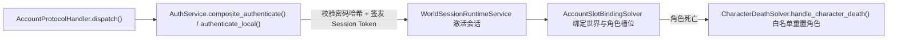

# 账户身份、多槽位档案与权限鉴权 (`account`)

> 对应源码：`backend/domains/account/`（13 个 `.gd`，含 `dto/` 与 `services/`）。维护账户聚合根与物理仓储、游客/正式注册加盐哈希鉴权、设备绑定会话令牌、存档槽位封面绑定及死后角色白名单精准重置（不污染世界连续性）。

---

## 一、核心模块与职责表

| 文件路径 | 核心类 | 角色定位 | 关键公开接口 |
| :--- | :--- | :--- | :--- |
| [account_profile.gd](../../../../backend/domains/account/account_profile.gd) | `AccountProfileAggregate` | 账户聚合根 | `get_summary_by_slot()`、`bind_character_to_slot()`、`get_world_slots()`、`bind_world_slot()`、`serialize()`/`deserialize()` |
| [account_repository.gd](../../../../backend/domains/account/account_repository.gd) | `AccountRepository` | 双索引物理仓储单例 | `load_all()`、`find_by_id()`、`find_by_username()`、`get_account_shard_path()`、`set_custom_registry_path()` |
| [auth_service.gd](../../../../backend/domains/account/auth_service.gd) | `AuthService` | 鉴权与会话服务 | `create_guest_account()`、`register_account()`、`authenticate_local()`、`composite_authenticate()`、`validate_token()`、`revoke_token()` |
| [account_slot_binding_solver.gd](../../../../backend/domains/account/account_slot_binding_solver.gd) | `AccountSlotBindingSolver` | 槽位绑定求解器 | `create_character_in_slot_context()`、`quick_create_in_next_slot()`、`to_gateway_slot_states()`、`clear_slot()` |
| [entitlement_service.gd](../../../../backend/domains/account/entitlement_service.gd) | `EntitlementService` | 账号权限与密封鉴权 | `has_entitlement()`、`add_entitlement()`、`seal_entitlements()`、`verify_seal()` |
| [character_profile.gd](../../../../backend/domains/account/character_profile.gd) | `CharacterProfile` | 角色本体容器 | `has_payload()`、`clear_payload()`、`is_fresh()`、`serialize()`/`deserialize()` |
| [character_death_solver.gd](../../../../backend/domains/account/character_death_solver.gd) | `CharacterDeathSolver` | 角色死亡白名单清理 | `handle_character_death()`、`spawn_fresh_character()`（仅清角色本体，世界时钟与历史只增不回退） |
| [save_slot_dto.gd](../../../../backend/domains/account/save_slot_dto.gd) | `SaveSlotSummaryDTO` | 槽位封面轻量 DTO | `attach_character_profile()`、`clear_character_payload()`、`serialize()`/`deserialize()` |
| [account_composite_auth_dto.gd](../../../../backend/domains/account/dto/account_composite_auth_dto.gd) | `AccountCompositeAuthDTO` | 复合注册/登录 DTO | 支持双模流转序列化与池化 `reset_state()` |
| [account_registration_dto.gd](../../../../backend/domains/account/dto/account_registration_dto.gd) | `AccountRegistrationDTO` | 注册入参 DTO | 限制 `password_plain` 仅存内存请求体，禁入日志/存档 |
| [account_slot_creation_dto.gd](../../../../backend/domains/account/dto/account_slot_creation_dto.gd) | `AccountSlotCreationDTO` | 槽位创建参数 DTO | 收口多参数上下文 |
| [account_home_view_model_builder.gd](../../../../backend/domains/account/services/account_home_view_model_builder.gd) | `AccountHomeViewModelBuilder` | 账号首页脱敏 VM 构造 | `build_account_home_view_model()` 剥离明文凭据 |
| [account_protocol_handler.gd](../../../../backend/domains/account/services/account_protocol_handler.gd) | `AccountProtocolHandler` | 客户端账号协议处理器 | `dispatch()` 分发注册、登录、注销与首页 VM 指令 |

---

## 二、登录鉴权与角色隔离机制

---

## 三、配置与验证

- **依赖与配置**：依赖 `world_navigation`；配置 `domains.account.core`、`infrastructure.admin`（会话 TTL / 设备绑定 / 最大条目）与 `narratives.account`；登记为可存档域。
- **验证套件**：[test_account.gd](../../../../tests/unit/domains/test_account.gd)、[test_account_registration_and_persistence.gd](../../../../tests/integration/pipelines/test_account_registration_and_persistence.gd)、[test_account_registration_and_real_reload_pipeline.gd](../../../../tests/integration/pipelines/test_account_registration_and_real_reload_pipeline.gd)。
