# 角色创生、权威命途解算与序章推演 (`character_creation`)

> 对应源码：`backend/domains/character_creation/`（**30 个** `.gd`，含 `dto/`）。负责零信任防伪属性派生、三层属性换算中枢、单机显性命途 MOD 预检与多包适配、四步不可逆创角状态机、新手行囊水化以及支持确定性回滚的 DAG 序章交互式推演。

---

## 一、子系统分模块清单

### 1. 权威命途解算与属性派生
| 文件路径 | 核心类 | 职责与核心接口 |
| :--- | :--- | :--- |
| [attribute_conversion_engine.gd](../../../../backend/domains/character_creation/attribute_conversion_engine.gd) | `AttributeConversionEngine` | 三层属性换算唯一入口（L1 等级 -> L2 系数 -> L3 实际值域）；消费 `domains.attribute`；提供 `convert_to_actual()`、`sheet_actual_value()`、`validate_level()` |
| [attribute_init_solver.gd](../../../../backend/domains/character_creation/attribute_init_solver.gd) | `AttributeInitializationSolver` | 天命掷骰（4d6 去最低）与 27 点购点校验：`generate_rolled_attributes()`、`validate_point_buy_allocation()` |
| [character_baseline_attribute_solver.gd](../../../../backend/domains/character_creation/character_baseline_attribute_solver.gd) | `CharacterBaselineAttributeSolver` | 从种族配置封闭派生六维基线，零信任拒绝客户端伪造属性值 |
| [authoritative_reincarnation_solver.gd](../../../../backend/domains/character_creation/authoritative_reincarnation_solver.gd) | `AuthoritativeReincarnationSolver` | `resolve_reincarnation_package()` 确定性解算身世、种族、天赋对与六维 |
| [innate_trait_registry.gd](../../../../backend/domains/character_creation/innate_trait_registry.gd) | `InnateTraitRegistry` | 正负先天天赋因果点数守恒天平：`calculate_trait_karma_balance()`、`validate_traits_selection()` |
| [reincarnation_origin.gd](../../../../backend/domains/character_creation/reincarnation_origin.gd) | `ReincarnationOriginEngine` | `get_origin()`、`get_birth_region()` 种族与地缘出生点表查询 |

### 2. 创角事务编排、新手水化与状态机
| 文件路径 | 核心类 | 职责与核心接口 |
| :--- | :--- | :--- |
| [character_creation_fsm.gd](../../../../backend/domains/character_creation/character_creation_fsm.gd) | `CharacterCreationFSM` | 顺序不可逆状态机 `CreationStep`：`start_creation()` -> `set_character_name()` -> `set_gender()` -> `finalize_extensions()` -> `mark_persisted_completed()` -> `mark_opening_triggered()` |
| [character_creation_service.gd](../../../../backend/domains/character_creation/character_creation_service.gd) | `CharacterCreationService` | 装配 `CharacterPhysiologySheet` 与六维生理基线 |
| [world_character_creation_orchestrator.gd](../../../../backend/domains/character_creation/world_character_creation_orchestrator.gd) | `WorldCharacterCreationOrchestrator` | 权威创角全事务门面：`create_character_authoritative()`、`execute_creation_and_boot_prologue()` |
| [save_slot_character_binder.gd](../../../../backend/domains/character_creation/save_slot_character_binder.gd) | `SaveSlotCharacterBinder` | `commit_creation_and_bind_slot()` 绑定档位与构造开局事件包 |
| [starter_loadout_dispatcher.gd](../../../../backend/domains/character_creation/starter_loadout_dispatcher.gd) | `StarterLoadoutDispatcher` | 优先匹配模组定制套件或按 `race_id` 从 `domains.starter_loadout` 幂等水化入包：`dispatch_starter_kit()`、`hydrate_starter_loadout_into_profile()` |
| [character_creation_protocol_handler.gd](../../../../backend/domains/character_creation/character_creation_protocol_handler.gd) | `CharacterCreationProtocolHandler` | 客户端协议入口：`dispatch_creation()`、`dispatch_prologue()` |

### 3. 命途 MOD 适配、序章 DAG 与伴侣黑匣子
| 文件路径 | 核心类 | 职责与核心接口 |
| :--- | :--- | :--- |
| [mod_manifest_validator.gd](../../../../backend/domains/character_creation/mod_manifest_validator.gd) | `ModManifestValidator` | 单包命途清单数值预算、因果天平与 DAG 结构预检 `precheck_single_mod()` |
| [mod_precheck_and_adaptation_solver.gd](../../../../backend/domains/character_creation/mod_precheck_and_adaptation_solver.gd) | `ModPrecheckAndAdaptationSolver` | 多包冲突裁决、UI 策略适配与基础池合并 `precheck_and_adapt_mod_list()` |
| [prologue_execution_kernel.gd](../../../../backend/domains/character_creation/prologue_execution_kernel.gd) | `PrologueExecutionKernel` | 序章启动、四阶段跃迁、DAG 节点水化与交接：`boot_character_prologue()`、`create_dag_session()`、`apply_dag_mutations()`、`complete_prologue_to_handoff()` |
| [prologue_placeholder_resolver.gd](../../../../backend/domains/character_creation/prologue_placeholder_resolver.gd) | `ProloguePlaceholderResolver` | `{VARIABLE_NAME}` 动态上下文安全占位替换 |
| [prologue_cutscene_port.gd](../../../../backend/domains/character_creation/prologue_cutscene_port.gd) | `PrologueCutscenePort` | 依赖倒置过场播放网关端口（由 `GameBootstrap` 注入运行时适配器） |
| [agent_playthrough_session.gd](../../../../backend/domains/character_creation/agent_playthrough_session.gd) | `AgentPlaythroughSession` | 支持 `start_session()`、`step()`、`rollback()`（无损回退历史栈）与观测包生成 |
| [companion_blackbox_recorder.gd](../../../../backend/domains/character_creation/companion_blackbox_recorder.gd) | `CompanionBlackboxRecorder` | `create_diagnostic_dump()` 抓取异常/死路尾部伴侣观测轨迹 |

### 4. DTO 数据传输族（11 个文件）
包括根目录的 [attribute_conversion_dto.gd](../../../../backend/domains/character_creation/attribute_conversion_dto.gd)、[character_creation_request_dto.gd](../../../../backend/domains/character_creation/character_creation_request_dto.gd)、[character_prologue_context.gd](../../../../backend/domains/character_creation/character_prologue_context.gd)、[opening_event_stream_dto.gd](../../../../backend/domains/character_creation/opening_event_stream_dto.gd)、[prologue_event_packet_dto.gd](../../../../backend/domains/character_creation/prologue_event_packet_dto.gd)、[race_definition_dto.gd](../../../../backend/domains/character_creation/race_definition_dto.gd)，以及 `dto/` 下的 [agent_observation_packet_dto.gd](../../../../backend/domains/character_creation/dto/agent_observation_packet_dto.gd)、[authoritative_character_creation_request_dto.gd](../../../../backend/domains/character_creation/dto/authoritative_character_creation_request_dto.gd)、[character_creation_presentation_dto.gd](../../../../backend/domains/character_creation/dto/character_creation_presentation_dto.gd)、[destiny_mod_manifest_dto.gd](../../../../backend/domains/character_creation/dto/destiny_mod_manifest_dto.gd)、[prologue_handoff_dto.gd](../../../../backend/domains/character_creation/dto/prologue_handoff_dto.gd)。

---

## 二、权威创角与序章交接流程

```mermaid
flowchart LR
    Req["AuthoritativeCharacterCreationRequestDTO"] --> Mod["ModPrecheckAndAdaptationSolver 预检适配 MOD"]
    Mod --> Solver["AuthoritativeReincarnationSolver 零信任解算身世与六维"]
    Solver --> Kit["StarterLoadoutDispatcher 物理水化新手包"]
    Kit --> Orch["WorldCharacterCreationOrchestrator 落盘与历史记录"]
    Orch --> Kernel["PrologueExecutionKernel / AgentPlaythroughSession"]
    Kernel -->|"complete_prologue_to_handoff()"| Handoff["PrologueHandoffDTO 交接至大地图探索"]
```

---

## 三、配置与验证

- **配置映射**：`domains.character_creation.core`、`domains.attribute`（共享）、`domains.starter_loadout`（共享）、`narratives.character_creation`、`narratives.prologue_i18n` 与 `narratives.prologue_dag_catalog`。
- **测试入口**：[test_character_creation.gd](../../../../tests/unit/domains/test_character_creation.gd)、[test_authoritative_character_creation_pipeline.gd](../../../../tests/integration/pipelines/test_authoritative_character_creation_pipeline.gd)、[test_prologue_core_and_placeholder_pipeline.gd](../../../../tests/integration/pipelines/test_prologue_core_and_placeholder_pipeline.gd)。
