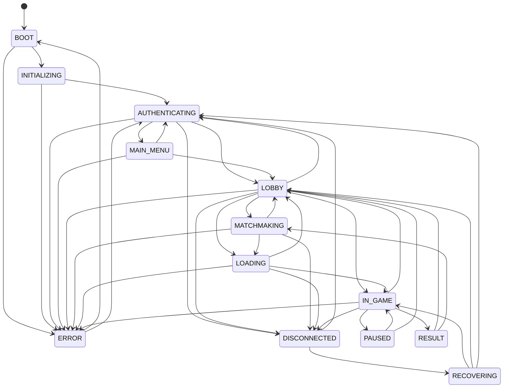

# 01 应用引导与导航状态机 (`frontend/app/` & `frontend/navigation/`)

> 本册覆盖 [app/](../../../frontend/app/)（3 个 `.gd` + [app_root.tscn](../../../frontend/app/app_root.tscn)）与 [navigation/](../../../frontend/navigation/)（2 个 `.gd`），负责引擎桌面关闭接管、幂等冷启动装配、客户端 13 态生命周期治理及全屏 Screen 栈式路由。

---

## 一、脚本与场景清单

| 模块 | 类名 / 类型 | 行数 | 核心职责 | 源码链接 |
| :--- | :--- | :---: | :--- | :--- |
| 根场景节点 | `AppRoot` (`Control`) | 40 | 挂载入口场景，管理 6 层 `CanvasLayer` 锚点并拦截桌面关闭信号触发优雅停机 | [app_root.gd](../../../frontend/app/app_root.gd) |
| 启动装配器 | `AppBootstrap` (`RefCounted`) | 70 | 幂等绑定导航根、4 个层级 UI 管理器，并驱动 `BOOT` -> `INITIALIZING` -> `AUTHENTICATING` 与首屏入栈 | [app_bootstrap.gd](../../../frontend/app/app_bootstrap.gd) |
| 应用状态机 | `AppLifecycleFSM` (`RefCounted`) | 127 | 维护 13 态应用生命周期枚举与白名单跃迁矩阵，发散 `state_changed` 信号 | [app_lifecycle_fsm.gd](../../../frontend/app/app_lifecycle_fsm.gd) |
| 导航路由器 | `NavManager` (`Node`) | 254 | 管理 17 屏注册表、`_screen_stack` 历史栈、有界场景缓存（上限 24）与交叉淡入/滑动转场 | [nav_manager.gd](../../../frontend/navigation/nav_manager.gd) |
| 导航契约 | `NavTypes` (`RefCounted`) | 33 | 声明 `LayerLevel`（6 层 Z-Index）、`TransitionType` 与 `ToastLevel` 枚举 | [nav_types.gd](../../../frontend/navigation/nav_types.gd) |

---

## 二、6 层视口深度与根宿主契约

`AppRoot` 与 `NavTypes.LayerLevel`、`DesignTokens.Z_INDEX_*` 保持三方数值对齐：

| `LayerLevel` 枚举 | Z-Index | `app_root.tscn` 节点容器 | 承载职责 |
| :--- | :---: | :--- | :--- |
| `BACKGROUND` | `-10` | `BackgroundLayer` | 动态星空、主城静态/视差背景 |
| `SCREEN` | `0` | `ScreenLayer/ScreenContainer` | 17 卷主功能视图栈（全屏互斥挂载点） |
| `HUD` | `10` | `HUDLayer` | 常驻生命/法力/行动力条、小地图与快捷栏 |
| `MODAL` | `50` | `ModalLayer/ModalContainer` | 业务模态弹窗与侧滑抽屉容器 |
| `OVERLAY` | `80` | `OverlayLayer/{OverlayContainer,ToastLayer,LoadingOverlay}` | 悬浮提示、右键菜单、轻提示流与全屏阻塞遮罩 |
| `DEBUG` | `100` | `DebugLayer` | 性能监测与调试控制台 |

**桌面端优雅关闭钩子**：`AppRoot._ready()` 调用 `get_tree().set_auto_accept_quit(false)`，拦截 `NOTIFICATION_WM_CLOSE_REQUEST` 后构造 `GameShutdownDTO.Request`（原因 `USER_DESKTOP_QUIT`）调用 `GameLifecycleService.execute_graceful_shutdown()` 落盘并退出树。

---

## 三、启动装配与 13 态生命周期状态机

### 3.1 幂等启动时序（`AppBootstrap.bootstrap`）

1. `NavManager.get_instance().bind_root(app_root)` 绑定根宿主（重入幂等）。
2. 为 `ModalManager`、`DrawerManager` 绑定 `modal_layer/modal_container`；为 `TooltipManager`、`ContextMenuManager` 绑定 `overlay_layer/overlay_container`；惰性唤醒 `RedDotTreeManager`、`FocusInputManager`、`UIAudioBridge`。
3. 检查 `_bootstrapped` 守卫：若已执行完整引导则直接返回，避免重复重跑生命周期或重复压入 `account_entry`。
4. 首次引导驱动 `_drive_lifecycle_boot(services)`：`AppLifecycleFSM` 跃迁至 `INITIALIZING`，调用 `services.version().check_version_async()`；仅当 `compatible == true` 跃迁至 `AUTHENTICATING`，否则进入 `ERROR`。
5. 将 `ThemeManager.get_instance().theme` 赋给 `app_root.theme`，最后调用 `nav.push_screen("account_entry")`。

### 3.2 `AppLifecycleFSM` 白名单跃迁图

> 同状态重复调用 `transition_to(current_state)` 返回 `true` 以刷新 `_context`；非法跨跃迁通过 `EventBusCore.emit_log("warn", ...)` 记录并返回 `false`。

---

## 四、导航栈与转场不变量（`NavManager`）

1. **原子跳转时序**：`_navigate_to()` 严格先加载并实例化目标 `.tscn`（校验根节点为 `Control` 且 `_app_root.screen_container != null`），任一失败立即 `queue_free()` 临时实例并返回 `null`，绝不污染 `_screen_stack` 或销毁当前屏。
2. **栈操作语义**：
   - `push_screen(screen_id, params, transition_type)`：成功后追加 `screen_id` 并调用新屏 `on_screen_enter(params)`。
   - `replace_screen(...)`：先记录 `prev_depth`，仅当新屏挂载成功后移除 `prev_depth - 1` 旧栈顶。
   - `pop_screen(transition_type = SLIDE_RIGHT)`：栈深 `<= 1` 时拒绝出栈；先导航至 `_screen_stack[-2]` 成功后再 `pop_back()`。
3. **转场互斥与 FIFO 场景缓存**：
   - 常量 `MAX_SCENE_CACHE_ENTRIES = 24`、`TRANSITION_DURATION = 0.25` 秒。新场景写入 `_scene_cache` 超限时按插入序逐出最早键。
   - 同时仅允许一个 `_active_transition` `Tween` 运行；新转场启动前立即清理未完结的 `_transitioning_old_screen`（触发 `on_screen_exit()` 后 `queue_free()`）并 `kill()` 旧 `Tween`。
4. **全局遮罩与轻提示兜底**：`show_toast()` / `show_loading()` / `hide_loading()` 优先委托给 `_app_root.toast_layer` 与 `loading_overlay`，无宿主（无头测试）时降级写 `EventBusCore` 日志或使用 `UIIntermediary.text("ui.common.loading")`。
