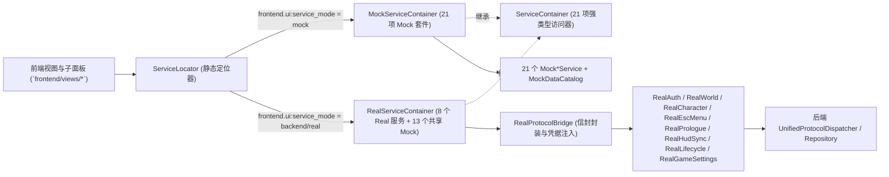

# 02 领域边界与协议容器 (`frontend/domain_boundary/`)

> 本册映射 [domain_boundary/](../../../frontend/domain_boundary/) 全部 **62 个** `.gd` 脚本（3,856 行），是前端表现层与后端领域服务/测试替身之间的唯一隔离带（Anti-Corruption Layer），确保所有 `.gd` 视图零后端直接耦合与零本地规则硬编码。

---

## 一、边界容器拓扑

---

## 二、核心定位器、基类与快照契约（5 个文件）

| 类名 | 职责与核心接口 | 配置 / 关键常量 | 源码路径 |
| :--- | :--- | :--- | :--- |
| `ServiceLocator` | 读取 `frontend.ui:service_mode`（或测试覆盖 `_custom_mode`）惰性构建并缓存 `MockServiceContainer` / `RealServiceContainer`；托管并同步 `WorldSessionRuntimeService` 中的 `_active_gateway` | `frontend.ui:service_mode` | [service_locator.gd](../../../frontend/domain_boundary/service_locator.gd) |
| `ServiceContainer` | 服务依赖注入抽象基类，提供 `register_service()` / `get_service()` 与 21 个强类型访问方法（`auth()`、`world()`、`combat()`、`version()`、`gacha()`、`chat_command()`、`crafting()`、`grimoire()`、`economy()`、`character()`、`quest()`、`guild()`、`save()`、`misc_edge()`、`mail()`、`snapshot_data()`、`esc_menu()`、`prologue()`、`hud_sync()`、`lifecycle()`、`game_settings()`）及 `_register_shared_mock_services()` | — | [service_container.gd](../../../frontend/domain_boundary/service_container.gd) |
| `FrontendSnapshot` | 前端统一快照序列化基底，提供 `to_dictionary()` 及防御性静态解析器（`read_string/int/float/bool/array/dict`） | — | [frontend_snapshot.gd](../../../frontend/domain_boundary/contracts/frontend_snapshot.gd) |
| `FrontendHudSnapshot` | 对齐后端 `AuthoritativeHudSnapshotDTO` 的强类型快照，提供 `to_dictionary()`、`from_dictionary()` 与展示比例派生（`get_health_ratio()`、`get_mana_ratio()`） | `SCHEMA_VERSION` | [frontend_hud_snapshot.gd](../../../frontend/domain_boundary/contracts/frontend_hud_snapshot.gd) |
| `CombatFloatingTextDTO` | 战斗视图与 `CombatSubpanels` 间强类型飘字渲染数据载体 | — | [combat_floating_text_dto.gd](../../../frontend/domain_boundary/contracts/combat_floating_text_dto.gd) |

---

## 三、抽象服务接口清单 (`interfaces/`，22 个 `.gd`)

| 接口类 | 覆盖能力域与关键签名 | 源码路径 |
| :--- | :--- | :--- |
| `IAuthService` | 账号登录/注册/登出/令牌吊销/选服/角色列表/创角/属性预览骰点 (`PREVIEW_ATTR_KEYS`, `MIN`, `MAX`, `build_preview_attribute_spread`, `login_async`, `get_account_home_async`) | [i_auth_service.gd](../../../frontend/domain_boundary/interfaces/i_auth_service.gd) |
| `IWorldService` | HUD 快照、小地图地标、网关模式探测、世界档案列表与进出 (`get_hud_snapshot_async`, `enter_gateway_async`, `probe_modes_async`, `select_or_create_world_async`) | [i_world_service.gd](../../../frontend/domain_boundary/interfaces/i_world_service.gd) |
| `ICharacterService` | 背包负重、装备词缀聚合、潜能加点预览、创角与骰点 (`calculate_inventory_weight`, `aggregate_equipment_modifiers`, `preview_add_point`) | [i_character_service.gd](../../../frontend/domain_boundary/interfaces/i_character_service.gd) |
| `IEscMenuService` | ESC 系统菜单状态、安全存盘、退回网关与直接退出 (`get_menu_state_async`, `request_save_async`, `exit_to_gateway_async`, `quit_game_async`) | [i_esc_menu_service.gd](../../../frontend/domain_boundary/interfaces/i_esc_menu_service.gd) |
| `IPrologueService` | 序章剧情启动、状态查询、阶段推进、跳过与完结交接大世界探索接口 | [i_prologue_service.gd](../../../frontend/domain_boundary/interfaces/i_prologue_service.gd) |
| `IHudSyncService` | 主页常驻 HUD 快照拉取、时钟/状态增量同步、HUD 指令派发与总线信道订阅接口 | [i_hud_sync_service.gd](../../../frontend/domain_boundary/interfaces/i_hud_sync_service.gd) |
| `ILifecycleService` | 暂停/恢复、退回账号首页（软重置）与多阶段优雅/强制退出游戏接口 | [i_lifecycle_service.gd](../../../frontend/domain_boundary/interfaces/i_lifecycle_service.gd) |
| `IGameSettingsService` | 音画/UI 设置拉取、即时应用、分辨率安全回滚确认与恢复默认设置接口 | [i_game_settings_service.gd](../../../frontend/domain_boundary/interfaces/i_game_settings_service.gd) |
| `ICombatService` | 战斗快照拉取与技能动作下发 (`get_combat_snapshot_async`, `cast_skill_async`) | [i_combat_service.gd](../../../frontend/domain_boundary/interfaces/i_combat_service.gd) |
| `IVersionService` | 客户端版本握手与热更新探测 (`check_version_async`) | [i_version_service.gd](../../../frontend/domain_boundary/interfaces/i_version_service.gd) |
| `IGachaService` | 抽卡规则查询、掉落生成、单抽/十连结算与付费购买 (`get_rules`, `generate_drops`, `resolve_pull`, `purchase`) | [i_gacha_service.gd](../../../frontend/domain_boundary/interfaces/i_gacha_service.gd) |
| `ICraftingService` | 强化成功率预估公式抽象 (`preview_enhance_rate`) | [i_crafting_service.gd](../../../frontend/domain_boundary/interfaces/i_crafting_service.gd) |
| `IGrimoireService` | 魔典著书收入预估与版税求和 (`estimate_authoring_income`, `sum_royalties`) | [i_grimoire_service.gd](../../../frontend/domain_boundary/interfaces/i_grimoire_service.gd) |
| `IEconomyService` | 货币四级换算、商店总价、汇率波动与物价序列 (`split_copper`, `calculate_exchange_rate`, `generate_price_series`) | [i_economy_service.gd](../../../frontend/domain_boundary/interfaces/i_economy_service.gd) |
| `IQuestService` | 任务状态跃迁守卫 (`transition_status`) | [i_quest_service.gd](../../../frontend/domain_boundary/interfaces/i_quest_service.gd) |
| `IGuildService` | 公会名单生成、RBAC 管理权限判定与交易状态机 (`generate_roster`, `can_manage`, `trade_transition`) | [i_guild_service.gd](../../../frontend/domain_boundary/interfaces/i_guild_service.gd) |
| `IMailService` | 邮箱容量、已读标记、批量删除与附件提取 (`get_max_capacity`, `mark_read`, `delete_by_ids`, `claim_all`, `claim_one`) | [i_mail_service.gd](../../../frontend/domain_boundary/interfaces/i_mail_service.gd) |
| `ISaveService` | 确定性回放帧推进、倍率切换、进度拖动与存档槽写清 (`get_replay_speeds`, `advance_replay`, `write_slot`, `clear_slot`) | [i_save_service.gd](../../../frontend/domain_boundary/interfaces/i_save_service.gd) |
| `IMiscEdgeService` | 突变词条激活/替换、掉落拾取与命名注册费用 (`activate_mutation`, `replace_last_mutation`, `pickup_loot`, `get_name_type_fee`) | [i_misc_edge_service.gd](../../../frontend/domain_boundary/interfaces/i_misc_edge_service.gd) |
| `IChatCommandService` & `IChatCommandSession` | GM 命令索引创建与会话内前缀补全、分页、最近使用记录及 Tab 手势判定 (`create_session`, `query`, `feed_gesture`) | [i_chat_command_service.gd](../../../frontend/domain_boundary/interfaces/i_chat_command_service.gd) · [i_chat_command_session.gd](../../../frontend/domain_boundary/interfaces/i_chat_command_session.gd) |
| `ISnapshotDataService` | 全前端 17 视图演示快照单源加载抽象 (`load_snapshot`) | [i_snapshot_data_service.gd](../../../frontend/domain_boundary/interfaces/i_snapshot_data_service.gd) |

---

## 四、真实后端适配器 (`services/`，10 个 `.gd`)

当前 `RealServiceContainer` 已将 8 个核心账号/创角/序章/网关/HUD/ESC/生命周期/设置服务接入真实后端，其余 13 个渐进域通过基类 `_register_shared_mock_services()` 回退对应 Mock 实现：

| 适配器类 | 继承 / 对应后端通路 | 关键行为契约 | 源码路径 |
| :--- | :--- | :--- | :--- |
| `RealServiceContainer` | 继承 `ServiceContainer` | 注册 8 个 `Real*Service` + 13 个共享 Mock | [real_service_container.gd](../../../frontend/domain_boundary/services/real_service_container.gd) |
| `RealProtocolBridge` | 通用协作者 | 单源封装 `ClientRequestEnvelopeDTO` 构造、活跃凭据注入与异步回调分发，消除各适配器重复样板 | [real_protocol_bridge.gd](../../../frontend/domain_boundary/services/real_protocol_bridge.gd) |
| `RealAuthService` | 实现 `IAuthService` | 封装后端 `AuthService`、`AccountRepository` 与 `AccountSlotBindingSolver`；含 `ERROR_CODE_I18N_MAP` 错误码映射与 `frontend.views:fe01_account_entry/default_servers` 配置读取 | [real_auth_service.gd](../../../frontend/domain_boundary/services/real_auth_service.gd) |
| `RealWorldService` | 实现 `IWorldService` | 通过 `RealProtocolBridge` / `UnifiedProtocolDispatcher` 派发网关进入/探针/建档/切模/退出动作，并从 `AuthoritativeHudSyncService` 拉取权威快照 | [real_world_service.gd](../../../frontend/domain_boundary/services/real_world_service.gd) |
| `RealCharacterService` | 实现 `ICharacterService` | 通过 `UnifiedProtocolDispatcher` 分发权威创角与资质骰点请求，触发后端存档落盘、初始装备发放与序章上下文初始化 | [real_character_service.gd](../../../frontend/domain_boundary/services/real_character_service.gd) |
| `RealEscMenuService` | 实现 `IEscMenuService` | 注入 `WorldSessionRuntimeService` 活跃凭据与槽位，封装 ESC 菜单状态拉取、安全存盘回执校验与双退出路径（回网关 / 直接退出） | [real_esc_menu_service.gd](../../../frontend/domain_boundary/services/real_esc_menu_service.gd) |
| `RealPrologueService` | 实现 `IPrologueService` | 经统一协议调度序章启动、状态查询、分支推进与完结交接大世界 | [real_prologue_service.gd](../../../frontend/domain_boundary/services/real_prologue_service.gd) |
| `RealHudSyncService` | 实现 `IHudSyncService` | 对接 `AuthoritativeHudSyncService` 与 `EventBusCore`，负责主页 HUD 快照拉取、时钟推进与指令派发 | [real_hud_sync_service.gd](../../../frontend/domain_boundary/services/real_hud_sync_service.gd) |
| `RealLifecycleService` | 实现 `ILifecycleService` | 封装暂停/恢复、退回账号首页（软重置）与多阶段退出协议 | [real_lifecycle_service.gd](../../../frontend/domain_boundary/services/real_lifecycle_service.gd) |
| `RealGameSettingsService` | 实现 `IGameSettingsService` | 经统一协议调度器透传设置读取、热应用、回滚确认与恢复默认指令 | [real_game_settings_service.gd](../../../frontend/domain_boundary/services/real_game_settings_service.gd) |

---

## 五、确定性 Mock 服务集群 (`mocks/`，25 个 `.gd`)

| 类别 | 包含类目与核心特性 | 源码目录与索引 |
| :--- | :--- | :--- |
| 异步基桩与容器 | `MockBaseService`（`DEFAULT_SIMULATE_DELAY_MS`）、`MockServiceContainer`（全 21 项注册 Mock） | [mock_base_service.gd](../../../frontend/domain_boundary/mocks/mock_base_service.gd) · [mock_service_container.gd](../../../frontend/domain_boundary/mocks/mock_service_container.gd) |
| 单源演示目录与加载 | `MockDataCatalog`（集中托管覆盖 17 个视图的离线演示数据集）、`MockSnapshotDataService`（按域名返回深拷贝快照） | [mock_data_catalog.gd](../../../frontend/domain_boundary/mocks/mock_data_catalog.gd) · [mock_snapshot_data_service.gd](../../../frontend/domain_boundary/mocks/mock_snapshot_data_service.gd) |
| 核心接入与控制 Mock（8 个） | 账号认证、世界网关、角色创角、ESC 菜单、序章剧情、HUD 同步、生命周期、游戏设置 | [mock_auth_service.gd](../../../frontend/domain_boundary/mocks/mock_auth_service.gd) · [mock_world_service.gd](../../../frontend/domain_boundary/mocks/mock_world_service.gd) · [mock_character_service.gd](../../../frontend/domain_boundary/mocks/mock_character_service.gd) · [mock_esc_menu_service.gd](../../../frontend/domain_boundary/mocks/mock_esc_menu_service.gd) · [mock_prologue_service.gd](../../../frontend/domain_boundary/mocks/mock_prologue_service.gd) · [mock_hud_sync_service.gd](../../../frontend/domain_boundary/mocks/mock_hud_sync_service.gd) · [mock_lifecycle_service.gd](../../../frontend/domain_boundary/mocks/mock_lifecycle_service.gd) · [mock_game_settings_service.gd](../../../frontend/domain_boundary/mocks/mock_game_settings_service.gd) |
| 业务域与命令 Mock（13 个） | 战斗（确定性 LCG）、版本、抽卡、工坊、魔典、经济、公会、邮箱、任务（三态跃迁表）、存档、杂项边缘、`MockChatCommandService` & `ChatCommandSession` | [mock_combat_service.gd](../../../frontend/domain_boundary/mocks/mock_combat_service.gd) · [mock_version_service.gd](../../../frontend/domain_boundary/mocks/mock_version_service.gd) · [mock_gacha_service.gd](../../../frontend/domain_boundary/mocks/mock_gacha_service.gd) · [mock_crafting_service.gd](../../../frontend/domain_boundary/mocks/mock_crafting_service.gd) · [mock_grimoire_service.gd](../../../frontend/domain_boundary/mocks/mock_grimoire_service.gd) · [mock_economy_service.gd](../../../frontend/domain_boundary/mocks/mock_economy_service.gd) · [mock_guild_service.gd](../../../frontend/domain_boundary/mocks/mock_guild_service.gd) · [mock_mail_service.gd](../../../frontend/domain_boundary/mocks/mock_mail_service.gd) · [mock_quest_service.gd](../../../frontend/domain_boundary/mocks/mock_quest_service.gd) · [mock_save_service.gd](../../../frontend/domain_boundary/mocks/mock_save_service.gd) · [mock_misc_edge_service.gd](../../../frontend/domain_boundary/mocks/mock_misc_edge_service.gd) · [mock_chat_command_service.gd](../../../frontend/domain_boundary/mocks/mock_chat_command_service.gd) · [chat_command_session.gd](../../../frontend/domain_boundary/mocks/chat_command_session.gd) |
