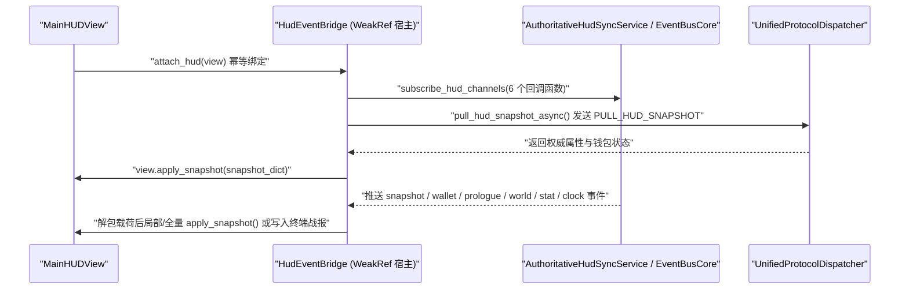

# 03 系统桥接与视图模型 (`frontend/systems/` & `frontend/view_models/`)

> 本册映射 [systems/](../../../frontend/systems/)（3 个 `.gd`，524 LOC）与 [view_models/](../../../frontend/view_models/)（2 个 `.gd`，174 LOC），承担后端事件总线信道单源订阅、按需视口动态装配、以及 Transport DTO 到视图模型的数据防腐变换。

---

## 一、模块清单

| 类别 | 类名 | 行数 | 职责 | 源码路径 |
| :--- | :--- | :---: | :--- | :--- |
| 系统桥接 | `HudEventBridge` | 208 | 单源订阅主页 HUD 6 条领域信道，将领域事件转化为轻量字典快照并调用 `MainHUDView.apply_snapshot()` | [hud_event_bridge.gd](../../../frontend/systems/hud_event_bridge.gd) |
| 系统桥接 | `CutsceneEventBridge` | 259 | 单源监听 `cutscene.*` 广播，负责宿主挂载/动态创建 `CutscenePlayerView`、异步资源获取及播放完结/跳过反向回调 | [cutscene_event_bridge.gd](../../../frontend/systems/cutscene_event_bridge.gd) |
| 占位相约视图 | `ModWorkbenchView` | 57 | 模组工坊前端轻量白模占位控件，暴露 `bind_session` / `get_workbench_state` / `apply_snapshot` 契约 | [mod_workbench_view.gd](../../../frontend/systems/mod_workbench/mod_workbench_view.gd) |
| 视图模型 | `CharacterHudDecoupled` | 105 | 定义 `CharacterTransportDTO` -> `CharacterDomainModel` -> `CharacterHUDViewModel` 三层转换与零除/非有限值防线 | [character_hud_view_model.gd](../../../frontend/view_models/character_hud_view_model.gd) |
| 视图模型 | `CombatViewModel` | 69 | 维护 BOSS 血量、部位状态、战报日志环形截断（`MAX_BATTLE_LOGS`）与飘字信号发射 | [combat_view_model.gd](../../../frontend/view_models/combat_view_model.gd) |

---

## 二、事件桥接链路契约 (`systems/`)

### 2.1 `HudEventBridge` 双向与流式刷新链

- **幂等与防泄漏**：通过 `weakref(view)` 持有视图引用；`attach_hud()` 若同一实例已挂载直接返回，切换实例前先调用 `detach_hud()` 逐个 `unbind()` 全部 `_bus_tokens`；`reset_for_tests()` 专供测试环境隔离清空单例。
- **支持信道**：权威快照接收、钱包余额变更（保留当前 HP/MP/AP 仅刷新金/单晶）、序章叙事推进（追加 `NARRATIVE` 终端日志）、进入世界同步（追加本地化 `SYSTEM` 战报）、单属性变更（`hp`/`mp`/`ap`/`gold`/`mana_monocrystals`）与时钟显示更新。

### 2.2 `CutsceneEventBridge` 待命零接线与动态装配

- **双绑定模式**：支持 `attach_view(existing_view)` 静态接管现有 `CutscenePlayerView`，或 `attach_host(host_container)` 仅挂载父容器待命，在收到 `"cutscene.started"` 事件时按需动态实例化 `CutscenePlayerView`；`detach_all()` 幂等断开视图信号、`queue_free()` 动态视图并注销总线监听。
- **总线事件路由**（订阅 `EventChannelDefinition.DOMAIN_EVENT_GENERIC` 并过滤 `cutscene.` 前缀）：
  - `cutscene.started` -> 从 `CutsceneAsyncLoader` 或 `ResourceLoader` 提取缓存媒体流并调用 `view.play_stream(stream, payload)`，发散 `presentation_started(cutscene_id, is_placeholder)`。
  - `cutscene.playback_progress` -> 向视图调用 `apply_snapshot()` 更新时间码、进度与字幕文本，发散 `presentation_progress`。
  - `cutscene.finished` / `cutscene.skipped` -> 调用 `view.stop_and_dismiss(fade_out_sec)`，清空 `_current_cutscene_id` 并分别发散 `presentation_finished` / `presentation_skipped`。
- **反向反馈闭环**：当玩家点击/长按跳过或视频自然播毕时，视图信号 `_on_view_playback_finished` / `_on_view_skip_requested` 直接触发后端 `CutsceneOrchestrator.finish_cutscene()` / `skip_cutscene()`，恢复上游剧情状态机。

---

## 三、三层视图模型变换 (`view_models/`)

### 3.1 `CharacterHudDecoupled`（Transport DTO -> Domain Model -> ViewModel）

- **`CharacterTransportDTO`**：纯传输结构（`character_id`、`nickname`、`level_raw`、`hp_current/hp_maximum`、`ap_current/ap_maximum`、`coins_copper_total`、`mana_monocrystals`）。
- **`CharacterDomainModel`**：在 `from_dto()` 中完成铜币三进制拆解（`10000` 铜 = 1 金，`100` 铜 = 1 银）、等级下限钳制 `maxi(1, level_raw)` 与分母下限 `maxf(1.0, ...)`；`get_health_ratio()` 与 `get_action_ratio()` 提供零除守卫与 `[0.0, 1.0]` 钳制。
- **`CharacterHUDViewModel`**：执行 `is_finite()` + `clampf()` 双重守卫后格式化 `"%d / %d"` 文本与 `"%d 金 %d 银 %d 铜"` 货币串，并按血量比例阈值自动映射进度条配色（`< 0.25` 取 `DesignTokens.COLOR_ERROR`，`< 0.50` 取 `COLOR_WARNING`，否则 `COLOR_SUCCESS`），最终触发 `property_changed.emit("all", null)`。

### 3.2 `CombatViewModel`

- 仅维护中性初始状态，严禁内嵌演示假数据；所有 BOSS 名称/血量/部位词条经 `update_from_snapshot()` 注入并 emit `data_changed()`。
- `append_log()` 受 `MAX_BATTLE_LOGS` 常量约束截断头部陈旧战报；`request_floating_text()` 通过 `floating_text_requested` 信号单向通知视图层生成飘字。
