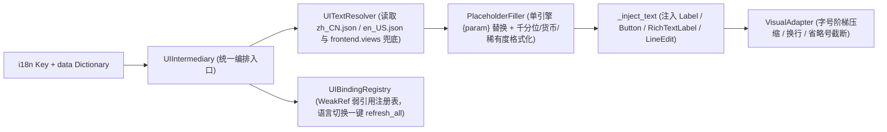

# 04 主题组件与 UI 基建 (`theme/` & `components/` & `ui_infrastructure/` & `presentation/` & `i18n/`)

> 本册覆盖设计令牌与动态主题（2 `.gd`）、`K*` 通用控件库（13 `.gd`）、全局 UI 管理器（8 `.gd`）、表现层基类与五态容器（6 `.gd`）以及前端本地化编排管线（5 `.gd`），合计 **34 个 `.gd` 脚本**（3,515 LOC）。

---

## 一、设计令牌与动态主题 (`frontend/theme/`)

| 类名 | 行数 | 核心设计契约 | 源码路径 |
| :--- | :---: | :--- | :--- |
| `DesignTokens` | 127 | 唯一常量真源：定义语义色板、道具品质五阶色、Theme 兜底色板与视图展示色、8px 栅格间距（`SPACING_ZERO..XXL`）、排版字阶（`12..36`）、动效时长（`DURATION_FAST=0.15s` / `NORMAL=0.25s` / `SLOW=0.45s` / `DEBOUNCE_DELAY=0.30s`）、有界容量（`SCENE_CACHE_MAX=32`, `BATTLE_LOG_MAX=200`）与 6 层 Z-Index（`-10, 0, 10, 50, 80, 100`） | [design_tokens.gd](../../../frontend/theme/design_tokens.gd) |
| `ThemeManager` | 113 | 运行时从配置 `infrastructure.event_categories` 读取分类 HEX 配色生成 Godot `Theme` 资源并应用基础 `StyleBoxFlat`（`Button` 正常/悬停/按下、`PanelContainer`、`Label`、`ProgressBar`、`TabContainer`），全部基础令牌引用 `DesignTokens` | [theme_manager.gd](../../../frontend/theme/theme_manager.gd) |

---

## 二、通用 `K*` UI 组件库 (`frontend/components/`，13 个 `.gd`)

所有通用组件遵循「纯渲染、事件信号上报、i18n 驱动文案、零业务逻辑」原则：

| 组件类 | 继承基类 | 关键能力与对外契约 | 源码路径 |
| :--- | :--- | :--- | :--- |
| `KButton` | `Button` | 视觉风格变体（`StyleVariant`）、内置防连击去抖（`DEBOUNCE_DELAY`）并透传 `UIAudioBridge` 点击音效，发散 `debounced_pressed` | [k_button.gd](../../../frontend/components/k_button.gd) |
| `KBackButton` | `Button` | 统一返回按钮样式、防连击与点击音效，发射 `back_pressed` 委托给路由回退 | [k_back_button.gd](../../../frontend/components/k_back_button.gd) |
| `KPageHeader` | `Control` | 页面标题栏组合（返回按钮 + 图标 + i18n 标题/副标题），向外转发 `back_pressed` | [k_page_header.gd](../../../frontend/components/k_page_header.gd) |
| `KTabBar` | `TabContainer` | i18n 驱动的 Tab 注册（`register_tab`）与标题批量刷新（`init_all_titles`） | [k_tab_bar.gd](../../../frontend/components/k_tab_bar.gd) |
| `KCurrencyBar` | `Control` | 金/银/铜/魔晶四级货币横向只读渲染（`set_currency`, `set_gold/silver/copper/crystals`） | [k_currency_bar.gd](../../../frontend/components/k_currency_bar.gd) |
| `KItemSlot` | `Control` | 道具图标、品质色阶边框、堆叠数量及 `TooltipManager` 悬停绑定；发散 `slot_clicked` / `slot_right_clicked` | [k_item_slot.gd](../../../frontend/components/k_item_slot.gd) |
| `KRarityTag` | `Control` | 稀有度色块与文案键静态映射（`get_rarity_color`, `get_rarity_name_key`） | [k_rarity_tag.gd](../../../frontend/components/k_rarity_tag.gd) |
| `KBadge` | `Control` | 自动订阅 `RedDotTreeManager` 路径变更，控制红点/数字徽章显隐 | [k_badge.gd](../../../frontend/components/k_badge.gd) |
| `KSearchBar` | `Control` | 封装 `LineEdit` + 清除按钮，防抖输入归一化后发射 `search_changed` / `search_cleared` | [k_search_bar.gd](../../../frontend/components/k_search_bar.gd) |
| `KSplitPanel` | `Control` | 左列表 + 右详情双栏布局与比例控制（`set_left_content`, `set_right_content`） | [k_split_panel.gd](../../../frontend/components/k_split_panel.gd) |
| `KStatePanel` | `Control` | 空态 / 加载中 / 错误 / 就绪四态面板，支持重试信号 `retry_requested` | [k_state_panel.gd](../../../frontend/components/k_state_panel.gd) |
| `KStatusBar` | `Control` | 进度条与数值标签组合展示及静态构建/刷新助手（`create_bar`, `refresh_bar`） | [k_status_bar.gd](../../../frontend/components/k_status_bar.gd) |
| `KVirtualList` | `ScrollContainer` | 可视区间求解 `calculate_visible_range()`（闭区间 `[start_idx, end_idx]`）与内嵌具体池化行 `KVirtualRow`（`POOL_HARD_CAP = 128`），在缩容与离区回收时强制执行 `reset_state()` 防止脏状态串行 | [k_virtual_list.gd](../../../frontend/components/k_virtual_list.gd) |

---

## 三、UI 基础设施管理器 (`frontend/ui_infrastructure/`，8 个 `.gd`)

| 管理器类 | 挂载 / 类型 | 核心机制与边界契约 | 源码路径 |
| :--- | :--- | :--- | :--- |
| `ModalManager` | `Node` 单例 | 维护 `_modal_stack` 与暗色遮罩 `_backdrop`（通过 `ensure_backdrop_for_container` 与 `ensure_fallback_container` 自动对齐容器），支持点击遮罩关闭标记与栈顶提升 | [modal_manager.gd](../../../frontend/ui_infrastructure/modal_manager.gd) |
| `DialogManager` | `Node` 单例 | 统一调度 `show_confirm`、`show_exit_choice`（标准/宽/退出三档按钮宽度常量）、`show_alert`、`show_prompt`，消除视图手写重复弹窗 | [dialog_manager.gd](../../../frontend/ui_infrastructure/dialog_manager.gd) |
| `DrawerManager` | `Node` 单例 | 管理左/右/底三边（`EdgeSide`）滑出抽屉面板，发射 `drawer_opened` / `drawer_closed` | [drawer_manager.gd](../../../frontend/ui_infrastructure/drawer_manager.gd) |
| `ContextMenuManager` | `Node` 单例 | 在屏幕任意坐标弹出上下文菜单，发散 `menu_shown` / `menu_hidden` | [context_menu_manager.gd](../../../frontend/ui_infrastructure/context_menu_manager.gd) |
| `TooltipManager` | `Node` 单例 | 管理全局 Hover / 长按提示气泡，`calculate_tooltip_pos()` 实现屏幕边缘防溢出自动翻转 | [tooltip_manager.gd](../../../frontend/ui_infrastructure/tooltip_manager.gd) |
| `FocusInputManager` | `RefCounted` 单例 | 维护焦点捕获栈（`push_focus_trap` / `pop_focus_trap`），模态开启时锁定焦点并在关闭时精准归还 | [focus_input_manager.gd](../../../frontend/ui_infrastructure/focus_input_manager.gd) |
| `RedDotTreeManager` | `RefCounted` 单例 | 点分路径树状红点聚合器（如 `main_hud.social.mail`）；`_recalculate_tree()` 沿祖先链自底向上聚合新计数并与旧快照差量比较后广播 `red_dot_changed(path, new_val)` | [red_dot_tree_manager.gd](../../../frontend/ui_infrastructure/red_dot_tree_manager.gd) |
| `UIAudioBridge` | `RefCounted` 单例 | 声明 `UISfxType` 枚举与 `play_sfx` 信号，解耦 UI 组件（点击/悬停/成功/告警/报错/弹窗开关）与音频节点实现 | [ui_audio_bridge.gd](../../../frontend/ui_infrastructure/ui_audio_bridge.gd) |

---

## 四、表现层基类与通用容器 (`frontend/presentation/`，6 个 `.gd`)

| 模块类 | 所属子目录 | 职责与核心约束 | 源码路径 |
| :--- | :--- | :--- | :--- |
| `BaseScreen` | `base/` | 全部 17+ 业务屏基类：定义 `on_screen_enter` / `on_screen_exit` / `back` / `on_screen_suspend` / `on_screen_resume`、唯一数据入口 `apply_snapshot()` -> `_render_from_snapshot()`、`NOTIFICATION_PREDELETE` 自动解绑 i18n 并释放非树上 `_owned_subcontroller`、懒加载 `UIStateContainer` 与通用 `_ensure_*` 组件装配助手 | [base_screen.gd](../../../frontend/presentation/base/base_screen.gd) |
| `BaseModal` | `base/` | 模态弹窗基类：提供 `on_modal_open`、`apply_snapshot`、`close_modal` 与 `modal_closed` 信号 | [base_modal.gd](../../../frontend/presentation/base/base_modal.gd) |
| `UIStateContainer` | `common/` | 管理 `INITIAL / LOADING / READY / EMPTY / ERROR` 五态节点可见性；`set_ready_view()` 自动校验父子归属并收养节点；内置重试回调触发 | [ui_state_container.gd](../../../frontend/presentation/common/ui_state_container.gd) |
| `LoadingOverlay` | `common/` | 场景切换与异步请求全屏半透明阻塞遮罩（`show_loading` / `hide_loading`） | [loading_overlay.gd](../../../frontend/presentation/common/loading_overlay.gd) |
| `ToastLayer` | `common/` | 居中浮动轻提示队列容器（上限 `MAX_TOASTS`），按 `ToastLevel` 配对色阶与淡出动效 | [toast_layer.gd](../../../frontend/presentation/common/toast_layer.gd) |
| `CutscenePresenter` | `common/` | 过场视口 MVP 中介（`bind_view` / `configure_orchestration` / `handle_cutscene_started` / `handle_cutscene_progress`） | [cutscene_presenter.gd](../../../frontend/presentation/common/cutscene_presenter.gd) |

---

## 五、前端本地化与视觉适配管线 (`frontend/i18n/`，5 个 `.gd`)

- **单引擎填充**：[ui_text_resolver.gd](../../../frontend/i18n/ui_text_resolver.gd)（`UITextResolver.resolve()`）统一委托 [placeholder_filler.gd](../../../frontend/i18n/placeholder_filler.gd)（`PlaceholderFiller.fill()`），支持 `{key}` 参数插值与空格/大括号底座英文模板直通；若字典未命中依次回退至 `frontend.views` 配置表或 `[key]` 显式占位。
- **内存泄漏防御**：[ui_binding_registry.gd](../../../frontend/i18n/ui_binding_registry.gd)（`UIBindingRegistry`）使用 `weakref(node)` 登记 UI 控件，配合 [ui_intermediary.gd](../../../frontend/i18n/ui_intermediary.gd)（`UIIntermediary.clear_view_bindings(self)`）在 `BaseScreen.on_screen_exit()` 与 `NOTIFICATION_PREDELETE` 时自动释放已销毁节点绑定。
- **跨语种适配**：[visual_adapter.gd](../../../frontend/i18n/visual_adapter.gd)（`VisualAdapter`）区分 CJK 与拉丁字符宽度比（`CJK_WIDTH_RATIO` vs `LATIN_WIDTH_RATIO`）与最低字号下限（`FONT_SIZE_MIN_CJK` / `FONT_SIZE_MIN_LATIN`），支持窗口缩放信号 `on_viewport_resized` 自适应重排。
