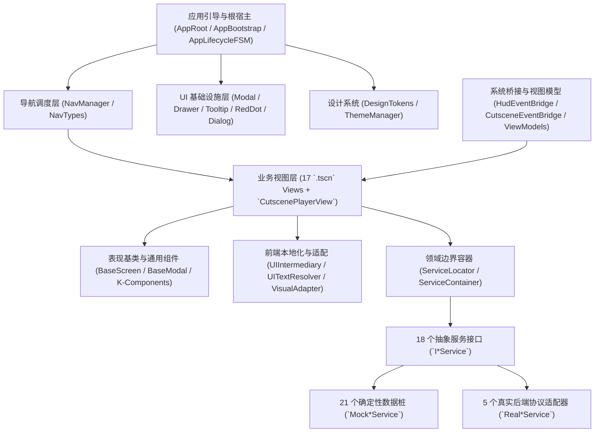

# 04 前端表现层 (`frontend/`)

> 本分卷映射 `WebGames/frontend/` 全部 **128 个** `.gd` 脚本（19,377 LOC）与 **18 个** `.tscn` 场景文件，涵盖应用引导、13 态生命周期、分层导航与转场、领域边界与服务容器、事件桥接与视图模型、设计令牌与通用组件、UI 基础设施，以及 18 个前端业务视图模块。

---

## 一、表现层分层与单向依赖流

---

## 二、分册索引（全量覆盖 128 个脚本与 18 个场景）

| 专题文档 | 覆盖源码目录 | 脚本 / 场景规模 | 核心内容 |
| :--- | :--- | :---: | :--- |
| [01_应用引导与导航状态机.md](01_应用引导与导航状态机.md) | `frontend/app/`、`frontend/navigation/` | 5 `.gd` + 1 `.tscn` | 6 层 `CanvasLayer` 视口锚点、幂等启动装配、13 态 `AppLifecycleFSM`、Screen 栈与转场缓存 |
| [02_领域边界与协议容器.md](02_领域边界与协议容器.md) | `frontend/domain_boundary/` | 49 `.gd` | `ServiceLocator` 模式切换、17 域访问器、3 个快照契约、18 个服务接口、21 个 Mock 与 5 个 Real 适配器 |
| [03_系统桥接与视图模型.md](03_系统桥接与视图模型.md) | `frontend/systems/`、`frontend/view_models/` | 5 `.gd` | `HudEventBridge` / `CutsceneEventBridge` 单源事件消费、`CharacterHudViewModel` 与 `CombatViewModel` |
| [04_主题组件与UI基建.md](04_主题组件与UI基建.md) | `frontend/theme/`、`components/`、`ui_infrastructure/`、`presentation/`、`i18n/` | 34 `.gd` | `DesignTokens`、动态 `ThemeManager`、13 个 `K*` 复用组件、8 个 UI 管理器、五态基类与 i18n 中间体 |
| [05_业务视图层/README.md](05_业务视图层/README.md) | `frontend/views/`（18 个子目录） | 35 `.gd` + 17 `.tscn` | 17 卷主界面（Host View + Tabs/Subpanels 委派架构）与 `cutscene_player` 独立演播视图 |
