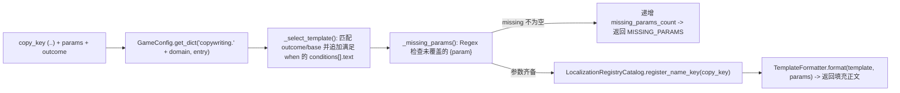

# 02 叙事文案与国际化字典 (`narratives/` & `copywriting/` & `i18n/`)

> 本册说明卡拉尔世界引擎的「三轨文本隔离架构」：领域叙事模板（`narratives/`，49 张）、结构化条件文案（`copywriting/`，4 张）、前端双语 UI 词典（`i18n/`，2 张）与底层合规标准英文底座文本库（`SystemBaseMessages`）各自职责清晰、互不越界。

---

## 一、四轨文本职责矩阵

| 文本体系 | 真源位置 | 解析引擎 | 典型调用方与约束 |
| :--- | :--- | :--- | :--- |
| **结构化条件文案** | `config/copywriting/*.json`（4 张：`bulletin`, `item`, `narrative`, `probability`） | `CopywritingResolver.resolve()` | 通过 `<域>.<条目>.<字段>` 定位条目，依据 `outcome`（`success`/`failure`/`partial`/`base`）与 `conditions[].when` 数值阈值拼接文本并填充 `{param}`；缺参累加 `missing_params_count` 并返回 `MISSING_PARAMS` |
| **领域叙事文案** | `config/narratives/*.json`（49 张） | `GameConfig.msg()` / `EventBusCore.emit_narrative_by_key()` | 后端 42 业务域 + 5 基础设施（`admin`, `clock`, `persistence`, `errors`, `events`）+ `frontend` + `prologue_dag_catalog`/`prologue_i18n` |
| **前端多语言界面词典** | `config/i18n/zh_CN.json` & `en_US.json` | `UITextResolver` + `PlaceholderFiller` + `UIIntermediary` | 专供 `frontend/` UI 控件文本绑定（`magic.*`, `ui.common.*`, `ui.fe01.*` .. `ui.fe17.*`, `item.*`），支持 `zh_CN` 与 `en_US` 运行时热切换 |
| **底座标准英文文本库** | [system_base_messages.gd](../../../backend/infrastructure/logging/system_base_messages.gd) | `SystemBaseMessages.format()` / `resolve_event_or_base()` | 仅供内核启动、日志导出、加密 fail-closed、对象池告警与契约校验等基础设施级英文诊断日志使用（含 `{param}` 命名占位符），优先读取 `infrastructure.log:events/<code >` 配置覆盖，缺省回退合规英文底座 |

---

## 二、`CopywritingResolver` 解析与注册联动流程

- **命名占位符规范**：`CopywritingResolver` 正则强制 `{([a-z_][a-z0-9_]*)}` 蛇形命名占位符，并与 `TemplateFormatter` 及前端 `PlaceholderFiller` 保持单源语法一致。
- **跨表唯一键登记**：每次解析成功即在 `LocalizationRegistryCatalog` 幂等登记 `copy_key`，受 `audit_name_keys.py` 与 `audit_copywriting.py` 门禁双向核查。

---

## 三、前端 `i18n` 与序章专用字典

- **`config/i18n/zh_CN.json` 与 `en_US.json`**：均含 1,936 行键值对，涵盖魔法体系（`magic.*` 双维度、五阶能力等阶、十三阶职业位阶）、通用交互按钮与状态文案（`ui.common.*`）、过场提示（`ui.cutscene.*`）及全部业务视图键。
- **`config/narratives/prologue_dag_catalog.json` & `prologue_i18n.json`**：分别托管序章有向无环图路由规则与多语言序章节点/地点/NPC 词条，保证单机与联机开局序章剧情可配置化演进。
