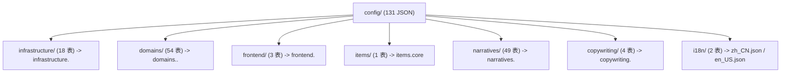

# 05 配置与本地化体系 (`config/`)

> 本分卷映射 [WebGames/config/](../../../config/) 全部 **131 个** JSON 配置文件及其运行时加载与文案水化引擎，构成本项目「零硬编码、配置驱动」的单一事实来源（SSOT）。

---

## 一、七层目录结构与表名映射规律

| 配置层级 | 文件数量 | 表名命名规律 | 运行时消费者 |
| :--- | :---: | :--- | :--- |
| `config/infrastructure/` | 18 | `infrastructure.<name>` | `GameConfig` 必需基表、契约注册表、`EventBusCore`、日志/持久化/生命周期/版本灰度 |
| `config/domains/` | 54 | `domains.<domain>.core`（及 `mechanics` / `damage_formulas` / `buff_definitions`） | 47 个业务域与 7 张跨域共享数值表 |
| `config/frontend/` | 3 | `frontend.ui`、`frontend.views`、`frontend.views.hud_event_bridge` | `ServiceLocator`、8 个前端语义白名单视图与事件桥接路由 |
| `config/items/` | 1 | `items.core` | 全量物品原型库与三元组校验（`canonical_id` / `english_name` / `loc_name_key`） |
| `config/narratives/` | 49 | `narratives.<name>` | 后端 `GameConfig.msg()` 与 `EventBusCore.emit_narrative_by_key()` |
| `config/copywriting/` | 4 | `copywriting.<name>`（`bulletin` / `item` / `narrative` / `probability`） | `CopywritingResolver` 结构化模板条件水化 |
| `config/i18n/` | 2 | `zh_CN.json` / `en_US.json` | 前端 `UITextResolver` 独立双语界面词典（各 1,936 行键值对） |

---

## 二、分册索引

| 专题文档 | 核心内容 | 重点文件指针 |
| :--- | :--- | :--- |
| [01_基础设施与域配置模型.md](01_基础设施与域配置模型.md) | `GameConfig` 加载与路由、18 张基础设施 SSOT 表、54 张领域子表、物品原型三元组与 `audit_config.py` 格式规范 | [config/README.md](../../../config/README.md) · [domains.json](../../../config/infrastructure/domains.json) |
| [02_叙事文案与国际化字典.md](02_叙事文案与国际化字典.md) | `CopywritingResolver` 四表模板引擎、`narratives/` 49 表、前端 `i18n/` 字典与 `SystemBaseMessages` 标准英文底座文案边界 | [copywriting_resolver.gd](../../../backend/infrastructure/copywriting_resolver.gd) · [system_base_messages.gd](../../../backend/infrastructure/logging/system_base_messages.gd) |
