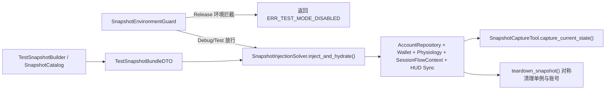

# 01 快照调试基座 (`dev_harness/snapshot_mode/`)

> 本册映射 [dev_harness/snapshot_mode/](../../../dev_harness/snapshot_mode/) 全部 **6 个** `.gd` 脚本（944 行），提供隔离的运行时快照构建、冻结抓取与生命周期多锚点状态注入机制。

---

## 一、脚本清单

| 类名 | 行数 | 核心职责与公开接口 | 源码路径 |
| :--- | :---: | :--- | :--- |
| `TestSnapshotBundleDTO` | 192 | 快照载体 DTO：承载账号、会话、世界、存档槽位、角色属性、钱包、生理状态、背包、位置、阶段及扩展域；支持 `reset_state()` / `to_dict()` / `from_dict()` | [test_snapshot_bundle_dto.gd](../../../dev_harness/snapshot_mode/dto/test_snapshot_bundle_dto.gd) |
| `SnapshotEnvironmentGuard` | 62 | 发布构建隔离守卫：通过 `is_injection_permitted()` / `validate_injection_environment()` 限制仅 Debug/Test 环境允许注入（支持测试覆盖 `set_test_override` / `reset_for_test`） | [snapshot_environment_guard.gd](../../../dev_harness/snapshot_mode/snapshot_environment_guard.gd) |
| `SnapshotInjectionSolver` | 313 | 全域注入与状态初始化引擎：`inject_and_hydrate()` 装配 `GameBootstrap`、初始化虚拟命途 MOD、写入 `AccountRepository`、构建生理/钱包实体并推入 `SessionFlowContextDTO` 与 `AuthoritativeHudSyncService`；`teardown_snapshot()` 执行对称反装配 | [snapshot_injection_solver.gd](../../../dev_harness/snapshot_mode/snapshot_injection_solver.gd) |
| `SnapshotCaptureTool` | 146 | 运行时现场冻结工具：`capture_current_state()` / `capture_to_json_string()` / `save_snapshot_to_file()` 从活动上下文、实时实体与 `SaveDataAccessLayer` 抽取合并快照 | [snapshot_capture_tool.gd](../../../dev_harness/snapshot_mode/snapshot_capture_tool.gd) |
| `TestSnapshotBuilder` | 111 | 流式构建器（Fluent Builder）：提供 `with_account` / `with_character` / `with_attributes` / `with_hp/mp/stamina/sanity` / `with_wallet` / `with_item` / `at_location` / `at_stage` / `build()` | [test_snapshot_builder.gd](../../../dev_harness/snapshot_mode/test_snapshot_builder.gd) |
| `SnapshotCatalog` | 120 | 预制阶段测试夹具目录：`fixture_novice_spawned`、`fixture_mid_explorer`、`fixture_late_hero`、`fixture_combat_critical` | [snapshot_catalog.gd](../../../dev_harness/snapshot_mode/snapshot_catalog.gd) |

---

## 二、安全熔断与注入/抓取闭环

- **Fail-Closed 环境边界**：无论是 `SnapshotInjectionSolver.inject_and_hydrate()` 还是 `SnapshotCaptureTool.capture_current_state()`，入口第一行均强制检验 `SnapshotEnvironmentGuard`，防止快照注入能力在正式发布包中被调用；对应诊断文案取自 `SystemBaseMessages.MSG_SNAPSHOT_PROD_BLOCKED` 与 `MSG_NULL_REQUEST`。
- **端到端验证**：[test_snapshot_engineering_harness_pipeline.gd](../../../tests/integration/pipelines/test_snapshot_engineering_harness_pipeline.gd) 覆盖多阶段快照注入初始化、抓取等价性与对称反装配验证。
