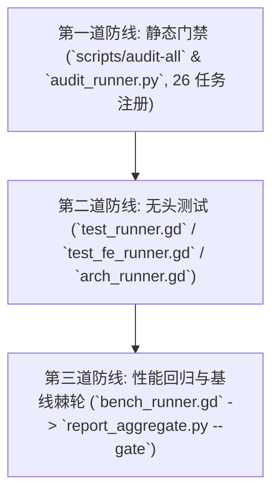

# 07 测试基准与工程脚本 (`tests/` & `benchmarks/` & `scripts/`)

> 本分卷映射卡拉尔世界引擎的质量验证与工程自动化体系：测试套件库 [tests/](../../../tests/)（149 个 `.gd` 脚本 / `TestRegistry` 登记 **139 套**可执行套件）、性能基准套 [benchmarks/](../../../benchmarks/)（8 个 `.gd` 脚本，570 LOC），以及跨平台门禁脚本库 [scripts/](../../../scripts/)（101 份脚本与规则配置）。

---

## 一、质量保障三层架构

---

## 二、分册索引

| 专题文档 | 映射源码范围 | 文件规模 | 核心内容 |
| :--- | :--- | :---: | :--- |
| [01_测试工程与架构护栏体系.md](01_测试工程与架构护栏体系.md) | `tests/`（根目录 Runner + `unit/` + `guards/` + `integration/` + `support/` + `fixtures/`） | 149 `.gd`（139 套注册套件） | 全量无头运行器、`TestRegistry`、`TestCase` 基类、4 大架构/边界/配置/鲁棒性护栏及 40 个集成流水线 |
| [02_性能基准测试体系.md](02_性能基准测试体系.md) | `benchmarks/` | 8 `.gd`（570 LOC） | `BenchHarness` 预热与 ops/s 度量、6 大性能基准类别、`sweep -> promote -> gate` 回归工作流 |
| [03_跨平台门禁与脚本库架构.md](03_跨平台门禁与脚本库架构.md) | `scripts/{ps1,sh,py,js,config}/` | 101 文件 | 15 对同构 `ps1/sh`、`audit_runner.py` 26 项审计调度、`docs_audit` / `gd` / `archive` / `lib` 子包与对抗自检 |
