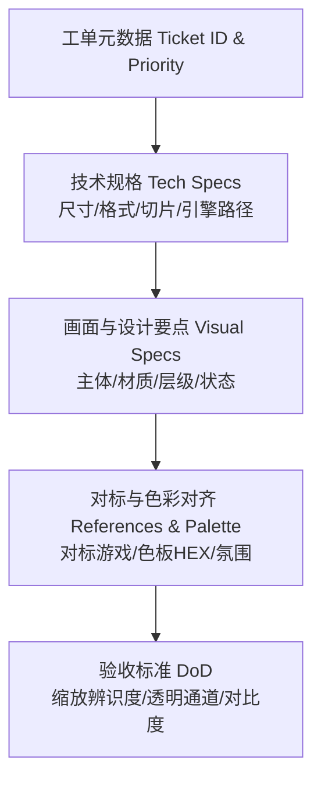
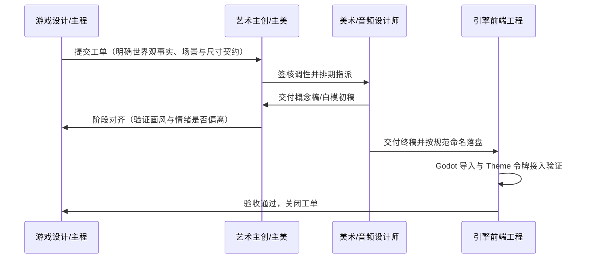

# 艺术工单需求库规范与资产交付契约 (Art Work Order System)

> 本目录为卡拉尔世界引擎（WebGames）前端表现层与艺术设计团队之间的**双向权威生产契约库**。所有发往艺术主创、概念设计师、UI 设计师与音效师的制作需求，必须严格遵循本规范模板建单、流转、验收与落盘。
>
> > [!IMPORTANT]
> > **【三位一体原型对标与资产解耦声明 (Illustrative Archetype Disclaimer)】**：
> > 本目录及下辖各工单中提及的**具体人物姓名**（如“老剑官阿尔诺”、“修女塞西莉亚”）、**技能具体名称**（如“刺”、“言灵·火凝”）以及**物品/装备/材料/消耗品名称**（如“秘银长剑”、“生铁胸甲”、“强效红药水”、“始源残卷”），**全部作为辅助艺术主创锚定形制、视觉特征、动势与功能槽位的示范原型参考（Illustrative Prototypes & Archetype Slots Only），绝非最终策划上线或业务系统锁死的唯一硬编码同名实体**。
> > 1. **人物半身像**：聚焦身份原型（Archetype）、职业体貌、年龄气质与情绪传达，资产统一采用中立身份槽位命名（如 `portrait_veteran_mentor`）；
> > 2. **技能招式与法印**：聚焦物理动词动势（刺/挑/劈/挂）与元素能量矢量（火/风/冰/雷），资产统一采用流派槽位命名（如 `rune_fire_elemental`）；
> > 3. **全域通用与剧情物品**：聚焦几何形制（双刃剑/单刃刀/大剑/法杖）、材质原貌（生铁/精钢/皮革/原木/晶石）与容器特征（水滴瓶/瓷罐/卷轴），资产统一采用大类原型槽位命名（如 `item_weapon_straight_sword`、`item_potion_healing_red`）。所有物品图标纯净无品质光效，由工程插槽系统动态叠加五阶品质外框（灰/绿/蓝/紫/金）与数量角标，全域 1000+ 道具均复用该套槽位库！

---

## 一、 工业化艺术工单的核心要素 (Work Order Schema)

一份合格的艺术生产工单必须剥离非必要文学修饰，直接向制作者交付确定性的**尺寸、材质、色板、参考、交付路径与验收标准**：



### 1. 技术规格六大刚性字段
1. **工单编号（Ticket ID）**：`ART-<类别>-<三位编号>`（例如 `ART-UI-001`、`ART-ICO-012`、`ART-VIG-003`、`ART-AUD-005`）；
2. **资产命名键（Asset Key）**：严格遵循 `snake_case`，与代码绑定名 1:1 对齐；
3. **文件格式（Format）**：纹理为 32-bit 透明通道 `.png`，音频为 `.ogg`，字体为 `.ttf` 或 `.otf`；
4. **尺寸与安全区（Dimensions & Padding）**：标称像素尺寸（如 `48x48`、`128x128`），九宫格切片安全边距（`margin_top/bottom/left/right`）；
5. **引擎目标路径（Target Engine Path）**：在 Godot 工程内的落盘位置（如 `res://frontend/assets/ui/skins/`）；
6. **验收标准（Definition of Done, DoD）**：验收时必须执行的检查项（如在 `#0F131A` 暗底上对比度 $\ge 4.5:1$、缩放至 16px 无糊死粘连）。

---

## 二、 艺术工单标准 Markdown 模板 (Work Order Template)

所有新增工单文件均套用此标准化卡片格式：

````markdown
### 【工单编号】ART-XXX-000: 资产中文名称

* **工单元数据**：
  * **优先级**：P0 (阻塞级) / P1 (重要级) / P2 (增强级)
  * **所属版本**：1.0 文字版 / 2.0 图文版
  * **关联剧情/系统**：第一幕·长夜薪火 / 战斗系统 (FE04)
  * **交付文件与路径**：`res://frontend/assets/.../asset_name.png`

* **技术规格 (Technical Specifications)**：
  * **分辨率尺寸**：`宽 px × 高 px`
  * **切片参数**：九宫格边距 Top: Xpx, Bottom: Xpx, Left: Xpx, Right: Xpx
  * **色彩深度**：RGBA 32-bit (带透明 Alpha 通道)

* **画面设计要点 (Visual Specifications)**：
  * **主体构图**：明确焦点物体与剪影动态；
  * **材质质感**：锻打黑铁 / 粗纤维羊皮纸 / 晶化晶体 / 粗糙麻布；
  * **状态机要求**：若为控件，需提供 Normal / Hover / Pressed / Disabled 四态切片。

* **色彩对齐与参考 (Palette & Reference)**：
  * **主色板 HEX**：基底色 `#XXXXXX`、强调色 `#XXXXXX`、高光色 `#XXXXXX`；
  * **风格对标**：《布兰特爵士》版画感 /《暗黑地牢》冷硬剪影 /《极乐迪斯科》克制排版。

* **验收标准 (Definition of Done)**：
  - [ ] 导出尺寸与切片边距与契约 100% 吻合；
  - [ ] 置于深灰暗底 (`#0F131A`) 上边缘无白边、无杂色毛刺；
  - [ ] 导入 Godot 4 引擎预览材质无变形失真。
````

---

## 三、 工单生命周期与流转流程 (Lifecycle & Workflow)



1. **立项签发（Backlog ➔ Assigned）**：需求方按模板起草工单，锁定尺寸与功能场景；
2. **对标签核（Concept Review）**：艺术主创核对色彩脚本与风格一致性；
3. **制作交付（Asset Handoff）**：设计师按规定目录与文件命名落盘至 `frontend/assets/`；
4. **工程导入与门禁闭环（Engine Verification）**：工程师替换 Mock 资源并确认全绿。

---

## 四、 工单目录索引

| 工单文件 | 覆盖内容与系统 | 当前状态 | 负责团队 |
| :--- | :--- | :--- | :--- |
| [第一幕长夜薪火艺术工单总表.md](第一幕长夜薪火艺术工单总表.md) | 第一幕长夜薪火全量资产工单（UI皮肤/图标/版画/字体/音频） | 🟢 待排期排产 | UI / 概念 / 音效组 |

