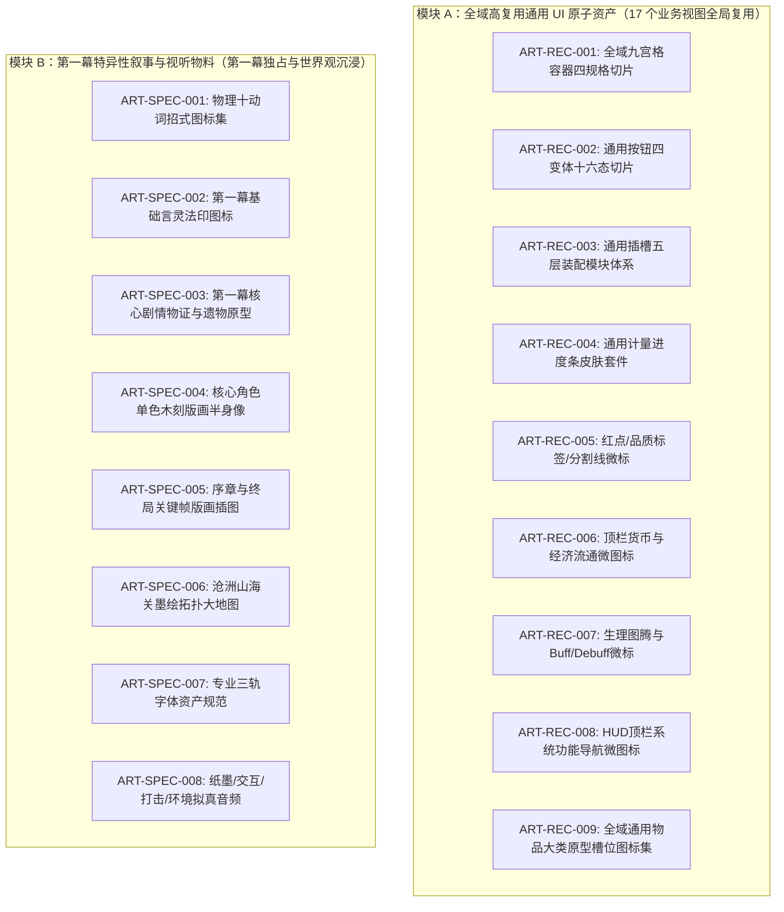
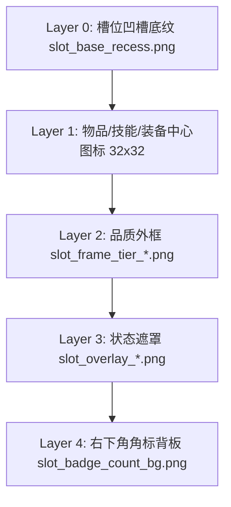

# 第一幕“长夜薪火”艺术生产工单总表

> 本文档为卡拉尔世界引擎 1.0 文字版 **第一幕主线剧情《长夜的薪火》** 全量艺术资产直接生产工单。
> 采用工业化**“高复用通用组件库”与“业务特异叙事物料”严格解耦架构**，消灭泛化修饰，直接交付像素尺寸、九宫格参数、分层装配规则与十六进制色板。
>
> > [!IMPORTANT]
> > **【三位一体原型对标与资产解耦声明 (Illustrative Archetype Disclaimer)】**：
> > 本表及各工单中提及的**具体人物姓名**（如“老剑官阿尔诺”、“修女塞西莉亚”）、**技能招式/法印名称**（如“刺”、“言灵·火凝”）以及**物品/装备/材料/消耗品名称**（如“秘银长剑”、“生铁胸甲”、“回血药水”、“始源残卷”），**全部作为辅助艺术主创锚定人设体貌、动势矢量、几何形制与功能槽位的示范原型参考（Illustrative Prototypes & Archetype Slots Only），绝非最终策划上线或业务系统锁死的唯一硬编码同名实体**。
> > 1. **人物半身像**：聚焦“身份原型（Archetype）、年龄阅历、体貌特征与精神气质”，资产统一以身份槽位命名（如 `portrait_veteran_mentor`）；
> > 2. **技能法印**：聚焦“物理动词轨迹（刺/劈/架）与元素能量矢量（火/风/冰）”，资产统一以招式流派槽位命名（如 `rune_fire_elemental`）；
> > 3. **全域物品体系**：聚焦“武器刃形、防具质地、药剂瓶型、材料原初形态”，资产统一以大类原型槽位命名（如 `item_weapon_straight_sword`、`item_potion_healing_red`）。所有物品图标纯净无品质光效，通过工程插槽系统的 Layer 2 五阶品质外框（灰/绿/蓝/紫/金）与 Layer 4 数量角标动态装配，全域 1000+ 策划道具均可 100% 稳定复用该槽位库！

---

## 一、 工单体系矩阵架构 (Work Order Matrix)

---

## 二、 模块 A：全域高复用通用 UI 原子资产工单

### 【工单编号】ART-REC-001: 全域九宫格容器四规格切片 (Universal NinePatch Containers)
* **复用范围**：全工程 17 视图、弹窗、二级抽屉、侧边栏、悬浮提示 (Tooltip)
* **技术标准**：RGBA 32-bit PNG，拉伸轴必须支持 `axis_stretch_horizontal: StretchMode.TILE` 与 `axis_stretch_vertical: StretchMode.TILE`（中心瓦片平铺，杜绝拉伸失真）。
* **四款规格切片清单**：

| 资产文件名 | 标称分辨率 | 九宫格安全切片 (Top/Bottom/Left/Right) | 适配承载尺寸区间 | 结构与像素细节 |
| :--- | :--- | :--- | :--- | :--- |
| `panel_window_base.png` | 128 × 128 px | 16px / 16px / 16px / 16px | 800x480 ~ 1920x1080 | **大视窗底板**：基底 `#0F131A`；外描边 1px `#1A202C`；上内边框 1px 亮线 `#2D3748`；四角内嵌 4x4px 下凹黑铁六角铆钉；中心区域平铺微细玄武岩噪点（透明度 4%）。 |
| `panel_card_surface.png` | 64 × 64 px | 8px / 8px / 8px / 8px | 200x120 ~ 600x400 | **子卡片/列表容器**：基底 `#161922`；四周 1px 内描边 `#232836`；圆角倒角半径 4px；用于装备详情卡、商铺商品陈列块、任务列表项。 |
| `panel_dialog_modal.png` | 96 × 96 px | 12px / 12px / 12px / 12px | 360x240 ~ 640x480 | **系统模态确认框**：基底 `#12151D`；外描边 2px 锻打暗铁 `#4A5568`；顶部具有 24px 高度的微浮雕标题托底装饰纹，四角带防裂包边铁皮。 |
| `panel_tooltip_hud.png` | 32 × 32 px | 4px / 4px / 4px / 4px | 120x40 ~ 320x160 | **悬浮提示轻量框**：基底 `#0B0D13`（不透明度 92% 半透）；四周 1px 极细暗金边框 `#B7791F`；内边距紧凑（留白 6px）。 |

* **验收标准**：
  - [ ] 在 Godot 4 中使用 `StyleBoxTexture` 设置对应 margins，拉伸测试无任何模糊、拉扯走样；
  - [ ] 底色与当前 `DesignTokens.COLOR_SURFACE_*` 明度完全兼容。

---

### 【工单编号】ART-REC-002: 通用按钮四变体十六态切片 (Multi-Variant Button System)
* **复用范围**：全工程所有可点击按钮（`k_button.gd` 统管：Primary / Secondary / Danger / Flat）
* **技术标准**：单态标称尺寸 `48 × 48 px`，四边切片边距均为 `6px`，四角圆角半径 `4px`。
* **物理位移规范**：所有 `pressed`（按下）态切片内容整体下移 `1px`，下方外投影由 `2px` 缩减为 `0px`，模拟微动开关物理下陷。
* **十六态矩阵配置表**：

| 变体名称 (Variant) | 状态 (State) | 资产文件名 | 像素与色彩规范 (HEX) |
| :--- | :--- | :--- | :--- |
| **主要按钮 (Primary)** *(核心确认/战斗出牌)* | 常态 (Normal) | `btn_pri_normal.png` | 基底 `#2B4C7E`；上高光 1px `#4A72B2`；下投影 2px `#152640`；四周边框 1px `#1E355B`。 |
|  | 悬停 (Hover) | `btn_pri_hover.png` | 基底 `#365D99`；边缘外发光 1px `#5B84C4`（明度提升 15%）；高光线 `#6A93D4`。 |
|  | 按下 (Pressed) | `btn_pri_pressed.png` | 基底 `#1F385C`；整体内容下移 1px；下投影消除，出现 1px 内阴影 `#0F1C2E`。 |
|  | 禁用 (Disabled) | `btn_pri_disabled.png` | 基底 `#222630`；边框 `#323846`；无外投影；整体透明度 45%。 |
| **次要按钮 (Secondary)** *(翻页/取消/次级导航)* | 常态 (Normal) | `btn_sec_normal.png` | 基底 `#20232D`；上边框 1px `#323846`；外描边 1px `#161820`；下微投影 1px `#0C0E12`。 |
|  | 悬停 (Hover) | `btn_sec_hover.png` | 基底 `#2A2F3D`；边框泛起冷白微光 `#4A5568`；明度提升 10%。 |
|  | 按下 (Pressed) | `btn_sec_pressed.png` | 基底 `#181B22`；整体下移 1px；内阴影 1px `#0B0C0E`。 |
|  | 禁用 (Disabled) | `btn_sec_disabled.png` | 基底 `#1A1D24`；边框 `#252932`；整体透明度 40%。 |
| **危险按钮 (Danger)** *(重置/分解/销毁/逃跑)* | 常态 (Normal) | `btn_dan_normal.png` | 基底 `#742A2A`；上高光 1px `#9B2C2C`；下投影 2px `#4A1B1B`；边框 `#5C1D1D`。 |
|  | 悬停 (Hover) | `btn_dan_hover.png` | 基底 `#8B3232`；边缘发光 `#C53030`；明度提升 15%。 |
|  | 按下 (Pressed) | `btn_dan_pressed.png` | 基底 `#521D1D`；整体下移 1px；下投影消除。 |
|  | 禁用 (Disabled) | `btn_dan_disabled.png` | 基底 `#2A2222`；边框 `#3D2D2D`；整体透明度 40%。 |
| **透明文本按钮 (Flat)** *(关闭图标/折叠展开)* | 常态 (Normal) | `btn_flat_normal.png` | 完全透明，仅中心锚点占位。 |
|  | 悬停 (Hover) | `btn_flat_hover.png` | 浅白半透明矩形底底 `#FFFFFF`（透明度 8%）；圆角 3px。 |
|  | 按下 (Pressed) | `btn_flat_pressed.png` | 深暗半透明矩形底底 `#000000`（透明度 20%）；内容下移 1px。 |
|  | 禁用 (Disabled) | `btn_flat_disabled.png` | 完全透明，图标或文本变暗灰化。 |

---

### 【工单编号】ART-REC-003: 通用插槽五层装配模块体系 (Universal Slot Architecture)
* **复用范围**：全工程 **物品背包 200 格、穿戴装备 10 槽、技能配置 6 槽、工坊锻造材料槽、集市商铺货架** 统一采用本套模块。
* **分层装配逻辑（Layered Assembly）**：杜绝单张死图，采用 5 层透明叠加渲染结构，尺寸统一为 `48 × 48 px`：

* **模块分层切片明细**：
  1. **Layer 0（通用底槽）`slot_base_recess.png`**：
     * 尺寸：`48 × 48 px`，正方形；
     * 结构：内凹 1px 阴影 `#0B0D12`，中央平底 `#161922`，四周留有 1px 细暗线 `#232733`；
  2. **Layer 2（五阶品质外框，中心镂空透明）`slot_frame_tier_1..5.png`**：
     * 尺寸：`48 × 48 px`，四周描边厚度严格为 `2px`，中心 `44 × 44 px` 区域 100% 透明；
     * 阶位 1（普通）：磨损铁灰色 `#718096`；
     * 阶位 2（精良）：冷霜松绿色 `#2F855A`；
     * 阶位 3（稀有）：奥术钴蓝色 `#2B6CB0`；
     * 阶位 4（史诗）：虚空曜紫色 `#6B46C1`；
     * 阶位 5（传说）：始源金黄色 `#C69214`，外边缘带 1px 极细外发光扩散；
  3. **Layer 3（状态浮层遮罩）`slot_overlay_*.png`**：
     * `slot_overlay_selected.png`（选中态）：内发光金色高亮线（1px `#ECC94B`），全框闪烁；
     * `slot_overlay_locked.png`（锁死态）：全图覆上 50% 半透明黑色暗影 + 斜向 45° 细铁栅栏暗纹；
  4. **Layer 4（数量角标底托）`slot_badge_count_bg.png`**：
     * 尺寸：`20 × 12 px`（自适应横拉），置于右下角；
     * 结构：深黑半透圆角矩形 `#000000`（透明度 75%），顶部留 1px 浅灰色分界线。

---

### 【工单编号】ART-REC-004: 通用计量进度条皮肤套件 (Modular Meter Skins)
* **复用范围**：玩家 HP/MP/AP、心核/机能条、BOSS 多部位血条、领地建设度、经验条 (`KStatusBar`, `ProgressBar`)
* **技术标准**：高度严格限定为 `16px` 或 `20px`，横向采用九宫格水平拉伸；
* **三层套件明细**：
  1. **底槽（Track）`meter_track_dark.png`**：
     * 尺寸：`64 × 16 px`，切片参数：左 4px，右 4px；
     * 像素规范：下凹式金属滑轨，底色 `#0D0F14`，内凹描边 `#1A1D24`；
  2. **填充条（Fill）`meter_fill_*.png`**：
     * 尺寸：`64 × 16 px`，切片参数：左 2px，右 2px；
     * `meter_fill_hp.png`：暗红渐变（上亮红 `#C53030`，下暗红 `#742A2A`），带 1px 顶高光；
     * `meter_fill_mp.png`：奥术深蓝（上天蓝 `#3182CE`，下幽蓝 `#1A365D`）；
     * `meter_fill_ap.png`：亮金战意（上暖黄 `#ECC94B`，下暗金 `#975A16`）；
     * `meter_fill_neutral.png`：中性经验冷灰（上白灰 `#CBD5E0`，下深灰 `#4A5568`）；
  3. **缓冲条（Buffer）`meter_fill_damage_buffer.png`**：
     * 纯白半透明材质（`#FFFFFF`，不透明度 60%），置于 Fill 层下方，掉血时延迟缩减。

---

### 【工单编号】ART-REC-005: 红点 / 品质标签 / 分割线微标 (Badges, Tags & Dividers)
* **复用范围**：全域导航红点 (`k_badge.gd`)、品质小标签 (`k_rarity_tag.gd`)、界面折叠分割条 (`k_split_panel.gd`)
* **资产清单与精度要求**：
  1. **红点与严重度指示器（`k_badge.gd`）**：
     * 尺寸：`16 × 16 px` 正圆形；
     * `badge_dot_error.png`（错误/新内容）：鲜红发光球（核心 `#E53E3E`，外晕 1px `#9B2C2C`）；
     * `badge_dot_warning.png`（待办/警告）：暖金发光球（核心 `#D69E2E`）；
     * `badge_dot_info.png`（提示）：奥术冷蓝球（核心 `#3182CE`）；
  2. **品质铭牌微型底座（`k_rarity_tag.gd`）**：
     * 尺寸：`60 × 20 px`，四周圆角 2px；
     * `tag_rarity_base_*.png`：5 级色阶对应的低饱和暗色底板（透明度 25%）+ 1px 左侧坚挺品质色竖线；
  3. **标准分割线套件（`k_split_panel.gd`）**：
     * `divider_line_horizontal.png`：尺寸 `256 × 2 px`，两端透明渐隐，中间 1px 暗铁灰 `#2D3748`；
     * `divider_stud_center.png`：尺寸 `8 × 8 px`，放置在分割线中央的菱形黑铁铆钉。

---

### 【工单编号】ART-REC-006: 顶栏货币与经济流通微图标 (Currency Micro-Icons)
* **复用范围**：顶栏货币显示条 ([`k_currency_bar.gd`](../../frontend/components/k_currency_bar.gd))、交易商铺、道具说明
* **技术标准**：交付双分辨率（`16 × 16 px` 像素级锐化版 + `32 × 32 px` 标准版）；边缘带 1px 极细深色阴影抗锯齿圈；
* **8 项经济资产清单**：

| 资产文件名 | 像素主体与构图 | 权威十六进制色板 (HEX) | 对应后端经济领域 |
| :--- | :--- | :--- | :--- |
| `currency_gold.png` | 古帝国金币：正圆 14px，中央微雕双头战鹰，带外齿边。 | 高光 `#FFE066`，基底 `#D69E2E`，暗面 `#744210`。 | 通用购买力代币 |
| `currency_silver.png` | 北方诸国银币：六边形 14px，中央阴刻六角冰霜符印。 | 高光 `#FFFFFF`，基底 `#CBD5E0`，暗面 `#4A5568`。 | 地方结算货币 |
| `currency_copper.png` | 斯特林顿旧铜币：圆形 14px，中心有 4x4px 方孔，边缘锈斑。 | 红铜 `#C05621`，暗面 `#652B19`，铜锈青绿 `#234E52`。 | 基层民用货币 |
| `currency_mana_frag.png` | 碎裂魔微晶：三粒不规则天然碎屑，表面微粗糙。 | 晶体浅蓝 `#BEE3F8`，荧光 `#63B3ED`，杂质暗青 `#2C5282`。 | 最底层魔素矿碎 |
| `currency_mana_std.png` | 标准魔单晶：立式正六棱柱晶体，内部垂直光导纤维光柱。 | 高光白 `#EBF8FF`，柱体深蓝 `#3182CE`，晶座 `#1A365D`。 | 帝国本位核心货币 |
| `currency_mana_pure.png` | 高纯魔单晶：三棱簇聚晶群，周围浮动 2 颗微缩光粒子。 | 晶尖透白 `#FFFFFF`，晶簇极光蓝 `#2B6CB0`，电弧 `#4299E1`。 | 高阶炼金与传送耗材 |
| `currency_mana_primal.png`| 始源神晶核：正八面体晶核，外围环绕一圈微缩金色自转光环。 | 核心虚空紫 `#322659`，晶面深蓝 `#1E3A8A`，光环暖金 `#ECC94B`。 | 超位/神级唯一法媒 |
| `currency_rations.png` | 军资粮草：粗麻结扎干粮袋，露出一支倾斜 45° 的实心麦穗。 | 麻布棕 `#744210`，麦穗金黄 `#ECC94B`，绑带 `#2D3748`。 | 大地图行军生存点 |

---

### 【工单编号】ART-REC-007: 核心生理状态图腾与 Buff/Debuff 微标 (Vital Status & Afflictions)
* **复用范围**：血条前置 Leading 图标 ([`k_status_bar.gd`](../../frontend/components/k_status_bar.gd))、战报飘字前缀、角色头顶状态列表
* **技术标准**：统一采用 `24 × 24 px`，黑色 1px 描边剪影风格，确保在暗色背景或彩色血条上清晰可辨；
* **具体设计细目**：

| 分类 | 资产文件名 | 符号图案设计规范 | 核心色板 (HEX) |
| :--- | :--- | :--- | :--- |
| **生理图腾** | `status_vital_hp.png` | 饱满红心，底部延伸出一颗 3x4px 滴血滴。 | 鲜红 `#E53E3E`，高光 `#FC8181`，暗影 `#9B2C2C` |
|  | `status_vital_mp.png` | 垂直奥术水滴，中心带有反向顺时针涡流线。 | 湛蓝 `#3182CE`，光斑 `#90CDF4`，暗核 `#1A365D` |
|  | `status_vital_ap.png` | 45° 俯冲展翼羽翎，中间横向贯通一道折线闪电。 | 亮金 `#D69E2E`，辉光 `#FAF089`，阴影 `#744210` |
|  | `status_vital_heart.png` | 裂纹晶化心核：多面体轮廓，中央有一道锯齿裂缝。 | 警告橘红 `#DD6B20`，裂隙熔岩黄 `#F6AD55` |
|  | `status_vital_sf.png` | 身体机能 SF：挺拔脊椎骨骼与双侧萌发绿叶的结合体。 | 坚韧生命绿 `#38A169`，高光 `#9AE6B4` |
|  | `status_vital_msf.png` | 精神压力 MSF：微缩脑域球，正上方束缚着一段生锈锁链。 | 压力虚空紫 `#805AD5`，锁链冷灰 `#718096` |
| **战术Buff** | `buff_parry_stance.png` | 招架就绪：两柄 45° 交叉的短剑，交叉点带有十字星芒。 | 精钢白 `#EDF2F7`，星芒暖金 `#ECC94B` |
|  | `buff_atk_boost.png` | 锋芒强化：剑尖朝上，两侧各有 2 弧向上飞扬的气刃。 | 狂暴绯红 `#E53E3E`，气刃白红 `#FEB2B2` |
|  | `buff_def_shield.png` | 重盾固守：带十字强化梁的坚实方盾剪影。 | 磐石深蓝 `#2B6CB0`，盾框亮银 `#E2E8F0` |
|  | `buff_haste_ap.png` | 先手神速：轻装战靴侧面展开一对饱满疾风翅膀。 | 极速金黄 `#D69E2E`，风痕浅蓝 `#BEE3F8` |
|  | `buff_mana_surge.png` | 灵能过载：正八芒星法阵，四周带有 4 条向外放射电芒。 | 奥术紫蓝 `#6B46C1`，雷芒亮蓝 `#63B3ED` |
|  | `buff_iron_will.png` | 钢铁意志：紧握断剑的戴铁手套重拳。 | 战火灰黑 `#2D3748`，拳套冷银 `#A0AEC0` |
| **战术Debuff**| `debuff_bleed.png` | 深度流血：3 条从右上到左下的抓痕裂口，下垂血滴。 | 伤口深黑 `#742A2A`，滴血鲜红 `#E53E3E` |
|  | `debuff_armor_break.png` | 甲胄碎裂：中心纵向呈“之”字形折断崩碎的盾面。 | 碎裂深灰 `#4A5568`，裂痕暗红 `#9B2C2C` |
|  | `debuff_stun_bind.png` | 硬直锁死：两环扣合的粗大铁手铐，带断裂半截链条。 | 锈铁深暗 `#1A202C`，生锈赭黄 `#B7791F` |
|  | `debuff_sanity_panic.png`| 理智崩溃：瞳孔剧烈缩小的眼眶，边缘延伸扭曲黑触须。 | 眼眸暗黑 `#000000`，狂乱深紫 `#44337A` |
|  | `debuff_burn.png` | 烈焰灼蚀：两瓣交错向上窜动的火舌，核心黑灰。 | 外焰亮橙 `#ED8936`，内焰深红 `#C53030` |
|  | `debuff_frostbite.png` | 极寒冻结：一块八角冰霜结晶，完全覆压在一根手指上。 | 极寒深蓝 `#2C5282`，冰锋淡白 `#EBF8FF` |

---

### 【工单编号】ART-REC-008: HUD 顶栏系统功能导航微图标 (Navigation Micro-Icons)
* **复用范围**：主界面顶栏右侧系统功能入口 ([`MainHUDView`](../../frontend/views/main_hud/main_hud_view.gd))
* **技术标准**：标称尺寸 `24 × 24 px`，纯净冷银金属线稿（`#A0AEC0`），悬停状态整体泛起金色高光（`#ECC94B`）；
* **8 项导航功能设计清册**：
  1. `nav_character.png`（角色面板）：侧面骑士全封闭十字面甲剪影，保留颈部锁甲鳞片细节；
  2. `nav_inventory.png`（行囊背包）：牛皮行军包正面，双排金属锁扣横穿，两侧有水壶挂载耳；
  3. `nav_skills.png`（武道魔典）：翻开 120° 的厚重古籍，书脊中央悬垂一条末端分叉的丝绸书签；
  4. `nav_map.png`（世界地图）：斜置羊皮纸卷轴，上方叠加一枚带有“北”字标示的四角罗盘探针；
  5. `nav_quests.png`（任务手札）：垂直悬挂的公告羊皮纸，顶部压印一枚滴蜡火漆圆形印章；
  6. `nav_mail.png`（帝国信箱）：闭合的羊皮纸信封背面，折角处插有一支斜刺向上的羽毛笔；
  7. `nav_settings.png`（设置中心）：两枚内外咬合的齿轮，主齿轮 8 齿，副齿轮 6 齿，齿距硬朗；
  8. `nav_exit.png`（系统菜单）：一扇双开厚重木质门扇，左扇向内虚掩微启，门缝透出平整光带。

---

### 【工单编号】ART-REC-009: 全域通用物品大类原型槽位图标集 (Universal Item Category Archetype Icons)
* **复用范围**：全工程 **物品背包（200格）、穿戴装备（10槽）、集市商铺货架、工坊锻造合成、战利品掉落** 全局复用。
* **高复用装配第一性原理**：
  * **槽位解耦与动态装配**：本工单交付的不是“某一特定名字的道具”，而是**“通用物品原型槽位 (Visual Category Archetypes)”**。所有图标尺寸统一为 `48 × 48 px`，物品中心剪影尺寸严格控制在 `32 × 32 px`（四周留白 8px 预留给插槽边框与阴影，严禁画框、严禁画外发光）。
  * **千件物品一套槽位**：具体策划道具的阶位品质由 `ART-REC-003` 的 Layer 2 五阶品质外框（灰/绿/蓝/紫/金）动态叠加，数量由 Layer 4 动态叠加。例如 `item_weapon_straight_sword` 搭配铁灰框即为“粗铁剑”，搭配钴蓝框即为“秘银长剑”，搭配始源金框即为“神圣裁决之刃”。
  * **示范名称仅为情境参考**：列表中标注的“示范策划名称”仅作为形制与调性对标参考（Illustrative Exemplars），全域同形制、同功能道具均无缝复用该槽位。

#### 1. 武器大类原型槽位清单 (Weapon Archetypes · 8 枚)

| 资产文件名 | 槽位原型定义与构图细节 | 示范策划参考 (Exemplar) | 权威十六进制色板 (HEX) |
| :--- | :--- | :--- | :--- |
| `item_weapon_straight_sword.png` | **直刃长剑原型**：双刃对称开刃，45° 倾斜朝右上；十字金属护手宽 16px，缠皮剑柄长 8px，八棱配重球。 | 粗铁剑 / 精钢长剑 / 秘银长刃 | 刃面冷白 `#E2E8F0`，脊线暗灰 `#718096`，柄皮深褐 `#4A3525` |
| `item_weapon_curved_saber.png` | **弧面单手刀原型**：单刃微弯，刀背厚重，刀尖后掠带 15° 斜切角；单侧护手，微弯刀柄。 | 猎人单刀 / 帝国马刀 / 斩风刀 | 刀刃亮银 `#EDF2F7`，刀背黑铁 `#2D3748`，刀镡古铜 `#B7791F` |
| `item_weapon_greatsword.png` | **双手大剑原型**：剑身宽阔厚重（宽 10px），带两道纵向减重凹槽；加长双手握柄，粗大防脱护手。 | 斩马大剑 / 黑铁重剑 / 破阵剑 | 剑身重铁 `#4A5568`，槽纹幽暗 `#1A202C`，护甲纯钢 `#CBD5E0` |
| `item_weapon_dagger.png` | **短匕刺刃原型**：短小锐利剑尖，剑刃呈倒梯形反曲，带深暗放血凹槽；环形柄头便于指环扣合。 | 粗铁短匕 / 淬毒刺刀 / 潜行短刀 | 锋刃冷白 `#FFFFFF`，血槽黑红 `#4A1B1B`，缠布暗灰 `#2D3748` |
| `item_weapon_spear.png` | **长柄枪矛原型**：45° 斜贯对角线的穿甲菱形枪尖，下端有金属锁箍与红色系缨，木质长杆截断示出。 | 卫兵步枪 / 透甲长矛 / 猎兽标枪 | 矛尖钢白 `#E2E8F0`，束缨朱红 `#C53030`，枪杆沉木 `#5B3E31` |
| `item_weapon_blunt_mace.png` | **破甲战锤原型**：四面突起十字钝钉的重型钢锤头，粗壮短柄覆以菱形防滑滚花铁皮。 | 锻铁战锤 / 晨星链锤 / 审判重锤 | 锤体锻铁 `#333C4D`，尖钉精钢 `#A0AEC0`，把手暗黑 `#171923` |
| `item_weapon_wooden_bow.png` | **曲木猎弓原型**：双曲对称反曲弓臂，两端角质弓梢，中段包覆牛皮握把，一根绷紧的细白兽筋弦。 | 杉木短弓 / 强力复合弓 / 精灵长弓 | 弓背冷杉 `#744210`，握把牛皮 `#975A16`，弓弦银白 `#EDF2F7` |
| `item_weapon_arcane_staff.png` | **奥术长杖原型**：天然扭曲硬木长杖，杖顶分叉枝杈环抱一颗微微悬浮的菱形奥术晶石，周围带微光。 | 学徒木杖 / 秘法长杖 / 始源星杖 | 杖身老木 `#4A2E1B`，晶石奥蓝 `#3182CE`，晶芯荧光 `#BEE3F8` |

#### 2. 防具装具大类原型槽位清单 (Armor & Shield Archetypes · 9 枚)

| 资产文件名 | 槽位原型定义与构图细节 | 示范策划参考 (Exemplar) | 权威十六进制色板 (HEX) |
| :--- | :--- | :--- | :--- |
| `item_armor_chest_plate.png` | **重型金属胸铠原型**：正面立体冲压双曲前胸甲，中央防冲击脊线突起，边缘有加固卷边与铆钉。 | 生铁胸甲 / 骑士板甲 / 皇家重铠 | 胸甲锻钢 `#A0AEC0`，内凹暗面 `#4A5568`，铆钉亮白 `#FFFFFF` |
| `item_armor_chainmail.png` | **锁子甲长衫原型**：细密咬合的金属圆环网状织物，圆领开襟，肩部与下摆露出边缘锯齿环扣。 | 铁锁子甲 / 锁环衬衣 / 秘银链甲 | 锁环高光 `#E2E8F0`，网底阴影 `#1A202C`，皮革包边 `#744210` |
| `item_armor_leather_tunic.png`| **硬化皮甲背心原型**：多层鞣制牛皮拼接，前胸交叉双排皮带系扣，肩部覆有加厚双层护肩皮层。 | 猎人皮衣 / 熟皮甲 / 巡林轻装 | 皮质主色 `#975A16`，阴影深褐 `#5B3E31`，搭扣黄铜 `#D69E2E` |
| `item_armor_cloth_robe.png` | **织物长袍原型**：立领对襟修长法袍，腰间系有布结带，领口与袖口带有极细几何纹理暗色滚边。 | 学者长衫 / 亚麻信徒袍 / 织魔斗篷 | 织物灰蓝 `#4A5568`，布褶阴影 `#2D3748`，暗纹冷灰 `#A0AEC0` |
| `item_armor_helm_open.png` | **轻型开面头盔原型**：拱顶半球头盔，正前方下延 12px 一体式护鼻梁，两侧各有护耳活动铁甲片。 | 步兵铁盔 / 探索者皮盔 / 护鼻盔 | 盔顶冷银 `#CBD5E0`，护鼻暗钢 `#4A5568`，内衬暗黑 `#171923` |
| `item_armor_helm_closed.png`| **全覆式重装头盔原型**：桶形全密封重骑士头盔，面部仅留有一道宽 4px 水平观察缝与 8 个十字透气孔。 | 审判官十字全盔 / 圣殿重盔 | 盔面黑铁 `#2D3748`，窥缝幽黑 `#000000`，棱线亮银 `#EDF2F7` |
| `item_armor_gauntlet.png` | **战术装甲护手原型**：手背到手指多节铰接的钢制防护甲片，手腕处附有厚实皮革收紧束带。 | 铆钉皮护腕 / 铁护手 / 龙鳞拳套 | 甲片冷灰 `#718096`，骨节高光 `#CBD5E0`，手腕黑革 `#1A202C` |
| `item_armor_boots.png` | **重行军战靴原型**：高帮硬牛皮长靴，靴头与小腿迎风面各装有一块弧形冲压防撞金属铁板。 | 游侠皮靴 / 行军铁靴 / 坚韧战靴 | 皮面深棕 `#5B3E31`，防撞铁板 `#718096`，鞋底硬黑 `#0F131A` |
| `item_armor_shield_heater.png`| **坚实鸢形盾原型**：上平下收尖弧形中世纪鸢盾，正面带有十字交叉金属加固梁与中心平头铁脐。 | 步兵木盾 / 黑铁重盾 / 符文鸢盾 | 盾面暗蓝 `#2C5282`，加固横梁 `#A0AEC0`，盾框黑铁 `#1A202C` |

#### 3. 炼金消耗品大类原型槽位清单 (Consumable Archetypes · 6 枚)

| 资产文件名 | 槽位原型定义与构图细节 | 示范策划参考 (Exemplar) | 权威十六进制色板 (HEX) |
| :--- | :--- | :--- | :--- |
| `item_potion_healing_red.png` | **生命治愈药剂原型**：水滴状圆底玻璃瓶，瓶内盛有半满翻滚微泡的鲜红药液，瓶塞为打蜡软木塞。 | 草药浸膏 / 凝血剂 / 强效生命合剂 | 药液鲜红 `#E53E3E`，高光浅红 `#FC8181`，玻璃瓶身 `#EDF2F7` |
| `item_potion_mana_blue.png` | **法力充盈合剂原型**：立式六角棱柱细颈瓶，瓶内涌动着泛起电弧的幽蓝荧光液体，瓶颈缠有一圈细铜丝。| 微晶溶液 / 灵能恢复药 / 纯魔原浆 | 药液深蓝 `#3182CE`，荧光极蓝 `#90CDF4`，铜丝暖金 `#D69E2E` |
| `item_potion_cure_green.png` | **解毒净化药水原型**：矮胖扁平烧瓶，墨绿色微带沉淀物的透明苦草药液，瓶塞系着一片干燥绿叶标本。| 解毒草药水 / 清神薄荷剂 / 净毒散 | 药水墨绿 `#276749`，透亮翠绿 `#48BB78`，草叶暗黄 `#975A16` |
| `item_potion_buff_gold.png` | **体能亢奋药剂原型**：正三角形锥形烧瓶，金黄色透亮高浓度药剂，中心有一团顺时针旋转的高亮光核。| 狂热狂暴水 / 敏捷酊剂 / 铁骨药油 | 药水暖金 `#D69E2E`，辉光明黄 `#FAF089`，暗核深橘 `#C05621` |
| `item_consum_salve_jar.png` | **急救药膏瓷罐原型**：带螺纹木盖的灰白粗陶圆罐，罐口侧面微溢出一抹干涸的灰黄色消炎凝胶。 | 止痛油脂 / 跌打草药膏 / 愈疮脂 | 瓷罐灰白 `#E2E8F0`，药膏土黄 `#D69E2E`，木盖深褐 `#5B3E31` |
| `item_consum_scroll_paper.png`| **即用羊皮纸卷轴原型**：干燥羊皮纸紧密卷制，中央有一道深红火漆封蜡，两端卷轴轴头露出木质骨架。| 回城卷轴 / 侦测卷轴 / 避难卷轴 | 羊皮纸黄 `#F6E05E`，纸褶阴影 `#B7791F`，火漆深红 `#9B2C2C` |

#### 4. 工坊锻造与生产材料原型槽位清单 (Material Archetypes · 6 枚)

| 资产文件名 | 槽位原型定义与构图细节 | 示范策划参考 (Exemplar) | 权威十六进制色板 (HEX) |
| :--- | :--- | :--- | :--- |
| `item_material_ore_rough.png` | **天然原矿石原型**：多棱角不规则断裂玄武岩体，其中 2 处断面上露出向外突起的多晶天然金属晶粒。 | 生铁原矿 / 秘银碎块 / 粗铜矿石 | 岩体暗黑 `#2D3748`，晶粒亮银 `#E2E8F0`，阴影深暗 `#1A202C` |
| `item_material_ingot_metal.png`| **精炼金属铸锭原型**：标准等腰梯形金属条块，顶面下凹压印有工坊锻造铁锤钢印，侧面带脱模倾角。 | 精钢锭 / 纯银砖 / 纯铜铸条 | 锭身金属灰 `#A0AEC0`，顶反光纯白 `#FFFFFF`，底阴影 `#4A5568` |
| `item_material_wood_timber.png`| **硬木原木材原型**：整齐切锯的带皮实心圆木段，斜向横截面上清晰可见 6 圈同心年轮与干燥干裂缝。| 冷杉原木 / 铁线橡木 / 白蜡树干 | 截面木质黄 `#D69E2E`，树皮粗褐 `#4A2E1B`，裂缝深黑 `#171923` |
| `item_material_leather_hide.png`| **鞣制兽皮卷原型**：紧扎成卷的厚重熟牛皮，横截面呈卷曲蚊香状，两端散落数根未经修整的细毛。 | 生鞣牛皮 / 厚韧狼皮 / 巨蜥重革 | 皮面熟褐 `#975A16`，背里淡棕 `#C05621`，扎绳麻黄 `#CBD5E0` |
| `item_material_herb_bundle.png`| **药用干草药束原型**：3 支并排扎紧的风干草药，顶部带有干燥卷曲的星形花苞与长条披针形叶片。 | 银叶草 / 蛇床子干枝 / 苦艾草束 | 干燥绿 `#2F855A`，枯黄叶尖 `#B7791F`，麻线米白 `#E2E8F0` |
| `item_material_powder_dust.png`| **精磨矿物粉末原型**：倾倒在平布上的小堆圆锥状细腻矿粉，四周散落 5 粒呈微弱反光的微细晶体尘埃。 | 魔素晶尘 / 铁屑粉末 / 硫磺研磨粉 | 粉堆浅灰蓝 `#CBD5E0`，晶亮点纯白 `#FFFFFF`，阴影深暗 `#2D3748` |

#### 5. 任务与功能杂项大类原型槽位清单 (Miscellaneous Archetypes · 5 枚)

| 资产文件名 | 槽位原型定义与构图细节 | 示范策划参考 (Exemplar) | 权威十六进制色板 (HEX) |
| :--- | :--- | :--- | :--- |
| `item_misc_key_iron.png` | **古旧锻铁钥匙原型**：传统十字镂空环形柄，长方体钥匙杆，端部带有 3 阶不对称高低开锁牙齿。 | 牢房钥匙 / 军械库旧匙 / 锈迹铁钥 | 锈铁暗面 `#2D3748`，磨光牙面 `#A0AEC0`，锈斑红褐 `#7B341E` |
| `item_misc_sealed_letter.png` | **火漆封缄密函原型**：四折整齐封口的羊皮纸信件，正背面交接处压覆一枚带有双头鹰残印的暗红火漆。| 军团密令 / 求援血书 / 走私账本 | 信封米黄 `#F7FAFC`，纸褶暗灰 `#CBD5E0`，火漆深红 `#742A2A` |
| `item_misc_ancient_tome.png` | **装订厚重古籍原型**：黑色硬皮厚重大书，书脊嵌有 3 道金属装订凸肋，四角装有三角形防磨损黄铜包角。| 旅者见闻录 / 破损典籍 / 炼金日志 | 封皮黑黑 `#1A202C`，黄铜包角 `#D69E2E`，内页泛黄 `#FAF089` |
| `item_misc_whetstone.png` | **便携双面磨刀石原型**：长条形磨石，上下双层复合粘结（上层粗磨深灰粒面，下层精磨浅灰镜面）。 | 细砂油石 / 便携磨刀块 / 粗磨岩条 | 粗磨面暗黑 `#2D3748`，细磨面浅灰 `#A0AEC0`，接缝黑线 `#171923` |
| `item_misc_identity_badge.png` | **金属身份标牌原型**：椭圆形冲压黑铁片，顶端冲压穿绳小孔，正面深刻一串数字编码与一柄短剑印痕。| 阵亡士兵名牌 / 斥候领章 / 佣兵铁牌 | 铁牌基底 `#4A5568`，冲印深黑 `#1A202C`，磨损边缘亮银 `#EDF2F7` |

---

## 三、 模块 B：第一幕特异性叙事与视听物料工单

### 【工单编号】ART-SPEC-001: 物理十动词招式图标集 (Verbs Set)
* **技术规格**：`48 × 48 px`，10 枚独立透明通道 PNG；
* **视觉语言**：纯黑背景衬托下的锋利冷钢刀刃光轨与动势矢量；
* **动词视觉特征与坐标轨迹规范**：
  1. `verb_stab.png`（刺）：平直向右穿刺的剑锋，剑尖向后喷射出 3 道放射状白色破空冲击波（角度 0°）；
  2. `verb_lift.png`（挑）：剑尖自左下方朝右上方（45° 角）疾速挑起，拖拽出一道月牙形高光圆弧；
  3. `verb_chop.png`（劈）：剑身垂直自正上方砸落（90° 角），正下方地面受挫处带有 2 道崩碎石屑；
  4. `verb_hack.png`（砍）：大开大合的 30° 倾斜重切面，带有粗犷刀痕与空气摩擦阻力流线；
  5. `verb_sweep.png`（撩）：反手回转挑撩的弧形轨迹，形成一个半包围的逆向风环；
  6. `verb_parry.png`（挂）：剑身微倾（15°）架住来袭兵刃，受力点爆发出 6 颗向外迸射的锐角火星；
  7. `verb_point.png`（点）：手腕震颤形成的极小着力点，前方扩散出两圈同心圆微震波；
  8. `verb_collapse.png`（崩）：剑身横推震荡，前方爆发出一面扇形气浪碎裂纹理；
  9. `verb_twist.png`（绞）：两柄刀剑刃面紧贴旋转，中央呈现双螺旋气流旋涡；
  10. `verb_wipe.png`（抹）：极度扁平的横切剑芒，如一抹贴颈掠过的冷白细丝，锋芒内敛。

---

### 【工单编号】ART-SPEC-002: 第一幕基础言灵法印图标 (Runes Set · 原型槽位)
* **设计性质**：元素法印槽位原型参考（示范名称仅供情境对标，非业务唯一锁定名）
* **技术规格**：`48 × 48 px`，6 枚透明 PNG，奥术矢量印记；
* **法印原型清册**：
  1. `rune_fire_elemental.png`（火系言灵原型 · 示范名“火凝”）：三道内聚的微缩炽热火焰舌（`#DD6B20`）；
  2. `rune_wind_pierce.png`（风系穿刺原型 · 示范名“风矢”）：由 3 圈同心螺旋气旋汇聚成一枚穿透性箭矢（`#319795`）；
  3. `rune_frost_rime.png`（冰系霜冻原型 · 示范名“霜冻”）：六角对称但边缘结霜脆裂的冰晶符咒（`#3182CE`）；
  4. `rune_arcane_charge.png`（奥术蓄势原型 · 示范名“蓄势”）：向中心引力塌陷的环形光环与 4 枚收敛符文（`#805AD5`）；
  5. `rune_astral_sigil.png`（星辉流派原型 · 示范名“星辉法印”）：八芒星中央悬浮一颗自由菱形星核，带点阵辉光（`#4299E1`）；
  6. `rune_mana_overload.png`（法力过载原型 · 示范名“微晶过载”）：中央晶体呈碎裂状，周围向四面八方炸裂出电弧（`#ECC94B`）。

---

### 【工单编号】ART-SPEC-003: 第一幕核心剧情物证与遗物原型槽位 (Story Relics & Quest Archetypes)
* **复用范围**：第一幕主线剧情任务（Quest）交付物、叙事背包（Story Inventory）、剧情对话展示物。
* **原型解耦与设计定位**：
  * **特异性与槽位化兼顾**：本工单物料专为第一幕“长夜薪火”风雪边境的战火残酷感服务。括号内的剧情道具名称（如“始源残卷”、“阿尔诺的断剑”）**全部严格作为情境对标原型（Illustrative Exemplars Only）**，绝非最终业务锁死的静态实体。
  * **美术关注重心**：重点刻画冷兵器创伤、皮革碳化、极寒冰凌结霜、血液氧化发黑等物理痕迹；
  * **技术标准**：画布尺寸 `48 × 48 px`，核心物证剪影约束在 `36 × 36 px` 内，外围带 1px 深暗轮廓线以脱离底色；交付 RGBA 32-bit 透明 PNG。

| 资产文件名 | 槽位原型定义与物理质感 | 示范剧情参考 (Exemplar) | 权威十六进制色板 (HEX) |
| :--- | :--- | :--- | :--- |
| `story_relic_ancient_tome.png` | **核心典籍遗物原型**：黑色重皮封皮，外箍 2 道带铆钉黑铁箍；右下角呈斜向碳化烧焦破损，破损内页发黄，边缘有干涸暗红血浸痕。 | 始源残卷 / 逃亡者手札 / 先民密典 | 龙皮黑褐 `#1A202C`，烧焦黑 `#0D0F14`，泛黄书页 `#FAF089`，血迹 `#742A2A` |
| `story_relic_broken_blade.png` | **老兵断损军刃原型**：宽刃单手剑齐中段折断，参差不齐的锯齿状断口；剑身遍布 7 处深浅砍缺，护手粗糙缠满浸透灰黑机油的麻绳。 | 阿尔诺的断剑 / 卫戍长残刃 / 陷阵断锋 | 折断面精钢 `#CBD5E0`，剑身暗灰 `#4A5568`，缠绳污黑 `#2D3748` |
| `story_relic_inquisitor_badge.png`| **敌将裁决铁印原型**：黑铁铸造的十字鸢形小盾印章，中心浮雕一条被铁链紧锁的死龙，龙眼处嵌有一颗散发幽暗红芒的微型人造人晶体。 | 审判官铁印 / 军团惩戒章 / 执政官信物 | 铁盾基底 `#2D3748`，死龙浮雕 `#1A202C`，龙眼血红 `#C53030`，反光 `#E2E8F0` |
| `story_relic_mana_shards.png` | **粗粝魔素矿渣原型**：浸透油脂的泛黄粗布中，包裹着 3 块天然碎裂的微晶原石，透过布层缝隙向外溢出幽寒的冰蓝色光线与微弱电芒。 | 魔单晶碎片 / 走私灵晶渣 / 淬火废矿 | 浸油粗布 `#744210`，晶核深蓝 `#2B6CB0`，溢光荧蓝 `#63B3ED`，高光纯白 `#FFFFFF` |
| `story_relic_ration_pack.png` | **极寒行军干粮原型**：粗暴掰断成两截的黑色黑麦硬干粮，断面暴露出粗糙未经细磨的麦壳颗粒，干粮表皮附着一层白霜与木炭烤痕。 | 干硬黑麦面包 / 戍边救命粮 / 冻结干粮块 | 麦块深褐 `#5B3E31`，粗麦粒灰黄 `#D69E2E`，烤焦黑斑 `#171923`，冰霜淡白 `#EDF2F7` |
| `story_relic_blood_bandage.png`| **急救染血绷带原型**：从粗纺军服撕扯下、随意缠裹成团的粗麻布带，表面渗透着大片暗红氧化的陈旧血污与一抹捣碎草药的暗绿残渣。 | 浸血粗麻绷带 / 战地止血带 / 缝合布条 | 亚麻粗灰 `#CBD5E0`，陈旧血污 `#742A2A`，草药暗绿 `#276749`，干涸黑褐色 `#1A1D24` |
| `story_relic_frontier_token.png`| **边塞要塞铁令原型**：厚达 5mm 的八角形纯铁令牌，正中阴刻“山海关要塞”微缩浪涛城垛纹，边缘因常年磨损露出明亮金属生铁原色。 | 山海关铁令 / 边防守备印 / 渡河通行铁牌 | 铁令本体 `#4A5568`，阴刻凹槽 `#1A202C`，磨损金属边缘 `#E2E8F0`，锈斑赭红 `#9C4221` |

---

### 【工单编号】ART-SPEC-004: 核心角色单色木刻版画半身像 (Portraits · 身份原型槽位)
* **设计性质**：核心身份原型半身像（括号内姓名仅为剧情推演示例，美术重点锚定“身份类型与体貌特征”，绝非死板同名实体）
* **技术规格**：`256 × 256 px`，黑白单色木刻版画风格（Monochrome Woodcut），强剪影黑白对比；
* **5 位身份原型肖像精细面貌描述**：
  1. `portrait_protagonist_seeker.png`（探求者主角原型 · 演示参考：记录官）：
     * 脸型削瘦，颧骨微突，双颊凹陷；眼神锐利而疲惫；
     * 领口外翻露出被长矛刺穿后缠裹的粗麻布绷带，绷带下渗出蛛网状晶光；
     * 左肩覆着一件被火星灼穿多个小洞的学者短披风，双手抱于胸前护住古籍。
  2. `portrait_veteran_mentor.png`（伤残老兵导师原型 · 演示参考：老剑官阿尔诺）：
     * 55 岁左右，右脸颊有一道贯穿耳垂的马刀撕裂疤痕；
     * 须发皆白且如铁针般杂乱蓬张，眼神如冰原孤狼般冷冽凶横；
     * 右肩袖管齐肩整齐切断，断口用牛皮绳死死扎紧；左手反提断刃长剑，身披破旧带雪熊皮。
  3. `portrait_healer_medic.png`（透支救赎医官原型 · 演示参考：星辉修女塞西莉亚）：
     * 24 岁女子，神态平和慈悲，但眼眶深黑，额角有几缕过早白化的银丝；
     * 身上穿着染满深褐色血污与药渍的围裙，双手轻搭胸前，指节粗大开裂；
     * 背景带有几条极其微弱纤细的星辉法术光轨线条。
  4. `portrait_antagonist_commander.png`（极权敌将指挥官原型 · 演示参考：审判长莫尔顿）：
     * 全封闭式中世纪重装全铁头盔，面部仅有一道宽仅 8mm 的十字窥孔；
     * 窥孔阴影深处泛起两点非人的冰冷寒光；
     * 颈部包裹厚实带铆钉的护喉甲板，胸甲正中央雕刻着一条被铁锁绞杀的死龙。
  5. `portrait_inheritor_child.png`（传承后辈遗孤原型 · 演示参考：孤儿艾尔）：
     * 9 岁小男孩，头上戴着一顶极不合身、盖住双眉的破洞粗毛线帽；
     * 脸颊与鼻尖冻得发红，双手死死将主角遗留的大部头古卷抱在怀中；
     * 眼神中没有眼泪，抿着嘴唇，透着劫后余生的倔强与坚毅。

---

### 【工单编号】ART-SPEC-005: 序章与终局关键帧版画插图 (Story Scenes)
* **技术规格**：`512 × 256 px` 横版版画插图，严格遵循 16:9 或 2:1 版式；
* **4 幕画面构图要素**：
  1. `scene_act1_ruins.png`（旧都劫火）：
     * 左侧前景为泥泞雪地中逃亡者踉跄前行的佝偻背影；
     * 远景为斯特林顿王都倾塌的哥特式大教堂尖顶，滚滚浓烟蔽空，天际残留火光剪影。
  2. `scene_act1_fortress.png`（风雪山海关）：
     * 两座如天堑般的万丈黑石悬崖夹峙，中间矗立着满是箭痕与冰凌的巨石关隘；
     * 城头斜插着几面被北风撕成布条的战旗，城下一片白茫茫的暴风雪原。
  3. `scene_act1_bivouac.png`（伤兵营炉火）：
     * 昏暗逼仄的地下石窟，石壁渗水形成反光条纹；
     * 中央一口吊在火塘上的黑色铁锅正腾起白汽，四周地垄上拥挤地躺卧着裹着粗毯的断肢伤员。
  4. `scene_act1_dawn.png`（破晓天河与传承）：
     * **前景**：主角长剑直插雪地，单膝跪倒在浮桥头，胸膛心核光芒彻底消散成灰白；
     * **中景**：天河封锁链化作漫天碎冰光屑消散，第一艘满载难民的木质渡船正推离岸边，一个孩子站在船尾回望；
     * **远景**：暴风雪铅云被一道万丈晨曦刺穿，金红色的朝霞平铺在浩荡南去的天河水面上。

---

### 【工单编号】ART-SPEC-006: 沧洲山海关墨绘局部拓扑大地图 (Frontier Realm Map)
* **技术规格**：`1920 × 1080 px` 高清底图，欧洲古典羊皮纸手绘航海图风格；
* **构图与地貌要素**：
  * **主河流**：天河横贯画面中央偏南，带有手绘细腻波纹线条；
  * **关隘据点**：天河北岸为险峻隆起的龙崎雪山南麓山脉，标注“山海关要塞”微缩城堡线描图腾；
  * **渡口与航道**：标明“天河铁索浮桥”与“南岸接应渡口”，带有虚线探索路径；
  * **装饰边缘**：地图四角带有中世纪罗盘玫瑰（Compass Rose）、比例尺羊皮纸卷轴与拉丁文铭刻题头。

---

### 【工单编号】ART-SPEC-007: 专业三轨字体资产规范 (Typography Assets)
* **技术标准**：TrueType (`.ttf`) 或 OpenType (`.otf`)，必须完整包含 GB2312/GBK 规范 6,763 个简体汉字、全套 ASCII 字符与全角标点符号；
* **三款字体详细参数**：
  1. `font_display_ancient.ttf`（史诗主标题字）：
     * 风格：带有古典碑刻刻石棱角、横细竖粗、起落笔具有金石力量感的人文楷宋体；
     * 适用场景：游戏标题、章节开场大字、BOSS 登场名牌（字号 28~36px）。
  2. `font_body_standard.ttf`（正文阅读字）：
     * 风格：中宫开阔、笔画清晰、字距舒展、长时间阅读无视疲劳的高清人文宋体或现代屏显黑体；
     * 适用场景：战报长篇叙事、剧情对话、文献阅读、道具长说明（字号 12~14px）。
  3. `font_mono_terminal.ttf`（终端等宽字）：
     * 风格：英文字符与数字严格等宽（宽度比严格 1:1），行高紧凑利落；
     * 适用场景：打字机战斗日志、伤害数值飘字、AP 时间轴倒计时、属性对比数值。

---

### 【工单编号】ART-SPEC-008: 纸墨 / 交互 / 打击 / 环境拟真音频 (Audio Foley & Ambience)
* **技术标准**：Ogg Vorbis (`.ogg`)，采样率 44.1kHz，位深 16-bit，无爆音、无杂音底噪；
* **十九条音频资产清单**：

| 分类 | 资产文件名 | 时长 (s) | 拟音动作与听觉特征 | 目标接入点 |
| :--- | :--- | :--- | :--- | :--- |
| **纸墨 Foley** | `paper_typewriter_click.ogg` | 0.08 | 类似木质打字机或活字印章敲击在硬桌面的极短清脆声。 | 打字机战报单字滚屏 |
|  | `paper_scribble_fast.ogg` | 0.25 | 羽毛笔在粗纤维羊皮纸上快速签署刮擦的沙沙摩擦声。 | 任务接取 / 技能著书 |
|  | `paper_page_turn.ogg` | 0.40 | 干燥厚实的古籍硬质羊皮纸翻动掀起的沉闷风声。 | 翻页 / 菜单面板切换 |
|  | `paper_stamp_seal.ogg` | 0.20 | 沉重金属火漆印章猛力压盖在封蜡上的沉实闷响。 | 任务完成结算 / 归档 |
| **UI 交互** | `ui_hover.ogg` | 0.05 | 极轻微的微风拂过或木质触碰声（音量 -18dB，防听觉疲劳）。 | 全局按钮悬停 |
|  | `ui_click.ogg` | 0.08 | 干燥清脆的木制搭扣锁闭卡嗒声。 | 全局按钮点击按下 |
|  | `ui_success.ogg` | 1.10 | 空灵温润的小铜磬轻敲，泛音悠长柔和。 | 强化成功 / 获得稀有物 |
|  | `ui_warn.ogg` | 0.35 | 带有余颤的低音皮鼓轻闷击，带有警示感。 | 行动受制 / 濒死提示 |
|  | `ui_error.ogg` | 0.25 | 沉重铁链瞬间拉紧受阻的刺耳金属撞击声。 | 无法出牌 / 路径被阻 |
|  | `ui_modal_open.ogg` | 0.30 | 卷轴快速展开、骨签轻磕台面的声音。 | 弹窗 / 对话框弹出 |
|  | `ui_modal_close.ogg` | 0.25 | 卷轴合拢、皮束带系紧的收口声。 | 弹窗关闭 / 退出视图 |
| **冷兵器打击**| `hit_stab.ogg` | 0.15 | 极短而尖锐的刀刃破空声，伴随扎入重革的噗嗤闷声。 | 物理动词【刺】 |
|  | `hit_chop_heavy.ogg` | 0.28 | 势大力沉的铁剑正面斩裂重装铁甲的钝击金石碎裂声。 | 物理动词【劈 / 砍】 |
|  | `hit_collapse_blunt.ogg` | 0.20 | 剑面横推、空气受压爆开的低频冲击波闷击声。 | 物理动词【崩】 |
|  | `hit_parry_counter.ogg` | 0.85 | **当——！**极清脆、带悠长金属共振回音的高硬度铁剑格挡反弹声。 | **核心反馈：招架打断** |
|  | `hit_magic_burn.ogg` | 0.35 | 魔素骤然被热力学点燃爆裂的呼啸火舌爆破声。 | 言灵法术命中 |
|  | `hit_chain_shatter.ogg` | 0.90 | 粗重冰冷神铁锁链被凌空斩断、寸寸崩解跌落的巨响。 | 终局：斩碎因果之锁 |
| **环境白噪音**| `amb_blizzard_fortress.ogg` | 60.0 (Loop) | 寒风在山海关石垒隘口呼啸撕扯的风雪低嚎，夹杂微弱碎冰声。 | 序章 / 要塞全域声景 |
|  | `amb_dawn_river.ogg` | 60.0 (Loop) | 暴雪初停，天河宽阔平稳的水流撞击木栈道，间歇有远方微弱晨鸟鸣。 | 终局破晓 / 渡口声景 |
