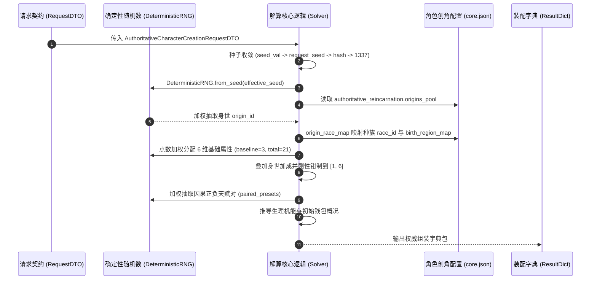

# 施工细则：世界内角色权威创建与时空装配施工细则 —— 阶段2：身世属性权威解算器与背包装备物理水化实现

> [!NOTE]
> **【施工目标】**：落地实现身世属性权威解算器（`AuthoritativeReincarnationSolver`）与背包装备物理水化派发器（`StarterLoadoutDispatcher.hydrate_starter_loadout_into_profile`）。打通身世轮盘加权抽取、种族因果绑定、严格 [1, 6] 六维属性点数购点解算与因果平衡天赋对选择闭环；实现新手初始物理物资至 `WearableInventoryAggregate` 与 `CharacterProfile` 的物理水化装配。满足圈复杂度 CC <= 15、控制流深度 Depth <= 4 与循环内零瞬态堆分配。
> **施工开始日期**：2026-10-11

---

## 📌 第一性原理溯源指针

* **精准上游规范指针**：[AGENTS.md 工作区全局刚性公理](../../../../../AGENTS.md) §二.1、§二.2、§三、§四.1
* **核心不变量约束断言**：
  - `Inv-SOLVER-RANGE-1 (六维属性数值刚性有界约束)`：解算器产出的 STR、CON、INT、AGI、SPR、VIT 六维基础属性值域严格钳制在 [1, 6] 离散闭区间内，总点数与加成计算严格受控，杜绝任何属性溢出或负数异常；
  - `Inv-SOLVER-CAUSAL-2 (因果天赋对偶守卫)`：天赋抽取遵循因果能量守恒，每个角色在解算期必然绑定一对正负对偶天赋（如始源魔素共鸣与心核裂隙），杜绝纯增益无代价倾斜；
  - `Inv-LOADOUT-PHYSICAL-3 (新手装备物理水化实体完整性)`：新手套件中的武器与耗材实例化为具备唯一 `SRV_` 前缀 UID 的 `ItemEntity`，主手武器直接挂载至 `equipped_slots["MAIN_HAND"]`，其余物品安全入包，并同步写回 `CharacterProfile` 的 `inventory` 与 `equipment`；
  - `Inv-LOADOUT-IDEMPOTENT-4 (向后兼容与幂等安全保障)`：既有 `StarterLoadoutDispatcher.dispatch_starter_kit` 保持 100% 行为向后兼容与运行时标记幂等拦截，二次调用安全跳过零重复发放。
* **业务实现最高指示**：严禁在循环体内实例化对象或执行浅深拷贝；严禁将未签发权威 UID 的物品写入背包聚合根。

---

## 一、 第一性原理与架构解耦契约

### 1. 权威身世轮盘与因果解算管线

解算器核心逻辑承载于 `AuthoritativeReincarnationSolver.resolve_reincarnation_package`：

### 2. 背包装备物理水化装配流水线

新手初始物资物理水化由 `StarterLoadoutDispatcher.hydrate_starter_loadout_into_profile` 完成：

1. **套件与物资读取**：根据角色的 `race_id` 查询 `domains.starter_loadout` 配置中的 `race_kit_map`，缺省回退至 `defaults/fallback_kit`（如 `KIT_HUMAN_DEFAULT`）；
2. **货币发放**：解析套件 `initial_gold`，累计写入 `profile.personal_resources["gold"]`；
3. **聚合根初始化**：实例化 `WearableInventoryAggregate`，绑定属主 `owner_account_id = profile.character_id`；
4. **物品实体水化**：
   - 循环前预先提取 `items.core` 中已登记物品原型，构建 $O(1)$ 哈希字典查找集（ADV-PRF-001）；
   - 提取各物品 `canonical_id`、`count`、重量与容积；
   - 逐项实例化 `ItemEntity` 并签发 `SRV_` 前缀权威 UID；
   - 若物品为武器且主手槽位空闲，优先装备进 `equipped_slots["MAIN_HAND"]`；其余物品塞入背包 `storage_items`（裸身容量为 0 时安全兜底防丢失）；
5. **双向原子写回**：调用 `inventory_agg.serialize()` 将深度数据同步写入 `profile.inventory`，将 `equipped_payloads` 写入 `profile.equipment`。

---

## 二、 命令式施工执行清单 (Agent Execution Checklist)

- [x] Step 1: 编制 Phase 112 阶段2身世属性解算与物理水化技术规范
- [x] Step 2: 扩展 character_creation/core.json 单源配置节点 authoritative_reincarnation
- [x] Step 3: 实现 AuthoritativeReincarnationSolver 权威身世与属性天赋解算器
- [x] Step 4: 扩展 StarterLoadoutDispatcher 提供 hydrate_starter_loadout_into_profile 方法
- [x] Step 5: 实施循环内零瞬态堆分配与圈复杂度 CC <= 15 门禁治理

---

## 三、 DoD 验收矩阵 (DoD Matrix)

| 检验项 ID | 校验目标 | 验证输入 | 预期输出断言 |
| :--- | :--- | :--- | :--- |
| TC-SOLVER-RNG-01 | 身世解算确定性可复现校验 | 传入固定种子 `seed_val = 88888` 的合法创角请求 | 重复执行 10 次，身世、种族、性别、属性与天赋对结果 100% 严格一致 |
| TC-SOLVER-BOUNDS-02 | 六维属性 [1, 6] 离散刚性边界 | 遍历全部身世池并施加身世加成 | STR/CON/INT/AGI/SPR/VIT 全部属性均严格满足 `val >= 1 and val <= 6` |
| TC-SOLVER-TRAIT-03 | 天赋对偶因果平衡校验 | 执行 `AuthoritativeReincarnationSolver.resolve_reincarnation_package` | 返回的天赋对必然包含 1 个 POSITIVE 天赋与 1 个 NEGATIVE 天赋 |
| TC-LOADOUT-HYDRATE-04 | 人类新手装备物理水化与穿戴 | 传入人类角色档案调用 `hydrate_starter_loadout_into_profile(profile, "HUMAN")` | 主手装备槽 `MAIN_HAND` 正确装备铁剑实体，背包包含法力药水，`profile.inventory` 与 `equipment` 成功原子写盘 |
| TC-LOADOUT-FALLBACK-05 | 未知种族与缺省配置安全兜底 | 传入未知种族 `race_id = "UNKNOWN_RACE"` 进行水化 | 自动回退至人类默认套件，发放保底金币与物资，不触发中断崩溃 |
| TC-LOADOUT-IDEMPOTENT-06 | 既有序章套件发放幂等防护 | 连续两次调用 `StarterLoadoutDispatcher.dispatch_starter_kit(ctx)` | 第一次返回 `KIT_DISPATCHED`，第二次返回 `ALREADY_GRANTED` 且金币不重复叠加 |
