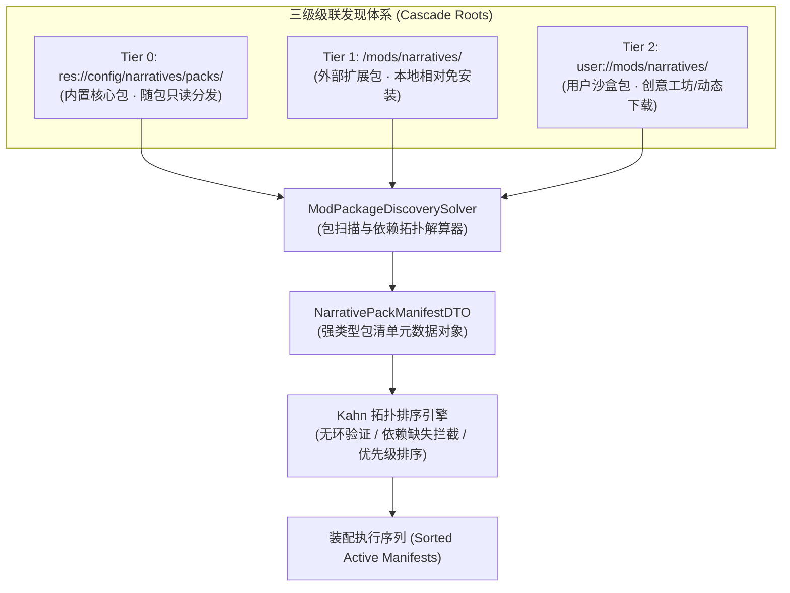

# 施工细则：剧情MOD库相对加载因果扰动与世界绑定引擎施工细则 —— 阶段1：MOD相对加载路径与拓扑排序契约设计

> [!NOTE]
> **【施工目标】**：设计并定义剧情 MOD 扩展包相对加载路径模型与依赖消解数据契约体系。确立“Tier 0 内置核心包、Tier 1 外部安装包、Tier 2 用户沙盒包”三级级联相对路径发现规则；定义 `NarrativePackManifestDTO` 元数据传输对象；基于 Kahn 算法制定具备环路检测与缺失依赖拦截的拓扑排序契约，并在同依赖层级内实现优先级稳定排序。
> **施工开始日期**：2026-10-11

---

## 📌 第一性原理溯源指针

* **精准上游规范指针**：[AGENTS.md 工作区全局刚性公理](../../../../../AGENTS.md) §二.1、§三、§四.1
* **核心不变量约束断言**：
  - `Inv-MOD-RELPATH-1 (三级级联安全路径隔离)`：MOD 扫描路径严格分层（Tier 0 内置只读 `res://config/narratives/packs/`、Tier 1 可执行程序同级 `mods/narratives/`、Tier 2 用户沙盒 `user://mods/narratives/`），所有路径由单一真源配置统一约束，禁止跨沙盒任意目录穿透；
  - `Inv-MOD-TOPO-2 (Kahn 拓扑排序无环与依赖确定性)`：多 MOD 组装依赖图必须为严格有向无环图 (DAG)，若存在循环依赖或未安装的前置依赖，解算器必须在装配前阻断并抛出确定性错误代码，同层级内按优先级降序排列；
  - `Inv-MOD-DTO-3 (清单元数据不可变契约与强类型反序列化)`：MOD 清单通过 `NarrativePackManifestDTO` 承载，提供只读快照与双向序列化保障，彻底杜绝弱类型字典直接入侵业务核心；
  - `Inv-MOD-CONFIG-4 (单一真源配置驱动)`：MOD 根目录、安装相对路径与支持文件格式统一收敛于 `config/domains/narrative_orchestration/core.json` 的 `mod_discovery` 节点，代码零硬编码。
* **防漂移最高指示**：严禁硬编码 MOD 安装与扫描根路径；严禁允许循环依赖或悬挂缺失依赖包进入运行时装配。

---

## 一、 第一性原理与架构解耦契约

### 1. 三级级联相对加载架构设计

卡拉尔引擎支持跨平台部署（包含开发编辑器环境、独立桌面分发环境与沙盒隔离运行环境），必须保障 MOD 包的相对加载路径安全隔离：

### 2. 核心数据契约设计 (`NarrativePackManifestDTO`)

每个 MOD 目录下包含 `pack.json` 清单文件，解析后映射为 `NarrativePackManifestDTO` 强类型实例：

| 字段名称 | 类型 | 缺省回退值 | 契约约束与职责语义 |
| :--- | :--- | :--- | :--- |
| `pack_id` | `String` | `""` | MOD 唯一标识符（如 `mod_shadow_realm`） |
| `pack_name` | `String` | `""` | MOD 人类可读名称 |
| `version` | `String` | `""` | 语义化版本号（SemVer） |
| `author` | `String` | `""` | 作者或开发团队署名 |
| `engine_api_version` | `String` | `""` | 兼容的目标引擎 API 版本 |
| `priority` | `int` | `100` | 同拓扑层级内的加载优先级（数值越大越优先） |
| `dependencies` | `Array[String]` | `[]` | 必须前置加载的 MOD `pack_id` 依赖列表 |
| `incompatible_packs` | `Array[String]` | `[]` | 互斥冲突 MOD 标识符黑名单 |
| `semantic_tags` | `Array[String]` | `[]` | 语义标签（如 `dark_fantasy`, `extra_arcs`） |
| `root_path` | `String` | `""` | MOD 物理根目录绝对/相对路径 |
| `is_active` | `bool` | `true` | 是否激活启用状态 |

### 3. Kahn 算法依赖拓扑消解与排序规则

依赖消解遵循以下刚性步骤：
1. **依赖前置性校验**：遍历所有候选包，若存在依赖项不在当前已发现包列表中，立即中止并返回 `ERR_MISSING_DEPENDENCY` 及缺失列表；
2. **入度表与后继邻接表构建**：以被依赖方为起点指向依赖方（`Prerequisite -> Dependent`），构建入度 `in_degree` 与邻接表 `adj_list`；
3. **分层分批贪心就绪**：以入度为 0 的节点集合为当前层级，对同一层级内的节点按照 `priority` 降序（相同时按 `pack_id` 字典序）进行稳定排序；
4. **入度递减与环路检测**：已出队节点减少其后继节点的入度，当且仅当最终排序数组长度等于输入包总数时，确认拓扑无环；否则返回 `ERR_CYCLIC_DEPENDENCY` 及涉环节点标识。

---

## 二、 命令式施工执行清单 (Agent Execution Checklist)

- [x] Step 1: 编制 Phase 113 阶段1 技术规范与数据契约设计文档
- [x] Step 2: 扩展 `config/domains/narrative_orchestration/core.json` 的 `mod_discovery` 配置节点
- [x] Step 3: 实现 `NarrativePackManifestDTO` 传输对象契约及双向序列化
- [x] Step 4: 实现 `ModPackageDiscoverySolver` 路径发现与三级级联目录解析
- [x] Step 5: 实现 Kahn 拓扑排序算法、环路与缺失依赖防御拦截机制

---

## 三、 DoD 验收矩阵 (DoD Matrix)

| 检验项 ID | 校验目标 | 验证输入 | 预期输出断言 |
| :--- | :--- | :--- | :--- |
| TC-MOD-DTO-01 | 清单元数据 DTO 默认实例化与重置 | 默认构造 `NarrativePackManifestDTO.new()` 并调用 `reset_state()` | 字段初值完全对齐：`priority == 100`，`is_active == true`，其余数组与字符串清空 |
| TC-MOD-DTO-02 | 清单元数据 DTO 往返一致性序列化 | 传入合法元数据字典执行 `from_dto()` 与 `to_dto()` | 反序列化结果与序列化输出 100% 深度等价 |
| TC-MOD-ROOT-03 | 三级级联发现路径解析 | 调用 `ModPackageDiscoverySolver.get_discovery_roots([])` | 依次包含 Tier 0 内置、Tier 1 安装目录、Tier 2 沙盒目录三项合法路径 |
| TC-MOD-KAHN-04 | 独立无依赖包优先级降序排序 | 传入 Pack A (priority=50) 与 Pack B (priority=100) | `sorted_packs` 顺序必然为 Pack B 优先于 Pack A |
| TC-MOD-KAHN-05 | 跨包前置依赖排序保证 | 传入 Pack C (dep=[B], priority=200) 与 Pack B (dep=[], priority=50) | 即使 C 优先级更高，B 必然排在 C 之前加载 |
| TC-MOD-MISS-06 | 缺失前置依赖阻断 | 传入 Pack D (dep=["pack_missing"]) | 返回 `{"success": false, "error": "ERR_MISSING_DEPENDENCY", "missing": ["pack_missing"]}` |
| TC-MOD-CYCLE-07 | 循环依赖环路死锁阻断 | 传入 Pack E (dep=[F]) 与 Pack F (dep=[E]) | 返回 `{"success": false, "error": "ERR_CYCLIC_DEPENDENCY", "cycles": ["E", "F"]}` |
